# 思维链（COT）提示

> 来源：[https://vxc3hj17dym.feishu.cn/docx/VnptdCDhvoIwkFxAB9rcqxEEnse](https://vxc3hj17dym.feishu.cn/docx/VnptdCDhvoIwkFxAB9rcqxEEnse)

**译者注：**

本文为论文《Chain-of-Thought Prompting Elicits Reasoning in Large Language Models》的中文精校解读

原文地址：https://arxiv.org/abs/2201.11903

PDF文档：https://arxiv.org/pdf/2201.11903.pdf

这篇论文是思维链提示（Chain-of-Thought Prompting）概念的开山之作，是现任谷歌大脑研究员的Jason Wei在22年1月发布在arxiv上面的文章，当时 NLP Prompt learning 兴起已开始大约两年时间，OepenAI 彼时刚刚推出GPT-3 的第二个大版本更新不久，作者等人在这样的大背景下提出了思维链这个概念。

—— 感谢Raven对本译文的贡献。

                                                                                                                             -- 小七姐

---

## Chain-of-Thought Prompting Elicits Reasoning in Large Language Models (思维链提示技术引发大型语言模型的推理能力)

---

摘要

我们探索了如何生成一个思维链 — 一系列中间推理步骤 — 如何显著提高大型语言模型进行复杂推理的能力。特别是，我们展示了如何通过一种简单的方法 — 思维链提示技术，在足够大的语言模型中自然地产生这种推理能力，其中在提示中提供了几个思维链的示例。

在三个大型语言模型上的实验显示，思维链提示技术提高了在一系列算术、常识和符号推理任务上的表现。实证增益可以是显著的。例如，只用八个思维链示例提示PaLM 540B可以在GSM8K数学文字问题基准测试中达到最先进的准确率，甚至超过了经过微调的GPT-3和验证器。

**标准提示**

> 模型输入

> 

> 问：罗杰有5个网球。他又买了2罐网球。每个罐子里有3个网球。他现在有多少个网球？

>

> 答：答案是11。

> 

> 问：食堂有23个苹果。如果他们用20个做午餐，再买6个，他们有多少个苹果？

**思维链提示**

> 模型输入

> 

> 问：罗杰有5个网球。他又买了2罐网球。每个罐子里有3个网球。他现在有多少个网球？

> 答：罗杰开始有5个球。2罐3个网球，每罐6个网球。5 + 6 = 11。答案是11。

> 

> 问：食堂有23个苹果。如果他们用20个做午餐，再买6个，他们有多少个苹果？

> 模型输出

>

> 答：答案是27。

> **×**

> 模型输出

> 

> 答：食堂原来有23个苹果。他们用20个来做午餐。所以他们有 23 - 20 = 3。他们又买了 6 个苹果，所以他们有 3 + 6 = 9。答案是9。

> **√**

图1：思维链提示技术使大型语言模型能够处理复杂的算术、常识和符号推理任务。突出显示了思维链推理过程。

---

## 引言

NLP（自然语言处理）领域近年来由于语言模型（例如Peters等人，2018年；Devlin等人，2019年；Brown等人，2020年等）的出现而发生了革命性的变化。放大语言模型的规模已被证明能带来一系列好处，如提升性能和样本效率（Kaplan等人，2020年；Brown等人，2020年等）。然而，仅仅放大模型规模还不足以在诸如算术、常识和符号推理等挑战性任务上取得高性能（Rae等人，2021年）。

这项工作探索了两个概念如何简单地解锁大型语言模型的推理能力。首先，算术推理技术可以从生成导致最终答案的自然语言解释中受益。先前的工作通过从头开始训练（Ling等人，2017年）或微调预训练模型（Cobbe等人，2021年）使模型能够生成自然语言的中间步骤，此外还有使用形式语言而非自然语言的神经-符号方法（Roy和Roth，2015年；Chiang和Chen，2019年；Amini等人，2019年；Chen等人，2019年）。其次，大型语言模型提供了通过提示进行上下文内少量样本学习的激动人心的前景。即，不需要为每个新任务微调一个单独的语言模型检查点，而只需用几个输入-输出样例“提示”模型。令人惊讶的是，这种方法在一系列简单的问答回答任务上已经成功（Brown等人，2020年）。

然而，上述两个想法都有关键的局限性。对于带有解释的训练和微调方法，创建一大套高质量的解释是代价高昂的，这比正常机器学习中使用的简单输入-输出对要复杂得多。对于Brown等人（2020年）中使用的传统少量样本提示方法，它在需要推理能力的任务上表现不佳，并且通常不会随着语言模型规模的增加而显著改善（Rae等人，2021年）。在这篇论文中，我们以一种避免这些局限性的方式结合了这两个想法的优点。具体来说，我们探索了语言模型在给定由三元组组成的提示：〈输入，思维链，输出〉的推理任务中进行少量样本提示的能力。思维链是一系列导致最终输出的中间自然语言推理步骤，我们将这种方法称为思维链提示。图1中显示了一个示例提示。

我们在算术、常识和符号推理基准测试上进行了实证评估，结果显示思维链提示优于标准提示，有时甚至达到令人惊讶的程度。图2举例说明了这样一个结果——在数学词问题的GSM8K基准测试（Cobbe等人，2021年）上，配备PaLM 540B的思维链提示大幅优于标准提示，并达到了新的最佳性能。仅使用提示的方法之所以重要，是因为它不需要大量的训练数据集，并且单个模型检查点可以在不失去通用性的情况下执行多个任务。这项工作强调了大型语言模型如何通过少量与任务相关的自然语言数据（与通过大型训练数据集自动学习输入和输出底层模式相比）进行学习。

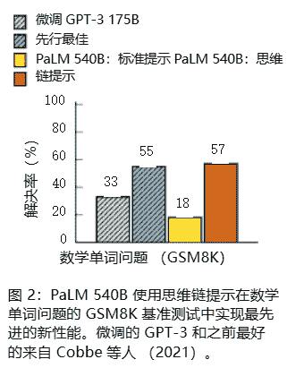

---

## 思维链提示技术

在解决复杂的推理任务（例如多步数学单词问题）时，请考虑自己的思维过程。通常将问题分解为中间步骤并解决每个步骤，然后再给出最终答案：“简给妈妈 2 朵花后，她有 10 朵......然后她给她爸爸 3 后，她会有 7 个......所以答案是7。本文的目标是赋予语言模型产生类似思维链的能力——一系列连贯的中间推理步骤，推导问题的最终答案。

我们将证明，如果在示例中为少样本提示提供思维链推理的演示，那么大语言模型可以生成思维链。

图1展示了一个模型为了解决一个数学文字问题而产生的思维链的例子，如果没有这个思维链，模型本来会得到错误答案。在这种情况下，思维链类似于解决方案，可以解释为一个解决方案，但我们仍然选择称其为思维链，以更好地捕捉它模仿逐步思考过程以得出答案的想法（另外，解题思路/解释通常出现在最终答案之后（Narang 等人，2020 年；Wiegreffe 等人，2022 年；Lampinen 等人，2022 年等））。

思维链提示技术作为一种促进语言模型推理的方法具有几个吸引人的特性。

1.  首先，从原则上讲，思维链允许模型将多步骤问题分解为中间步骤，这意味着可以为需要更多推理步骤的问题分配额外的计算。

1.  其次，思维链提供了一个可解释的窗口，观察模型的行为，建议它可能是如何得出特定答案的，并提供机会去调试推理路径哪里出错了（尽管完全描述支持答案的模型的计算仍然是一个悬而未决的问题）。

1.  第三，思维链推理可用于诸如数学文字问题、常识推理和符号操纵等任务，并且可能适用（至少从原则上讲）于人类可以通过语言解决的任何任务。

1.  最后，通过在少量提示的例子中包含思维链序列，可以容易地在现成语言模型中引出思维链推理。

在实证实验中，我们将观察思维链提示技术在算术推理（第3节）、常识推理（第4节）和符号推理（第5节）方面的实用性。

---

## 算术推理

我们首先考虑图1中的形式的数学文字问题，这些问题衡量语言模型的算术推理能力。尽管对人类来说很简单，算术推理是语言模型经常遇到困难的任务（Hendrycks等人，2021；Patel等人，2021等）。令人震惊的是，当与540B参数的语言模型一起使用时，思维链提示技术在几个任务上的表现与针对特定任务微调的模型相当，甚至在具有挑战性的GSM8K基准测试上达到了新的最高水平（Cobbe等人，2021）。

### 实验设置

我们探索了对多个基准测试中的各种语言模型的思维链提示技术。

**基准测试****。**我们考虑以下五个数学文字问题基准测试：(1) GSM8K数学文字问题基准测试 (Cobbe等人，2021)，(2) 结构各异的SVAMP数学文字问题数据集 (Patel等人，2021)，(3) 多样化的ASDiv数学文字问题数据集 (Miao等人，2020)，(4) AQuA代数文字问题数据集，以及(5) MAWPS基准测试 (Koncel-Kedziorski等人，2016)。例题在附录表12中给出。

**标准提示。**作为基线，我们考虑了Brown等人（2020）普及的标准少量示例提示，在该方法中，语言模型在为测试时的示例输出预测之前获得了上下文中的输入-输出对示例。示例被格式化为问题和答案。模型直接给出答案，如图1（左）所示。

**思维链提示。**我们建议的方法是用思维链为关联的答案增强少量示例提示中的每个示例，如图1（右）所示。由于大多数数据集只有一个评估分割，我们手动编写了一组带有思维链的八个少量示例提示——图1（右）显示了一个思维链示例，完整的示例集在附录表20中给出。（这些特定的示例并未经过提示工程；在第3.4节和附录A.2中研究了鲁棒性。）为了调查这种形式的思维链提示是否可以成功地引发一系列数学文字问题的成功推理，我们使用这单一的八个思维链示例集对除AQuA之外的所有基准进行了测试，因为AQuA是多项选择而不是自由响应。对于AQuA，我们使用了训练集中的四个示例和解决方案，如附录表21中所给。

**语言模型。**我们评估**了五个大型语**言模型。第一个是GPT-3 (Brown等人，2020)，我**们使用的****是text-ad****a-001、**text-babbage-001、text-curie-001和text-davinci-002，这些模型可能对应于InstructGPT模型，分别有350M、1.3B、6.7B和175B参数 (Ouyang等人，2022)。第二个是LaMDA (Thoppilan等人，2022)，它有422M、2B、8B、68B和137B参数的模型。第三个是PaLM，其模型分别有8B、62B和540B参数。第四个是UL2 20B (Tay等人，2022)，第五个是Codex (Chen等人，2021，OpenAI API中的code-davinci-002)。我们通过贪婪解码从模型中采样（尽管后续工作显示，通过取多次采样生成的最后答案的多数票，可以改进思维链提示（Wang等人，2022a））。对于LaMDA，我们报告了五个随机种子的平均结果，其中每个种子都有一个不同的随机洗牌的示例顺序。由于LaMDA的实验在不同的种子之间没有显示出大的差异，为了节省计算资源，我们报告了所有其他模型的单一示例顺序的结果。

### 结果

思维链提示的最强结果总结如图4所示，每个模型集合、模型规模和基准测试的所有实验输出都显示在附录的表2中。有三个关键要点。首先，图4显示，思维链提示是模型规模的新兴能力（Wei等人，2022b）。也就是说，思维链提示对小型模型的性能没有积极影响，只有在使用大约1000亿参数的模型时才能获得性能提升。我们在定性上发现，较小规模的模型产生了流畅但不合逻辑的思维链，导致性能低于标准提示。

其次，思维链提示对更复杂的问题有更大的性能提升。例如，对于GSM8K（基准性能最低的数据集），最大的GPT和PaLM模型的性能提高了一倍多。另一方面，对于SingleOp，MAWPS的最简单子集，只需要一个步骤就能解决，性能改善要么是负数，要么是非常小的（请参阅附录表3）。

第三，通过GPT-3 175B和PaLM 540B进行的思维链提示与以往的最新技术相比表现出色，通常是在标记的训练数据集上对任务特定模型进行微调。图4显示，PaLM 540B如何使用链式思维提示在GSM8K、SVAMP和MAWPS上取得新的最新技术成果（尽管需要注意的是，标准提示已经超越了SVAMP的先前最佳成果）。在另外两个数据集AQuA和ASDiv上，使用链式思维提示的PaLM达到了最新技术的水平，仅相差不到2%（请参阅附录表2）。

为了更好地理解为什么思维链提示有效，我们手动检查了LaMDA 137B为GSM8K生成的思维链示例。在其中50个随机示例中，模型返回了正确的最终答案，所有生成的思维链也在逻辑和数学上都是正确的，只有两个偶然得出了正确答案（请参阅附录D.1，以及正确的模型生成的思维链示例表8）。我们还随机检查了50个模型给出错误答案的随机示例。这项分析的总结是，46%的思维链几乎正确，除了一些小错误（计算器错误、符号映射错误或少了一个推理步骤），而其他54%的思维链在语义理解或连贯性方面存在重大错误（请参阅附录D.2）。为了更好地了解为什么扩大规模可以改进链式思维推理能力，我们对PaLM 62B制造的错误进行了类似的分析，以及通过扩大规模到PaLM 540B是否修复了这些错误。总结是，将PaLM扩大到540B规模修复了62B模型中的许多缺少一个步骤和语义理解错误（请参阅附录A.1）。

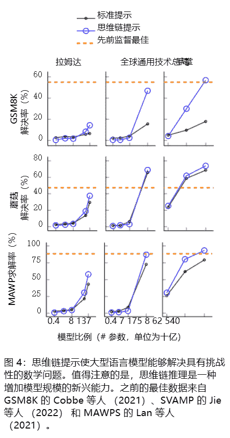

### 消融研究

使用思维链提示带来的观察到的好处引发了一个自然的问题，即是否可以通过其他类型的提示获得相同的性能改进。图5显示了对链式思维的三种变化进行的割除研究，如下所述。

**仅方程。**链式思维提示可能有助于的一个原因是它产生了要评估的数学方程式，因此我们测试了一种变化，即在提供答案之前，模型只被提示输出数学方程式。图5显示，仅方程提示对GSM8K并没有太大帮助，这意味着GSM8K中的问题语义太具挑战性，无法直接转化为方程式，而没有思维链中的自然语言推理步骤。然而，对于一步或两步问题的数据集，我们发现仅方程提示确实可以提高性能，因为方程可以很容易地从问题中推导出来（请参阅附录表6）。

**仅计算变量。**另一个直觉是，思维链允许模型在更困难的问题上花费更多的计算资源（即中间标记）。为了将变量计算的效果与思维链推理分开，我们测试了一种配置，其中模型被提示仅输出与解决问题所需的方程式中字符数相等的一系列点（...）。这个变体的性能与基准性能几乎相同，这表明仅仅是变量计算并不是思维链提示成功的原因，而通过自然语言表达中间步骤似乎具有实用性。

**答案后的思维链。**思维链提示的另一个潜在好处可能仅仅是这种提示允许模型更好地访问在预训练期间获取的相关知识。因此，我们测试了一种另一种配置，其中思维链提示仅在回答之后提供，以分离模型是否实际依赖生成的思维链来给出最终答案。这个变体的性能与基准性能几乎相同，这表明思维链中的顺序推理对于除了激活知识之外的其他原因也是有用的。

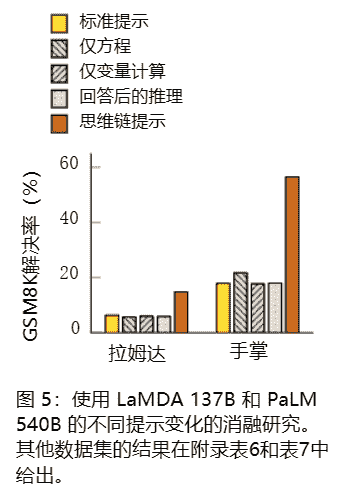

###

### 思维链的鲁棒性

对示例的敏感性是提示方法的一个关键考虑因素，例如，改变少量样本示例的排列顺序可以使GPT-3在SST-2上的准确率从接近机会水平（54.3%）变化到接近最新技术水平（93.4%）（Zhao等人，2021）。在这个最后的小节中，我们评估了对由不同注释者编写的思维链的稳健性。除了上面的结果，使用由Annotator A编写的思维链外，本文的另外两位共同作者（Annotators B和C）还独立编写了相同少量样本示例的思维链（附录H中显示）。Annotator A还编写了另一种思维链，比原始的更为简洁，遵循了Cobbe等人（2021）给出的解决方案的风格。

图6显示了LaMDA 137B在GSM8K和MAWPS上的结果（其他数据集的割除结果见附录表6/表7）。尽管不同的思维链注释之间存在一定的差异，这在使用样本示例提示时是可以预期的（Le Scao和Rush，2021；Reynolds和McDonell，2021；Zhao等人，2021），但所有思维链提示集都明显优于标准基准。这个结果表明，成功使用思维链并不依赖于特定的语言风格。

为了确认成功的链式思维提示适用于其他一组示例，我们还进行了实验，从GSM8K训练集中随机抽取了三组包含八个示例的示例，这些示例来自一个独立的数据源（该数据集中的示例已经包括了像思维链一样的推理步骤）。图6显示，这些提示的性能与我们手动编写的示例相当，也远远优于标准提示。

除了对注释者、独立编写的思维链、不同示例以及各种语言模型的稳健性外，我们还发现，针对算术推理的链式思维提示对不同示例顺序和不同数量的示例也具有稳健性（请参阅附录A.2）。

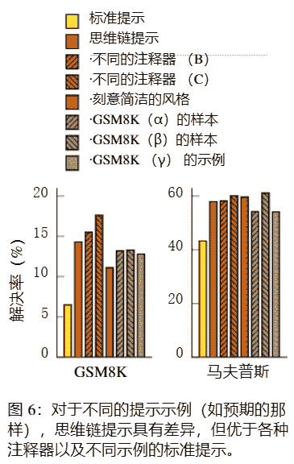

¹例如，原始思维链使用了几个简短的句子（“最初有9台电脑。每天增加5台电脑。所以一共增加了5 * 4 = 20台电脑。9 + 20 = 29。”），而简洁的思维链将是“5 * 4 = 增加了20台新电脑。所以现在服务器室有9 + 20 = 29台新电脑”。

²我们抽样了不超过60个标记的示例以适应我们的输入上下文窗口，并且将示例限制为不超过2步以便与我们编写的八个示例进行公平比较。

---

## 常识推理

尽管思维链特别适用于数学文字问题，但思维链的基于语言的特性实际上使其适用于广泛的常识推理问题。这些问题涉及在假设有一般背景知识的前提下对物理和人类互动进行推理。常识推理对于与世界互动至关重要，而目前的自然语言理解系统仍无法实现这一点 (Talmor等人，2021)。

**基准测试****。**我们考虑了涵盖多种常识推理类型的五个数据集。受欢迎的CSQA (Talmor等人，2019) 提出了关于世界的常识问题，这些问题涉及复杂的语义，经常需要先验知识。StrategyQA (Geva等人，2021) 要求模型推断出一个多跳转策略来回答问题。我们从BIG-bench项目 (BIG-bench协作，2021) 中选择了两个专门的评估数据集：Date Understanding，涉及从给定的上下文中推断出一个日期，以及Sports Understanding，涉及确定与体育相关的句子是合理还是不合理的。最后，SayCan数据集 (Ahn等人，2022) 涉及将自然语言指令映射到来自离散集的机器人操作序列。图3展示了所有数据集的带有思维链注释的示例。

**提示。**我们遵循与前一节相同的实验设置。对于CSQA和StrategyQA，我们从训练集中随机选择了一些例子，并为它们手动编写了思维链，以便用作少量示例。两个BIG-bench任务没有训练集，所以我们选择了评估集中的前十个示例作为少量示例，并报告了评估集剩余部分的数据。对于SayCan，我们使用了Ahn等人(2022)中使用的训练集中的六个示例，并且也手动编写了思维链。

**结果。**图7突出显示了PaLM的这些结果（LaMDA、GPT-3和不同的模型规模的完整结果显示在表4中）。对于所有任务，增大模型规模都提高了标准提示的性能；思维链提示带来了进一步的增益，其中PaLM 540B的提升似乎最大。使用思维链提示，PaLM 540B相对于基准线取得了强劲的性能，在StrategyQA上超越了之前的最佳水平（75.6% vs 69.4%），并在体育理解上超越了未受辅助的体育爱好者（95.4% vs 84%）。这些结果证明，思维链提示也可以提高要求各种常识推理能力的任务的性能（尽管注意在CSQA上的增益是最小的）。

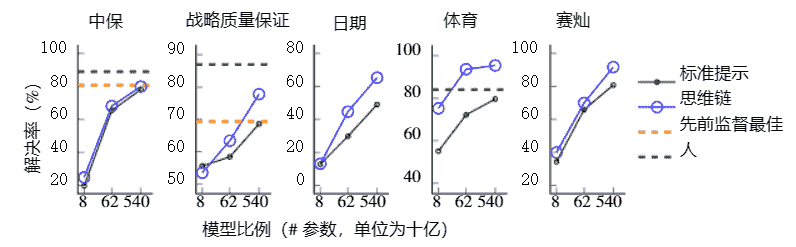

---

## 符号推理

我们的最后一个实验评估考虑了符号推理，这对人类来说很简单，但对语言模型来说可能具有挑战性。我们展示了思维链提示不仅使语言模型能够在标准提示设置中执行具有挑战性的符号推理任务，而且还有助于长度泛化，以适应比在少数示例中看到的输入更长的推理时间。

任务。我们使用以下两个玩具任务。

• 最后字母连接。这项任务要求模型将姓名中单词的最后一个字母连接起来（例如，“Amy Brown” → “yn”）。这是首字母连接的更具挑战性版本，而无需思维链³，语言模型已经可以执行此操作。我们通过随机连接来自姓名普查数据（https://namecensus.com/）中的前一千个首字母和姓氏中随机连接出全名。

• 抛硬币。这个任务要求模型回答在人们是否翻转或不翻转硬币之后，硬币是否仍然是正面朝上（例如，“一枚硬币是正面朝上的。Phoebe翻转了硬币。Osvaldo没有翻转硬币。硬币还是正面朝上吗？”→ “不是”）

由于这些符号推理任务的构造是明确定义的，因此对于每项任务，我们都考虑了一个域内测试集，其中示例的步骤数与训练/少量示例的步骤数相同；以及一个域外（OOD）测试集，其中评估示例的步骤数多于示例中的步骤数。对于最后一个字母的连接，模型只看到两个单词的名称示例，然后对 3 个和 4 个单词的名称执行最后一个字母的连接⁴。我们的实验设置采用了与前两节相同的方法和模型。我们再次为每项任务中的少拍示例手动构建思维链，如图 3 所示。

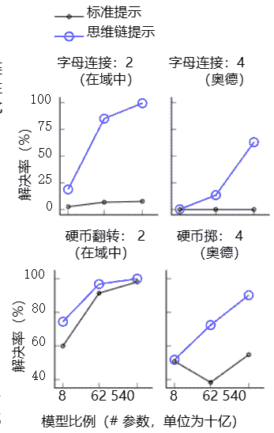

结果 图 8 显示了 PaLM 的域内和 OOD 评估结果，附录表 5 显示了 LaMDA 的结果。对于 PaLM 540B，思维链提示的解题率几乎达到了 100%（注意，标准提示已经解决了 PaLM 540 的掷硬币问题，但对于 LaMDA 137B 则没有）。请注意，这些域内评估都是 "玩具任务"，因为少许示例中的思维链已经提供了完美的解法结构；模型所要做的就是用测试时间示例中的新符号重复同样的步骤。然而，小模型仍然失败了--只有在模型参数达到 100B 的规模时，才有能力对这三个任务中未见的符号进行抽象处理。

至于 OOD 评估，标准提示在这两项任务中都失败了。有了思维链提示 语言模型实现了向上扩展曲线（尽管性能比在域内 设置）。因此，对于规模足够大的语言模型来说，思维链提示有助于超越所见思维链的长度泛化。因此，对于规模足够大的语言模型来说，思维链提示可以促进长度泛化，使其超越所见的思维链。

³我们使用GPT-3 Davinci测试了10个常见的名字，它几乎全部都翻译正确。

⁴对于长度超过2个词的名字，我们将多个名字的姓和名拼接在一起。

---

## 讨论

我们探讨了思维链提示作为一种简单的机制，用来引发大型语言模型的多步推理行为。首先，我们发现思维链提示在算术推理方面显著提高了性能，带来了比去除操作（ablations）更为强烈的改进，而且对不同的注释者、示例和语言模型都具有稳健性（第3节）。接下来，对常识推理的实验强调了思维链推理的语言性质，使其具有普遍适用性（第4节）。最后，我们展示了对于符号推理，思维链提示有助于在更长的序列长度上实现跨领域泛化（第5节）。在所有实验中，思维链推理只需通过提示一个现成的语言模型即可引发，没有在写作本文过程中对语言模型进行微调。

思维链推理作为模型规模的结果而出现是一个主要的主题（Wei等人，2022b）。对于许多推理任务，标准提示具有平坦的缩放曲线，而思维链提示导致了剧烈增长的缩放曲线。思维链提示似乎扩展了大型语言模型可以成功执行的任务集合，换句话说，我们的工作强调标准提示只提供了大型语言模型能力的下限。这一观察很可能引发更多问题，而不是答案，例如，随着模型规模的进一步增加，我们可以期望推理能力提高多少？还有哪些提示方法可以扩展语言模型可以解决的任务范围？

至于局限性，首先，我们首次明确指出，尽管思维链模拟了人类推理者的思维过程，但这并不能回答神经网络是否真正“推理”，这是一个开放问题。其次，尽管在少样本情况下手动增加思维链的成本很低，但这种注释成本对于微调可能是限制性的（尽管可以通过合成数据生成或零样本泛化来克服这一问题）。第三，没有正确推理路径的保证，这可能导致正确和错误的答案；改进语言模型的事实生成是未来工作的一个开放方向（Rashkin等人，2021；Ye和Durrett，2022；Wiegreffe等人，2022等）。最后，思维链推理只在大型模型规模下才会出现，这使得在实际应用中提供推理变得昂贵；进一步的研究可以探讨如何在较小的模型中引发推理。

---

## 相关工作

这项工作受到许多研究领域的启发，我们在扩展的相关工作部分（附录C）中详细描述了这些领域。在这里，我们描述了两个可能最相关的方向和相关论文。

第一个相关方向是使用中间步骤来解决推理问题。Ling等人（2017）首创了使用自然语言解释来通过一系列中间步骤解决数学文字问题的想法。他们的工作与使用形式语言进行推理的文献形成了显著对比（Roy等人，2015；Chiang和Chen，2019；Amini等人，2019；Chen等人，2019）。Cobbe等人（2021）扩展了Ling等人（2017）的工作，通过创建更大的数据集并使用它来微调预训练语言模型，而不是从头开始训练一个模型。在程序合成领域，Nye等人（2021）利用语言模型来预测Python程序的最终输出，首先逐行预测中间计算结果，结果表明他们的逐步预测方法比直接预测最终输出更好。

当然，这篇论文还与最近有关提示的大量研究密切相关。自Brown等人（2020）提出少样本提示的普及以来，有几种通用方法已经改进了模型的提示能力，比如自动学习提示（Lester等人，2021）或给模型提供描述任务的指令（Wei等人，2022a；Sanh等人，2022；Ouyang等人，2022）。虽然这些方法改进或增强了提示的输入部分（例如，附加到输入前面的指令），但我们的工作采取了与之正交的方向，通过思维链来增强语言模型的输出部分。

---

## 结论

我们探索了思维链提示作为一种简单而广泛适用的方法，用来增强语言模型的推理能力。通过对算术、符号和常识推理的实验，我们发现思维链推理是模型规模的新兴属性，使足够大的语言模型能够执行在其他情况下具有平坦缩放曲线的推理任务。扩展语言模型可以执行的推理任务范围，希望能激发更多基于语言的推理方法的研究工作。

**致谢**

我们感谢Jacob Devlin、Claire Cui、Andrew Dai和Ellie Pavlick为论文提供反馈意见。我们感谢Jacob Austin、Yuhuai Wu、Henryk Michalewski、Aitor Lewkowycz、Charles Sutton和Aakanksha Chowdhery为有益的讨论。我们还感谢Sid Maxwell在原始手稿的手动错误分析中提醒我们的错误。

**参考文献**

Mich[a](https://arxiv.org/abs/2204.01691)el Ahn, Anthony Brohan, Noah Brown, Yevgen Chebotar, Omar Cortes, Byron David, Chelsea Finn, Keerthana Gopalakrishnan, Karol Hausman, Alex Herzog, et al. 2022. Do as I can, not as I say: Grounding language in robotic affordances. arXiv preprint arXiv:2204.01691.

Aida Amini, Saadia Gabriel, Shanchuan Lin, Rik Ko[nc](https://aclanthology.org/N19-1245)el Kedziorski, Yejin Choi, and Hannaneh Hajishirzi. 2019. MathQA: Towards interpretable math word problem solving with operation based formalisms. In Proceedings of the 2019 Conference of the North American Chapter of the Association for Computational Linguistics: Human Language Technologies, Volume 1 (Long and Short Papers), Minneapolis, Minnesota. Association for Computational Linguistics.

D[aniel Andor, Luheng He, Kenton Lee, and Emily ](https://doi.org/10.18653/v1/D19-1609)Pitler. 2019. Giving BERT a calculator: Finding operations and arguments with reading comprehension. EMNLP.

Jacob Andreas, Dan Klein, and Sergey Levine. 2018. Learning with latent language. NAACL.

Jacob Austin, Augustus Odena, Maxwell Nye, Maarten Bosma, Henryk Michalew[ski, David Dohan, Ellen J](https://arxiv.org/abs/2108.07732)iang, Carrie Cai, Michael Terry, Quoc Le, et al. 2021. Program synthesis with large language models. arXiv preprint arXiv:2108.07732.

[BI](https://github.com/google/BIG-bench/)G-bench collaboration. 2021. Beyond the imitation game: Measuring and extrapolating the capabilities of language models. In preparation.

K[aj Bostrom, Xinyu Zhao, Swarat ](https://doi.org/10.18653/v1/2021.emnlp-main.506)Chaudhuri, and Greg Durrett. 2021. Flexible generation of natural language deductions. EMNLP.

Tom Brown, Benjamin Mann, Nick Ryder, Melanie Subbiah, Jared D Kaplan, Prafulla Dhariwal, Arvind Neelakantan, Pranav Shyam, Girish Sastry, Amanda Askell, Sandhini Agarwal, Ariel Herbert-Voss, Gretchen Krueger, Tom Henig[han, Rewon Child, ](https://proceedings.neurips.cc/paper/2020/file/1457c0d6bfcb4967418bfb8ac142f64a-Paper.pdf)Aditya Ramesh, Daniel Ziegler, Jeffrey Wu, Clemens Winter, Chris Hesse, Mark Chen, Eric Sigler, Mateusz Litwin, Scott Gray, Benjamin Chess, Jack Clark, Christopher Berner, Sam McCandlish, Alec Radford, Ilya Sutskever, and Dario Amodei. 2020. Language models are few-shot learners. NeurIPS.

Jonathon Cai, Richard Shin, a[n](https://arxiv.org/abs/1704.06611)d Dawn Song. 2017. Making neural programming architectures generalize via recursion. ICLR.

Oana-Maria Camburu, Tim Rocktäschel, Thom[a](https://arxiv.org/pdf/1812.01193.pdf)s Lukasiewicz, and Phil Blunsom. 2018. e-SNLI: Natural language inference with natural language explanations. NeurIPS.

H[oward Chen, Jacquel](https://arxiv.org/abs/2204.11790)ine He, Karthik Narasimhan, and Danqi Chen. 2022. Can rationalization improve robustness? NAACL.

Mark[ Chen, Jerry Tworek, Heewoo J](https://arxiv.org/abs/2107.03374)un, Qiming Yuan, Henrique Ponde de Oliveira Pinto, Jared Kaplan, Harri Edwards, Yuri Burda, Nicholas Joseph, Greg Brockman, et al. 2021. Evaluating large language models trained on code. arXiv preprint arXiv:2107.03374.

Xinyun Chen, Chen Liang, Adams Wei Yu, Denny[ Zhou, Dawn Song, and Quoc V. Le. 2019. Neural symbolic](https://openreview.net/forum?id=ryxjnREFwH) reader: Scalable integration of distributed and symbolic representations for reading comprehension. ICLR.

Ting-Rui Chiang and Y[un-Nung Chen. 2019. Semantically aligned equat](https://doi.org/10.18653/v1/N19-1272)ion generation for solving and reasoning math word problems. In Proceedings of the 2019 Conference of the North American Chapter of the Association for Computational Linguistics: Human Language Technologies, Volume 1 (Long and Short Papers), pages 2656–2668, Minneapolis, Minnesota. Association for Computational Linguistics.

P[eter Clark, Oyvind Tafjor](https://www.ijcai.org/proceedings/2020/0537.pdf)d, and Kyle Richardson. 2020. Transformers as soft reasoners over language. IJCAI.

Kar[l Cobbe, Vineet Kosaraju, M](https://arxiv.org/abs/2110.14168)ohammad Bavarian, Jacob Hilton, Reiichiro Nakano, Christopher Hesse, and John Schulman. 2021. Training verifiers to solve math word problems. arXiv preprint arXiv:2110.14168.

Jacob Devlin, Ming-Wei Chang, Ke[nton Lee, and Kristina Toutanova. 2019. ](https://aclanthology.org/N19-1423)BERT: Pre-training of deep bidirectional transformers for language understanding. NAACL.

Honghua Dong, Jiayuan Mao, Tian Lin, Chong Wang, Lihong Li, and Denny Zhou. 2019. Neural logic machines. ICLR.

Dheeru Dua, Sameer Singh, and [M](https://arxiv.org/abs/1904.11694)att Gardner. 2020. Benefits of intermediate annotations in reading comprehension. ACL.

Mo[r ](https://doi.org/10.1162/tacl_a_00370)Geva, Daniel Khashabi, Elad Segal, Tushar Khot, Dan Roth, and Jonathan Berant. 2021. Did aristotle use a laptop? A question answering benchmark with implicit reasoning strategies. TACL.

Y[u](https://arxiv.org/pdf/2112.08656.pdf)ling Gu, Bhavana Dalvi Mishra, and Peter Clark. 2022. DREAM: Uncovering mental models behind language models. NAACL.

Br[a](https://doi.org/10.18653/v1/P18-1175)den Hancock, Paroma Varma, Stephanie Wang, Martin Bringmann, Percy Liang, and Christopher Ré. 2018. Training classifiers with natural language explanations. ACL.

[Peter Hase and Mohit Bansal. 2022. When can mode](https://arxiv.org/abs/2102.02201)ls learn from explanations? a formal framework for understanding the roles of explanation data. ACL.

Dan Hendrycks, Collin Burns, Saurav Kadavath, Akul Arora, Steve[n](https://arxiv.org/abs/2103.03874) Basart, Eric Tang, Dawn Song, and Jacob Steinhardt. 2021. Measuring mathematical problem solving with the math dataset. arXiv preprint arXiv:2103.03874.

Mohammad Javad Hosseini, Hannaneh Hajishirzi[,](https://doi.org/10.3115/v1/D14-1058) Oren Etzioni, and Nate Kushman. 2014. Learning to solve arithmetic word problems with verb categorization. EMNLP.

Zhanming Jie, Jierui Li[, ](https://arxiv.org/abs/2203.10316)and Wei Lu. 2022. Learning to reason deductively: Math word problem solving as complex relation extraction. arXiv preprint arXiv:2203.10316.

Jared Kaplan, Sam McCandlish, Tom Henighan, Tom B Brown, Benjamin Ch[ess, Rewon Child, Sc](https://arxiv.org/abs/2001.08361)ott Gray, Alec Radford, Jeffrey Wu, and Dario Amodei. 2020. Scaling laws for neural language models. arXiv preprint arXiv:2001.08361.

Rik Koncel-Kedziorski, Subh[ro Roy, Aida Amini](https://doi.org/10.18653/v1/N16-1136), Nate Kushman, and Hannaneh Hajishirzi. 2016. MAWPS: A math word problem repository. NAACL.

Andr[e](https://arxiv.org/abs/2204.02329)w K. Lampinen, Ishita Dasgupta, Stephanie C.Y. Chan, Kory Matthewson, Michael Henry Tessler, Antonia Creswell, James L. McClelland, Jane X. Wang, and Felix Hill. 2022. Can language models learn from explanations in context? arXiv preprint arXiv:2204.02329.

Yihua[i Lan, Lei Wang, Qiyuan Zhang, Yunshi Lan, Bing](https://arxiv.org/abs/2109.00799) Tian Dai, Yan Wang, Dongxiang Zhang, and Ee-Peng Lim. 2021. MWPToolkit: An open-source framework for deep learning based math word problem solvers. arXiv preprint arXiv:2109.00799.

Teven Le[ Scao and Alexander](https://doi.org/10.18653/v1/2021.naacl-main.208) Rush. 2021. How many data points is a prompt worth? NAACL.

B[r](https://doi.org/10.18653/v1/2021.emnlp-main.243)ian Lester, Rami Al-Rfou, and Noah Constant. 2021. The power of scale for parameter-efficient prompt tuning. EMNLP.

I[d](https://aclanthology.org/W04-0902)do Lev, Bill MacCartney, Christopher Manning, and Roger Levy. 2004. Solving logic puzzles: From robust processing to precise semantics. Proceedings of the 2nd Workshop on Text Meaning and Interpretation.

Xiang Lisa Liand Percy Liang. 2021. Prefix-tuning: Optimizing continuous prompts for generation. ACL.

**清单**

1.  对于所有的作者...
(a) 摘要和引言中提出的主要声明是否准确反映了论文的贡献和范围？ [是]
(b) 是否描述了您的工作的局限性？ [是] 请参见第6节和附录A.2。
(c) 是否讨论了您的工作可能产生的负面社会影响？ [是] 我们不认为我们论文的贡献会直接导致负面社会影响。然而，一个考虑因素是生成的思维链并不总是事实准确的，这在附录D.1中作为一个局限性进行了说明（请注意，我们不建议以事实方式或在任何现实场景中使用这样的思维链）。
(d) 您是否阅读了伦理审查指南，并确保您的论文符合这些指南？ [是]

1.  如果您包括理论结果...
(a) 您是否陈述了所有理论结果的完整假设集？ [不适用]
(b) 您是否包含了所有理论结果的完整证明？ [不适用]

1.  如果您进行了实验...
(a) 您是否包含了重现主要实验结果所需的代码、数据和说明（可以作为补充材料或URL提供）？ [是] 我们在补充材料中包含了LaMDA和GPT-3的输入、输出和目标。虽然我们使用了专有模型，但我们的GPT-3结果是完全可重现的。在附录E.1中进一步讨论了可重现性。
(b) 您是否明确指定了所有训练细节（例如，数据拆分、超参数、它们是如何选择的）？ [是] 数据拆分已经指定，对于超参数不适用。
(c) 您是否报告了误差条（例如，在多次运行实验后针对随机种子的标准差）？ [是] 在使用LaMDA 137B进行多次种子实验时，每个种子是示例的不同随机顺序，标准差见表6和表7。
(d) 您是否包含了总计算量和使用的资源类型（例如，GPU的类型、内部集群或云提供商）？ [是] 资源类型在附录E.2中有描述，尽管我们没有估计总计算量。

1.  如果您使用了现有资产（例如，代码、数据、模型）或策划/发布了新资产...
(a) 如果您的工作使用现有资产，您是否引用了创建者？ [是] 我们使用了两个模型，根据NeurIPS主席的建议，我们对其进行了匿名化处理。这些模型将在论文的最终版本中进行引用。
(b) 您是否提及了资产的许可证？ [是] 请参见附录E.3。
(c) 您是否在补充材料或URL中包含了任何新的资产？ [是] 抛硬币和最后一个字母拼接数据集是唯一的新资产，它们在补充材料中提供。
(d) 您是否讨论了是否以及如何获得了使用/策划数据的人的同意？ [不适用] 没有收集人类数据。
(e) 您是否讨论了您使用/策划数据是否包含个人身份信息或冒犯性内容？ [不适用] 没有收集人类数据。

1.  如果您使用众包或进行了涉及人类受试者的研究...
(a) 您是否包括了给参与者的全部指导文字和屏幕截图（如果适用）？ [不适用]
(b) 您是否描述了潜在的参与者风险，并提供了相关的伦理委员会批准链接（如果适用）？ [不适用]
(c) 您是否包括了支付给参与者的预计小时工资和参与者补偿的总额？ [不适用]

---

## A 常见问题解答

### A.1为什么增加模型规模可以提高思维链提示的效果？

成功的思维链推理可预测地只在某些模型尺度上出现这一发现很有趣。扩展语言模型已被证明可以带来诸如提高性能和样本效率等好处（Kaplan 等人，2020 年），但思维链推理是新兴的，因为不能仅通过推断小尺度模型的性能来预测其成功，因为思维链实际上会损害大多数小于 10B 参数的模型的性能。

为什么模型尺度可以改善思维链提示的问题当然是多方面的，我们初步尝试通过错误分析来深入了解它。这个小型分析涉及手动读取 PaLM 62B 造成的 45 个错误，并将它们分类为语义理解（20 个错误）、缺失一步（18 个错误）和其他错误（7 个错误）。“其他类别”包括幻觉、重复输出和符号映射错误。这种分类是从附录D.2中对LaMDA进行的初始错误分析中借用的粗略分类，其类别是根据使思维链正确所需的改进来构思的。

如图9所示，将PaLM参数缩放到540B可以修复所有三个类别中的大部分错误。图 10 给出了通过将 PaLM 缩放到 540B 来修复的语义理解和一步缺失错误的示例。这一结果似乎与一个假设一致，即语言模型获得一系列语义理解和逻辑推理技能作为模型尺度的函数（尽管请注意，模型尺度通常与其他因素（例如训练计算量）混为一谈）。

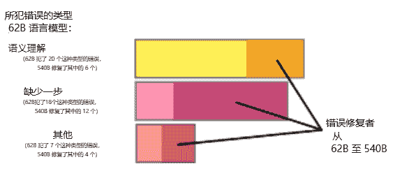

关于为什么小语言模型失败，还有三个值得注意的点。第一个观察结果是，小语言模型在相对简单的符号映射任务中都失败了。如第 5 节所示，即使是符号推理任务，只需要使用与少数样本中给出的相同的思维逻辑结构链对新示例进行概括，小语言模型仍然失败。第二个观察结果是，小语言模型似乎具有天生较弱的算术能力，如 Brown 等人 （2020） 所示，进行简单算术运算（没有语义理解）的能力需要足够的模型规模。最后，我们定性地注意到，小语言模型通常不会生成可以解析的最终答案，因为重复或逻辑从未得出最终答案。

总之，由于模型规模，思维链推理的成功是一个复杂的现象，可能涉及各种涌现能力（语义理解、符号映射、紧扣主题、算术能力、忠实度等）。未来的工作可以更彻底地研究预训练数据、模型架构和优化目标的哪些属性因果关系地支持这种推理能力。

### A.2 提示工程的作用是什么？

关于提示的一个关键考虑是对确切提示的敏感性。大量的工作显示，提示会以意想不到的方式影响语言模型（Min等，2022）。我们创建思维链注解的一般方法是从训练集中选取八个示例，并将推理过程分解为多个步骤，直至得出最终答案。在图3中提供了思维链注解的示例，完整的提示在附录G中给出。为了分析思维链对提示工程的敏感性，我们对各种因素进行了稳健性实验。

+   不同的注解者。我们首先分析了对三个不同注解者的稳健性（第3.4节和图6）。尽管在性能上存在显著的差异（我们稍后将进行讨论），但在算术、常识和符号推理的八个数据集上，思维链的表现均大幅优于基线（表6和表7）。与Cobbe等人（2021）的注解过程类似，注解者没有收到关于如何编写思维链注解的具体指示，只是简单地写出导致最终答案的逐步推理过程。因此，这些注解是以每个注解者自己的语言“思维链”写作风格编写的。

+   没有机器学习背景的注解者。GSM8K数据集（Cobbe等，2021）方便地提供了一个训练集，该训练集的推理链是由众包计算工作者编写的，这使我们能够调查不具有机器学习背景的独立来源的推理链的思维链是否仍然有效。因此，我们随机从GSM8K中抽取了三组带有思维链的八个示例。这些思维链注解在所有四个算术数据集上的表现均大幅超过了基线（表6），这表明思维链并不依赖于特定的注解者。

+   示例的不同顺序。先前的工作已经显示，在某些情况下（例如，分类），即使提示的顺序也很重要——改变少量示例的排列顺序可能导致GPT-3在SST-2上的准确性从接近随机（54.3%）到接近最佳状态（93.4%）波动（Zhao等人，2021）。我们在表6和表7中展示了不同示例的性能标准差。对于提示顺序的标准差在几乎所有情况下都相对较小。唯一的例外是抛硬币任务，其示例顺序的标准差很高，可能是由于Zhao等人（2021）中提到的原因——对于分类，连续的多个相同类别的示例会偏向模型的输出。

+   示例的不同数量。我们还发现，当少量示例的数量有所变化时，从思维链提示中获得的增益通常仍然存在。这在图11的五个数据集中有所显示（我们没有计算资源来为所有数据集运行这个）。我们还在初步实验中发现，进一步增加标准提示中的示例数量并没有带来显著的增益（例如，从8个增加到16个示例并没有提高标准提示的性能，以足以追赶思维链提示）。

+   不同的语言模型。另一个有趣的问题是，某些对一个模型更有效的提示是否对其他大型语言模型也更有效。我们发现，使用相同的提示，对于所有数据集，思维链提示都可以提高所有三种模型（LaMDA，GPT-3和PaLM）的性能，除了GPT-3的CSQA和StrategyQA（表1、表4、表5）。思维链的增益没有在模型之间完美传递是一个局限性；进一步的研究可以探讨为什么不同的预训练数据集和模型架构会影响从思维链提示中获得的性能增益。

尽管提示工程仍然很重要。虽然对于算术推理，结果相对不受提示的影响，但我们想明确提示工程确实很重要，并且在许多情况下可以显著提高性能。尽管大多数思维链注释的性能都超过了标准提示，但在许多情况下仍存在很大的变异。例如，对于抛硬币的任务，标注者A的性能为99.6%，而标注者C的性能为71.4%，尽管它们都高于标准提示= 50.0%（见表7）。甚至有些任务，良好的性能需要提示工程。在初步实验中，我们尝试使用思维链来使语言模型反转一个包含5个项目的列表的顺序。虽然两位合著者尽管尽了最大努力但无法编写解决任务的思维链提示，但第三位合著者能够编写一个完美解决任务的思维链。

如何以稳健的方式生成思维链注释可能是未来工作的一个有趣方向。例如，这里的一个想法可能是使用大型语言模型通过提示自动生成思维链（并可能在验证集上优化这一点）。

### A.3 思维链提示技术是否能提高我关心的任务的表现？

虽然思维链提示原则上适用于任何文本到文本的任务，但对某些任务比其他任务更有帮助。基于本文的实验，我们的直觉是当满足三个条件时，思维链提示最有助益：(1) 任务具有挑战性并需要多步推理；(2) 使用了大型的语言模型；和(3) 缩放曲线相对平坦。相反，当这些条件之一或多个不满足时，所得到的好处较小。

算术推理的结果或许支持了这些直觉。对于满足这些条件的GSM8K上的PaLM 540B，从思维链提示中获得的性能提升最大（具有挑战性的多步问题，平坦的缩放曲线）。对于仅需要一步或两步的MAWPS子集（SingleOP，SingleEq和AddSub），性能提升很小，因为PaLM 540B已经达到了90%或更高的性能（并且当性能已经很强时，提高的空间通常也较小）。

尽管在本文中我们重点研究了多步推理任务（算术、常识和符号），但原则上，对于人类使用“思维链”来解决的任何任务，都可以应用思维链提示。我们将留给未来的工作来实证评估思维链提示在如此多样化的任务（例如，机器翻译等）上的表现。

### A.4 为什么仅使用方程式提示对某些算术推理数据集来说是不够的？

仅使用方程式作为中间步骤在许多数据集上确实有所帮助，尤其是当这些数据集只需要几步推理时（例如SVAMP、ASDiv、MAWPS）。然而，对于GSM8K，仅使用方程式并没有显著地提高性能。基于定性分析，我们认为这些问题在语义上对模型来说太具挑战性，以至于它无法直接将它们转换为数学方程式。考虑LaMDA 137B中的这个例子：

**问题：**Mike玩乒乓球40分钟。在前20分钟，他得了4分。在第二个20分钟，他得分增加了25%。他总共得了多少分？

**仅方程式（错误答案）：**(4 + 20 * 0.25) = 6。答案是6。

**思维链（正确）：**Mike玩乒乓球40分钟。在前20分钟，他得了4分。在第二个20分钟，他得分增加了25%。所以他在第二个20分钟得了25%更多的分数。4 x 1.25 = 5。所以他在第二个20分钟得了5分。所以他总共得了9分。答案是9。

对模型来说，直接将所有的语义转化为一个单独的方程式是很难的，但思维链允许它通过自然语言中的中间步骤更好地对问题的每一部分进行推理。

---

## B 所有实验结果

本节包含了针对不同模型和模型大小、在所有基准测试上的标准提示与思维链提示的实验结果表格。

对于算术推理基准测试，一些思维链（以及生成的方程式）是正确的，只是模型在执行算术运算时出现错误。类似的观察在Cobbe等人（2021）的研究中也有提到。因此，我们可以进一步添加一个Python程序作为外部计算器（使用Python的eval函数）来处理生成的思维链中的所有方程式。当思维链中包含多个方程式时，我们通过字符串匹配将外部计算器的结果从一个方程式传递到下一个方程式。正如表1所示，我们可以看到，添加计算器显著提高了思维链提示在大多数任务上的性能。

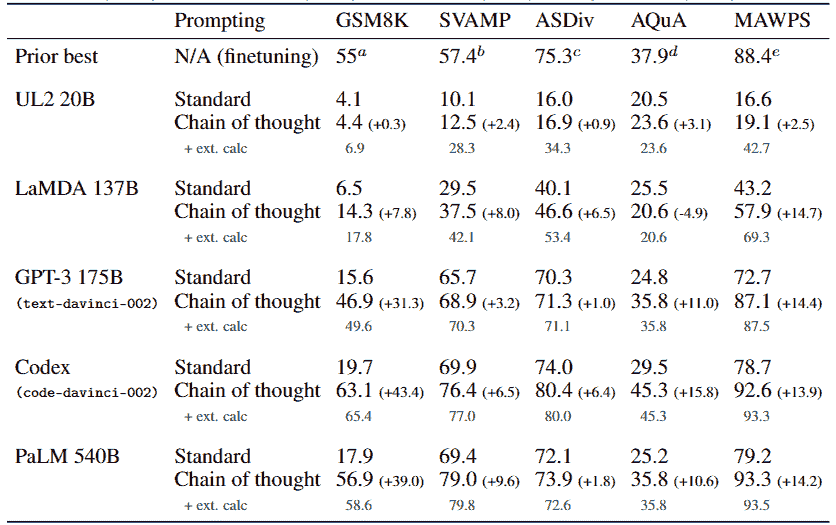

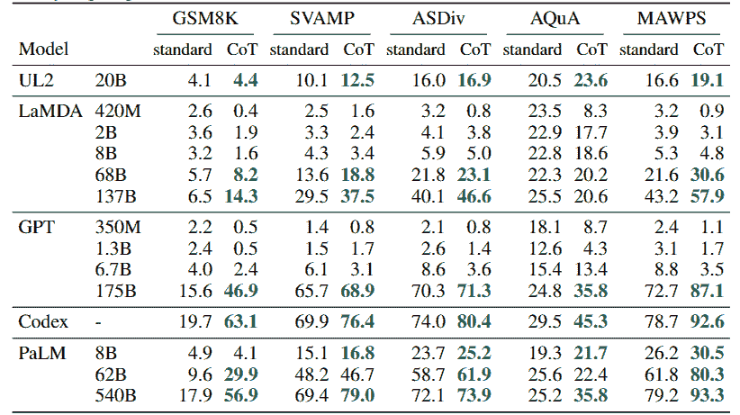

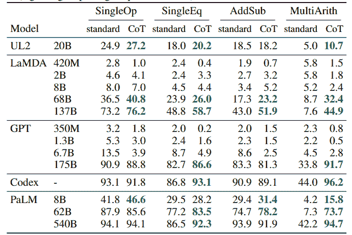

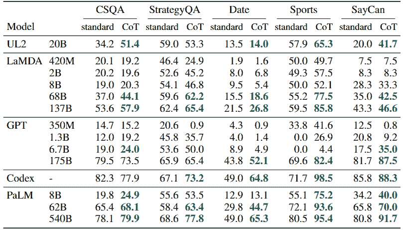

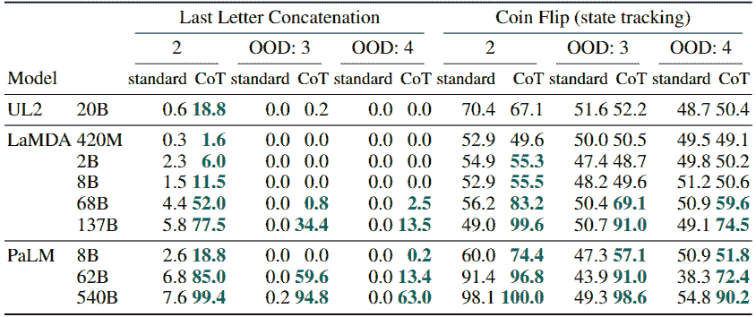

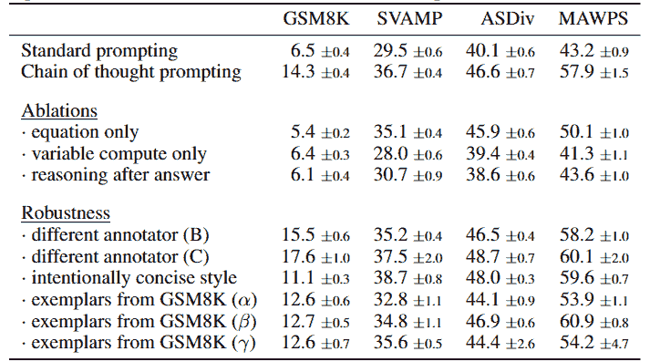

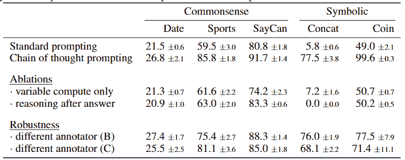

---

## C 扩展相关工作

思维链提示是一个受到多个先前方向启发的通用方法：提示、自然语言解释、程序合成/执行、数值和逻辑推理，以及中间语言步骤。

### C.1 提示技术

大规模语言模型的近期成功已导致人们日益关注通过提示提高它们执行任务的能力（参见Brown等人（2020）以及Liu等人（2021）的调查）。本文属于通用提示方法类别，其中输入提示被优化，使得单一的大型语言模型能够更好地执行各种任务（Li和Liang, 2021; Lester等人, 2021; Reif等人, 2022等）。

最近的一系列工作旨在通过提供描述任务的指示来提高语言模型的执行能力（Raffel等人, 2020; Wei等人, 2022a; Ouyang等人, 2022; Sanh等人, 2022; Wang等人, 2022b）。这项工作与本文相关，因为它也使用元数据来增强输入-输出对。但是，与一个指令增强任务的输入不同（指令通常被前置到输入中），思维链提示增强了语言模型的输出。另一个相关的方向是顺序地组合语言模型的输出；人机交互（HCI）工作（Wu等人，2022a,b）已经显示，组合语言模型的顺序生成在一个20人的用户研究中改善了任务结果。

### C.2 自然语言解释

另一个与此紧密相关的方向使用自然语言解释(NLEs)，其目标通常是提高模型的可解释性（Zhou等人，2020；Wiegreffe和Marasovi´c，2021等）。这方面的工作通常关注自然语言推理（Camburu等人，2018；Yordanov等人，2021；Bostrom等人，2021），并在最终预测同时或之后产生解释（Narang等人，2020；Majumder等人，2021；Wiegreffe等人，2021，2022）。相比之下，本文考虑的思维链处理是在最终答案之前进行的。而NLE主要旨在提高神经网络的可解释性（Rajagopal等人，2021），思维链提示的目标是允许模型将多跳转推理任务分解为多个步骤—可解释性只是一个副作用。Marasovi´c等人（2022）显示，基于NLE的提示微调可以提高NLI和分类性能，尽管他们主要关注评估解释的合理性。相比之下，我们的工作关注需要多跳转推理的一系列算术、常识和符号任务。

### C.3 程序合成和执行

使用中间推理步骤在程序合成和执行中有着悠久的历史（Zaremba和Sutskever，2014等）。近期在这方向的工作包括了许多架构创新（Cai等人，2017；Dong等人，2019；Yan等人，2020），以及使用大型语言模型（Chen等人，2021；Austin等人，2021）。与我们最接近的程序执行工作可能是Nye等人（2021），他们展示了大型语言模型可以执行多达10位的加法、评估多项式，并执行python程序。而生成一个程序然后执行它可以被视为一种推理，我们的工作将这种领域特定的基元推广到自然语言，这是开放领域的，并原则上与任何文本到文本的NLP任务相关。

### C.4 数值和逻辑推理

数值和逻辑推理在机器学习和自然语言处理中一直是研究的任务（Lev等人，2004等）。最近的工作还试图以各种方式在语言模型中注入数值推理能力，如使用预定义的可执行操作集来增强BERT（Andor等人，2019），包括图神经网络（Ran等人，2019），并使用专门的训练程序（Pi˛ekos等人，2021）。另一线工作旨在使语言模型能够进行逻辑或正式推理，通常是通过用语言表达自然语言正式规则来实现的（Clark等人，2020；Saeed等人，2021；Liang等人，2021）。与此最相关的工作可能是Recchia（2021），它显示微调使长篇模块操作成为可能，这以前对执行者来说很难。虽然这方向的工作通常是任务特定的，并使用微调，但我们展示了思维链提示适用于广泛的任务，而不需要任何微调。

### C.5 中间语言步骤

大量的先前工作已经显示，通过训练或微调赋予神经网络产生中间步骤的能力在一系列场景中带来了各种好处。例如，已经显示自然语言中间步骤可以提高性能（Zaidan等人，2007；Yao等人，2021；Hase和Bansal，2022；Gu等人，2022），提高鲁棒性（Chen等人，2022），加速训练（Hancock等人，2018），减少偏见（Dua等人，2020），甚至帮助图像和强化学习设置（Andreas等人，2018）。为了赋予模型产生中间步骤的能力，先前的工作通常在手工注释的训练数据集（Camburu等人，2018；Rajani等人，2019，等等）或生成的合成数据集（Talmor等人，2020；Zelikman等人，2022）上微调模型。与这些训练或微调方法相比，我们的工作显示，通过提示可以在足够规模的现成语言模型中引出各种自然语言推理能力。这种提示设置很重要，因为它允许在没有大量标记注释的情况下进行中间步骤推理，而且单一模型可以执行一系列推理任务，而无需任何梯度更新。

---

## D 附录：额外分析

### D.1 正确的思维链分析

如正文中提到，我们分析了在GSM8K数据集中导致正确答案的LaMDA 137B的50个思维链。在这50个中，只有一个通过不正确的推理得出了正确的答案（如表9所示：“偶然正确”）。其他49个都有正确的逻辑和数学，示例如表8所示。五个在保持连贯和可理解的逻辑的同时有轻微的瑕疵：

+   一个有未明确说明的语句（如表9所示：“正确但语句未明确”）。

+   一个做出了无关但正确的陈述（如表9所示：“正确但无关的陈述”）。

+   两个有正确的逻辑，但在等式中省略了特定步骤，尽管它仍然可以理解（如表9所示：“正确但不完美的等式”）。

+   一个数学上是正确的，但语义上是颠倒的（如表9所示：“正确但反转的语义”）

| 表8：模型为GSM8K数据集生成的正确思维链的示例 |
| --- |
| **问题：****James决定每周**跑3次冲刺，每次冲刺跑60米。他每周跑多少米总共？  模型答案（正确）：James决定每周跑3次冲刺。他每次跑60米。所以他每周跑60米 x 3次冲刺 x 3次。那就是60米 x 9。答案是540米。✔️ |
| **问题：****Brandon的i**Phone的年龄是Ben的iPhone的四倍。Ben的iPhone的年龄是Suzy的iPhone的两倍。如果Suzy的iPhone是1岁，那么Brandon的iPhone多大？  模型答案（正确）：Brandon的iPhone的年龄是Ben的iPhone的四倍。Ben的iPhone的年龄是Suzy的iPhone的两倍。所以Brandon的iPhone的年龄是Suzy的iPhone的8倍。Suzy的iPhone是1岁。所以Brandon的iPhone是8 x 1 = 8岁。答案是8岁。✔️ |
| **问题：****Jean有30个棒**棒糖。Jean吃了2个棒棒糖。剩下的棒棒糖，Jean想每袋装2个。Jean可以装满多少袋？  模型答案（正确）：Jean开始时有30个棒棒糖。她吃了2个。所以她还有28个棒棒糖。她想每袋装2个棒棒糖。所以她可以装28 / 2 = 14袋。答案是14袋。✔️ |

尽管我们发现，对于最终答案正确的数学问题，链式思维推理大多是正确的，但这可能是因为对于自由回答问题，很难偶然得到正确的最终答案。对于多项选择或二分类问题，模型通过不正确的推理路径得到正确答案的可能性要大得多（例如，我们评估的所有常识推理数据集）。这是一个局限性，未来的工作应该对这样的思维链的事实性进行分析。

| 表格9：在模型得到的50个正确的示例中，有7个明显的案例中，模型生成的思维链是不完美的。我们发现其他43个与人可能生成的基准答案相当。 |
| --- |
| **问题：**有3**6只企鹅在雪地里晒太阳**。他们中的三分之一跳进海里游泳。另外三分之一进入洞穴吃晚餐。还有多少企鹅仍然在晒太阳？  模型答案（偶然正确）：有36只企鹅。三分之一的企鹅跳进海里游泳。所以是12只企鹅。另外三分之一进入洞穴吃晚餐。所以是12只企鹅。答案是12。 |
| **问题：****约翰有2栋房子，每栋房子有3**个卧室。每个卧室有2扇窗户。每栋房子里还有另外4扇不连接卧室的窗户。两栋房子之间总共有多少窗户？  模型答案（正确但描述不足）：有2栋房子，每栋有3个卧室。每个卧室有2扇窗户。所以每栋房子有2 x 3 = 6扇窗户。每栋房子里还有另外4扇不连接卧室的窗户。所以每栋房子有4 + 4 = 8扇窗户。所以每栋房子有6 x 2 = 12扇窗户。所以两栋房子共有12 + 8 = 20扇窗户。答案是20。 |
| **问题：**如果安妮9岁，她的哥哥年龄是她的两倍，那么她的哥哥三年后多大？  模型答案（正确但与问题无关的陈述）：安妮9岁。她的哥哥年龄是她的两倍。所以她的哥哥是18岁。三年后，她将是12岁。所以她的哥哥将是18 + 3 = 21岁。答案是21。 |
| **问题：****一个当地的加油站正在以每加仑3**.00美元的价格出售汽油。一个应用公司提供每加仑0.20美元的返现，如果你在这个加油站加满油。如果有人购买了10加仑的汽油，经过返现奖励后，他们的汽油要多少钱？  模型答案（正确但方程不完美）：汽油原价是每加仑3美元。如果你买10加仑，那么是3 x 10 = 30美元。如果每加仑可以得到20美分的折扣，那么是20 x 10 = 2美元。所以总计是30 - 2 = 28美元。答案是28美元。 |
| **问题：****Nissa雇佣了60名季节性工**人在她的百货商店的圣诞老人村扮演小精灵。其中三分之一的小精灵在孩子们呕吐在他们身上后辞职，然后在孩子们踢他们的胫骨后，还有10名小精灵辞职。还剩下多少小精灵？  模型答案（正确但方程不完美）：Nissa雇佣了60名季节性工人。三分之一的人辞职。所以60 - 1/3 = 40名小精灵留下。然后10名小精灵辞职。所以40 - 10 = 30名小精灵留下。答案是30名小精灵。 |
| **问题：****Jones奶奶为消防员的午餐**烤了5个苹果派。她将每个派切成8块，然后将这五个派放在自助餐桌上供客人自助取用。到了晚上，客人拿走并吃掉了他们的派块后，还剩下14块派。客人拿走了多少块派？  模型答案（正确但语义颠倒）：烤了5个派并每个切成8块。这5个派然后被客人食用。8 x 5 = 40块派。客人吃了14块派。40 - 14 = 26块派剩下了。答案是26块。✔️ |

### D.2 错误的思维链分析

我们还手动分析了LaMDA 137B在GSM8上错误的模型输出的50个随机抽样样本。一个思维链可以有很多种不正确的方式，这使得错误分类的设计并不简单。我们决定根据需要做哪些改变来使思维链正确来分类错误，目的是为了阐明未来如何改进模型。

我们发现，许多思维链可以通过以下三类修改之一来修正。

+   仅计算器错误。我们发现8%的思维链完全正确，只是在计算器上出了一个错误——换句话说，像Cobbe等人（2021年）所做的那样，将一个外部计算器应用于等式，可以使思维链正确。此类错误的一个例子显示在表10中：“仅计算器错误”。的确，当我们在表2中添加了Python程序作为外部计算器时，LaMDA 137B GSM8K的链式思维提示的解决率从14.3%上升到17.3%。此外，34%的示例除了其他类型的错误外还包含计算器错误。但是，我们独立于计算器错误进行其余的错误分类。

+   符号映射错误。接下来，我们发现16%的思维链除了我们称之为符号映射错误外都是正确的。我们定义符号映射错误为当思维链除了数字符号都是正确的，只通过修改等式而不是词语就可以完全正确。因为有人可能会争辩说他们可以简单地在任何思维链中放置正确的最终等式，所以我们将此类别限制为思维链，其中思维链可以修改为一个完全正确的推理过程（而不仅仅是最终答案）。此错误类别的一个例子显示在表10中：“符号映射错误”。

+   缺少一步的错误。我们的下一个错误类别是除了缺少一个步骤外都是正确的思维链。换句话说，这些思维链可以通过增加模型遗漏的额外推理步骤来重写为正确的。此错误类别的一个例子显示在表10中：“缺少一步的错误”。我们发现22%的错误归入了这个类别。

| 表10：如附录D.2所描述的，错误思维链的例子分类 |
| --- |
| **问题：****Dan种植了3株**玫瑰。每株玫瑰有25朵玫瑰花。每朵玫瑰花有8个刺。总共有多少刺？  模型答案（错误；仅计算器错误）：Dan种植了3株玫瑰。每株玫瑰有25朵玫瑰。每朵玫瑰有8个刺。所以3 x 25 x 8 = 300。答案是300。  错误类别的解释：只需通过一个外部计算器运行方程，而不是要求模型进行计算，就可以使生成的思维链正确。✖️ |
| **问题：****Jill每小时教**学收费20美元，当啦啦队教练时收费30美元。如果她一年工作50周，每周作为老师工作35小时，作为教练工作15小时，那么她的年薪是多少？  模型答案（错误；符号映射错误）：Jill每小时教学收费20美元，当啦啦队教练时收费30美元。如果她每年工作50周，每周作为老师工作35小时，作为教练工作15小时，那么她作为老师工作50 x 35 = 1750小时，作为教练工作15 x 30 = 450小时。所以她工作1750 + 450 = 2200小时。她每小时为1750小时付20美元，为450小时付30美元。所以她的年薪是20 x 1750 + 30 x 450 = $36,500。答案是$36,500。  错误类别的解释：模型错误地映射了“15 x 30”而不是“15 x 50”，只需修正这一个更改（使用外部计算器），思维链就会变得正确。✖️ |
| **问题：**Kel**ian有两个烹饪**菜肴的食谱，一个有20条指示，另一个的指示是第一个的两倍。Kelian需要阅读多少指令来准备这两道菜？  模型答案（错误；缺少一步的错误）：Kelian有两个食谱。一个有20条指示。另一个的指示是第一个的两倍。所以第二个有40条指示。所以Kelian需要阅读40条指示来准备这两道菜。答案是40。  错误类别的解释：只需添加一个额外的步骤（在这种情况下，添加20和40），模型答案就可以变得正确。✖️ |

我们发现，其余的思维链（50中的27；54%）需要进行大量的编辑才能变成一个正确的思维链。这里几乎所有的情况都涉及到了语义理解的错误（参见表11：“语义理解错误”），而27中的8个还有不连贯的思维链，这意味着在生成的思维链中，一些声明并没有根据之前的声明进行，或者违反了基本的世界知识（参见表11：“不连贯的思维链错误”）。

| 表11：如附录D.2中描述的错误思维链的示例。这些思维链有多个错误，不能通过小的编辑来修复。 |
| --- |
| **问题：**Gretchen有110枚硬币**。金币比银币多**30枚。Gretchen有多少枚金币？  模型答案（错误；语义理解错误）：Gretchen有110枚硬币。金币比银币多30枚。所以银币有110 - 30 = 80枚。所以有80枚银币和110 - 80 = 30枚金币。答案是30。  错误类别说明：模型不理解110枚硬币是总数，并且它必须解一个方程来得到金币和银币的数量。✖️ |
| **问题：****在一个有20名**学生的舞蹈班中，20%报名参加现代舞，剩下的25%报名参加爵士舞，其余的报名参加嘻哈舞。全班学生中有多少百分比报名参加嘻哈舞？  模型答案（错误；不连贯的思维链错误）：20%的学生报名参加现代舞。剩下的25%的学生报名参加爵士舞。其余的报名参加嘻哈舞。所以全班学生中报名参加嘻哈舞的百分比是参加嘻哈舞的学生的百分比，减去参加现代舞的学生的百分比，再减去参加爵士舞的学生的百分比。所以全班学生中报名参加嘻哈舞的百分比是(25 + 20) - (25 + 20) = 100%。答案是100%。  错误类别说明：这条思维链不连贯，因为全班学生中报名参加嘻哈舞的百分比不可能是参加嘻哈舞的学生的百分比减去另一个项目。✖️ |

总的来说，没有保证大型语言模型生成的推理过程是连贯的或事实上是正确的，正如最近对语言模型生成和解释的事实性评估工作所强调的(Maynez et al., 2020; Rashkin et al., 2021; Ye and Durrett, 2022; Marasovi´c et al., 2022; Wiegreffe et al., 2022)。错误的推理过程可能导致错误的最终答案，也可能导致偶然正确的最终答案（对于诸如二分类任务这样的任务，偶然正确的最终答案更有可能，而不是自由回答）。

提高语言模型生成的事实性，特别是与上下文和世界知识的相关性，是语言模型研究中的一个重要方向，也有望进一步提高语言模型的多步骤推理能力。提高解码质量的一个可能方法是生成多个推理路径，并用一个验证器为它们打分，尽管这需要训练验证器(Cobbe et al., 2021; Shen et al., 2021; Thoppilan et al., 2022)。

### D.3 额外的鲁棒性分析

由于主论文中的实验使用固定数量的少数示例（8个；由于输入长度为1024个标记的限制），我们验证了链式思维提示是否对各种数量的少数示例具有鲁棒性。我们针对LaMDA 137B进行实验，比较链式思维提示和标准提示在五个数据集上的表现，其中标准提示具有大致平坦的缩放曲线（最大的模型没有达到高性能）。如图11所示，链式思维提示相对于标准提示的改进在变化的少数示例提示中仍然稳健。

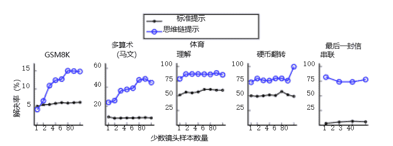

| 表12：本文中使用的数学词问题基准摘要及示例。 |  |  |
| --- | --- | --- |
| 数据集 | N（评估示例的数量） | 示例问题 |
| GSM8K | 1,319 | 乔什决定尝试翻修一栋房子。他以80,000美元的价格购买了一栋房子，然后投入了50,000美元进行修复。这使得房子的价值增加了150%。他赚了多少利润？ |
| SVAMP | 1,000 | 每包DVD的价格为76美元。如果每包有25美元的折扣。你需要支付多少钱来购买每一包？ |
| ASDiv | 2,096 | 艾伦比玛琳多了六个球。玛琳有九个球。艾伦有多少个球？ |
| AQuA | 254 | 一辆汽车正在直线行驶，并以均匀速度向一个垂直塔的基座驶去。从汽车上观察到塔顶，在这个过程中，仰角从45°变为60°需要10分钟。这辆车还需要多少时间才能到达塔的底部？答案选择：(a) 5√3 + 1 (b) 6√3 + √2 (c) 7√3 - 1 (d) 8√3 - 2 (e) 以上都不是 |
| MAWPS: SingleOp | 562 | 如果一个盒子里有7个瓶盖，琳达再放进去7个瓶盖，盒子里有多少个瓶盖？ |
| MAWPS: SingleEq | 508 | 本尼买了一瓶软饮料，价格为2美元，又买了5块糖。他总共花费了27美元。每块糖花了多少钱？ |
| MAWPS: AddSub | 395 | 本尼买了一瓶软饮料，价格为2美元，又买了5块糖。他总共花费了27美元。每块糖花了多少钱？ |
| MAWPS: MultiArith | 600 | 学校食堂为学生的午餐订购了42个红苹果和7个绿苹果。但是，如果只有9名学生想要水果，那么食堂最后多出了多少水果？ |

---

## E 额外细节

版本控制

V5 → V6. 修复了图 3 中的小错误。

V4 → V5. 添加了 Codex 和 UL2 的结果。论文的写作和风格有少量更改。

V3 → V4. 修复了图 3 中的错误，并添加了几个引用。

V2 → V3. 添加了 GPT-3 的结果。为数学添加了 SVAMP 和 AQuA 评估数据集。为常识推理添加了 SayCan 评估。添加了扩展的相关工作部分（附录 C）。为常识和符号推理添加了消融实验（表 7）。添加了常见问题解答部分（附录 A）。在附录 B 中添加了原始结果。

V1 → V2. 添加了 PaLM 的结果（V1 只有 LaMDA）。

### E.1 可复现性声明

由于我们的结果使用了两套并未公开的大型语言模型，为了便于复现，我们采取了以下行动。首先，我们在附录 G 的表 20–表 27 中提供了所有任务的确切输入提示（并强调我们没有进行任何微调，仅对现成的语言模型进行了提示）。其次，我们使用公开的 GPT-3 API 对四种模型规模（text-ada-001、text-babbage-001、text-curie-001、text-davinci-002）进行了实验。最后，我们在补充材料中以 zip 文件的形式提供了每个任务的 LaMDA 137B 的确切输入、目标和预测。

### E.2 计算资源

对于我们评估的所有三个语言模型，我们仅进行了基于提示的推理。本文没有进行任何微调。对于 LaMDA 137B 的推理，我们使用了 TPU v3（8x8 配置，64 芯片 / 128 核心），而对于 PaLM 540B 的推理，我们使用了 TPU v4（4x4x12 配置，192 芯片 / 384 核心）。GPT-3 的实验是通过公开 API 完成的。

### E.3 数据集细节和许可

我们列出了本文中使用的所有算术和常识数据集的详细信息和许可证。符号推理数据集是根据第 4 节中的描述合成创建的。

**算术推理**

+   数学单词问题仓库（Math Word Problem Repository）（Koncel-Kedziorski 等人，2016）：AddSub（Hosseini 等人，2014）：https://www.cs.washington.edu/nlp/arithmetic; MultiArith（Roy 和 Roth，2015），许可证：CC BY 4.0。

+   [ASDiv（Miao 等人，2020）：https](https://github.com/chaochun/nlu-asdiv-dataset%E3%80%82)[:](https://github.com/chaochun/nlu-asdiv-dataset%E3%80%82)//github.com/chaochun/nlu-asdiv-dataset。

+   AQuA（Ling 等人，2017）：https://github.com/deepmind/AQuA, 许可证： https://github.com/deepmind/AQuA/blob/master/LICENSE.

+   [GSM8K（Cobbe 等人，2021）：ht](https://github.com/openai/grade-school-math%EF%BC%8CMIT)[tps:](https://github.com/openai/grade-school-math%EF%BC%8CMIT)//git[h](https://github.com/openai/grade-school-math/blob/master/LICENSE%E3%80%82)[u](https://github.com/openai/grade-school-math/blob/master/LICENSE%E3%80%82)b.com/openai/grade-school-math，MIT 许可证：https://github.com/openai/grade-school-math/blob/master/LICENSE。

+   [SVAM](https://github.com/arkilpatel/SVAMP%EF%BC%8CMIT)P（Pat[e](https://github.com/arkilpatel/SVAMP/blob/main/LICENSE%E3%80%82)[l](https://github.com/arkilpatel/SVAMP/blob/main/LICENSE%E3%80%82) 等人，2021）：https://github.com/arkilpatel/SVAMP，MIT 许可证：https://github.com/arkilpatel/SVAMP/blob/main/LICENSE。

**常识推理**

+   [CSQA（Talmor 等人，20](https://www.tau-nlp.org/commonsenseqa%EF%BC%8Chttps://github.com/jonathanherzig/commonsenseqa%E3%80%82)[1](https://www.tau-nlp.org/commonsenseqa%EF%BC%8Chttps://github.com/jonathanherzig/commonsenseqa%E3%80%82)[9）：https://www.tau-nlp.org/](https://www.tau-nlp.org/commonsenseqa%EF%BC%8Chttps://github.com/jonathanherzig/commonsenseqa%E3%80%82)[c](https://www.tau-nlp.org/commonsenseqa%EF%BC%8Chttps://github.com/jonathanherzig/commonsenseqa%E3%80%82)[o](https://beta.openai.com/docs/api-reference/making-requests)mmonsenseqa，https://github.com/jonathanherzig/commonsenseqa。https://beta.openai.com/docs/api-reference/making-requests

+   S[trategyQA (Geva等](https://github.com/google/BIG-bench/tree/main/bigbench/benchmark_tasks/strategyqa)[，2021年)：我们使用来自BIG-bench合作](https://github.com/google/BIG-bench/tree/main/bigbench/benchmark_tasks/strategyqa)伙伴（2021年）的开放领域设置（仅包含问题的集合）：https://github.com/google/BIG-bench/tree/main/bigbench/benchmark_tasks/strategyqa。

+   原始数据集来自[https://github.com/](https://github.com/eladsegal/strategyqa)eladsegal/[strategyqa，采用MIT许可证](https://github.com/eladsegal/strategyqa/blob/main/LICENSE)：https://github.com/eladsegal/stra[tegyqa/blob/main/LICENSE。
](https://github.com/google/BIG-bench/blob/main/LICENSE)[BIG-Bench](https://github.com/google/BIG-bench/blob/main/LICENSE)的日期理解和体育理解（BIG-bench合作伙伴，2021年）：Apache许可证v.2：https://github.com/google/BIG-bench/blob/main/ LICENSE。

+   SayCan（Ahn等，2022年）：SayCan数据集可以在https://say-can.github. io/ 下使用CC BY 4.0许可证获得。

---

## F 附录：输入/输出示例

| 表 13：LaMDA 137B 在字母连接任务上产生的正确和不正确的思维链条示例。 |
| --- |
| **问题：****取“Waldo S**chmidt”中每个单词的最后一个字母并连接它们。  模型回答（正确）：单词“Waldo”的最后一个字母是“o”。单词“Schmidt”的最后一个字母是“t”。连接它们得到“ot”。因此，答案是 ot。✔️ |
| **问题：****取“Daniel **Friedman”中每个单词的最后一个字母并连接它们。  模型回答（错误）：单词“Daniel”的最后一个字母是“l”。单词“Friedman”的最后一个字母是“m”。连接它们得到“lm”。因此，答案是 lm。✖️ |

| 表 14：LaMDA 137B 在硬币翻转任务上产生的正确和不正确的思维链条示例。 |
| --- |
| **问题：**一个硬币**朝上是正面。And**ree 翻转了硬币。Audrie 没有翻转硬币。硬币现在还是正面朝上吗？  模型回答（正确）：硬币被 Andree 翻转了。所以硬币翻转了 1 次，这是一个奇数次。硬币开始时是正面朝上的，所以经过奇数次翻转后，它会是反面朝上。所以答案是否。✔️ |
| **问题：**一个硬币**朝上是正面。Kri**stian 没有翻转硬币。Dallas 没有翻转硬币。硬币现在还是正面朝上吗？  模型回答（错误）：硬币被 Kristian 翻转了。所以硬币翻转了 1 次，这是一个奇数次。硬币开始时是正面朝上的，所以经过奇数次翻转后，它会是反面朝上。所以答案是否。✖️ |

| 表 15：LaMDA 137B 在 CSQA 上产生的正确和不正确的思维链条示例。 |
| --- |
| **问题：****你在哪里最有可能找**到一个汉堡包？答案选项：（a）快餐店（b）比萨饼（c）碎死牛（d）嘴里（e）牛尸体  模型回答（正确）：答案必须是一个可以找到汉堡包的地方。在上述选项中，只有快餐店供应汉堡包。所以答案是（a）。✔️ |
| **问题：****你在哪里最有可能找**到一个汉堡包？答案选项：（a）快餐店（b）比萨饼（c）碎死牛（d）嘴里（e）牛尸体  模型回答（正确）：答案必须是一个可以找到汉堡包的地方。在上述选项中，只有快餐店供应汉堡包。所以答案是（a）。✔️ |
| **问题：****除了水和营养，你的**狗还需要什么？答案选项：（a）骨头（b）饰品（c）被抚摸（d）大量关注（e）散步  模型回答（错误）：答案必须是狗需要的东西。在上述选项中，只有骨头是狗需要的东西。所以答案是（a）。✖️（事实上的正确答案是（d））。 |
| **问题：****当你在接待区等待时**，你在和什么一起等待？答案选项：（a）汽车旅馆（b）椅子（c）医院（d）人们（e）酒店  模型回答（错误）：答案必须是在接待区和你一起等待的东西。在上述选项中，只有人们是在接待区和你一起等待的。所以答案是（e）。✖️（事实上的正确答案是（d））。 |

| 表格 16: LaMDA 137B 在 StrategyQA 上生成的正确和不正确的思维链示例。 |
| --- |
| **问题：**《驱魔人》会刺激边缘系统**吗？  模型答案（正**确）：《驱魔人》是一部恐怖电影。恐怖电影让人害怕。边缘系统与恐惧有关。因此，《驱魔人》会刺激边缘系统。所以答案是肯定的。✔️ |
| **问题：****杰克逊·波洛克受过**莱昂纳多·达·芬奇的训练吗？  模型答案（正确）：莱昂纳多·达·芬奇生活在15世纪。杰克逊·波洛克生活在20世纪。因此，杰克逊·波洛克不可能接受莱昂纳多·达·芬奇的训练。所以答案是否定的。✔️ |
| **问题：****哈利·波特能在亚洲航**空预订机票吗？  模型答案（不正确）：哈利·波特是虚构的角色。因此，哈利·波特可以做任何事情。所以答案是肯定的。✖️（实际答案是“否”） |
| **问题：****一个诡辩家会使用ép**ée吗？  模型答案（不正确）：诡辩家是一个擅长说服艺术的人。épée 是一种剑。因此，诡辩家可以使用épée。所以答案是肯定的。✖️（实际答案是“否”） |

| 表格 17: LaMDA 137B 在日期理解上生成的正确和不正确的思维链示例。 |
| --- |
| **问题：**1992年5月6日对于简来说就像昨天，但实际上是**十年前。一个月前的**日期是多少（MM/DD/YYYY格式）？  模型答案（正确）：1992年5月6日是十年前的日期，所以今天是2002年5月6日。所以一个月前的日期是2002年4月6日。所以答案是04/06/2002。✔️ |
| **问题：****这是1899年的最**后一天。24小时后的日期是多少（MM/DD/YYYY格式）？  模型答案（正确）：今天是12/31/1899。24小时后将是01/01/1900。所以答案是01/01/1900。✔️ |
| **问题：****简安排了3个预约，涉**及5个人，计划在明天（1972年7月9日，周二）进行。从今天算起一周前的日期是多少（MM/DD/YYYY格式）？  模型答案（不正确）：明天是1972年7月9日。从今天算起一周前的日期是1972年7月2日。所以答案是7/2/1972。✖️（实际答案是07/01/1972。） |
| **问题：****简安排了3个预约，涉**及5个人，计划在明天（1972年7月9日，周二）进行。从今天算起一周前的日期是多少（MM/DD/YYYY格式）？  模型答案（不正确）：明天是1972年7月9日。从今天算起一周前的日期是1972年7月2日。所以答案是7/2/1972。✖️（实际答案是07/01/1972。） |

| 表格 18: LaMDA 137B 在体育理解上生成的正确和不正确的思维链示例。 |
| --- |
| **问题：****以下句子是否合理？**“Joao Moutinho 在垒上出局。”  模型答案（正确）：Joao Moutinho 是一名足球运动员。在垒上出局是棒球的一部分，而不是足球。所以答案是不。✔️ |
| **问题：****以下句子是否合理？**“Malcolm Brogdon 在NBA总决赛中进行了欧洲步上篮。”  模型答案（正确）：Malcolm Brogdon 是一名篮球运动员。欧洲步上篮是篮球的一部分。所以答案是是。✔️ |
| **问题：****以下句子是否合理？“**Derrick White 用反手射门。”  模型答案（不正确）：Derrick White 是一名篮球运动员。用反手射门是篮球的一部分。所以答案是是。✖️（实际答案是“不”，反手射门是冰球的一部分。） |
| **问题：****以下句子是否合理？“**Nazem Kadri 在本垒出局。”  模型答案（不正确）：Nazem Kadri 是一名冰球运动员。在本垒出局是冰球的一部分。所以答案是是。✖️（实际答案是“不”，在本垒出局是棒球的一部分。） |

| 表格 19: PaLM 540B 在SayCanrobot规划任务上生成的正确和不正确的思维链示例。 |
| --- |
| **问题：****我把可乐洒在桌子上**了，你能把它扔掉，然后给我拿点东西来帮我擦吗？  模型答案（正确）：解释：用户把可乐洒在桌子上了。我会把可乐扔掉，然后给用户拿一个海绵。计划：查找(可乐), 拾取(可乐), 查找(垃圾), 放(可乐), 查找(海绵), 拾取(海绵), 查找(桌子), 放(海绵)。✔️ |
| **问题：**你能帮我把这个苹果丢进堆肥**桶吗？  模型答案（**正确）：解释：用户想让我把这个苹果丢进堆肥桶。我会把这个苹果移动到堆肥桶。计划：查找(苹果), 拾取(苹果), 查找(垃圾), 放(苹果)。✔️ |
| **问题：****你能给我拿一杯不是可**乐的饮料吗？  模型答案（不正确）：解释：用户要求我拿一杯不是可乐的饮料，我会拿一杯雪碧。计划：查找(雪碧), 拾取(雪碧), 查找(用户), 放(雪碧)。✖️（可行的答案包括查找柠檬苏打、百事可乐、葡萄柚苏打或水，因为表格28中定义的场景中没有雪碧。） |
| **问题：****你能给我拿一些咸的东**西吗？  模型答案（不正确）：解释：用户想要一些咸的东西。在对象列表中有几个选项，所以我会给用户拿一瓶柠檬苏打。计划：查找(柠檬苏打), 拾取(柠檬苏打), 查找(用户), 放(柠檬苏打)。✖️（可行的答案包括查找薯片。模型误将柠檬苏打误认为是咸的。） |

---

## G 附录：完整提示

| Table 20: 数学问题思维链提示的少样本示例，适用于除AQuA以外的所有数学问题数据集 |
| --- |
| **数学问题的提示：** |

| 表格 21: AQuA 代数单词问题思维链提示的少样本示例。 |
| --- |
| **AQuA代数单词问题的提示：**  Q: 约翰发现15个数字的平均值是40。如果每个数字都加上10，那么这些数字的平均值是多少？  答案选项：(a) 50 (b) 45 (c) 65 (d) 78 (e) 64  A: 如果每个数字都加上10，那么这些数字的平均值也会增加10。因此新的平均值将是50。答案是(a)。 |

| 表格 22: 最后一个字母连接任务的思维链提示的少样本示例。 |
| --- |
| **最后一个字母连接任务的提示：**  Q: 取出“Elon Musk”中单词的最后一个字母并连接起来。  A: “Elon”的最后一个字母是“n”。 “Musk”的最后一个字母是“k”。 连接它们是“nk”。 答案是“nk”。 |

| 表格 23: 抛硬币任务的全链条提示的少样本示例。 |
| --- |
| **抛****硬币****任务的提示：**  Q: 一枚硬币正面朝上。卡抛硬币。雪莉抛硬币。硬币是否仍然正面朝上？  A: 硬币被卡和雪莉抛掷。因此，硬币被抛掷了2次，这是一个偶数。硬币最初是正面朝上的，因此在偶数次抛掷后，它仍然是正面朝上的。所以答案是是。 |

| 表格 24: CSQA 思维链提示的少样本示例。为了节省空间，答案选项之间的换行符在表格中被省略。 |
| --- |
| **CSQA任务的提示：**  Q: 人们用什么来吸收钢笔的多余墨水？  答案选项: (a) 衬衫口袋 (b) 书法家的手 (c) 墨水瓶 (d) 书桌抽屉 (e) 吸墨纸  A: 答案必须是一种可以吸收墨水的物品。在上述选择中，只有吸墨纸用于吸收墨水。所以答案是(e)。 |

| 表格 25: StrategyQA 思维链提示的少样本示例。 |
| --- |
| StrategyQA任务的提示：  Q: 仓鼠为其他动物提供食物吗？  A: 仓鼠是猎物动物。猎物是捕食者的食物。因此，仓鼠为某些动物提供食物。所以答案是是。 |

| 表格 26: Date Understanding 思维链提示的少样本示例。 |
| --- |
| Date Understanding 任务的提示：  Q: 2015年还有36小时就要来临。一周后的日期是多少（MM/DD/YYYY）？  A: 如果2015年还有36小时，那么它还有2天。01/01/2015的2天前是12/30/2014，所以今天是12/30/2014。所以一周后的日期是01/05/2015。所以答案是01/05/2015。 |

| 表格 27: Sports Understanding 思维链提示的少样本示例。 |
| --- |
| Sports Understanding 任务的提示：  Q: 以下句子是否合理？“Kyle Palmieri被犯规了。”  A: Kyle Palmieri是一名冰球运动员。被犯规是冰球的一部分。所以答案是是。 |

| 表格 28：SayCan机器人规划任务的思维链提示的少样本示例。 |
| --- |
| SayCan机器人规划任务的提示：  位置 = [柜台，桌子，用户，垃圾桶，碗]。  物品 = [7up、苹果、炸薯片、茶、多谷薯片、可乐、青柠苏打水、辣椒薯片、米薯片、橙子、葡萄柚苏打水、百事可乐、红牛、能量棒、海绵、水]。  机器人可以使用 pick(object) 拿取物品，使用 put(object) 放下物品，以及使用 find() 查找物品或位置。机器人只能理解明确列出的位置和物品。 |

---

## H 附录：MWP的替代注释者

| 表格 29：数学单词问题的思维链提示的少样本示例。这些示例与表格20中的示例相同，只是思维链是由不同的注释者（“注释者B”而不是“注释者A”）编写的。注释者是共同作者，熟悉思维链提示的目标。 |
| --- |
| **数学单词问题的提示：**  Q: 林地里有15棵树。林地工人今天将在林地里种树。完成后，将有21棵树。林地工人今天种了多少棵树？  A: 现在有21棵树，一开始有15棵树，所以工人种了21 - 15 = 6棵树。答案是6。 |

| 表格30：数学文字问题的思维链的少样本示例。这些示例与表格20中的相同，唯一不同的是思维链是由不同的注释者编写的（“注释者C”而不是“注释者A”）。 |
| --- |
| **数学文字问题提示：**  Q：树林里有15棵树。树林工人今天会在树林里种树。他们完成后，树林里将有21棵树。树林工人今天种了多少棵树？  A：我们从15棵树开始。后来有21棵树。差异必定是他们种的树的数量。所以，他们必定种了21 - 15 = 6棵树。答案是6。 |