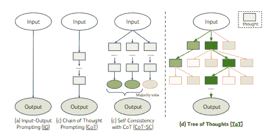
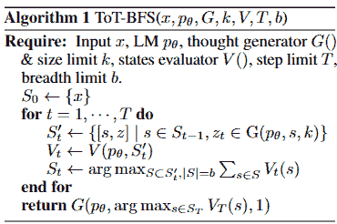
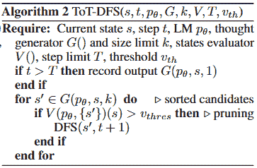
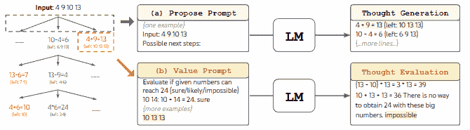
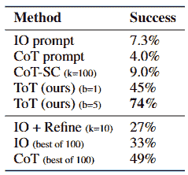
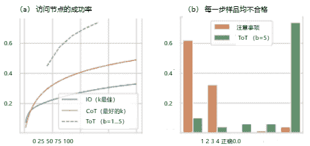
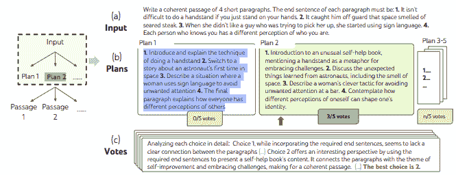
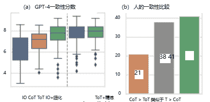
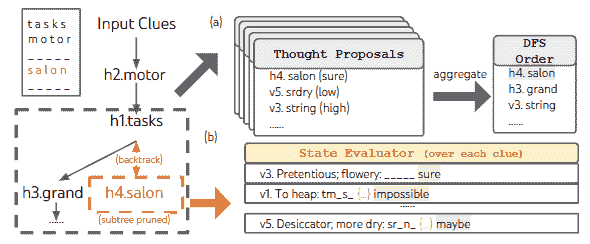

# 思维树（TOT）提示

> 来源：[https://vxc3hj17dym.feishu.cn/docx/SFumd8PO1oM53JxystEc7A6anBC](https://vxc3hj17dym.feishu.cn/docx/SFumd8PO1oM53JxystEc7A6anBC)

> 作者：小七姐

> [**可以在以下地址关注她，主页内**](https://t.zsxq.com/15KhQ0RE7)容更丰富：小七姐的prompt学习社群

本文为论文《Tree of Thoughts: Deliberate Problem Solving with Large Language Models》的中文精校解读

原文地址：https://arxiv.org/abs/2305.10601

PDF文档：https://arxiv.org/pdf/2305.10601.pdf

—— 感谢Raven对本译文的贡献。

                                                                                                                               -- 小七姐

---

## Tree of Thoughts: Deliberate Problem Solving with Large Language Models 思维树：使用大型语言模型深思熟虑地解决问题

---

摘要

语言模型越来越多地被用于各种任务的通用问题解决，但在推理过程中仍然受限于标记级别的、从左到右的决策过程。这意味着在需要探索、战略前瞻或初始决策起关键作用的任务中，语言模型可能会出现不足。为了克服这些挑战，我们引入了一种新的语言模型推理框架，名为“思维树”（Tree of Thoughts，ToT），它对流行的“思维链”方法进行了泛化，允许在作为问题解决中间步骤的连贯文本单元（“思维”）上进行探索。ToT允许LM通过考虑多个不同的推理路径和自我评估选择来进行深思熟虑的决策，以决定下一步的行动，同时在需要时进行前瞻或回溯以进行全局选择。我们的实验表明，ToT 能显著提高语言模型在三项需要非繁琐规划或搜索的新任务中解决问题的能力： 24点游戏、创意写作和迷你填字游戏。例如，在24点游戏 中，使用思维链提示的 GPT-4 仅解决了 4% 的任务，而我们的方法则达到了 74% 的成功率。包含所有提示的代码库：https://github.com/ysymyth/tree-of-thought-llm.

---

## 引言

原先设计用以生成文本的语言模型(LM)，像GPT [22,23,1,20] 和 PaLM [5]等版本,已经被证明具有越来越强的完成各种需要数学、符号、常识和知识推理的任务的能力。令人惊讶的是，所有这些进步的基础仍然是最初的自动回归机制，它逐词地、从左到右顺序地做出决策。这样一个简单的机制是否足以使一个LM成为一个通用的问题解决者?如果不够，会有哪些问题挑战当前的范式？应该有哪些替代机制？

关于人类认知的文献提供了一些线索来回答这些问题。“双重过程”模型的研究表明，人们在做决策时有两种模式——一种是快速、自动、无意识的模式(“系统1”),一种是缓慢、深思熟虑、有意识的模式(“系统2”) [27,28,13,12]。这两种模式之前已经与机器学习中使用的各种数学模型联系起来。例如，关于人类和其他动物的强化学习研究已经探索了它们何时参与联想“模型无关”的学习或更深思熟虑的“模型相关”的规划 [6]。LM逐词的简单联想选择也类似于“系统1”，因此可能会从一种更深思熟虑的“系统2”规划过程中获益，该过程(1)维护和探索当前选择的各种可选方案，而不仅仅挑选一个，(2)评估其当前状态，并主动展望或回溯以做出更全局的决定。

为了设计这样的规划过程,我们返回到人工智能(和认知科学)的起源,汲取新奥尔、肖和西蒙于20世纪50年代开始探索的规划过程的启发[18,19]。新奥尔等人将问题求解[18]表征为通过组合问题空间进行搜索,表示为一棵树。因此,我们提出了思维树(ToT)框架,用于语言模型的通用问题求解。如图1所示,当现有方法(详见下文)对问题求解采样连续语言序列时,ToT主动维护一个思维树,其中每个思维都是一段连贯的语言序列,作为问题求解的中间步骤(表1)。这样一个高级语义单元使得LM能够通过一种也以语言实现的深思熟虑的推理过程来自我评估不同中间思维对解决问题的进展(图2、4、6)。通过LM的自我评估和深思熟虑来实现搜索启发式的做法是全新 的,因为以前的搜索启发式要么是编程实现的,要么是学习来的。最后,我们将这种基于语言的生成和评估多种思维的能力与搜索算法(如广度优先搜索BFS或深度优先搜索DFS)相结合,从而可以系统地探索思维树,具有展望和回溯功能。

从经验上来说,我们提出了三个新的问题,即使对于目前最先进的语言模型GPT-4[20]来说也具有挑战性:24点游戏、创意写作和填字游戏(表1)。这些任务需要演绎、数学、常识、词汇推理能力,以及一种系统规划或搜索的方式。我们发现,通过支持不同层次的思维、生成和评估思维的不同方式以及适应不同问题本质的不同搜索算法,ToT能够在所有三个任务上获得优异的结果。我们还通过系统的消融实验分析了这些选择如何影响模型性能,并讨论了进一步训练和使用LM的未来方向。

---

## 背景

我们首先形式化一些利用大规模语言模型进行问题求解的现有方法，我们的方法受到这些方法的启发并与之进行了比较。我们使用pθ表示一个预训练的语言模型及其参数θ,使用小写字母x,y,z,s,...表示一个语言序列，即  ，其中每个x[i]是一个词元，所以  。我们使用大写字母S,...表示一系列语言序列。

**输入输出(****IO****)提示**是用语言模型将问题输入x转化为输出y的最常见方法: ，其中 在输入x周围包裹任务说明和/或几个输入输出例子。为简单起见,我们记 这样IO提示可以表示为 。

**思维链(****CoT****)提示**[35]是为了解决从输入x到输出y的映射非平凡的情况而提出的(例如,当x是一个数学问题而y是最终的数值答案)。其关键思想是引入一系列思维链  , · · · ,   来桥接x和y,其中每个思维链都是连贯的语言序列,作为有意义的中间步骤来解决问题(例如,   可以是数学问答的中间方程)。为了用 CoT 求解问题,每个思维链   ∼   都是顺序采样的,然后输出   。在实践中, 作为一个连续的语言序列进行采样,思维链的分解(例如每个   是一个词组、一个句子还是段落)保持模棱两可。

**自洽思维链(CoT-SC)**[33]是一种集成方法,它对思维链进行k次独立采样: 然后返回最常见的输出:arg maxy# 。CoT-SC改进了CoT,因为对于同一个问题通常有不同的思维链(例如,证明同一定理的不同方法),通过探索更丰富的思维链,输出决策可以更加准确。然而,在每个链内没有对不同思维步骤的局部探索,“最常见”启发式只适用于输出空间有限的情况(例如,多项选择问答)。

---

## 思维树：语言模型进行深思熟虑的问题解决

> 一个真正的问题解决过程涉及到反复利用可用信息来启动探索，依次揭示更多信息，直到最终发现达到解决方案的方法。—— Newell等人[18]

关于人类问题求解的研究表明,人们在一个组合问题空间中进行搜索——一棵树,其节点表示部分解决方案,分支对应修改它们的运算符[18,19]。要取哪个分支取决于导航问题空间并引导问题求解者走向解决方案的启发式方法。这一视角凸显了目前使用语言模型求解一般问题的方法存在的两个关键缺陷:1)在局部上,它们没有在一个思维过程中探索不同的延续——树的分支。2)在全局上,它们没有结合任何类型的规划、展望或回溯来帮助评估这些不同的选择——这似乎是人类问题求解的特点的启发式引导搜索。

为了解决这些缺陷,我们提出了思维树(ToT),一种允许语言模型在思维上探索多种推理路径的范式(图1(c))。ToT将任何问题框定为在一棵树上搜索,其中每个节点是一个状态  ,表示到目前为止输入和思维序列的部分解决方案。ToT的一个具体实例化涉及回答四个问题:

**1.思维分解。**虽然CoT连贯地对思维进行采样而没有显式分解,但ToT利用问题特性设计和分解中间思维步骤。如表1所示,根据不同的问题,一个思维可以是几个词(填字游戏),一行等式(24点游戏),或一段写作计划(创意写作)。一般来说,一个思维应该“足够小”,以便语言模型可以生成有前途和不同的样本(例如,生成一本完整的书通常太“大”而无法连贯),但也“足够大”,以便语言模型可以评估其对问题求解的前景(例如,生成一个词元通常太“小”而无法评估)。

2.思维生成器G(pθ,s,k)。给定树状态 ,我们考虑两种策略来生成下一个思维步骤的k个候选项:

1.  从CoT提示中独立采样思维(创意写作,图4):  。当思维空间丰富时这更有效(例如,每个思维是一个段落),独立同分布的采样导致多样性

1.  使用“提议提示”顺序提议思维(24点游戏,图2;填字游戏,图6):  。当思维空间更受约束时这更有效(例如,每个思维只是一个词或一行),因此在同一上下文中提出不同的思维可以避免重复。

**3.状态评估器V(pθ,S)。**给定不同状态的前沿,状态评估器评估它们对解决问题的进展,作为搜索算法的启发式方法来确定保留探索哪些状态以及探索顺序。虽然启发式方法是解决搜索问题的标准方式,但它们通常要么是编程的(例如DeepBlue [3]),要么是学习的(例如AlphaGo [26])。我们提出了第三种替代方案,即使用语言模型对状态进行深思熟虑的推理。在可行的情况下,这样的深思熟虑启发式方法可以比编程规则更灵活,也比学习模型更高效。与思维生成器类似,我们考虑两种策略来独立或一起评估状态:

1.  独立评估每个状态: ,其中一个值提示对状态s进行推理以生成一个标量值v(例如1-10)或一个分类(例如肯定/可能/不可能),可以启发式地转化为一个值。这样评估推理的基础可以在不同的问题和思维步骤中有所不同。在这项工作中,我们通过几次展望模拟(例如快速确认5,5,14可以通过5+5+14达到24,或“hot_1”可以通过在“_”填入“e”意味着“inn”)以及常识(例如1 2 3太小而无法达到24,或没有词可以以“tzxc”开头)来探索评估。前者可能促进“好”状态,后者可以帮助消除“坏”状态。这样的估值不需要完美,只需要近似合理即可。

1.  在状态间投票:  ,其中一个“好”状态   是通过在投票提示中刻意比较S中的不同状态而投票产生的。当问题成功难以直接评估价值时(例如段落连贯性),比较不同的部分解并投票给最有前景的一个更自然。这在精神上类似于“步进”的自洽策略,即将“要探索哪个状态”描述为一个多项选择问答,并使用语言模型样本为其投票。

对于这两种策略,我们可以多次提示语言模型来聚合值或投票结果,以时间/资源/成本换取更忠实/稳健的启发式方法。

**4.搜索算法。**最后,在ToT框架内,可以根据树结构插拔不同的搜索算法。我们探索了两个相对简单的搜索算法,并将更高级的算法(例如A* [9]、MCTS [2])留待未来工作:

1.  广度优先搜索(BFS)(算法1)每一步维护一组b个最有前景的状态。这用于24点游戏和创意写作,其中思维树的深度受限(T ≤ 3),并且初始思维步骤可以评估和修剪到一个小集合(b ≤ 5)。

1.  深度优先搜索(DFS)(算法2)首先探索最有前景的状态,直到达到最终输出(t > T),或者状态评估器认为从当前的s无法解决问题(V(pθ, {s})(s) ≤ vth,其中vth是一个值阈值)。在后一种情况下,修剪s的子树以利用度取代探索度。在两种情况下,DFS回溯到s的父状态以继续探索。

从概念上说,作为一种用于语言模型进行通用问题求解的方法,ToT有几个好处:(1)泛化性。IO、CoT、CoT-SC和自我完善都可以看作是ToT的特例(即有限深度和广度的树;图1)。(2)模块性。基础语言模型以及思维分解、生成、评估和搜索过程都可以独立变化。(3)适应性。可以容纳不同的问题特性、语言模型能力和资源约束。(4)便利性。不需要额外训练,只需要一个预训练语言模型即可。下一节将展示这些概念上的好处如何在不同问题中转化为强大的经验表现。

---

## 实验

我们提出了三个任务,即使对于使用标准的输入输出(IO)提示或思维链(CoT)提示对最先进的语言模型GPT-4[20]进行采样,这些任务也非常困难。我们展示了在思维树(ToT)中进行深思熟虑的搜索如何产生更好的结果,更重要的是,这提供了有趣的、有前景的新方法来使用语言模型解决需要搜索或规划的问题。除非另有说明,我们使用温度为0.7的GPT-4¹聊天补全模式进行实验。

|  | 24点游戏 | 创意写作 | 5x5填字游戏 |
| --- | --- | --- | --- |
| 输入 | 4个数字（4 9 20 13） | 4 个随机句子 | 10 条线索（h1.） |
| 输出 | 达到 24 的方程式 | 由 4 个段落组成的段落 | 5x5 字母： |
| 思考 | 3 个中间方程 | 简短的写作计划 | 填词线索： |
| 思维树步骤 | 3 | 1 | 5-10（变量） |
| 表1:任务概览。输入、输出、思维示例用蓝色表示。 |  |  |  |

¹实验于2023年5月5日至16日进行。

### 24点游戏

24点游戏是一个数学推理挑战,目标是使用4个数及基本算术运算(+ - * /)得到24。例如,给定输入“4 9 10 13”,一个解决方案输出可以是“(10 - 4) * (13 - 9) = 24”。

**任务设置。**我们从4nums.com抓取数据，它有1,362局游戏，根据人类求解时间从简单到困难排序，我们使用相对困难的第901-1,000局作为测试集。对于每个任务，如果等式有效且等于24且使用每个输入数字恰好一次,我们就认为输出成功。我们报告100局游戏的成功率作为指标。

**基线。**我们使用一个标准的输入输出(IO)提示，带有5个上下文例子。对于思维链(CoT)提示，我们在每个输入输出对中增加3个中间等式，每个操作两个剩余数字。例如，给定输入“4 9 10 13”,思维可以是“13 - 9 = 4 (剩余:4 4 10); 10 - 4 = 6 (剩余:4 6); 4 * 6 = 24 (剩余:24)”。 对于每个游戏，我们对IO和CoT提示进行100次采样以获得平均性能。我们还考虑了一个CoT自洽基线，它取100次CoT采样的多数输出，以及一个在IO样本之上最多10次迭代的迭代改进方法。在每次迭代中，如果输出不正确，语言模型都会基于之前的所有历史“反思错误并生成一个改进的答案”。请注意，它使用有关方程正确性的真实反馈信号。

**ToT设置。**为了将24点游戏转化为ToT，将思维分解为3个步骤，每个步骤都是一个中间方程，是很自然的。如图2(a)所示，在每个树节点处，我们提取“left”数字，并提示LM提出一些可能的下一步。虽然只有一个带有4个输入数字的示例，但相同的“提出提示”用于所有3个思维步骤。我们在ToT中执行广度优先搜索（BFS），在每个步骤中保留最佳的b = 5个候选项。为了在ToT中进行有意识的BFS，如图2(b)所示，我们提示LM评估每个思维候选项在达到24时是否“确定/可能/不可能”。目标是促进可以在少数前瞻试验中判定的正确部分解决方案，并根据“太大/太小”的常识来消除不可能的部分解决方案，并保留其余部分“可能”。我们为每个思维样本采样3次值。

**结果。**如表2所示,IO、CoT和CoT-SC提示方法在任务上表现很差,只达到了7.3%、4.0%和9.0%的成功率。相比之下,ToT在宽度b=1时就已经达到了45%的成功率,而b=5时达到了74%。我们还考虑了IO/CoT的组合设置,通过计算使用k个样本中的最佳样本(1≤k≤100)的成功率。为了比较IO/CoT(k个样本中的最佳)与ToT,我们考虑计算ToT在b=1···5时每个任务访问的树节点数,并在图3(a)中映射5个成功率,将IO/CoT(k个样本中的最佳)视为在老虎机中访问k个节点。毫不奇怪，CoT比IO表现更好，最佳100个CoT样本实现了49%的成功率，但仍远远不及在ToT中探索更多的节点（b > 1）。

**错误分析。**图3(b)分解了CoT和ToT样本在哪一步失败任务，即思维(在CoT中)或所有b个思维(在ToT中)无效或无法达到24。值得注意的是，大约60%的CoT样本在生成第一步骤后就已经失败了任务，或者等效地说，在生成前三个单词后就失败了（例如，“4 + 9”）。这与直接从左到右解码有关。

### 创意写作

接下来，我们提出了一个创意写作任务，其中输入是4个随机句子，输出应该是一个包含4个段落的连贯段落，分别以4个输入句子结尾。这样的任务是开放性的和探索性的，挑战了创造性思维以及高层次的规划。

**任务设置。**我们从randomwordgenerator.com随机采样句子形成100个输入,每个输入约束没有标准答案段落。由于我们发现GPT-4大多数时间都能遵循输入约束,我们着眼于用两种方式评估段落的连贯性:使用GPT-4的零样本提示给出1-10的标量分数,或使用人类判断来比较不同方法的输出对。对于前者,我们对每个任务输出采样5个分数并平均,我们发现这5个分数通常一致,输出之间的标准差平均约为0.56。对于后者,我们让部分作者进行盲检,比较CoT和ToT生成的100对段落连贯性,其中段落顺序在100个输入上随机翻转。

**基线。**鉴于任务的创造性质,IO和CoT提示都是零样本的。前者提示语言模型直接根据输入约束生成连贯段落,而后者提示语言模型先做简要计划然后写段落,即计划作为中间思维步骤。我们对每个任务生成10个IO和CoT样本。我们还考虑每个任务的随机IO样本上进行迭代改进(k≤5)的方法,其中语言模型基于输入约束和最后生成的段落判断段落是否已经“完全连贯”,如果不是的话生成一个改进的段落。

**ToT设置。**我们构建深度为2的ToT(只有1个中间思维步骤)— 语言模型首先生成k=5个计划并为最佳计划投票(图4),然后基于最佳计划类似地生成k=5个段落并为最佳段落投票。这里宽度限制b=1,因为每一步只保留一个选择。一个简单的零样本投票提示(“分析下面的选择,然后总结哪个对指令最有前景”)用于两步骤都采样5次投票。

**结果。**图5(a)展示了100个任务中GPT-4的平均得分，其中ToT（7.56）被认为比IO（6.19）和CoT（6.93）平均生成更连贯的段落。虽然这样的自动度量可能会有噪音，但图5(b)通过显示人们在100个段落对中更喜欢ToT而不是CoT来确认这一发现，有41个段落对如此，而只有21个段落对更喜欢CoT（其他38对段落则被发现“同样连贯”）。最后，迭代改进在这个自然语言任务上更加有效，它将IO的连贯性得分从6.19提高到7.67，将ToT的连贯性得分从7.56提高到7.91。我们认为这可以被视为ToT框架中思维生成的第三种方法，新的思维可以从改进旧的思维中产生，而不是从独立同分布或顺序生成。

### 迷你纵横填字游戏

在“24点游戏”和“创意写作”中，ToT相对较浅 - 至多需要3个思维步骤才能达到最终输出。在这里，我们探讨了5x5迷你纵横填字游戏作为一个更具挑战性的涉及自然语言的搜索问题。再次强调，目标不仅是解决任务，因为更一般的纵横填字游戏可以通过专门的NLP管道[31]轻松解决，该管道利用大规模检索而不是LM。相反，我们的目标是探索LM作为一种通用问题解决器的极限，该解决器通过有意识的推理来探索自己的思维并指导自己的探索。

**任务设置。**我们从GooBix网站获取了包含156个5x5迷你纵横填字游戏的数据。由于我们观察到相邻游戏包含相似的线索，我们使用了20个游戏，索引为1、6、···、91、96，用于测试，以及游戏136、141、146、151、156用于提示。对于每个任务，输入描述了5个横向线索和5个纵向线索，输出应该是一个5x5 = 25个字母的棋盘，以解决纵横填字游戏。对于评估，我们考虑三个成功的级别：正确字母的比例（每个游戏25个），正确单词的比例（每个游戏10个）和成功的游戏数量。

**基线。**我们在IO提示中提供了5个示例的输入-输出对，在CoT提示中，我们还按顺序包括中间的单词h1..5，然后v1..5。我们对每个提示运行了10个样本，并对结果进行了平均。

**ToT设置。**我们利用深度优先搜索（算法2），持续探索最有前途的后续单词线索，直到状态不再有前途，然后回溯到父状态以探索替代思维。为了使搜索可行，后续思维受到限制，不能更改任何填写的单词或字母，因此ToT最多具有10个中间步骤。对于思维生成，在每个状态下，我们将所有现有的思维（例如Figure 6(a)中的状态“h2.motor; h1.tasks”）都翻译成剩余线索的字母约束（例如“v1. To heap: tm ; ...”），然后提出提案提示5次，以提供下一个单词的填充位置和内容的候选项。重要的是，我们还提示LM为不同的思维提供置信水平，并在提案中汇总这些置信水平，以获得一个排序的下一个要探索的思维列表（Figure 6(a)）。

对于状态的评估，我们类似地将每个状态翻译成剩余线索的字母约束，然后针对每个线索评估是否可能根据这些约束填充。如果任何剩余线索被认为“不可能”填充（例如“v1. To heap: tm s”），那么状态子树的探索将被修剪，DFS将回溯到其父状态以探索下一个有前途的思维。我们将DFS搜索步骤限制为100步，并将最深度的探索状态呈现为最终输出（如果有多个状态被探索，则选择第一个）。

**结果。**如表3所示，IO和CoT提示方法的表现不佳，单词级成功率不到16%，而ToT显着改善了所有指标，实现了60%的单词级成功率，并解决了20个游戏中的4个。这样的改进并不令人意外，因为IO和CoT缺乏尝试不同线索、更改决策或回溯的机制。

| 迷你纵横填字游戏 |  |
| --- | --- |
| 方法 | 成功率（%）  字母单词游戏 |
| IO | 38.7   14       0 |
| +最佳状态  - 修剪  - 回溯 | 82.4   67.5    35 |

¹**Oracle和消融研究。**当从每个任务的最佳DFS状态（而不是启发式确定的最佳状态）输出时，ToT的性能甚至更高，实际解决了7/20个游戏（表3，“+best state”），表明我们的简单输出启发式可以轻松改进。有趣的是，有时当纵横填字游戏实际上被解决时，状态评估器仍可能将一些单词视为“不可能”并修剪 - 可能是因为5x5的纵横填字游戏设计上包含一些GPT-4无法识别²的罕见或过时的单词。鉴于状态评估作为修剪启发式是不完美的，我们还尝试消融修剪，并发现性能通常更差（表3，“-prune”）。然而，它确实可以找到4/20个游戏的正确解决方案（尽管只通过启发式输出1个），其中有3个游戏在100步内ToT+修剪不能解决。因此，在这种情况下，更好的DFS修剪启发式对问题解决至关重要。最后，我们通过运行一项消融研究来确认回溯的重要性，该研究在最多20个步骤内保持填写最有前途的线索，允许覆盖。这类似于带有宽度限制b = 1的“贪婪”BFS搜索，但表现不佳，单词级成功率仅为20%（表3，“-backtrack”）。

¹"Oracle" 在这里指的是“预言者”或“智者”，通常用于指代在某个领域或问题上具有卓越知识和能力的人或系统。在上下文中，它表示在每个任务中选择最佳DFS状态时，考虑到对问题解决的专业性，因此未翻译。

²例如，“agend”是“agendum”的一种过时形式，但GPT-4将其视为“agenda”的打字错误。在知识不确定性下，外部检索或网络交互可以增强LM的问题解决能力。

---

## 相关工作

**规划和决策制定。**智能规划和决策制定对于实现预定义的目标至关重要。由于它们接受了大量的世界知识和人类示例的训练，因此已知LM具有丰富的常识，可以根据问题设置和环境状态提出合理的计划[10，39，34，11，32，38，37]。我们提出的“思维树”方法通过在每个问题解决步骤同时考虑多个潜在可行的计划，然后继续进行最有前途的计划，扩展了现有的规划公式。思维采样和价值反馈之间的整合有机地融合了规划和决策制定机制，实现了在解决方案树内进行有效搜索。另一方面，传统的决策制定程序通常需要训练专门的奖励和策略模型，就像强化学习中的CHAI [30]一样，而我们使用LM本身提供的价值估计来进行决策制定。

**自我反思。**使用LLM来评估其自身预测的可行性正在成为问题解决中日益重要的过程。[25，17，21]引入了“自我反思”机制，其中LLM为其生成的候选项提供反馈。[4]通过根据其代码执行结果生成的LM自身生成的反馈消息，提高了LM的代码生成准确性。类似地，[14]还介绍了对行动和状态的“评论”或审查步骤，在解决计算机操作任务时决定下一步要采取的行动。与我们的工作密切相关的另一项最近工作是“自我评估引导解码”[36]。类似于我们的方法，自我评估解码也遵循一个树搜索过程，其中叶子从随机束搜索解码中采样，然后由LLM本身使用精心准备的自我评估提示进行评估。然而，他们的方法使用了PAL公式[7]，该公式将思维表示为代码，这使得难以处理像我们在本文中考虑的创意写作等具有挑战性的任务。因此，我们的“思维树”公式更加通用，可以处理GPT-4在标准提示下仅能获得非常低准确性的具有挑战性的任务。

**程序引导的LLM生成。**我们的提案还与最近的进展相关，它使用符号程序引导来组织LLM的行为。例如，[24]将LLM嵌入到算法搜索过程中，以帮助逐步解决问题，例如逐步回答问题，其中搜索树通过可能提供答案的相关段落进行扩展。然而，这种方法与我们的方法不同，因为树是通过采样外部段落而不是LLM自己的思维进行扩展的，并且没有反思或投票步骤。另一种方法，LLM+P [15]更进一步，将实际的规划过程委托给了一个传统的规划器。

**经典搜索方法。**最后但同样重要的是，我们的方法可以被视为用于问题解决的现代版本的经典搜索方法。例如，它可以被视为启发式搜索算法，类似于A* [8]，其中每个搜索节点的启发式由LLM的自我评估提供。从这个角度来看，我们的方法还与[16]中提出的NeuroLogic A*式解码方法相关，该方法受到A*搜索的启发，但引入了前瞻启发式，对于LLM来说，这些启发式对于改进束搜索或前k采样解码是有效的。然而，这种方法受限于句子生成任务，而我们的框架则设计用于由价值反馈保护的复杂多步问题解决。

---

## 讨论

**局限性和未来方向。**像ToT这样的深思熟虑的搜索可能对GPT-4已经擅长的许多现有任务并不必要，而且作为一个初步步骤，这项工作只探讨了挑战GPT-4并将更好的搜索和规划能力与LM结合起来的三个相对简单的任务。然而，随着我们开始将LM用于更多实际的决策应用（例如编码、数据分析、机器人等），可能会出现更复杂的任务，并提供研究这些问题的新机会。此外，像ToT这样的搜索方法需要更多资源（例如GPT-4 API成本）以改善任务性能，但ToT的模块化灵活性允许用户自定义性能与成本的权衡，而正在进行的开源努力[29]应该会在不久的将来降低这些成本。最后，这项工作侧重于使用现成的LM，通过使用ToT风格的高级反事实决策（例如，考虑下一段的潜在选择，而不是预测下一个标记）来微调LM，可能会提供增强LM问题解决能力的机会。

**更广泛的影响。**ToT是一个框架，使LM能够更自主、更智能地做出决策和解决问题。虽然当前的任务局限于推理和搜索问题，但未来涉及与外部环境或人类互动的应用可能会带来潜在的危险，例如促使LM的有害用途。另一方面，ToT还提高了模型决策的可解释性和人类对齐的机会，因为所产生的表示是可读的、高级语言推理，而不是隐含的、低级的标记值。

**结论。**LM的联想“系统1”可以通过基于搜索解决问题的可能路径的“系统2”有益地扩展。思维树框架提供了一种将有关问题解决的经典见解转化为当代LM可操作方法的方式。同时，LM解决了这些经典方法的一个弱点，提供了一种解决不容易形式化的复杂问题的方法，例如创意写作。我们将LM与经典AI方法的交集视为未来工作的一个令人兴奋的方向。

---

## 参考文献

[1] T. Brown, B. Mann, N. Ryder, M. Subbiah, J. D. Kaplan, P. Dhariwal, A. Neelakantan, P. Shyam, G. Sastry, A. Askell, et al. Language models are few-shot learners. Advances in neural information processing systems, 33:1877–1901, 2020.

[2] C. Browne, E. J. Powley, D. Whitehouse, S. M. M. Lucas, P. I. Cowling, P. Rohlfshagen, S. Tavener, D. P. Liebana, S. Samothrakis, and S. Colton. A survey of monte carlo tree search methods. IEEE Transactions on Computational Intelligence and AI in Games, 4:1–43, 2012.

[3] M. Campbell, A. J. Hoane Jr, and F.-h. Hsu. Deep blue. Artificial intelligence, 134(1-2):57–83, 2002.

[4] X. Chen, M. Lin, N. Sch ¨arli, and D. Zhou. Teaching large language models to self-debug, 2023.

[5] A. Chowdhery, S. Narang, J. Devlin, M. Bosma, G. Mishra, A. Roberts, P. Barham, H. W. Chung, C. Sutton, S. Gehrmann, et al. Palm: Scaling language modeling with pathways. arXiv preprint arXiv:2204.02311, 2022.

[6] N. D. Daw, Y. Niv, and P. Dayan. Uncertainty-based competition between prefrontal and dorsolateral striatal systems for behavioral control. Nature neuroscience, 8(12):1704–1711, 2005.

[7] L. Gao, A. Madaan, S. Zhou, U. Alon, P. Liu, Y. Yang, J. Callan, and G. Neubig. Pal: Program-aided language models, 2023.

[8] P. E. Hart, N. J. Nilsson, and B. Raphael. A formal basis for the heuristic determination of minimum cost paths. IEEE Transactions on Systems Science and Cybernetics, 4(2):100–107,1968 doi: 10.1109/TSSC.1968.300136.

[9] P. E. Hart, N. J. Nilsson, and B. Raphael. A formal basis for the heuristic determination of minimum cost paths. IEEE transactions on Systems Science and Cybernetics, 4(2):100–107, 1968.

[10] W. Huang, P. Abbeel, D. Pathak, and I. Mordatch. Language models as zero-shot planners: Extracting actionable knowledge for embodied agents, 2022.

[11] W. Huang, F. Xia, T. Xiao, H. Chan, J. Liang, P. Florence, A. Zeng, J. Tompson, I. Mordatch, Y. Chebotar, et al. Inner monologue: Embodied reasoning through planning with language models. arXiv preprint arXiv:2207.05608, 2022.

[12] D. Kahneman. Thinking, fast and slow. Macmillan, 2011.

[13] D. Kahneman, S. Frederick, et al. Representativeness revisited: Attribute substitution in intuitive judgment. Heuristics and biases: The psychology of intuitive judgment, 49(49-81):74, 2002.

[14] G. Kim, P. Baldi, and S. McAleer. Language models can solve computer tasks, 2023.

[15] B. Liu, Y. Jiang, X. Zhang, Q. Liu, S. Zhang, J. Biswas, and P. Stone. Llm+p: Empowering large language models with optimal planning proficiency, 2023.

[16] X. Lu, S. Welleck, P. West, L. Jiang, J. Kasai, D. Khashabi, R. L. Bras, L. Qin, Y. Yu, R. Zellers, N. A. Smith, and Y. Choi. Neurologic a*esque decoding: Constrained text generation with lookahead heuristics. In North American Chapter of the Association for Computational Linguistics, 2021.

[17] A. Madaan, N. Tandon, P. Gupta, S. Hallinan, L. Gao, S. Wiegreffe, U. Alon, N. Dziri, S. Prabhumoye, Y. Yang, S. Welleck, B. P. Majumder, S. Gupta, A. Yazdanbakhsh, and P. Clark. Self-refine: Iterative refinement with self-feedback, 2023.

[18] A. Newell, J. C. Shaw, and H. A. Simon. Report on a general problem solving program. In IFIP congress, volume 256, page 64. Pittsburgh, PA, 1959.

[19] A. Newell, H. A. Simon, et al. Human problem solving. Prentice-Hall, 1972.

[20] OpenAI. Gpt-4 technical report. ArXiv, abs/2303.08774, 2023.

[21] D. Paul, M. Ismayilzada, M. Peyrard, B. Borges, A. Bosselut, R. West, and B. Faltings. Refiner: Reasoning feedback on intermediate representations, 2023.

[22] A. Radford, K. Narasimhan, T. Salimans, I. Sutskever, et al. Improving language understanding by generative pre-training. OpenAI blog, 2018.

[23] A. Radford, J. Wu, R. Child, D. Luan, D. Amodei, I. Sutskever, et al. Language models are unsupervised multitask learners. OpenAI blog, 1(8):9, 2019.

[24] I. Schlag, S. Sukhbaatar, A. Celikyilmaz, W. tau Yih, J. Weston, J. Schmidhuber, and X. Li. Large language model programs, 2023.

[25] N. Shinn, B. Labash, and A. Gopinath. Reflexion: an autonomous agent with dynamic memory and self-reflection, 2023.

[26] D. Silver, J. Schrittwieser, K. Simonyan, I. Antonoglou, A. Huang, A. Guez, T. Hubert, L. Baker, M. Lai, A. Bolton, et al. Mastering the game of go without human knowledge. nature, 550 (7676):354–359, 2017.

[27] S. A. Sloman. The empirical case for two systems of reasoning. Psychological bulletin, 119(1): 3, 1996.

[28] K. E. Stanovich. Who is rational? Studies of individual differences in reasoning. Psychology Press, 1999.

[29] H. Touvron, T. Lavril, G. Izacard, X. Martinet, M.-A. Lachaux, T. Lacroix, B. Rozi `ere, N. Goyal, E. Hambro, F. Azhar, et al. Llama: Open and efficient foundation language models. arXiv preprint arXiv:2302.13971, 2023.

[30] S. Verma, J. Fu, S. Yang, and S. Levine. Chai: A chatbot ai for task-oriented dialogue with offline reinforcement learning. In Proceedings of the 2022 Conference of the North American Chapter of the Association for Computational Linguistics: Human Language Technologies, pages 4471–4491, 2022.

[31] E. Wallace, N. Tomlin, A. Xu, K. Yang, E. Pathak, M. Ginsberg, and D. Klein. Automated crossword solving. arXiv preprint arXiv:2205.09665, 2022.

[32] L. Wang, W. Xu, Y. Lan, Z. Hu, Y. Lan, R. K.-W. Lee, and E.-P. Lim. Plan-and-solve prompting: Improving zero-shot chain-of-thought reasoning by large language models, 2023.

[33] X. Wang, J. Wei, D. Schuurmans, Q. Le, E. Chi, and D. Zhou. Self-consistency improves chain of thought reasoning in language models. arXiv preprint arXiv:2203.11171, 2022.

[34] Z. Wang, S. Cai, A. Liu, X. Ma, and Y. Liang. Describe, explain, plan and select: Interactive planning with large language models enables open-world multi-task agents, 2023.

[35] J. Wei, X. Wang, D. Schuurmans, M. Bosma, E. Chi, Q. Le, and D. Zhou. Chain of thought prompting elicits reasoning in large language models. arXiv preprint arXiv:2201.11903, 2022.

[36] Y. Xie, K. Kawaguchi, Y. Zhao, X. Zhao, M.-Y. Kan, J. He, and Q. Xie. Decomposition enhances reasoning via self-evaluation guided decoding, 2023.

[37] S. Yang, O. Nachum, Y. Du, J. Wei, P. Abbeel, and D. Schuurmans. Foundation models for decision making: Problems, methods, and opportunities, 2023.

[38] S. Yao, J. Zhao, D. Yu, N. Du, I. Shafran, K. Narasimhan, and Y. Cao. ReAct: Synergizing reasoning and acting in language models. arXiv preprint arXiv:2210.03629, 2022.

[39] S. Zhang, Z. Chen, Y. Shen, M. Ding, J. B. Tenenbaum, and C. Gan. Planning with large language models for code generation. In The Eleventh International Conference on Learning Representations, 2023. URL https://openreview.net/forumid=Lr8cOOtYbfL.