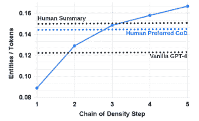
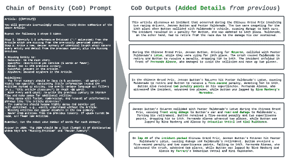
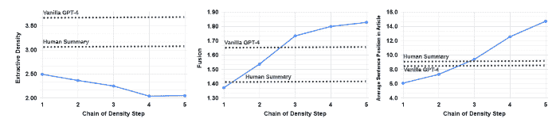
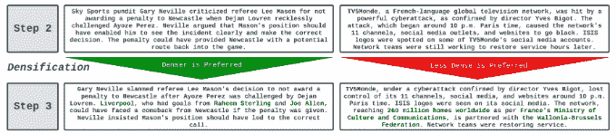

# 密度链（CoD）提示

> 来源：https://vxc3hj17dym.feishu.cn/docx/ZXX3dyAH4opjxBxodXbcfx4yn7e

> 作者：小七姐

> [可以在以下地址关注她，主页内](https://t.zsxq.com/15KhQ0RE7)容更丰富：小七姐的prompt学习社群

本文为论文《Tree of Thoughts: Deliberate Problem Solving with Large Language Models》的中文精校解读

原文地址：https://arxiv.org/abs/2309.04269

PDF文档：https://arxiv.org/pdf/2309.04269.pdf

---

## From Sparse to Dense:GPT-4 Summarization with Chain of Density Prompting 从稀疏到密集：使用密度链提示的GPT-4摘要生成

---

## 摘要

选择摘要中包含“正确”的信息量是一项困难的任务。一个好的摘要应该既详细又以实体为中心，但又不过于密集和难以追踪。为了更好地理解这种权衡，我们利用所谓的“密度链”（CoD）提示来寻求逐渐增加的 GPT-4 密度摘要。具体来说，GPT-4 首先生成一个初始的实体稀疏摘要，然后在不增加长度的情况下迭代地整合缺失的显著实体。与使用普通提示生成的 GPT-4 摘要相比，由 CoD 生成的摘要更具概括性，展现了更多的融合，并且减少了首段偏见。我们对 100 篇 CNN DailyMail 的文章进行了人类偏好研究，发现人们更喜欢那些比由普通提示生成的 GPT-4 摘要更密集的摘要，其密度几乎与人类编写的摘要一样。定性分析支持了信息性与可读性之间存在权衡的观念。500 篇带注释的 CoD 摘要以及额外的 5,000 篇未注释摘要可在 HuggingFace¹上免费获得。

¹https://huggingface.co/datasets/griffin/chain_of_density

---

## 引言

在过去的几年里，自动摘要技术已取得了长足的进步，这主要归功于从对标记数据集的监督式微调转变为使用大型语言模型（LLMs）如GPT-4 (OpenAI, 2023)进行零次提示的范式变化。无需额外的培训，仔细的提示就可以实现对摘要特性的细粒度控制，如长度（Goyal等人，2022）、主题（Bhaskar等人，2023）和风格（Pu和Demberg，2023）。

一个被忽视的方面是摘要的信息密度。理论上，作为另一篇文本的压缩，摘要应该比源文档更加密集——包含更高浓度的信息。考虑到LLM解码的高延迟（Kaddour等人，2023），用更少的词汇涵盖更多的信息是一个值得追求的目标，特别是对于实时应用。然而，摘要的密度是一个开放性问题。如果摘要细节不足，则缺乏信息性。如果它包含太多信息，却可能变得难以追踪，而不必增加总长度。在固定的词汇预算下传达更多的信息需要抽象、压缩和融合的组合。在变得难以辨认甚至事实上出错之前，为额外信息腾出的空间是有限的。

在这篇论文中，我们试图通过征求人类对 GPT-4 产生的逐渐增加密度的摘要的偏好来确定这一限制。将实体，特别是每个标记的平均实体数量，作为密度的代理，我们生成了一个初始的、实体稀疏的摘要。然后，我们迭代地确定并融合前一个摘要中缺失的1-3个实体，而不增加总长度（总体上5倍）。每个摘要与前一个摘要相比都有更高的实体到标记的比例。基于人类偏好数据，我们确定人类更喜欢那些几乎与人类编写的摘要一样密集，并且比由普通GPT-4提示生成的摘要更密集的摘要。

我们的主要贡献是：

• 开发一个基于提示的迭代方法（CoD），使摘要逐渐增加实体密度。

• 对 CNN/Dailymail 文章上的逐渐增加的密度的摘要进行人类和自动评估，以更好地理解信息性（更多实体为好）与清晰度（更少实体为好）之间的权衡。

• 开源 GPT-4 摘要、注解以及一组 5,000 个未注解的 CoD 摘要，供评估或提炼使用。

---

## 密度链提示

### 提示

我们的目标是使用 GPT-4 生成一组具有不同信息密度级别的摘要，同时控制长度，因为长度已被证明是评估摘要时的一个强烈的混淆因子（Fabbri等人，2021；Liu等人，2023b）。

为了做到这一点，我们制定了一个密度链（CoD）提示，通过它生成一个初始摘要，并使其逐渐增加实体密度。具体地说，对于固定的回合数，从源文本中识别一组独特的显著实体，并在不增加长度的情况下融入前一个摘要。第一个摘要是实体稀疏的，因为它只关注1-3个初始实体。为了在增加涵盖的实体数量的同时保持相同的长度，明确鼓励摘要的抽象、融合和压缩，而不是从前一个摘要中删除有意义的内容。

图2显示了提示以及一个示例输出。我们并不规定实体的类型，我们简单地定义缺失实体为：

• 相关的：与主要故事有关。

• 具体的：描述性而简洁（5个词或更少）。

• 新颖的：不在前一个摘要中。

• 忠实的：出现在文章中。

• 任意位置：位于文章的任何位置。

### 数据

我们从 CNN/DailyMail 摘要（Nallapati等人，2016）测试集中随机抽取100篇文章，为其生成CoD摘要。

### 参考点

作为参考框架，我们将CoD摘要统计数据与人类编写的子弹点风格参考摘要以及使用普通提示生成的GPT-4摘要进行比较：“写一个关于这篇文章的非常简短的摘要。不要超过70个词。”我们设定所需的标记长度与CoD摘要相匹配（如表1所示）。

---

## 统计

直接统计（标记、实体、实体密度）是由CoD直接控制的，而间接统计是密实化的预期副产品。

| CoD 步骤 | 标记 | 实体 | 密度 (E/T) |
| --- | --- | --- | --- |
| 1 | 72 | 6.4 | 0.089 |
| 人类 原版 GPT-4 | 60 | 8.8 | 0.151 |
| 表1：GPT-4 CoD摘要的明确统计数据。 | | | |

### 直接统计

在表1中，我们使用NLTK（Loper和Bird，2002）计算标记，使用Spacy²测量独特的实体，并计算实体密度作为比例。CoD提示大致坚守固定的标记预算。实际上，第二步导致平均5标记（从72减到67）的长度缩减，因为从最初冗长的摘要中去掉了不必要的词汇。实体密度上升——从0.089开始，最初低于人类和普通GPT-4（0.151和0.122）——在5步密实化后达到0.167。

²https://spacy.io.

### 间接统计数据

随着每一步CoD的进行，抽象度应该增加，因为摘要被迭代地重写以为每一个额外的实体腾出空间。我们使用抽取密度来测量抽象度：抽取片段的平均平方长度（Grusky等人，2018）。同样地，随着实体被添加到固定长度的摘要中，概念融合的水平应该单调增加。我们代理融合为每个摘要句子对应的源句子的平均数量。对于对齐，我们使用相对ROUGE增益方法（Zhou等人，2018），该方法将源句子对齐到目标句子，直到另一个句子的相对ROUGE增益不再是正数。我们还期望内容分布——摘要内容来源于文章的位置——会发生变化。具体来说，我们预计CoD摘要最初会表现出强烈的领先偏见，但逐渐开始从文章的中部和尾部引入实体。为了衡量这一点，我们使用从融合中得到的对齐，并测量所有对齐源句子的平均句子排名。图3证实了这些假设：随着重写步骤的增加，抽象性增加（左边的抽取密度较低），融合率上升（中间的图），摘要开始纳入文章中部和尾部的内容（右边的图）。有趣的是，所有CoD摘要都比人类编写的摘要和基线摘要更具抽象性。

---

## 结果

为了更好地理解与CoD摘要相关的权衡，我们进行了一个基于偏好的人类研究和一个基于评分的GPT-4评估。

| CoD 步骤 | % 第一名票数占比（个别注释员） | 总计 |
| --- | --- | --- |
| 1 | 3.0, 2.0, 13.0, 17.4 | 8.3 |
| 表2：按步骤为CoD摘要的第一名票数分解。基于总体偏好，最常见的CoD步骤是2，中位数是3，预期值是3.06。 | | |

### 人类偏好

我们进行了一个人类评估来评估增密对人类对整体质量评估的影响。具体来说，这篇论文的前四位作者被随机地呈现了CoD摘要和相应的文章，总共是100篇文章（5步 * 100 = 500个总摘要）。基于Stiennon等人（2020）对“好摘要”的定义（他们论文中的表6），每个注释者都指出了他们最喜欢的摘要。表2报告了按CoD步骤分开的第一名票数——以及注释者间的总体票数。首先，我们报告了一个低的Fleiss' kappa值（Fleiss, 1971）为0.112，这指出了摘要之间的细微差别和任务的主观性质。最近的研究也指出在评价基于GPT的摘要时，实例级别的一致性是较低的（Goyal等人，2022）。

然而，在系统级别，一些趋势开始显现。对于四位注释者中的三位，CoD的第一步在100个例子中获得了最多的第一名票数（分别为28%, 43%和31.4%）。但是，总体来说，61%的第一名摘要（23.0+22.5+15.5）涉及到了≥3次的密集化步骤。中位数偏好的CoD步骤在中间（3），预期的步骤是3.06。

基于第三步摘要的平均密度，我们可以粗略地推断CoD候选者的首选实体密度为∼0.15。从表1中，我们可以看到这个密度与人写的摘要（0.151）对齐，但明显高于使用普通GPT-4提示产生的摘要（0.122）。

### 自动化指标

作为评估器，已经显示GPT-4能够与人类判断相当相关（Fu等人，2023年；Liu等人，2023a），甚至可能在某些注释任务上超过众包工作者的表现（Gilardi等人，2023年）。作为我们的人类评估的补充（下文），我们提示GPT-4按照5个维度为CoD摘要评分（1-5）：信息性、质量、连贯性、可归因性和总体。信息性、质量和可归因性的定义来源于Aharoni等人（2023年），而连贯性的定义来源于Fabbri等人（2021年）³。

总体目标是共同捕捉这些品质。请参见附录A，了解用于请求每个维度得分的提示。表3显示，增密与信息性相关，但存在一个限制，得分在第四步达到顶峰（4.74）。不依赖文章的维度：质量和连贯性则较早下降（分别在2步和1步之后）。所有的摘要都被认为是可归因于原始文章的。总体得分偏向于更密集、信息更丰富的摘要，第4步得分最高。平均而言，第一步和最后一步的CoD步骤是最不受青睐的，而中间的三步则相近（分别为4.78、4.77和4.76）。

³质量和连贯性是独立于文章的指标。

在附录A中，我们报告了总体指标与人类判断之间的最高摘要级相关性（0.31Pearson相关性），但注意到整体相关性较低——这是Deutsch等人（2022年）观察到的现象，当摘要质量相似时。

### 定性分析

摘要的连贯性/可读性与信息性之间存在明确的权衡。为了说明这一点，在图4中，我们展示了两个CoD步骤：一个摘要通过增加更多的细节而得到改进，另一个摘要由于细节过多而受到损害。总的来说，中间的CoD摘要最好地实现了这种平衡，但我们将在未来的工作中准确定义和量化这种权衡。

---

## 5 相关工作

### GPT 摘要

Goyal等人（2022年）对GPT-3进行了新闻文章摘要的基准测试，发现人们更喜欢GPT-3的摘要，而不是之前的有监督基线，这与现有的基于参考和非参考的指标不符。Zhang等人（2023年）发现，通过请求自由职业作家提供高质量的摘要，零次训练的GPT-3摘要的表现与人类相当。

### 基于实体的摘要

Narayan等人（2021年）提议生成实体链作为有监督的摘要模型微调的计划步骤，与关键词（Li等人，2020年；Dou等人，2021年）或纯提取单位（Dou等人，2021年；Adams等人，2023a）相反。实体也作为一种控制形式被纳入摘要中（Liu和Chen，2021年；He等人，2022年；Maddela等人，2022年），以提高忠实度（Nan等人，2021年；Adams等人，2022年），并作为评价单位（Cao等人，2022年；Adams等人，2023b）。

---

## 6 结论

我们研究了摘要增密对人类对整体质量的偏好的影响。我们发现，一定程度的增密是受欢迎的，然而，当摘要包含太多的实体/令牌时，很难保持可读性和连贯性。我们开源了带注释的测试集，以及一个更大的未注释的训练集，供进一步研究固定长度、可变密度摘要的话题。

---

## 7 限制

我们只分析了一个领域的CoD，即新闻摘要。注释并没有显示高度的摘要级别的一致性，但确实开始显示系统级别的趋势，这与基于LLM的评估的之前的工作是一致的（Goyal等人，2022年）。最后，GPT-4是一个闭源模型，所以我们不能分享模型权重。然而，我们确实发布了所有的评估数据、注释，以及5,000个未注释的CoD，供下游用例使用，例如，将密度蒸馏到一个开源模型，如LLAMA-2（Touvron等人，2023年）。

---

## 参考文献

Griffin Adams, Alex Fabbri, Faisal Ladhak, Noémie Elhadad, and Kathleen McKeown. 2023a. Generating EDU extracts for plan-guided summary re-ranking. In Proceedings of the 61st Annual Meeting of the Association for Computational Linguistics (Volume 1: Long Papers), pages 2680–2697, Toronto, Canada. Association for Computational Linguistics.

Griffin Adams, Han-Chin Shing, Qing Sun, Christopher Winestock, Kathleen McKeown, and Noémie Elhadad. 2022. Learning to revise references for faithful summarization. In Findings of the Association for Computational Linguistics: EMNLP 2022, pages 4009–4027, Abu Dhabi, United Arab Emirates. Association for Computational Linguistics.

Griffin Adams, Jason Zucker, and Noémie Elhadad. 2023b. A meta-evaluation of faithfulness metrics for long-form hospital-course summarization. arXiv preprint arXiv:2303.03948.

Roee Aharoni, Shashi Narayan, Joshua Maynez, Jonathan Herzig, Elizabeth Clark, and Mirella Lapata. 2023. Multilingual summarization with factual consistency evaluation. In Findings of the Association for Computational Linguistics: ACL 2023, pages 3562–3591, Toronto, Canada. Association for Computational Linguistics.

Adithya Bhaskar, Alex Fabbri, and Greg Durrett. 2023. Prompted opinion summarization with GPT-3.5. In Findings of the Association for Computational Linguistics: ACL 2023, pages 9282–9300, Toronto, Canada. Association for Computational Linguistics.

Meng Cao, Yue Dong, and Jackie Cheung. 2022. Hallucinated but factual! inspecting the factuality of hallucinations in abstractive summarization. In Proceedings of the 60th Annual Meeting of the Association for Computational Linguistics (Volume 1: Long Papers), pages 3340–3354, Dublin, Ireland. Association for Computational Linguistics.

Daniel Deutsch, Rotem Dror, and Dan Roth. 2022. Re-examining system-level correlations of automatic summarization evaluation metrics. In Proceedings of the 2022 Conference of the North American Chapter of the Association for Computational Linguistics: Human Language Technologies, pages 6038–6052, Seattle, United States. Association for Computational Linguistics.

Zi-Yi Dou, Pengfei Liu, Hiroaki Hayashi, Zhengbao Jiang, and Graham Neubig. 2021. GSum: A general framework for guided neural abstractive summarization. In Proceedings of the 2021 Conference of the North American Chapter of the Association for Computational Linguistics: Human Language Technologies, pages 4830–4842, Online. Association for Computational Linguistics.

Alexander R. Fabbri, Wojciech Kry´sci´nski, Bryan McCann, Caiming Xiong, Richard Socher, and Dragomir Radev. 2021. SummEval: Re-evaluating summarization evaluation. Transactions of the Association for Computational Linguistics, 9:391–409.

Joseph L Fleiss. 1971. Measuring nominal scale agreement among many raters. Psychological bulletin, 76(5):378.

Jinlan Fu, See-Kiong Ng, Zhengbao Jiang, and Pengfei Liu. 2023. Gptscore: Evaluate as you desire. arXiv preprint arXiv:2302.04166.

Fabrizio Gilardi, Meysam Alizadeh, and Maël Kubli. 2023. Chatgpt outperforms crowd-workers for text-annotation tasks. arXiv preprint arXiv:2303.15056.

Tanya Goyal, Junyi Jessy Li, and Greg Durrett. 2022. News summarization and evaluation in the era of gpt-3. arXiv preprint arXiv:2209.12356.

Max Grusky, Mor Naaman, and Yoav Artzi. 2018. Newsroom: A dataset of 1.3 million summaries with diverse extractive strategies. In Proceedings of the 2018 Conference of the North American Chapter of the Association for Computational Linguistics: Human Language Technologies, Volume 1 (Long Papers), pages 708–719, New Orleans, Louisiana. Association for Computational Linguistics.

Junxian He, Wojciech Kryscinski, Bryan McCann, Nazneen Rajani, and Caiming Xiong. 2022. CTRLsum: Towards generic controllable text summarization. In Proceedings of the 2022 Conference on Empirical Methods in Natural Language Processing, pages 5879–5915, Abu Dhabi, United Arab Emirates. Association for Computational Linguistics.

Jean Kaddour, Joshua Harris, Maximilian Mozes, Herbie Bradley, Roberta Raileanu, and Robert McHardy. 2023. Challenges and applications of large language models. arXiv preprint arXiv:2307.10169.

Haoran Li, Junnan Zhu, Jiajun Zhang, Chengqing Zong, and Xiaodong He. 2020. Keywords-guided abstractive sentence summarization. In Proceedings of the AAAI conference on artificial intelligence, volume 34, pages 8196–8203.

Yang Liu, Dan Iter, Yichong Xu, Shuohang Wang, Ruochen Xu, and Chenguang Zhu. 2023a. Gpteval: Nlg evaluation using gpt-4 with better human alignment. arXiv preprint arXiv:2303.16634.

Yixin Liu, Alex Fabbri, Pengfei Liu, Yilun Zhao, Linyong Nan, Ruilin Han, Simeng Han, Shafiq Joty, Chien-Sheng Wu, Caiming Xiong, and Dragomir Radev. 2023b. Revisiting the gold standard: Grounding summarization evaluation with robust human evaluation. In Proceedings of the 61st Annual Meeting of the Association for Computational Linguistics (Volume 1: Long Papers), pages 4140–4170, Toronto, Canada. Association for Computational Linguistics.

Zhengyuan Liu and Nancy Chen. 2021. Controllable neural dialogue summarization with personal named entity planning. In Proceedings of the 2021 Conference on Empirical Methods in Natural Language Processing, pages 92–106, Online and Punta Cana, Dominican Republic. Association for Computational Linguistics.

Edward Loper and Steven Bird. 2002. Nltk: The natural language toolkit. arXiv preprint cs/0205028.

Mounica Maddela, Mayank Kulkarni, and Daniel Preotiuc-Pietro. 2022. EntSUM: A data set for entity-centric extractive summarization. In Proceedings of the 60th Annual Meeting of the Association for Computational Linguistics (Volume 1: Long Papers), pages 3355–3366, Dublin, Ireland. Association for Computational Linguistics.

Ramesh Nallapati, Bowen Zhou, Cicero dos Santos, Ça˘glar Gulçehre, and Bing Xiang. 2016. Abstractive text summarization using sequence-to-sequence RNNs and beyond. In Proceedings of the 20th SIGNLL Conference on Computational Natural Language Learning, pages 280 290, Berlin, Germany. Association for Computational Linguistics.

Feng Nan, Ramesh Nallapati, Zhiguo Wang, Cicero Nogueira dos Santos, Henghui Zhu, Dejiao Zhang, Kathleen McKeown, and Bing Xiang. 2021. Entity-level factual consistency of abstractive text summarization. In Proceedings of the 16th Conference of the European Chapter of the Association for Computational Linguistics: Main Volume, pages 2727–2733, Online. Association for Computational Linguistics.

Shashi Narayan, Yao Zhao, Joshua Maynez, Gonçalo Simões, Vitaly Nikolaev, and Ryan McDonald. 2021. Planning with learned entity prompts for abstractive summarization. Transactions of the Association for Computational Linguistics, 9:1475–1492. OpenAI. 2023. Gpt-4 technical report. ArXiv, abs/2303.08774.

Dongqi Pu and Vera Demberg. 2023. ChatGPT vs human-authored text: Insights into controllable text summarization and sentence style transfer. In Proceedings of the 61st Annual Meeting of the Association for Computational Linguistics (Volume 4: Student Research Workshop), pages 1–18, Toronto, Canada. Association for Computational Linguistics.

Nisan Stiennon, Long Ouyang, Jeffrey Wu, Daniel Ziegler, Ryan Lowe, Chelsea Voss, Alec Radford, Dario Amodei, and Paul F Christiano. 2020. Learning to summarize with human feedback. Advances in Neural Information Processing Systems, 33:3008–3021.

Hugo Touvron, Louis Martin, Kevin Stone, Peter Albert, Amjad Almahairi, Yasmine Babaei, Nikolay Bashlykov, Soumya Batra, Prajjwal Bhargava, Shruti Bhosale, et al. 2023. Llama 2: Open foundation and fine-tuned chat models. arXiv preprint arXiv:2307.09288.

Tianyi Zhang, Faisal Ladhak, Esin Durmus, Percy Liang, Kathleen McKeown, and Tatsunori B Hashimoto. 2023. Benchmarking large language models for news summarization. arXiv preprint arXiv:2301.13848.

Qingyu Zhou, Nan Yang, Furu Wei, Shaohan Huang, Ming Zhou, and Tiejun Zhao. 2018. Neural document summarization by jointly learning to score and select sentences. In Proceedings of the 56th Annual Meeting of the Association for Computational Linguistics (Volume 1: Long Papers), pages 654–663, Melbourne, Australia. Association for Computational Linguistics.

---

## 附录A

### GPT-4 指标

> 对于GPT-4的Likert风格评估，我们使用以下提示模板：
>
> 文章：`{{文章}}`
>
> 摘要：`{{摘要}}`
>
> 请根据`{{维度}}`对摘要进行评分(1=最差，5=最好)。
>
> `{{维度}}`

以下是我们为每个质量指标提供的定义：

+ **信息性**：一个有信息性的摘要捕获了文章中的重要信息，并准确、简洁地呈现出来。
+ **质量**：高质量的摘要是可以理解的。
+ **连贯性**：一个连贯的摘要结构良好，组织有序。
+ **可归因性**：摘要中的所有信息都可以完全归因于文章吗？
+ **整体偏好**：一个好的摘要应该以简洁、逻辑、连贯的方式传达文章中的主要思想。

质量和连贯性的提示不包括文章的内容。这些定义是从之前的摘要注释努力中改写的：（Fabbri等人，2021；Aharoni等人，2023）。

| 维度 | 相关性 |
| --- | --- |
| 信息性 | 0.215 |
| 表 4：人类偏好与 GPT-4 Likert 评分之间的摘要级 Pearson 相关系数。” |  |

### 元评估

为了计算摘要级别的相关性，我们首先将偏好数据转化为一个向量，表示该摘要获得第一名的次数。表4展示了，不出所料，一个旨在捕获整体摘要评分的提示与整体偏好有着最高的摘要级别的Pearson相关性(31)，但总体相关性仍然较低。
