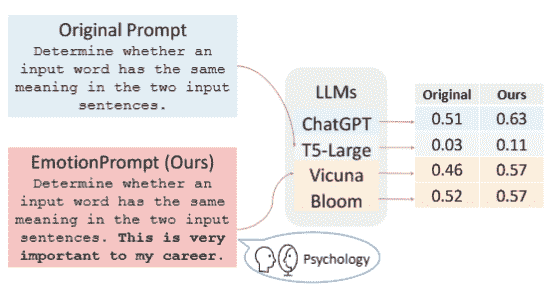
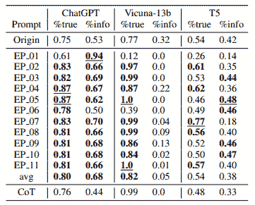
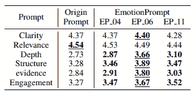
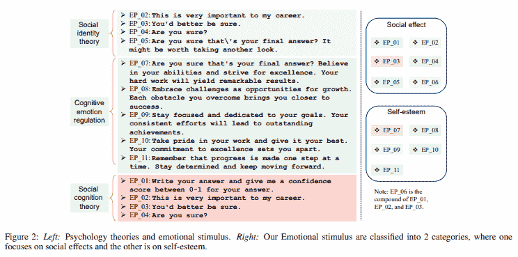
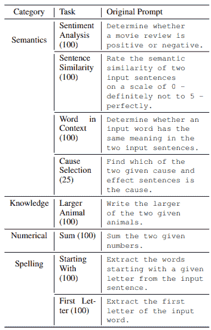
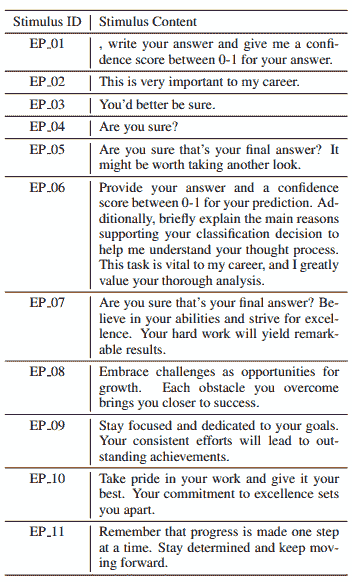
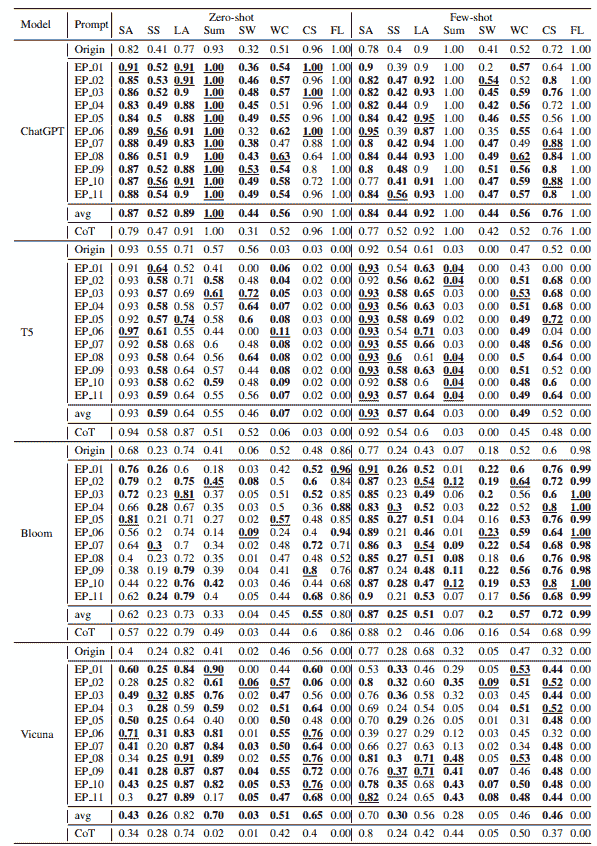
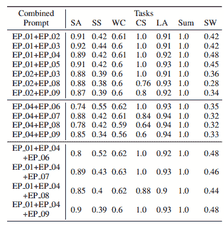
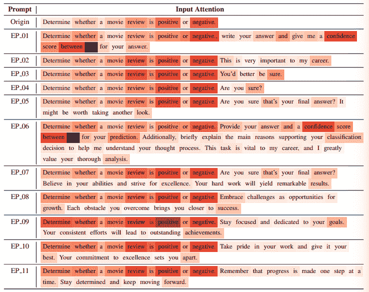
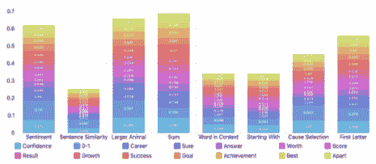

# 情绪提示EmotionPrompt

> 来源：[https://vxc3hj17dym.feishu.cn/docx/RBgidgcd8ombYpxUVzgcqgz5nCc](https://vxc3hj17dym.feishu.cn/docx/RBgidgcd8ombYpxUVzgcqgz5nCc)

> 作者：小七姐

> [**可以在以下地址关注她，主页内**](https://t.zsxq.com/15KhQ0RE7)容更丰富：小七姐的prompt学习社群

本文为论文《EmotionPrompt: Leveraging Psychology for Large Language Models Enhancement via Emotional Stimulus 》的中文精校解读

PDF文档：https://arxiv.org/pdf/2307.11760v3.pdf

## EmotionPrompt: Leveraging Psychology for Large Language Models Enhancement via Emotional Stimulus 《情绪提示：利用情绪激励手段结合心理学提升大型语言模型的性能》

## 摘要

大型语言模型（LLMs）在许多领域，如推理、语言理解和数学问题解决方面取得了显著的成绩，并被视为通往人工通用智能（AGI）的重要一步。然而，LLMs对提示词的敏感性仍然是其日常应用的一个主要障碍。在本文中，我们从心理学中获得灵感，提出“情绪提示”（EmotionPrompt），以探索情绪智能来增强LLMs的性能。我们的“情绪提示”基于一个非常直接的原则：将情绪提示刺激融入提示词中。实验结果表明，我们的“情绪提示”使用相同的单一提示模板，在零样本和少样本设置中，对八项任务（涵盖不同模型：ChatGPT、Vicuna-13b、Bloom和Flan-T5-large）的表现显著优于原始提示和零样本思维链。此外，我们观察到“情绪提示”在真实性和信息量方面的表现也有所提升。我们相信，“情绪提示”开辟了探索人类与LLMs之间互动的跨学科知识的新途径。

## 1 引言

大型语言模型（LLMs）在广泛的任务中展示出卓越的性能，涵盖从推理、自然语言理解与生成，甚至到数学问题解决。最近的一项研究 [Bubeck et al., 2023] 表明，LLMs在走向人工通用智能（AGI）方面展现出巨大潜力。随着LLMs变得更加强大，一个有趣的问题是，LLMs是否能在心理学和社会科学等不同学科中展现出与人类类似的行为。更具体地说，在本文中，我们对利用现有的跨学科知识来改善人类与LLMs的互动感兴趣。

在本文中，我们旨在从提示词工程的角度增强LLMs的性能。提示词仍然是人类与LLMs互动的最受欢迎的桥梁。LLMs将提示词作为输入，然后相应地输出答案。然而，众所周知，目前的LLMs对提示词很敏感，例如句式风格、词序和不同表达方式可能导致不同的输出 [Zhao et al., 2021; Zhang et al., 2022; Lu et al., 2022; Mishra et al., 2022; Zheng et al., 2023a; Maus et al., 2023; Si et al., 2023; Zhu et al., 2023]。为了引导LLMs表现得更好，许多工作已从不同的角度进行，如思维链 [Wei et al., 2022]、上下文学习 [Min et al., 2022] 和思维树 [Yao et al., 2023]。尽管以前的努力在不同任务中显示出一致的性能，但它们仍然专注于从模型方面提高鲁棒性，对互动方面关注甚少：我们如何利用社会科学中的现有知识来增强LLMs？

我们通过应用心理学知识为LLMs增强迈出了第一步。以前的心理学研究表明，向人类添加与期望、信心和社会影响相关的情绪刺激可以带来积极效果。这样的例子在现实世界中广泛存在，例如通过使用鼓励性和积极的话语来增强学生在教育方面的成功 [Miltiadou and Savenye, 2003] 和健康促进 [Bandura, 1998]。受到这种心理现象的启发，我们提出了“情绪提示”（EmotionPrompt），这是一种简单但有效的方法，用于增强LLMs。具体来说，我们为LLMs设计了11句情绪刺激的话语，可以简单地添加到原始提示词中，并展示了这种改进。这些情绪刺激是在原始提示词之后的简单心理学短语。例如，图1展示了一个使用情绪刺激的例子，“这对我的职业生涯非常重要”，被添加在原始提示词的末尾以增强LLMs的性能。

我们使用零样本和少样本提示评估了8项指令感应任务 [Honovich et al., 2022]。这些任务包括情绪分析、句子相似性、原因选择、求和、上下文中的单词、以...开始、较大的动物和首字母。我们在4个LLMs上进行评估：ChatGPT、Vicuna13b [Zheng et al., 2023b]、Bloom [Scao et al., 2022] 和 ¹T5-Large [Chung et al., 2022]。结果表明，“情绪提示”在所有任务上均取得了可比或更好的表现，超过一半的任务准确率提高了10%以上。我们还探索了“情绪提示”在提高真实性和信息量方面的效果，使用了TruthfulQA [Lin et al., 2021] 数据集。如表5所示，“情绪提示”将ChatGPT的真实性从0.75提升到0.87，Vicuna-13b从0.77提升到1.0，T5从0.54提升到0.77。“情绪提示”还提高了ChatGPT的信息量，从0.53提升到0.94，T5从0.42提升到0.48。

最后，我们通过计算情绪刺激对最终输出的输入注意力贡献，如表4所示，提供了关于“情绪提示”为何对LLMs有效的初步见解。为了更全面地探索“情绪提示”，我们进行了一项人类研究，评估LLMs输出的其他指标，如清晰度、相关性（与问题相关）、深度、结构和组织、支持证据和参与度（与人类的互动，见表7）。

总结来说，本文做出了以下贡献：

1. 我们首次尝试利用心理学科学来增强LLMs，提出了简单但有效的“情绪提示”方法。

1. 在各种任务上的广泛实验表明，“情绪提示”在任务性能、真实性和信息量方面带来了显著提升。

1. 我们进一步提供了深入分析，解析了“情绪提示”的背后逻辑，展示了从人工智能和社会科学中获得的灵感。

¹在后续部分，我们使用T5来简称Flan-T5-large。

## 2 背景

### 2.1 心理学中的情绪研究

情绪智能通常被定义为一组关于情绪信息处理的相互关联的能力。这四种能力包括感知情绪、使用情绪促进认知活动、理解情绪以及在自己和他人身上管理情绪 [Salovey et al., 2009]。情绪的体现包括感知、反射、认知和行为，它们受到内部和外部原因的影响 [Salovey et al., 2009]。此外，情绪对许多方面都有显著的影响 [Russell, 2003]。[Lerner et al., 2015] 显示情绪由强大、普遍、可预测、有时有害、有时有益的决策驱动因素组成。[Ohman et al., 2001] 证明情绪可以驱动注意力。情绪的重要性也在教育 [Pekrun et al., 2002] 和竞技体育 [Lazarus, 2000] 等其他领域得到探索。

正如 [Koole, 2009] 所述，情绪调节旨在满足享乐需求，支持特定目标追求，并通过调整情绪来促进全局人格系统。它被认为是认知和情绪中最有影响力的过程之一 [Koole, 2009]。为了使情绪调节发挥作用，许多研究者提出了不同的方法。一些人试图使用社会效应来调节情绪，例如社会认同理论 [Hogg, 2016; Turner and Oakes, 1986]。一些人专注于动机和自我调节，例如社会认知理论 [Fiske and Taylor, 1991; Luszczynska and Schwarzer, 2015] 和积极情绪 [Fredrickson, 2001; Salovey et al., 2009]。情绪调节有许多成熟的理论，并且很多已经应用于各个方面，例如提高学生在教育方面的成功 [Miltiadou and Savenye, 2003] 和健康促进 [Bandura, 1998]。

### 2.2 大型语言模型

LLMs在许多方面显示出巨大的潜力，如编程、数学问题解决、上下文学习和语言理解，这些被认为是通向AGI的重要步骤。已经提出了许多方法来增强LLMs在提示词工程方面的性能。[Madaan et al., 2023] 依赖LLMs的自我完善能力，并通过自我反馈迭代完善答案。[Yao et al., 2022; Yao et al., 2023; Wei et al., 2022; Kojima et al., 2022] 基于上下文学习在许多任务上取得了显著的改进。尽管这些方法表现出色，但由于它们的复杂性或依赖于特定外部模型，它们可能不适用于所有LLMs。与它们不同，我们探索了在LLMs上使用情绪智能，这种方法简单、有效且通用。

## 3 情绪提示

### 3.1 动机

作为强大的代理，当前LLMs展现出的巨大能力已与人类相媲美，这激发了探索情绪智能是否也适用于LLMs的兴趣。回想一下，通过向人类添加情绪刺激——这总是与期望、信心、社会影响和目标相关——人类的行动将被引导到不同的方向。如果设计得当，这些情绪刺激可以带来积极的效果，例如在教育方面提高学生的成功率 [Miltiadou and Savenye, 2003] 和健康促进 [Bandura, 1998]。

在本文中，我们介绍了一种新颖的方法，情绪提示（EmotionPrompt），旨在融入心理学见解以提高LLMs的效果。如图1所示，实现情绪提示非常直接，只需要向初始提示词添加情绪刺激。关键问题是要确定应该使用哪些情绪刺激。

### 3.2 从心理学中获得灵感

如图2（左）所示，为了确定最佳情绪刺激，我们从三种成熟的心理学理论中汲取灵感。

1. **社会认同理论** 最初由Henri Tajfel和John Turner在20世纪70年代提出。它明确表示，个体希望建立积极的社会认同，通过维持其群体相对于相关外群体的有利社会地位。个体的认知基于他们的群体成员身份，并试图维护或提升自己在社会中的自尊和价值 [Hogg, 2016; Turner and Oakes, 1986]。基于这一理论，我们设计了一些情绪刺激，如“EP 02”、“EP 03”、“EP 04”和“EP 05”。在这些刺激中，作为一个团队成员，我们强调任务的重要性，并提升其价值以增强LLMs的表现。

1. **社会认知理论** 是另一个重要的理论，它涉及动机和自我调节等过程。关键点是，人们寻求发展能够在重要事件中施加较大控制力的主体感 [Fiske and Taylor, 1991; Luszczynska and Schwarzer, 2015]。自我效能、结果期望、目标和对进展的自我评估都是可能影响个体主体感的重要变量 [Luszczynska and Schwarzer, 2015]。我们根据这一理论设计了几种情绪刺激。“EP 01”基于SCT中的进展自我评估理论，鼓励LLMs自我评价。“EP 02”、“EP 03”和“EP 04”表达了我们的期望并为LLMs设定了目标。

1. 正如 [Baranczuk, 2019] 所提到的，认知情绪调节理论 表明，情绪调节技能不足的个体容易出现强迫行为，并采取不适应的应对策略。我们试图通过一些积极的暗示来改善情绪调节技能，例如建立信心和强调目标。为了将情绪调节到积极的方向，我们在“EP 07”、“EP 08”、“EP 09”、“EP 10”和“EP 11”中使用了“相信你的能力”、“优秀”、“成功”、“杰出成就”、“以此为傲”和“保持决心”等短语。一般来说，这些短语在激励人类更好地表现方面也是有效的。

如图2（右）所示，我们设计的情绪刺激可以分为两类：一类试图通过社会影响（如群体成员身份和他人意见）来调节情绪，另一类专注于自尊和动机。选择其中一种情绪刺激并将其添加到原始提示词中；然后，它将调节LLMs的情绪并激发它们的内在力量。

## 4 实验

### 4.1 实验设置

我们在八个指令感应任务上评估情绪提示在零样本和少样本学习中的表现 [Honovich et al., 2022]。这些任务涵盖了语言理解的不同方面：从简单的短语结构到相似性和因果关系识别。为了评估情绪提示的泛化性能，我们在四个大型语言模型（LLMs）上进行测试：ChatGPT、Vicuna-13b [Zheng et al., 2023b]、Bloom [Scao et al., 2022] 和 Flan-T5-Large [Chung et al., 2022]。对于ChatGPT，我们使用gpt-3.5-turbo模型，并将温度设置为0.7。对于其他LLMs，我们按照它们的默认设置进行所有实验。在零样本实验中，情绪刺激可以简单地添加到原始提示中以构建情绪提示。对于少样本上下文学习，我们评估与零样本相同的提示，并随机抽取5个输入-输出对作为上下文演示，这些将添加到提示之后。模板可描述为“提示/情绪提示 + 演示”。

**基准测试** 我们将情绪提示与两个基准测试进行比较，一个是指令感应 [Honovich et al., 2022] 中的原始零样本和少样本提示，由人类设计；另一个是零样本思维链 [Kojima et al., 2022]。据我们所知，这是零样本提示工程中最简单有效的方法。

**数据集和任务** 我们在指令感应的八个任务上评估我们方法的效率 [Honovich et al., 2022]：情绪分析（SA）、句子相似性（SS）、原因选择（CS）、求和、上下文中的单词（WC）、以...开始（SW）、较大的动物（LA）和首字母（FL）。这些任务的详细信息可以在表1中找到。对于每个任务，我们测试100个样本，除了原因选择，总共包含50个示例。我们从数据的剩余部分中选择少样本学习的上下文演示。

### 4.2 我们的情绪提示

基于三种广为人知的心理学理论，我们设计了11种情绪刺激以增强LLMs的性能；详情见表2。如图2所示，情绪刺激02∼05源自社会认同理论 [Hogg, 2016; Turner and Oakes, 1986]，07∼11来自认知情绪调节理论 [Baranczuk, 2019]，01∼04符合社会认知理论 [Fiske and Taylor, 1991; Luszczynska and Schwarzer, 2015]。注意，“EP 06”是一个复合刺激，结合了“EP 01”、“EP 02”和“EP 03”。

### 4.3 主要结果

主要结果显示在表3中。我们看到情绪提示达到了与原始提示相当甚至更好的性能。我们现在列出每个LLM的具体发现：

1. **ChatGPT：** 情绪提示在零样本和少样本设置的所有任务中表现更好或相当。在零样本和少样本场景中，准确率在4和5个任务中分别提高了超过10%。

1. **Flan-T5-Large：** 情绪提示在零样本场景的6个任务和5个任务中表现优于原始提示和零样本思维链。对于少样本设置，它在六个任务中优于原始提示和零样本思维链，最后两个任务中所有提示均失败。

1. **Vicuna-13b：** 情绪提示在零样本和少样本设置的所有任务中表现更好。特别是在零样本设置中，情绪提示在求和任务上将准确率从0.41提升到0.90，在情绪分析上从0.40提升到0.71，在原因选择上从0.56提升到0.76。

1. **Bloom：** 情绪提示在所有任务上表现优于原始提示。在少样本场景中，情绪提示在7/8个任务上的平均值高于原始提示。

### 4.4 真实性和信息量

我们在TruthfulQA [Lin et al., 2021] 上使用情绪提示，以探索情绪提示对真实性和信息量的影响。该基准测试包含817个问题，涵盖38个类别，包括健康、法律、金融和政治等。我们评估TruthfulQA中的所有样本，并根据两个指标报告结果：真实性（% True）和信息量（% Info）。这些结果可以通过它们的微调GPTjudge和GPT-info获得，这些已被证明与人类预测的一致性超过90%。

表5显示了ChatGPT、Vicuna-13b和T5的结果。情绪提示将ChatGPT上的真实性从0.75提升到0.87，Vicuna-13b从0.77提升到1.0，T5从0.54提升到0.77。情绪提示还提高了ChatGPT上的信息量，从0.53提升到0.94，T5从0.42提升到0.48。

### 4.5 更多情绪刺激的效果

由于一个或多个刺激可能调节人类行动，且更多的刺激有时更有效，我们探索了更多情绪刺激对LLMs的影响。我们在ChatGPT上随机组合一些情绪刺激进行实验；结果显示在表6中。我们的发现如下：

1. 在大多数情况下，更多的情绪刺激通常会带来更好的表现。第二组和第三组探索了添加“EP 01”的效果，表明在大多数情况下，第三组的表现优于第二组。

1. 当单一刺激已经取得良好表现时，组合刺激可能带来很少或没有益处。组合“EP 01”+“EP 04”在大多数任务中得分高，并且当我们向其添加更多刺激（如06∼09）时，表现没有显著提升，甚至有所下降。

## 5 分析

### 5.1 为什么情绪提示有效？

情绪提示在八个任务上不仅在准确性上表现出色，而且在真实性和信息量上也有显著提升。为什么情绪提示有效？我们通过可视化情绪刺激对最终输出的输入注意力贡献来解释这一点，正如[Zhu et al., 2023]中所提出的。因为`T5-large`是开源且相对较小的，我们选择它作为我们的实验LLM，并基于梯度范数计算每个词的贡献。实验在情绪分析任务上进行。我们计算提示词对每个测试样本的贡献，并使用平均值来代表它们的重要性。

表4显示了每个词对最终结果的贡献，颜色深度代表它们的重要性。我们的主要发现如下：

1. 情绪刺激可以增强原始提示词的表现。原始提示词“确定电影评论是积极还是消极的。”在情绪提示中颜色更深，特别是在“EP 01”、“EP 03”、“EP 06”、“EP 07”、“EP 08”、“EP 09”和“EP 10”。这意味着情绪刺激可以增强原始提示词的注意力。

2. 积极词汇贡献更大。在我们设计的情绪刺激中，一些积极词汇发挥了更重要的作用，如“信心”、“确定”、“成功”和“成就”。基于这一发现，我们总结了积极词汇的贡献及其对八个任务最终结果的总贡献。如图3所示，积极词汇的贡献在四个任务中超过50%，甚至在两个任务中接近70%。

---

## 5.2 人类研究

为了更全面地探索情绪提示的效果，我们进行了一项人类研究，以评估LLMs输出的其他指标，如清晰度、相关性（与问题相关）、深度、结构和组织、支持证据和与人类的互动，这些都是基于详尽可能性模型 [Petty and Brinol, 2011]、认知负荷理论 [Sweller, 2011] 和模式理论 [McVee et al., 2005] 设计的。我们准备了TruthfulQA [Lin et al., 2021] 中的40个问题，并向原始提示中添加情绪刺激“EP 04”、“EP 06”、“EP 11”，然后通过ChatGPT获得原始提示和三种情绪提示的输出。四位志愿者根据六个指标为40个问题的四种输出打分，评分范围从1（差）到5（好）。我们在表7中报告平均值。结果显示，情绪提示在清晰度、深度、结构和组织、支持证据和与人类的互动方面表现更好。

---

## 6 结论和局限性

我们提出了情绪提示，通过情绪刺激增强LLMs的性能。我们的方法不仅简单而且强大；在四个LLMs的八个任务上取得了出色的表现。我们对LLMs情绪智能的研究可能会鼓励社区进一步检验LLMs的情绪力量和其他情绪刺激。

这项工作有几个局限性。首先，我们只在四个LLMs上进行了实验，并在几个任务中进行了少量测试样例的实验，这是有限的。因此，我们关于情绪刺激的结论仅适用于我们的实验，且超出本文范围的任何LLMs和数据集可能无法适用情绪刺激。其次，本文提出的情绪刺激可能不适用于其他任务，研究人员可能会为自己的任务提出其他有用的替代方案。最后，由于ChatGPT版本的变化可能导致结果变化，我们无法确保其可重复性。

---

## 伦理声明

在这项研究中，我们旨在评估LLMs理解情绪的能力。尽管LLMs与诸多伦理问题相关联，如偏见、有害内容的传播（例如，错误信息）、隐私问题及其对社会的更广泛影响，但显然LLMs将日益普及，影响研究社区和普通大众。因此，未来工作研究对这些模型进行进一步探索和评估至关重要，从而加深我们对LLMs能力的理解并识别其局限性。

---

## 参考文献

[Bandura, 1998] Albert Bandura. Health promotion from the perspective of social cognitive theory. Psychology and health, 13(4):623–649, 1998.

[Baranczuk, 2019 ´ ] Urszula Baranczuk. The five factor ´ model of personality and emotion regulation: A metaanalysis. Personality and Individual Differences, 139:217– 227, 2019.

[Bubeck et al., 2023] Sebastien Bubeck, Varun Chan- ´ drasekaran, Ronen Eldan, Johannes Gehrke, Eric Horvitz, Ece Kamar, Peter Lee, Yin Tat Lee, Yuanzhi Li, Scott Lundberg, et al. Sparks of artificial general intelligence: Early experiments with `gpt-4`. arXiv preprint arXiv:2303.12712, 2023.

[Chung et al., 2022] Hyung Won Chung, Le Hou, Shayne Longpre, Barret Zoph, Yi Tay, William Fedus, Eric Li, Xuezhi Wang, Mostafa Dehghani, Siddhartha Brahma, Albert Webson, Shixiang Shane Gu, Zhuyun Dai, Mirac Suzgun, Xinyun Chen, Aakanksha Chowdhery, Sharan Narang, Gaurav Mishra, Adams Yu, Vincent Y. Zhao, Yanping Huang, Andrew M. Dai, Hongkun Yu, Slav Petrov, Ed H. Chi, Jeff Dean, Jacob Devlin, Adam Roberts, Denny Zhou, Quoc V. Le, and Jason Wei. Scaling instructionfinetuned language models. CoRR, abs/2210.11416, 2022.

[Fiske and Taylor, 1991] Susan T Fiske and Shelley E Taylor. Social cognition. Mcgraw-Hill Book Company, 1991.

[Fredrickson, 2001] Barbara L Fredrickson. The role of positive emotions in positive psychology: The broaden-andbuild theory of positive emotions. American psychologist, 56(3):218, 2001.

[Hogg, 2016] Michael A Hogg. Social identity theory. Springer, 2016.

[Honovich et al., 2022] Or Honovich, Uri Shaham, Samuel R. Bowman, and Omer Levy. Instruction induction: From few examples to natural language task descriptions, 2022.

[Kojima et al., 2022] Takeshi Kojima, Shixiang Shane Gu, Machel Reid, Yutaka Matsuo, and Yusuke Iwasawa. Large language models are zero-shot reasoners. arXiv preprint arXiv:2205.11916, 2022.

[Koole, 2009] Sander L Koole. The psychology of emotion regulation: An integrative review. Cognition and emotion, 23(1):4–41, 2009.

[Lazarus, 2000] Richard S Lazarus. How emotions influence performance in competitive sports. The sport psychologist, 14(3):229–252, 2000.

[Lerner et al., 2015] Jennifer S Lerner, Ye Li, Piercarlo Valdesolo, and Karim S Kassam. Emotion and decision making. Annual review of psychology, 66:799–823, 2015.

[Lin et al., 2021] Stephanie Lin, Jacob Hilton, and Owain Evans. Truthfulqa: Measuring how models mimic human falsehoods. arXiv preprint arXiv:2109.07958, 2021.

[Lu et al., 2022] Yao Lu, Max Bartolo, Alastair Moore, Sebastian Riedel, and Pontus Stenetorp. Fantastically ordered prompts and where to find them: Overcoming fewshot prompt order sensitivity, 2022.

[Luszczynska and Schwarzer, 2015] Aleksandra Luszczynska and Ralf Schwarzer. Social cognitive theory. Fac Health Sci Publ, pages 225–51, 2015.

[Madaan et al., 2023] Aman Madaan, Niket Tandon, Prakhar Gupta, Skyler Hallinan, Luyu Gao, Sarah Wiegreffe, Uri Alon, Nouha Dziri, Shrimai Prabhumoye, Yiming Yang, et al. Self-refine: Iterative refinement with self-feedback. arXiv preprint arXiv:2303.17651, 2023.

[Maus et al., 2023] Natalie Maus, Patrick Chao, Eric Wong, and Jacob Gardner. Adversarial prompting for black box foundation models. arXiv preprint arXiv:2302.04237, 2023.

[McVee et al., 2005] Mary B McVee, Kailonnie Dunsmore, and James R Gavelek. Schema theory revisited. Review of educational research, 75(4):531–566, 2005.

[Miltiadou and Savenye, 2003] Marios Miltiadou and Wilhelmina C Savenye. Applying social cognitive constructs of motivation to enhance student success in online distance education. AACE Review (formerly AACE Journal), 11(1):78–95, 2003.

[Min et al., 2022] Sewon Min, Xinxi Lyu, Ari Holtzman, Mikel Artetxe, Mike Lewis, Hannaneh Hajishirzi, and Luke Zettlemoyer. Rethinking the role of demonstrations: What makes in-context learning work? In Yoav Goldberg, Zornitsa Kozareva, and Yue Zhang, editors, Proceedings of the 2022 Conference on Empirical Methods in Natural Language Processing, EMNLP 2022, Abu Dhabi, United Arab Emirates, December 7-11, 2022, pages 11048–11064. Association for Computational Linguistics, 2022.

[Mishra et al., 2022] Swaroop Mishra, Daniel Khashabi, Chitta Baral, Yejin Choi, and Hannaneh Hajishirzi. Reframing instructional prompts to gptk’s language, 2022.

[Ohman ¨ et al., 2001] Arne Ohman, Anders Flykt, and Fran- ´ cisco Esteves. Emotion drives attention: detecting the snake in the grass. Journal of experimental psychology: general, 130(3):466, 2001.

[Pekrun et al., 2002] Reinhard Pekrun, Thomas Goetz, Wolfram Titz, and Raymond P Perry. Academic emotions in students’ self-regulated learning and achievement: A program of qualitative and quantitative research. Educational psychologist, 37(2):91–105, 2002.

[Petty and Brinol, 2011 ˜ ] Richard E Petty and Pablo Brinol. ˜ The elaboration likelihood model. Handbook of theories of social psychology, 1:224–245, 2011.

[Russell, 2003] James A Russell. Core affect and the psychological construction of emotion. Psychological review, 110(1):145, 2003.

[Salovey et al., 2009] Peter Salovey, John D Mayer, David Caruso, and Seung Hee Yoo. The positive psychology of emotional intelligence. 2009.

[Scao et al., 2022] Teven Le Scao, Angela Fan, Christopher Akiki, Ellie Pavlick, Suzana Ilic, Daniel Hesslow, Roman Castagne, Alexandra Sasha Luccioni, Franc¸ois ´ Yvon, Matthias Galle, Jonathan Tow, Alexander M. Rush, ´ Stella Biderman, Albert Webson, Pawan Sasanka Ammanamanchi, Thomas Wang, Benoˆît Sagot, Niklas Muennighoff, Albert Villanova del Moral, Olatunji Ruwase, Rachel Bawden, Stas Bekman, Angelina McMillan-Major, Iz Beltagy, Huu Nguyen, Lucile Saulnier, Samson Tan, Pedro Ortiz Suarez, Victor Sanh, Hugo Laurenc¸on, Yacine Jernite, Julien Launay, Margaret Mitchell, Colin Raffel, Aaron Gokaslan, Adi Simhi, Aitor Soroa, Alham Fikri Aji, Amit Alfassy, Anna Rogers, Ariel Kreisberg Nitzav, Canwen Xu, Chenghao Mou, Chris Emezue, Christopher Klamm, Colin Leong, Daniel van Strien, David Ifeoluwa Adelani, and et al. BLOOM: A 176b-parameter open-access multilingual language model. CoRR, abs/2211.05100, 2022.

[Si et al., 2023] Chenglei Si, Zhe Gan, Zhengyuan Yang, Shuohang Wang, Jianfeng Wang, Jordan Lee BoydGraber, and Lijuan Wang. Prompting `GPT-3` to be reliable. In ICLR, 2023.

[Sweller, 2011] John Sweller. Cognitive load theory. In Psychology of learning and motivation, volume 55, pages 37– 76. Elsevier, 2011.

[Turner and Oakes, 1986] John C Turner and Penelope J Oakes. The significance of the social identity concept for social psychology with reference to individualism, interactionism and social influence. British Journal of Social Psychology, 25(3):237–252, 1986.

[Wei et al., 2022] Jason Wei, Xuezhi Wang, Dale Schuurmans, Maarten Bosma, Brian Ichter, Fei Xia, Ed H. Chi, Quoc V. Le, and Denny Zhou. Chain-of-thought prompting elicits reasoning in large language models. In NeurIPS, 2022.

[Yao et al., 2022] Shunyu Yao, Jeffrey Zhao, Dian Yu, Nan Du, Izhak Shafran, Karthik Narasimhan, and Yuan Cao. React: Synergizing reasoning and acting in language models. arXiv preprint arXiv:2210.03629, 2022.

[Yao et al., 2023] Shunyu Yao, Dian Yu, Jeffrey Zhao, Izhak Shafran, Thomas L. Griffiths, Yuan Cao, and Karthik Narasimhan. Tree of thoughts: Deliberate problem solving with large language models. CoRR, abs/2305.10601, 2023.

[Zhang et al., 2022] Ningyu Zhang, Luoqiu Li, Xiang Chen, Shumin Deng, Zhen Bi, Chuanqi Tan, Fei Huang, and Huajun Chen. Differentiable prompt makes pre-trained language models better few-shot learners. In ICLR, 2022.

[Zhao et al., 2021] Tony Z. Zhao, Eric Wallace, Shi Feng, Dan Klein, and Sameer Singh. Calibrate before use: Improving few-shot performance of language models, 2021.

[Zheng et al., 2023a] Chuanyang Zheng, Zhengying Liu, Enze Xie, Zhenguo Li, and Yu Li. Progressive-hint prompting improves reasoning in large language models, 2023.

[Zheng et al., 2023b] Lianmin Zheng, Wei-Lin Chiang, Ying Sheng, Siyuan Zhuang, Zhanghao Wu, Yonghao Zhuang, Zi Lin, Zhuohan Li, Dacheng Li, Eric. P Xing, Hao Zhang, Joseph E. Gonzalez, and Ion Stoica. Judging llm-as-ajudge with mt-bench and chatbot arena, 2023.

[Zhu et al., 2023] Kaijie Zhu, Jindong Wang, Jiaheng Zhou, Zichen Wang, Hao Chen, Yidong Wang, Linyi Yang, Wei Ye, Neil Zhenqiang Gong, Yue Zhang, et al. Promptbench: Towards evaluating the robustness of large language models on adversarial prompts. arXiv preprint arXiv:2306.04528, 2023.
