# 元提示Meta-Prompt

> 来源：[https://vxc3hj17dym.feishu.cn/docx/Bv3SdWNGIosF4fx6CiucSWPInfc](https://vxc3hj17dym.feishu.cn/docx/Bv3SdWNGIosF4fx6CiucSWPInfc)

> 作者：小七姐

> [**可以在以下地址关注她，主页内**](https://t.zsxq.com/15KhQ0RE7)容更丰富：小七姐的prompt学习社群

本文为论文《PROMPT ENGINEERING A PROMPT ENGINEER》的中文精校解读

原文地址：https://arxiv.org/abs/2311.05661

PDF文档：https://arxiv.org/pdf/2311.05661.pdf

---

## **PROMPT ENGINEERI**NG A PROMPT ENGINEER 构建元提示词使大语言模型能高效地自动化实施提示工程

---

## 摘要

提示词（Prompt）工程是优化大型语言模型（LLM）性能的一个具有挑战性但至关重要的任务。这需要复杂的推理来检查模型的错误，假设当前提示词中缺少或误导了什么，以及清晰地传达任务。尽管最近的研究表明LLM可以被元提示（meta-prompted）来自动进行提示词工程，但由于缺乏足够的引导来激发LLM在元提示中的复杂推理能力，它们的潜力可能尚未被完全挖掘。在这项工作中，我们研究了“PROMPT ENGINEERING A PROMPT ENGINEER”的问题——构建一个更有效地引导LLM自动进行提示词工程的元提示。我们介绍并分析了关键组成部分，如逐步推理模板和上下文规范，这些都有助于提高性能。此外，受到常见优化概念（如批量大小、步长和动量）的启发，我们将它们的口头化对应物引入元提示，并研究它们的效果。我们的最终方法，名为PE2，找到了一个提示词，其在MultiArith数据集上的表现比“让我们一步步思考”高出6.3%，在GSM8K数据集上高出3.1%。为了展示其多功能性，我们将PE2应用于指令归纳基准、一系列反事实任务和一个冗长的现实世界工业提示词中。在这些设置中，PE2表现出色，超过了以前的自动提示词工程基准。此外，我们展示了PE2如何进行有意义和针对性的提示词编辑，修正错误或不完整的提示词，并展现出非凡的反事实推理能力。

---

## 1 引言

在给定正确提示词¹的情况下，大型语言模型（LLM）是许多自然语言处理任务的强大工具。然而，由于模型的敏感性（Jiang等人，2020年；Zhao等人，2021年；Lu等人，2022年），找到最佳提示词可能具有挑战性，这通常需要大量的手动试错努力。此外，一旦初始提示词被部署到生产环境中，可能会出现意外的边缘情况，需要更多轮手动努力来进一步完善提示词。这些挑战催生了自动提示词工程这一新兴研究领域。在这个领域内，一条显著的方法线是利用LLM本身的能力（Zhou等人，2023b；Pryzant等人，2023）。具体来说，这涉及用诸如“检查当前提示词和一批示例，然后提出新的提示词”之类的指令对LLM进行元提示（meta-prompting）。

虽然这些方法取得了令人印象深刻的表现，但随之而来的问题是：什么构成了自动提示词工程的一个好的元提示？为了回答这个问题，我们联系了两个关键观察：（1）提示词工程本身是一个复杂的语言任务，需要深入推理：它涉及仔细检查模型的错误，假设当前提示词中缺少或误导了什么，以及更清楚地向LLM传达任务。（2）通过让模型“一步步思考”（Wei等人，2022年；Kojima等人，2022年），可以引出LLM中的复杂推理能力，并且通过指导它们反思它们的输出（Madaan等人，2023年；Chen等人，2023年）可以进一步改进。

¹在近期文献中，“提示词”这个词经常被赋予多重含义。在本文中，提示词指的是任务描述（例如，“将英文翻译成法文”）或指令（例如，“让我们一步步思考”）。

将这两个观察联系起来，在这项工作中，我们对PROMPT ENGINEERING A PROMPT ENGINEER——构建一个元提示指导LLM更有效地进行提示词工程（§3；图2）。通过反思现有方法的局限性并结合近期在复杂推理提示方面的进展，我们引入了元提示组件，如逐步推理模板和上下文规范，以明确指导LLM在提示词工程过程中进行推理。此外，由于提示词工程可以被视为一个优化问题，我们从常见的优化概念（如批量大小、步长和动量）中汲取灵感，并将它们的口头化对应物引入到元提示中。我们在两个数学推理数据集上测试了这些组件及其变体，包括MultiArith（Roy & Roth，2015）和GSM8K（Cobbe等人，2021），并确定了一个最佳性能组合，我们将其命名为PE2（§5.1）。

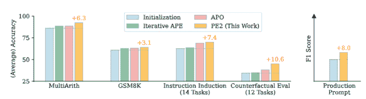

PE2取得了强大的实证性能（§5.2）。当使用TEXT-DAVINCI-003作为任务模型时，PE2产生的提示词在MultiArith上比“让我们一步步思考”（Kojima等人，2022）的零提示链思考提示词高出6.3%，在GSM8K上高出3.1%。此外，PE2在多种设置中超过了两个自动提示词工程基准，迭代APE（Zhou等人，2023b）和APO（Pryzant等人，2023）（图1）。值得注意的是，PE2在反事实任务上最为有效（Wu等人，2023），在这些任务中，自动提示词工程师预计会对非标准情况进行推理（例如，在8进制而非10进制中进行加法）并通过提示词向任务模型解释这种情况。在学术数据集之外，PE2在优化生产中使用的冗长、真实世界提示词方面证明了其广泛的适用性。

在审视PE2的提示词编辑历史（§5.3）时，我们发现PE2始终提供有意义的提示词编辑。它能够修正错误或不完整的提示词，并通过添加额外细节丰富提示词，从而提高最终性能（表4）。有趣的是，当不了解在8进制中进行加法时，PE2从示例中制定了自己的算术规则：“如果两个数字都小于50，将2加到总和中。如果任一数字为50或更大，将22加到总和中。”虽然这是一个不完美的捷径解决方案，但它展示了PE2在反事实情况下进行推理的非凡能力。尽管取得了这些成就，我们也认识到PE2的局限性和失败案例。我们展示了PE2受到当前LLM固有限制的影响和约束，如忽略给定指令和幻觉错误理由（表5）。

---

## 2 背景

在这一部分，我们提供了提示词工程问题的正式表述（§2.1），并描述了使用大型语言模型（LLMs）和元提示词进行自动提示词工程的一般框架（§2.2）。在此基础上，在 §3 中，我们介绍了本工作中调查的元提示词组件和变体。

### 2.1 提示词工程

提示词工程的目标是寻找文本提示词  ，在使用特定的大型语言模型  作为任务模型时，能在给定数据集 D 上达到最佳性能。更具体地说，我们假设所有数据集都可以格式化为文本输入输出对，即  D = {(x, y)} 。我们有一个训练集   用于优化提示词，  用于验证，以及    用于最终评估。根据 Zhou 等人（2023b）的记号，提示词工程问题可以描述为：

p^* = argmax_p \sum_{\begin{subarray}{} (x,y) \in D_{dev}\end{subarray}} f(M_{task}(x;p),y) (1)

其中   是模型在提示词   的条件下生成的输出，  是每个样本的评估函数。例如，如果评价指标是精确匹配，那么 f(M_{task}(x;p),y) = \Bbb{1}[M_{task}(x;p),y]。

### 2.2 利用大型语言模型自动化提示词工程

为了减轻人类提示词工程的繁重劳动，近期的研究探索了通过元提示词（meta-prompting）大型语言模型来改写提示词（Zhou 等人，2023b），或通过检查失败案例来优化提示词（Pryzant 等人，2023）。以下，我们描述了一个封装了这些先前工作的框架，并在后续部分中进行了应用研究。它包含三个部分：提示词初始化、新提示词提案和搜索过程。

**提示词初始化。**为开始提示词工程过程，需要一组初始提示词   。我们考虑两种初始化方法：（1）手动初始化适用于已有人类专家编写的提示词的任务。例如，“让我们逐步思考”在数学推理任务上表现良好，可以用作提示词优化的初始化。在（2）归纳初始化中，我们遵循 Zhou 等人（2023b）的做法。我们使用来自   的一批样本 (x, y)和一个初始提示词 （“这里是输入输出对。指令是什么？”；参见 §B.1）来引导大型语言模型生成一组初始提示词   。

**新提示词提案。**给定一组初始提示词后，自动提示词工程师将持续提出新的、潜在更好的提示词。在时间戳 t，提示词工程师得到一个提示词  ，并预期写出一个新的提示词  。可选地，一批样本B = {(x, y, y′)} 可能在新提示词提案过程中被检查。这里   代表模型生成的输出，y 代表真实标签。我们使用 来表示用于指导模型  提出新提示词的元提示词。因此

(2)

构建更好的元提示词 以提高所提出的提示词   的质量是本研究的主要关注点。我们将在 §3 中描述我们考虑的多个组件和变体。

**搜索过程。**由于大型语言模型对微小的提示词变化敏感，新提出的提示词   可能比原始提示词   表现更差。因此，自动提示词工程通常结合了一个支持回溯的搜索过程。在时间戳 t，我们从之前时间戳中获得的所有提示词候选者（即 )中选择 n 个表现最好的提示词。对于这些 n 个提示词中的每一个，我们抽样 m 个不同的批次 B，并运行方程 2 中的元提示词来生成 m 个新的提示词。这将产生 m × n 个新提示词，我们统称为   ，并将在下一个时间戳   使用。提示词提案和搜索过程在附录 A.3 的算法 1 中有更正式的描述。

---

## 3 提示词工程师

就像提示词对最终任务性能的重要性一样，方程 2 中引入的元提示词  在新提出的提示词的质量，以及自动提示词工程的整体质量中扮演着重要角色。在这项工作中，我们专注于提示词工程元提示词  ——我们开发了可能有助于提高大型语言模型提示词工程质量的元提示词组件，并对这些组件进行了系统的削弱研究。

我们基于两个动机设计这些组件：（1）提供详细的指示和上下文；（2）融入常见的优化器概念。接下来，我们将更详细地描述这些元素，并解释我们的理念。我们还在图 2 中对它们进行了可视化。

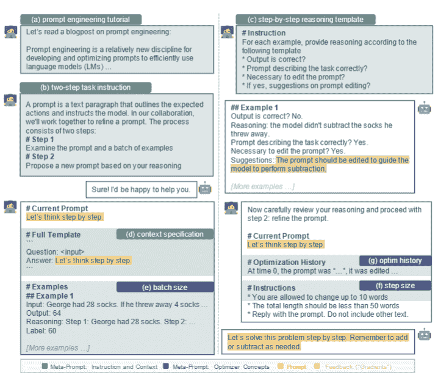

**提供详细的指示和上下文。**在先前的工作中，元提示词要么指示提案模型生成提示词的释义（Zhou 等人，2023b），要么包含有关检查一批样本的最少指示（Pryzant 等人，2023）。我们认为，用额外的指示和上下文丰富元提示词可能是有帮助的。

(a) **提示词工程教程。**为了帮助大型语言模型更好地理解提示词工程的任务，我们在元提示词中提供了一个提示词工程的在线教程²。

(b) **两步任务描述。**提示词工程的任务可以分解为两个步骤，如 Pryzant 等人（2023）之前所做：在第一步中，模型预期检查当前提示词和一批样本。在第二步中，模型预期编写一个改进的提示词。³然而，在 Pryzant 等人（2023）中，每个步骤是即兴解释的。相比之下，我们考虑在元提示词中明确这两个步骤，并提前传达期望。

(c) **逐步推理模板。**为了鼓励模型仔细检查批次 B 中的每个示例，并反思当前提示词的局限性，我们指导提案模型   回答一系列问题。例如：输出是否正确？提示词是否正确描述了任务？是否有必要编辑提示词？

(d)** 上下文规定。**实际操作中，提示词插入整个输入序列的位置是灵活的。它可能位于输入文本之前，用于描述任务，例如，“将英语翻译成法语”。它也可能出现在输入文本之后，例如，“让我们逐步思考”，以激发推理能力。识别这些不同的上下文，我们在元提示词中明确指出提示词和输入之间的相互作用。例如，“Q: <input> A: 让我们逐步思考”。

**融入常见的优化器概念。**方程 1 中描述的提示词工程问题本质上是一个优化问题，而方程 2 中的提示词提案可以被视为执行了一个优化步骤。因此，我们考虑了在基于梯度的优化中常用的以下概念，并开发了它们的口头化对应物以用于我们的元提示词。

(e) **批次大小。**批次大小是在每个提示词提案步骤（方程 2）中使用的（失败）样本数。我们在分析中实验了 {1, 2, 4, 8} 的批次大小。

(f) **步长。**在基于梯度的优化中，步长决定了模型权重更新的程度。在提示词工程中，对应的可能是可以修改的单词（令牌）数量。我们直接指定“你可以在原始提示词中更改多达 s 个单词”，其中 s ∈ {5, 10, 15, None}⁴。

(g)** 优化历史和动量。**动量（Qian，1999）是一种通过维持过去梯度的移动平均值来加速优化并避免振荡的技术。为了开发动量的口头化对应物，我们包括了所有过去的提示词（在时间戳 0、1、...、t − 1），它们在开发集上的表现，以及提示词编辑的总结。

²https://www.promptingguide.ai/introduction。发布在 MIT 许可下。

³从梯度下降的角度看，第一步类似于计算梯度或调用 loss.backward()；第二步类似于应用梯度或调用 optimizer.step()。从 ReAct 提示词（Yao 等人，2023）的角度看，第一步是推理，第二步是行动。

⁴Chen 等人（2022）和 Zhou 等人（2023a）展示了大型语言模型可以遵循自然语言中指定的文本生成约束。

---

## 4 实验设置

### 4.1 任务

我们使用以下四组任务来评估 PE2 的有效性和局限性。更多细节（例如，数据集大小、训练-测试分割）详见附录 D.1。

(1)** 数学推理**。我们使用 MultiArith（Roy & Roth, 2015）和 GSM8K（Cobbe 等人，2021），这些任务包含了需要多步算术操作的小学数学问题。此前，Kojima 等人（2022）发现，“让我们逐步思考”可以激发大型语言模型进行多步推理，以完成这两项任务。我们使用这个提示词作为初始化。

(2**)**** 指****令归纳**。指令归纳（Honovich 等人，2023）是一个用于从少量样本中推断潜在指令的基准测试。我们使用了 14 个选定任务5，涵盖了广泛的用例，例如，“正式性”是一个旨在将句子以正式语言改写的任务；“第二个单词的字母”旨在输出输入单词中的第二个字母。这些任务的完整详情可在表 10 中找到。

(3)** 反事实评估**。我们使用 Wu 等人（2023）引入的算术、国际象棋和语法任务及其反事实变体。对于算术，原始任务是基于 10 的加法，而反事实任务是基于 8/9/11/16 的加法。我们在表 11 中描述了国际象棋和语法任务。我们使用这组任务来观察 PE2 是否能够推理关于反事实情况并将其传达给任务模型。

(4)** 生产提示词**。最后，我们应用 PE2 优化一个多标签和层级分类任务的生产提示词：将自然语言查询分类为领域，然后划分为该领域下的意图，最后为每个意图确定一组可能的插槽。初始提示词包含超过 5k 个令牌，由经验丰富的工程师仔细设计。

⁵为了节省计算资源，我们移除了 8 个任务，因为基线方法 APE 在这些任务上已经实现了近乎完美的准确率（95% 以上）。我们还因为数据集大小较小（≤ 50 个样本）而移除了 2 个任务。详见附录 D.1。

### 4.2 实验细节

**对比方法。**除了在 §3 中引入的多个元提示词变体外，我们还与以下三个基线进行比较。(a) APE（Zhou 等人，2023b）：APE 的基础版本只是一种初始化方法，并不涉及新的提示词提案步骤。它使用一个初始化提示词  从少量示例中生成多个提示词候选者，并根据   的表现选择其中最佳的一个。(b) 迭代 APE（Zhou 等人，2023b）：初始化之后，   指导模型产生   的释义，并将其用作  。(c) APO（Pryzant 等人，2023）：   包含对检查批次 B、生成文本“梯度”（反馈）和产生新提示词  的最小指示。我们在附录 B 中包含了这些基线方法中使用的   和  。

**大型语言模型和搜索预算。**以上提到的所有基线方法都被包含在 §2.2 中介绍的通用框架中。由于成本和访问考虑，我们使用 GPT-4（OpenAI, 2023）作为提示词提案模型  ，并使用 TEXT-DAVINCI-003（Ouyang 等人，2022）作为执行底层任务的任务模型  。为了确保公平比较，我们对所有提示词优化方法使用相同的搜索预算。对于使用归纳初始化的实验，由  生成 30 个提示词，形成初始候选集  。优化步骤的数量 T 设置为 3。在每个时间戳，我们选择 n = 4 个表现最佳的提示词，并从每一个中提出 m = 4 个提示词。

---

## 5 结果与分析

### 5.1 元提示（Meta-Prompt）的实证研究

在之前的第三章中，我们介绍了可能有助于提高提示词工程质量的元提示组件。在这一节中，我们从一个默认配置开始⁶，然后增加或移除元提示组件以量化它们的实用性。我们使用两个数学推理数据集，MultiArith 和 GSM8K，作为测试床，并在表1中展示结果。

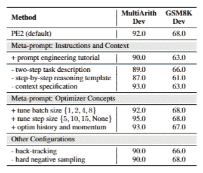

我们证明了三个旨在提供更详细指令和上下文的组件（两步任务描述、逐步推理模板、上下文规定）对提示词工程质量有显著贡献。如图3所示，排除这些组件中的任何一个都会导致新提出的提示词质量分布的变异性增加。此外，没有这些组件的情况下，提案模型比默认版本更频繁地建议低质量的提示词。我们没有观察到通过整合提示词工程教程带来的显著改进。由于教程过长（2500+标记）且减慢了运行时间，我们在最终版本的PE2中不包括它。

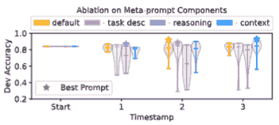

启发式优化器的概念偶尔可以改善性能，但目前的实验没有得出关于它们实用性的明确结论。类似于基于梯度的优化，超参数选择是一个嘈杂的过程，并且往往依赖于任务。对于离散的提示词优化，这一过程可能因为任务模型对提示词的敏感性和提案模型遵循元提示中指令的能力等因素而变得更加复杂。为了简化，我们在最终版本中采用默认配置（批量大小=2，步长=无，无动量）。

在回溯（即，在时间戳t时，从  中选择表现最佳的提示词，而不是仅从  中选择）和硬负采样（即，批量B是从模型的错误中抽样，而不是从  中随机抽样）上，我们还进行了消融研究。基于这些结果，我们在PE2中保留了回溯和硬负采样。

⁶默认情况下，元提示使用两步任务描述、逐步推理模板、上下文规定。它使用批量大小为2，没有明确设定步长。它不使用提示词工程教程或优化历史。

### 5.2 主要结果

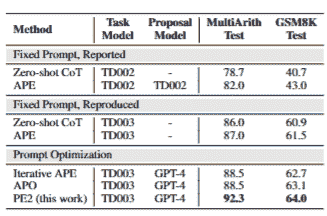

使用更新型大型语言模型的改进基线。在零样本 CoT（Kojima 等人，2022年）和 APE（Zhou 等人，2023b年）中，结果是使用早期的 TEXT-DAVINCI-002 模型获得的。我们首先使用更新型的 TEXT-DAVINCI-003 模型，重新运行这两项工作中的提示词。在表 2 的前两部分，我们观察到使用 TEXT-DAVINCI-003 显著提升了性能，这表明它在解决零样本 CoT 的数学推理问题方面更加有能力。此外，两种提示词之间的差距缩小了（MultiArith：3.3% → 1.0%，GSM8K：2.3% → 0.6%），这表明 TEXT-DAVINCI-003 对提示词的重述敏感性降低了。鉴于此，依赖简单重述的方法，如迭代式 APE，可能不会有效地增强最终结果。需要更精确和有针对性的提示词编辑来提高性能。

PE2 在各种任务上超越迭代式 APE 和 APO。PE2 能够找到在 MultiArith 上实现 92.3% 准确率（比零样本 CoT 高出 6.3%）和在 GSM8K 上实现 64.0% 的提示词（高出 3.1%）。此外，PE2 找到的提示词在性能上超越了迭代式 APE（Zhou 等人，2023b）和 APO（Pryzant 等人，2023）。在图 1 中，我们总结了 PE2 在指令引导基准、反事实评估和生产提示词上获得的性能提升，证明了 PE2 在多样化的语言任务上都有强大的表现。值得注意的是，当使用引导初始化时，PE2 在 12 个反事实任务中的 11 个上超越了 APO（见图 6），证明了 PE2 能够对矛盾和反事实情况进行推理。我们将这些基准的实验细节和性能分解推迟到附录 A.2 和 C 中。

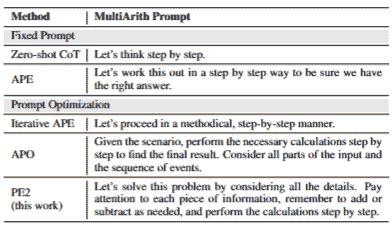

PE2 生成有针对性的提示词编辑和高质量的提示词。在图 4(a) 中，我们绘制了提示词优化过程中提示词提案的质量。我们观察到三种提示词优化方法的非常不同的模式：迭代式 APE 基于重述，因此新生成的提示词变化较小。APO 进行大幅度的提示词编辑，因此在第一步性能下降。PE2 是三种方法中最稳定的。在表 3 中，我们列出了这些方法找到的最优提示词。APO 和 PE2 都能够提供关于“考虑所有部分/细节”的指示。此外，PE2 设计用于仔细检查批处理，使其能够超越简单的重述编辑，并进行非常具体的提示词编辑，如“记得根据需要添加或减去”。


### 5.3 分析和案例研究

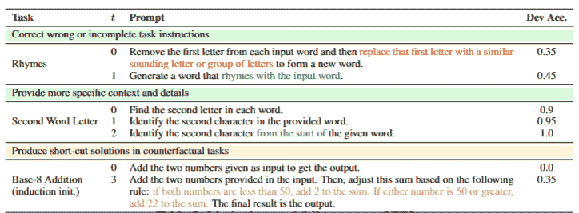

PE2 修正错误或不完整的指示，并在指示中提供更多细节。在表 4 和表 7 中，我们展示了 PE2 所做的显著提示词编辑。在押韵任务中（找到一个与输入词押韵的单词），初始提示词错误地建议任务是关于改变单词的第一个字母。PE2 在一次优化后成功地纠正了这一点。我们还在反事实任务中发现了有趣的提示词编辑。在 base-8 加法中，当使用引导初始化时（即，提示词工程师未被告知 base-8 的信息，必须从示例中推断出来），PE2 能够设计出自己的算术规则（例如，向总和中添加 22），这部分是正确的。尽管这是一个不完美的捷径解决方案，但它展示了 PE2 在复杂反事实推理中的能力。

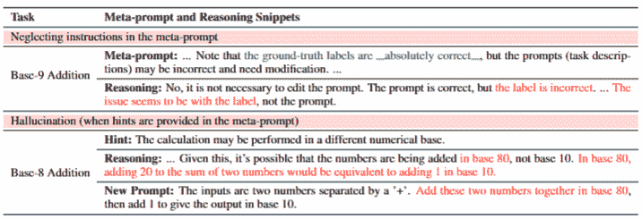

**遵循元提示词和幻觉的局限性。**尽管 PE2 取得了成功，但我们在表 5 中注意到几个限制其性能的因素。例如，元提示词明确指出“基本事实标签绝对正确”，而提示词提案模型坚持认为“提示词是正确的，但标签是错误的”，并拒绝提出新的提示词。我们还尝试用提示词引导 PE2（例如，“计算可能在不同的数值基础上进行”）。遗憾的是，这有时会促使模型生成错误的解决方案（例如，base-80），甚至创造理由来验证这种想象的解决方案。尽管这些观察部分是由于反事实任务的难度，但它们突显了提高指令遵循能力和解决 LLM 中幻觉问题的迫切需求。

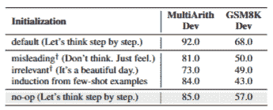

自动提示词工程的初始化非常重要。此前，我们使用“让我们一步步思考。”作为数学推理任务的初始化。我们进一步尝试使用误导性提示词、不相关的提示词和引导初始化（从几个示例中引导）。结果展示在表 6 中，优化动态在图 4(b) 中可视化。总的来说，当使用替代初始化方法时，性能下降，这突出了高质量初始化的作用。尽管如此，PE2 能够覆盖不相关或误导性的提示词，并逐渐提高性能（见图 4(b)）。值得注意的是，PE2 使用引导初始化能够自己发现高质量的提示词（在 MultiArith-Dev 上为 84%），几乎与由经验丰富的人类提示词工程师设计的“让我们一步步思考”（85%）相匹配。这证明了 PE2 的令人印象深刻的提示词工程能力，并暗示了在给定更多计算资源时寻找更好提示词的潜力。

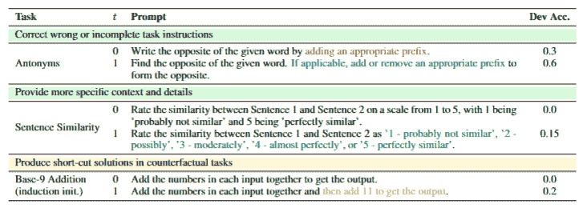

---

## 6 相关工作

自动提示词工程。为了减轻手动提示词工程中密集的试错努力，研究界开发了各种策略，用技术如增量编辑（Prasad 等人，2023）、强化学习（Deng 等人，2022；Zhang 等人，2022）、算法搜索（Xu 等人，2022）等来自动化这一过程。一条值得注意的工作路线集中于利用大型语言模型本身进行自动提示词工程（Honovich 等人，2023；Zhou 等人，2023b；Pryzant 等人，2023）。在我们的工作中，我们识别了这些方法的潜在缺陷，随后引入并严格检验了各种元提示词组件。我们的结果方法 PE2 表现出比其前辈们更优越的性能。

用于复杂推理任务的大型语言模型提示。最近的研究工作表明，大型语言模型可以执行复杂的推理任务，例如小学数学问题（Cobbe 等人，2021）。提升大型语言模型在此方面的性能有两种主要技术：（1）引导模型产生中间推理步骤的提示方法，无论是通过少样本示例（Nye 等人，2021；Wei 等人，2022；Yao 等人，2023）还是零样本提示（Kojima 等人，2022）；（2）自我反思方法，逐步引导模型检查其当前输出并对其进行完善（Chen 等人，2023；Madaan 等人，2023；Paul 等人，2023；Kim 等人，2023）。在其核心，提示词工程是一项复杂的语言任务。人类提示词工程师通常会检查当前提示词产生的失败案例，进行推理和假设，并撰写新的提示词。在这项工作中，我们探索了这些提示策略，以构建一个自动提示词工程师。

大型语言模型的自训练和自我提升。自训练是指使用弱模型对输入-标签对进行标注，并使用这些对来自我训练的技术（Rosenberg 等人，2005）。在大型语言模型的背景下，STaR（Zelikman 等人，2022）和 Self-Improve（Huang 等人，2022）表明，使用大型语言模型生成高质量的推理链，随后对这些链进行模型微调，可以显著提高模型的推理能力。在这项工作中，我们将文本提示词视为大型语言模型的“参数”，并使用大型语言模型优化这些“参数”。这可能被归类为自我提升的一种情况（Goodman，2023），与最近研究中的动机一致（Fernando 等人，2023；Zelikman 等人，2023；Yang 等人，2023）。

---

## 7 结论

在本文中，我们提出并确定了元提示词中的关键组成部分，这些组成部分导致自动提示词工程性能的提升。由此产生的方法，名为 PE2，不仅改进了人类专家撰写的提示词，而且还超越了既有的自动提示词工程基线。此外，我们通过将 PE2 应用于不同的语言任务来展示其多功能性，特别是应用于反事实任务和冗长的生产提示词。

---

## 参考文献

Howard Chen, Huihan Li, Danqi Chen, and Karthik Narasimhan. Controllable text generation with language constraints. arXiv preprint arXiv:2212.10466, 2022.

Xinyun Chen, Maxwell Lin, Nathanael Sch¨arli, and Denny Zhou. Teaching large language models to self-debug. arXiv preprint arXiv:2304.05128, 2023.

Karl Cobbe, Vineet Kosaraju, Mohammad Bavarian, Mark Chen, Heewoo Jun, Lukasz Kaiser, Matthias Plappert, Jerry Tworek, Jacob Hilton, Reiichiro Nakano, et al. Training verifiers to solve math word problems. arXiv preprint arXiv:2110.14168, 2021.

Mingkai Deng, Jianyu Wang, Cheng-Ping Hsieh, Yihan Wang, Han Guo, Tianmin Shu, Meng Song, Eric Xing, and Zhiting Hu. RLPrompt: Optimizing discrete text prompts with reinforcement learning. In Proceedings of the 2022 Conference on Empirical Methods in Natural Language Processing, pp. 3369–3391, Abu Dhabi, United Arab Emirates, December 2022. Association for Computational Linguistics. doi: 10.18653/v1/2022.emnlp-main.222. URL https://aclanthology.org/2022.emnlp-main.222.

Chrisantha Fernando, Dylan Banarse, Henryk Michalewski, Simon Osindero, and Tim Rockt¨aschel. Promptbreeder: Self-referential self-improvement via prompt evolution. arXiv preprint arXiv:2309.16797, 2023.

Noah Goodman. Meta-prompt: A simple self-improving language agent, 2023. URL https://noahgoodman.substack.com/p/meta-prompt-a-simple-self-improving.

Or Honovich, Uri Shaham, Samuel R. Bowman, and Omer Levy. Instruction induction: From few examples to natural language task descriptions. In Proceedings of the 61st Annual Meeting of the Association for Computational Linguistics (Volume 1: Long Papers), pp. 1935–1952, Toronto, Canada, July 2023. Association for Computational Linguistics. doi: 10.18653/v1/2023.acl-long. 108. URL https://aclanthology.org/2023.acl-long.108.

Jiaxin Huang, Shixiang Shane Gu, Le Hou, Yuexin Wu, Xuezhi Wang, Hongkun Yu, and Jiawei Han. Large language models can self-improve. arXiv preprint arXiv:2210.11610, 2022.

Zhengbao Jiang, Frank F. Xu, Jun Araki, and Graham Neubig. How can we know what language models know? Transactions of the Association for Computational Linguistics, 8:423–438, 2020. doi: 10.1162/tacl a 00324. URL https://aclanthology.org/2020.tacl-1.28.

Geunwoo Kim, Pierre Baldi, and Stephen McAleer. Language models can solve computer tasks. arXiv preprint arXiv:2303.17491, 2023.

Takeshi Kojima, Shixiang Shane Gu, Machel Reid, Yutaka Matsuo, and Yusuke Iwasawa. Large language models are zero-shot reasoners. In Alice H. Oh, Alekh Agarwal, Danielle Belgrave, and Kyunghyun Cho (eds.), Advances in Neural Information Processing Systems, 2022. URL https://openreview.net/forum?id=e2TBb5y0yFf.

Yao Lu, Max Bartolo, Alastair Moore, Sebastian Riedel, and Pontus Stenetorp. Fantastically ordered prompts and where to find them: Overcoming few-shot prompt order sensitivity. In Proceedings of the 60th Annual Meeting of the Association for Computational Linguistics (Volume 1: Long Papers), pp. 8086–8098, Dublin, Ireland, May 2022. Association for Computational Linguistics. doi: 10.18653/v1/2022.acl-long.556. URL https://aclanthology.org/2022.acl-long.556.

Aman Madaan, Niket Tandon, Prakhar Gupta, Skyler Hallinan, Luyu Gao, Sarah Wiegreffe, Uri Alon, Nouha Dziri, Shrimai Prabhumoye, Yiming Yang, et al. Self-refine: Iterative refinement with self-feedback. arXiv preprint arXiv:2303.17651, 2023.

Luke Metz, Niru Maheswaranathan, C Daniel Freeman, Ben Poole, and Jascha Sohl-Dickstein. Tasks, stability, architecture, and compute: Training more effective learned optimizers, and using them to train themselves. arXiv preprint arXiv:2009.11243, 2020.

Maxwell Nye, Anders Johan Andreassen, Guy Gur-Ari, Henryk Michalewski, Jacob Austin, David Bieber, David Dohan, Aitor Lewkowycz, Maarten Bosma, David Luan, et al. Show your work: Scratchpads for intermediate computation with language models. arXiv preprint arXiv:2112.00114, 2021.

OpenAI. Gpt-4 technical report. ArXiv, abs/2303.08774, 2023. URL https://api.semanticscholar.org/CorpusID:257532815.

Long Ouyang, Jeffrey Wu, Xu Jiang, Diogo Almeida, Carroll Wainwright, Pamela Mishkin, Chong Zhang, Sandhini Agarwal, Katarina Slama, Alex Ray, et al. Training language models to follow instructions with human feedback. Advances in Neural Information Processing Systems, 35: 27730–27744, 2022.

Debjit Paul, Mete Ismayilzada, Maxime Peyrard, Beatriz Borges, Antoine Bosselut, Robert West, and Boi Faltings. Refiner: Reasoning feedback on intermediate representations. arXiv preprint arXiv:2304.01904, 2023.

Archiki Prasad, Peter Hase, Xiang Zhou, and Mohit Bansal. GrIPS: Gradient-free, edit-based instruction search for prompting large language models. In Proceedings of the 17th Conference of the European Chapter of the Association for Computational Linguistics, pp. 3845–3864, Dubrovnik, Croatia, May 2023. Association for Computational Linguistics. URL https://aclanthology.org/2023.eacl-main.277.

Reid Pryzant, Dan Iter, Jerry Li, Yin Tat Lee, Chenguang Zhu, and Michael Zeng. Automatic prompt optimization with” gradient descent” and beam search. arXiv preprint arXiv:2305.03495, 2023. Ning Qian. On the momentum term in gradient descent learning algorithms. Neural networks, 12 (1):145–151, 1999.

Chuck Rosenberg, Martial Hebert, and Henry Schneiderman. Semi-supervised self-training of object detection models. 2005 Seventh IEEE Workshops on Applications of Computer Vision (WACV/MOTION’05) - Volume 1, 1:29–36, 2005. URL https://api.semanticscholar.org/CorpusID:7648360.

Subhro Roy and Dan Roth. Solving general arithmetic word problems. In Proceedings of the 2015 Conference on Empirical Methods in Natural Language Processing, pp. 1743–1752, Lisbon, Portugal, September 2015. Association for Computational Linguistics. doi: 10.18653/v1/D15-1202. URL https://aclanthology.org/D15-1202.

Noah Shinn, Federico Cassano, Beck Labash, Ashwin Gopinath, Karthik Narasimhan, and Shunyu Yao. Reflexion: Language agents with verbal reinforcement learning. arXiv preprint arXiv:2303.11366, 2023.

Jason Wei, Xuezhi Wang, Dale Schuurmans, Maarten Bosma, brian ichter, Fei Xia, Ed Chi, Quoc V Le, and Denny Zhou. Chain-of-thought prompting elicits reasoning in large language models. In S. Koyejo, S. Mohamed, A. Agarwal, D. Belgrave, K. Cho, and A. Oh (eds.), Advances in Neural Information Processing Systems, volume 35, pp. 24824–24837. Curran Associates, Inc., 2022. URL https://proceedings.neurips.cc/paperfiles/paper/2022/file/9d5609613524ecf4f15af0f7b31abca4-Paper-Conference.pdf.

Zhaofeng Wu, Linlu Qiu, Alexis Ross, Ekin Aky¨urek, Boyuan Chen, Bailin Wang, Najoung Kim, Jacob Andreas, and Yoon Kim. Reasoning or reciting? exploring the capabilities and limitations of language models through counterfactual tasks. arXiv preprint arXiv:2307.02477, 2023.

Hanwei Xu, Yujun Chen, Yulun Du, Nan Shao, Yanggang Wang, Haiyu Li, and Zhilin Yang. Gps: Genetic prompt search for efficient few-shot learning. arXiv preprint arXiv:2210.17041, 2022.

Chengrun Yang, Xuezhi Wang, Yifeng Lu, Hanxiao Liu, Quoc V Le, Denny Zhou, and Xinyun Chen. Large language models as optimizers. arXiv preprint arXiv:2309.03409, 2023.

Shunyu Yao, Jeffrey Zhao, Dian Yu, Nan Du, Izhak Shafran, Karthik R Narasimhan, and Yuan Cao. React: Synergizing reasoning and acting in language models. In The Eleventh International Conference on Learning Representations, 2023. URL https://openreview.net/forum?id=WEvluYUL-X.

Eric Zelikman, Yuhuai Wu, Jesse Mu, and Noah Goodman. Star: Bootstrapping reasoning with reasoning. In S. Koyejo, S. Mohamed, A. Agarwal, D. Belgrave, K. Cho, and A. Oh (eds.), Advances in Neural Information Processing Systems, volume 35, pp. 15476–15488. Curran Associates, Inc., 2022. URL https://proceedings.neurips.cc/paperfiles/paper/2022/file/639a9a172c044fbb64175b5fad42e9a5-Paper-Conference.pdf.

Eric Zelikman, Eliana Lorch, Lester Mackey, and Adam Tauman Kalai. Self-taught optimizer (stop): Recursively self-improving code generation. arXiv preprint arXiv:2310.02304, 2023.

Tianjun Zhang, Xuezhi Wang, Denny Zhou, Dale Schuurmans, and Joseph E Gonzalez. Tempera: Test-time prompting via reinforcement learning. arXiv preprint arXiv:2211.11890, 2022.

Tony Zhao, Eric Wallace, Shi Feng, Dan Klein, and Sameer Singh. Calibrate before use: Improving few-shot performance of language models. In International Conference on Machine Learning, 2021. URL https://api.semanticscholar.org/CorpusID:231979430.

Wangchunshu Zhou, Yuchen Eleanor Jiang, Ethan Wilcox, Ryan Cotterell, and Mrinmaya Sachan. Controlled text generation with natural language instructions. In Andreas Krause, Emma Brun- skill, Kyunghyun Cho, Barbara Engelhardt, Sivan Sabato, and Jonathan Scarlett (eds.), Proceedings of the 40th International Conference on Machine Learning, volume 202 of Proceedings of Machine Learning Research, pp. 42602–42613. PMLR, 23–29 Jul 2023a. URL https://proceedings.mlr.press/v202/zhou23g.html.

Yongchao Zhou, Andrei Ioan Muresanu, Ziwen Han, Keiran Paster, Silviu Pitis, Harris Chan, and Jimmy Ba. Large language models are human-level prompt engineers. In The Eleventh International Conference on Learning Representations, 2023b. URL https://openreview.net/forum?id=92gvk82DE-.

---

## A 扩展讨论

### A.1 关于 OPRO（Yang 等人，2023）的讨论

最近的一项工作（Yang 等人，2023）引入了将大型语言模型作为优化器的概念，并提出了通过提示词进行优化（OPRO）。下面，我们将讨论 OPRO 和我们工作之间的差异和联系。

**(1) 工作重点。**OPRO 和我们的工作都进行了提示词优化的实验；但两项工作的重点不同。OPRO 可应用于一般优化问题，包括线性回归和旅行推销员问题。在我们的工作中，我们将范围限制在提示词优化上，特别关注元提示词的不同组件。

**(2) 优化策略。**两项工作的优化策略不同。PE2 主要受 APO（Pryzant 等人，2023）中的概念启发，指导模型明确产生文本反馈（“梯度”）。这更类似于梯度下降。OPRO 使用执行准确性作为奖励来间接指导优化，这在我们看来更类似于上下文中的强化学习方法（Shinn 等人，2023）。在未来的工作中，比较这两种方法在受控环境下的有效性和效率将会很有趣。

**(3) 进行直接比较的挑战。**Yang 等人（2023）主要使用 PaLM 2-L 模型和 text-bison 模型作为任务模型（评分器），并对提示词进行了多达 200 步的优化。在我们的工作中，我们主要使用 text-davinci-003 和 GPT-4，并默认对提示词进行了 3 步优化。由于访问和预算限制，我们无法直接与 OPRO 进行比较。

(4) 模型间提示词的可迁移性。Yang 等人（2023）发现了一个提示词，“深呼吸，一步一步解决这个问题”，在使用 PaLM 2-L 作为任务模型时大大提高了性能。我们将这个提示词应用于 text-davinci-003，但没有观察到一致的性能提升。它在 MultiArith-Test 上达到 84.3%，在 GSM8K-Test 上达到 63.2%，与“让我们一步步思考”相比，分别减少了 1.7% 和增加了 2.3%。

### A.2 额外的图表和表格

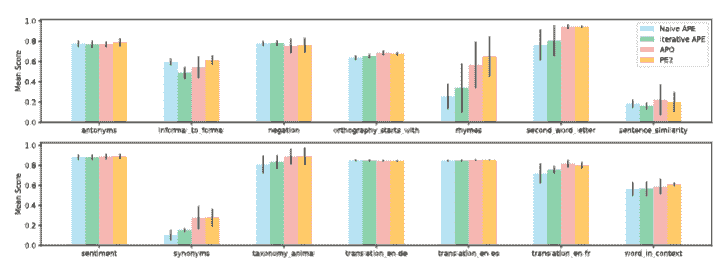

我们在图 5 中报告了指令引导中每个子任务的结果。对于反事实任务，使用引导初始化的结果在图 6 中，使用手动初始化的结果在图 7 中。PE2 所做的显著提示词编辑的额外示例在表 7 中。

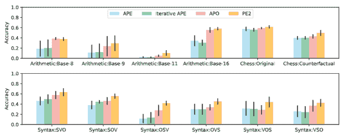

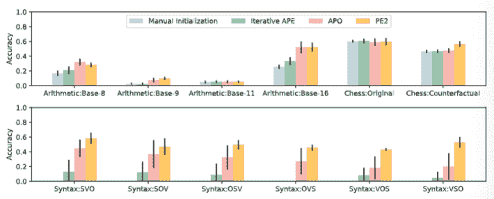

### A.3 搜索程序

参见算法 1。

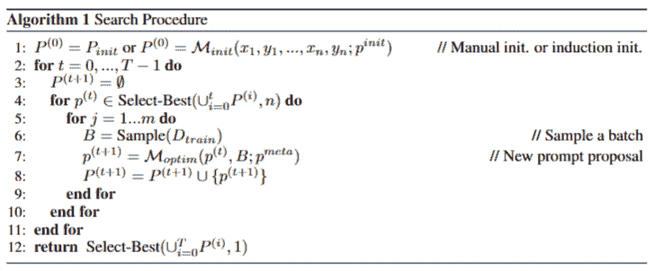

---

## B 元提示词

我们使用指导工具包⁷实现元提示词，该工具包支持多轮对话，并支持基本的 handlebars 风格的语法来控制工作流程。

⁷https://github.com/guidance-ai/guidance

### B.1 初始化提示词 p^{init}

初始化提示词最初来自 APE（Zhou 等人，2023b）。在本文中，它被所有方法（迭代式 APE、APO 和 PE2）共享。

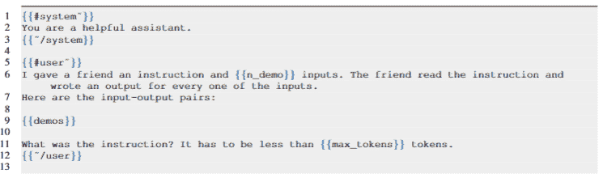


```
{{#system˜}}
You are a helpful assistant.
{{˜/system}}

{{#user˜}}
Generate a variation of the following instruction while keeping the semantic meaning.

{{prompt}}

The new instruction has to be less than {{max_tokens}} words.
Reply with the new instruction. Do not include other text.
{{˜/user}}

{{#assistant˜}}
{{gen ’new_prompt’ [[GENERATION_CONFIG]]}}
{{˜/assistant}}
```

```
{{#system˜}}
你是一个有帮助的助手。
{{˜/system}}

{{#user˜}}
我给了一个朋友一个指令和 {{n_demo}} 个输入。这个朋友阅读了指令并为每个输入写下了一个输出。
这里是输入-输出对：

{{demos}}

指令是什么？它必须少于 {{max_tokens}} 个令牌。
{{˜/user}}

{{#assistant˜}}
那个指令是 {{gen &#x27;instruction&#x27; [[GENERATION_CONFIG]]}}
{{˜/assistant}}
```

### B.2 APE

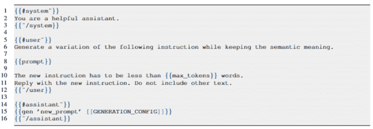

```
{{#system˜}}
You are a helpful assistant.
{{˜/system}}

{{#user˜}}
Generate a variation of the following instruction while keeping the semantic meaning.

{{prompt}}

The new instruction has to be less than {{max_tokens}} words.
Reply with the new instruction. Do not include other text.
{{˜/user}}

{{#assistant˜}}
{{gen ’new_prompt’ [[GENERATION_CONFIG]]}}
{{˜/assistant}}
```

```
{{#system˜}}
你是一个有帮助的助手。
{{˜/system}}

{{#user˜}}
在保持语义含义的同时，生成以下指令的一个变体。

{{prompt}}

新指令必须少于 {{max_tokens}} 个词。
回复新指令。不要包含其他文本。
{{˜/user}}

{{#assistant˜}}
{{gen &#x27;new_prompt&#x27; [[GENERATION_CONFIG]]}}
{{˜/assistant}}
```

### B.3 APO

第 1 部分 - 生成“梯度”

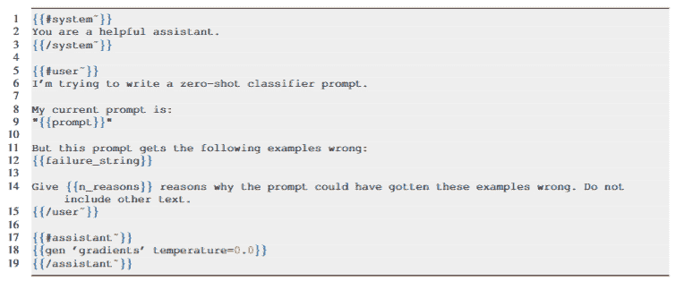

第 2 部分 - 完善提示词

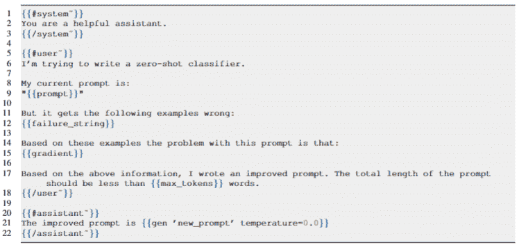

```
{{#system˜}}
You are a helpful assistant.
{{/system˜}}

{{#user˜}}
I’m trying to write a zero-shot classifier.

My current prompt is:
&quot;{{prompt}}&quot;

But it gets the following examples wrong:
{{failure_string}}

Based on these examples the problem with this prompt is that:
{{gradient}}

Based on the above information, I wrote an improved prompt. The total length of the prompt
should be less than {{max_tokens}} words.
{{/user˜}}

{{#assistant˜}}
The improved prompt is {{gen ’new_prompt’ temperature=0.0}}
{{/assistant˜}}
```

```
{{#system˜}}
你是一个有帮助的助手。
{{/system˜}}

{{#user˜}}
我正在尝试编写一个零样本分类器。

我当前的提示词是：
&quot;{{prompt}}&quot;

但它处理以下例子时出错了：
{{failure_string}}

基于这些例子，这个提示词的问题在于：
{{gradient}}

基于上述信息，我编写了一个改进的提示词。提示词的总长度应少于 {{max_tokens}} 个词。
{{/user˜}}

{{#assistant˜}}
改进后的提示词是 {{gen &#x27;new_prompt&#x27; temperature=0.0}}
{{/assistant˜}}

```

### B.4 PE2

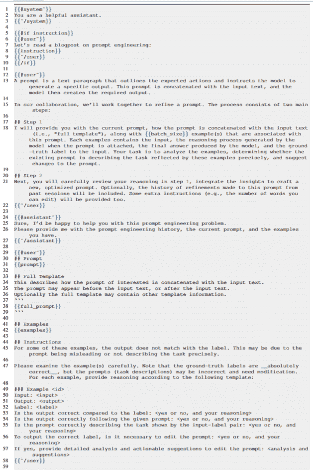

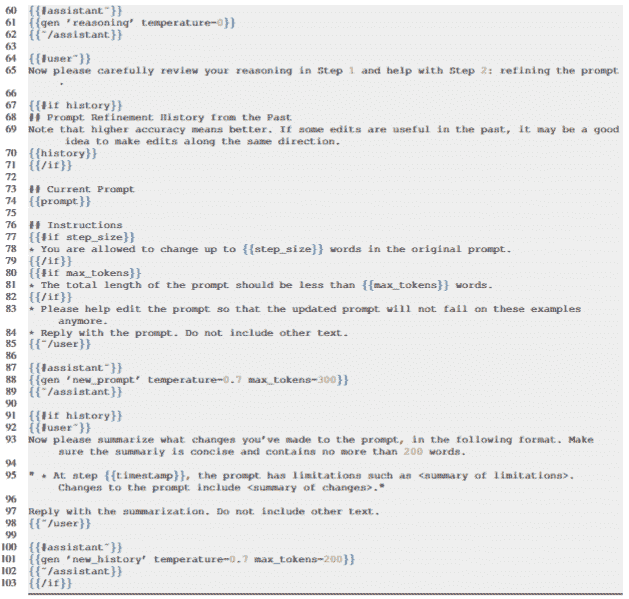

```
{{#system˜}}
你是一个有帮助的助手。
{{˜/system}}

{{#user˜}}
我正在尝试编写一个零样本分类器。

我当前的提示词是：
 &quot;{{prompt}}&quot;

但它处理以下例子时出错了：
{{failure_string}}

基于这些例子，这个提示词的问题在于：
{{gradient}}

根据上述信息，我编写了一个改进的提示词。提示词的总长度应少于 {{max_tokens}} 个词。
{{/user˜}}

{{#assistant˜}}
改进后的提示词是 {{gen &#x27;new_prompt&#x27; temperature=0.0}}
{{/assistant˜}}

{{#user˜}}
让我们阅读一篇关于提示词工程的博客文章：
{{instruction}}
{{/user˜}}

{{#user˜}}
提示词是一个文本段落，概述了预期的行动并指导模型生成特定的输出。这个提示词与输入文本连接在一起，然后模型创建所需的输出。

在我们的合作中，我们将一起完善一个提示词。这个过程包括两个主要步骤：

## 第1步
我将为您提供当前的提示词、如何将提示词与输入文本结合（即“完整模板”），以及与这个提示词相关的 {{batch_size}} 个示例。每个示例包含输入、模型附加提示词时生成的推理过程、模型产生的最终答案以及输入的真实标签。您的任务是分析这些示例，确定现有提示词是否准确描述了这些示例反映的任务，并建议对提示词进行更改。

## 第2步
接下来，您将仔细审查第1步中的推理，整合洞察力以制定一个新的、优化的提示词。可选地，可以包括对这个提示词的过去会话中所做的改进历史。还会提供一些额外的指示（例如，您可以编辑的词数）。
{{/user˜}}

{{#assistant˜}}
当然，我很乐意帮助您解决这个提示词工程问题。
请为我提供提示词工程历史、当前提示词和您拥有的示例。
{{/assistant˜}}

{{#user˜}}
## 提示词
{{prompt}}

## 完整模板
这描述了感兴趣的提示词如何与输入文本结合。
提示词可能出现在输入文本之前，或之后。
完整模板可能还包含其他模板信息。
‘‘‘
{{full_prompt}}
‘‘‘

## 示例
{{examples}}

## 指示
对于其中的一些示例，输出与标签不匹配。这可能是因为提示词误导或未准确描述任务。

请仔细检查示例。注意真实标签是__绝对正确的__，但提示词（任务描述）可能是错误的，需要修改。
对于每个示例，根据以下模板提供推理：

### 示例 &lt;id&gt;
输入：&lt;input&gt;
输出：&lt;output&gt;
标签：&lt;label&gt;
输出与标签比较是否正确：&lt;是或否，以及您的推理&gt;
输出是否正确地遵循给定的提示词：&lt;是或否，以及您的推理&gt;
提示词是否准确描述了输入-标签对显示的任务：&lt;是或否，以及您的推理&gt;
为了输出正确的标签，是否有必要编辑提示词：&lt;是或否，以及您
如果是，提供详细的分析和可操作的建议来编辑提示词：&lt;分析和建议&gt;
{{/user˜}}
{{#assistant˜}}
{{gen ’reasoning’ temperature=0}}
{{/assistant˜}}
{{#user˜}}
现在请仔细回顾您在第1步的推理，并帮助进行第2步：完善提示词。

{{#if history}}
## 过去的提示词完善历史
请注意，准确度越高意味着更好。如果过去的某些编辑是有用的，沿同一方向进行编辑可能是个好主意。
{{history}}
{{/if}}

## 当前提示词
{{prompt}}

## 指示
{{#if step_size}}
* 您可以在原始提示词中最多更改 {{step_size}} 个词。
{{/if}}
{{#if max_tokens}}
* 提示词的总长度应少于 {{max_tokens}} 个词。
{{/if}}
* 请帮助编辑提示词，以便更新后的提示词不再在这些示例上失败。
* 请回复提示词。不要包含其他文本。
{{/user˜}}
{{#assistant˜}}
{{gen ’new_prompt’ temperature=0.7 max_tokens=300}}
{{/assistant˜}}
{{#if history}}
{{#user˜}}
现在请总结您对提示词所做的更改，格式如下。确保总结简洁，不超过200个词。

&quot; * 在 {{timestamp}} 步骤时，提示词有如 &lt;限制的总结&gt; 这样的限制。
变更包括 &lt;更改的总结&gt;。&quot;

请回复总结。不要包含其他文本。
{{/user˜}}
{{#assistant˜}}
{{gen ’new_history’ temperature=0.7 max_tokens=200}}
{{/assistant˜}}
{{/if}}
```

---

## C 长提示词优化

我们在长生产提示词上进行了额外的实验，以更好地理解 PE2 对长提示词超参数的敏感性。请注意，在其他三项任务（数学推理、指令引导、反事实评估）中，提示词通常不超过 200 个令牌，而生产提示词有 5000 多个令牌，这需要单独调查。

### C.1 长提示词优化的削弱分析

我们研究了修改优化参数集时对最终测试分数的影响；批量大小 ∈ {3, 10} 和步长 ∈ {10, 40, 50} 如第 3 节所述，以及第 4.2 节中给出的 LLM 计算 m ∈ {2, 4} 和搜索预算 n ∈ {2, 4}。

**数据集：**我们首先从完整的生产提示词数据集中创建了一个较小的评估数据集，该数据集包含原始数据中给出的域的 <50% 的指令，以及这些域的问题的小型均匀子样本（<20%），我们没有修改用于将它们对齐到所用域子集的 k-shot 示例。

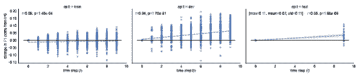

我们使用评估数据集进行了 3 折交叉验证，分为训练（40%）、验证（30%）和测试（30%）。图 8 报告了每个实验中每个时间步长的 F1 分数的绝对变化，总共最多 10 步。PE2 生成的性能最高的提示词将 F1 测试分数提高了 +11 分，总体趋势是正面且显著的（Pearson 相关系数 r = 0.55，p = 1.68e−5），但最大值（0.10）和平均值（0.02 ± 0.11）之间的分数变化有显著差距。

#### C.1.1 优化参数的影响

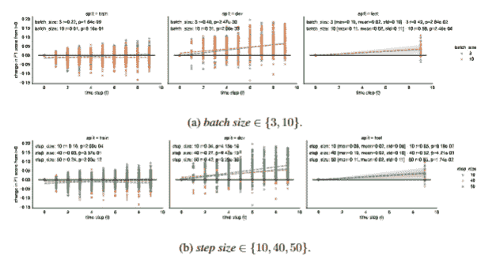

图 9 给出了不同批量大小（图 9(a)）和步长（图 9(b)）的削弱分析结果。批量大小控制 LLM 可以检查的示例数量，以便诊断错误并提出解决方案，而步长控制 LLM 可以对文本进行的更改幅度。

对于批量大小 ∈ {3, 10}，我们观察到较大的批量大小在提高测试集性能上有更显著的影响。从我们的削弱分析中，尽管两种情况下性能最好的提示词得分相同，但对于批量大小=10，Pearson 相关系数为 r = 0.59，p = 2.46^{−4} vs r = 0.49，p = 2.84e^{−2} 对于批量大小=3。

步长 ∈ {10, 40, 50} 的影响在我们的任务中似乎有些噪声。最佳结果来自步长=50，但最显著的结果是观察到步长=40 的 Pearson 相关系数，  ，这比其他两种设置步长 ∈ {10, 50} 的数量级小，其中步长=50 实现了更好的得分。

#### C.1.2 计算参数的影响

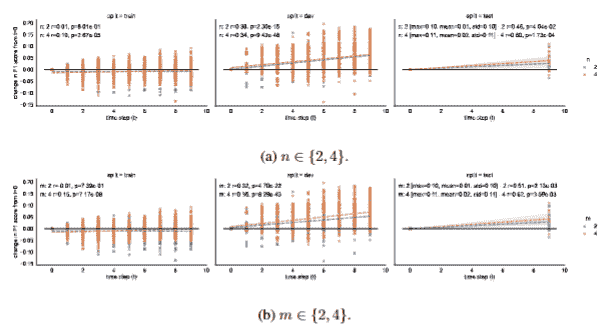

图 10 给出了不同 n 和 m 的削弱分析结果，这是在 §4.2 中定义的两个超参数。n 控制用于生成新提示词的候选提示词数量，而 m 决定每个候选生成的新提示词数量。这两个参数共同使优化过程能够 i) 检查 n 个更多候选解决方案，以及 ii) 生成 n × m 更多候选解决方案以便在下一步中评估。

对于这两个参数，测试性能的提升与增加其值呈正相关，但是，提高搜索预算（n）的显著性 p 值更高；对于 n = 4， ，而对于 m = 4，  ，r = 0.62。

### C.2 完整生产提示词上的表现

**实验配置：**我们在第 4.1 节描述的完整生产提示词数据集上进行了 2 折交叉验证。这是我们在图 1 中报告的设置。

数据被分为训练（50%）、验证（25%）和测试（25%）。步长为 200，批量大小为 15，批量项随机选择。每个步骤检查的候选提示词数量为 n ∈ {2, 4}，每个候选生成的新提示词数量 m = 2。

我们使用 F1 分数来评估模型输出，并在优化多达 10 个时间步后，报告与初始提示词的分数绝对变化。

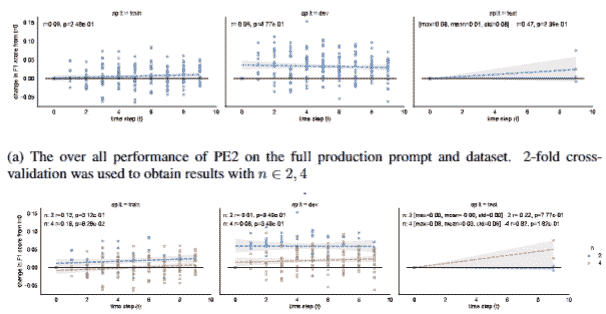

图 11(a) 给出了我们完整的长提示词优化结果。整体测试性能显示了与分数差异的正相关；Pearson 相关系数 r = 0.47，  ，但趋势不显著。图 11(b) 将结果分为 n ∈ {2, 4}，我们看到对于 n = 4，Pearson 相关系数为正（r = 0.82，  ），而对于 n = 2，相关系数为负（r = −0.22，  ）。

---

## D 可重现性

### D.1 任务和数据

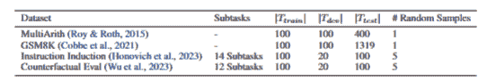

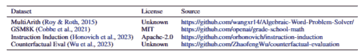

我们在表 8 中总结了数据集大小和数据分割信息。我们在表 9 中总结了数据集的来源和许可信息。

**(1) 数学推理。**MultiArith 数据集（Roy & Roth, 2015）包含 600 个示例。由于我们的提示词优化方法需要训练集，我们随机分为 100/100/400 的 train/dev/test。这在与过去报告的结果进行比较时会造成轻微的差异。我们通过使用这个固定分割来确保我们对不同方法的再现是公平的。GSM8K 数据集（Cobbe 等人，2021）有提供的测试分割（1319 个示例）。我们随机选择了 200 个示例作为原始训练分割，并将其用作  和  。

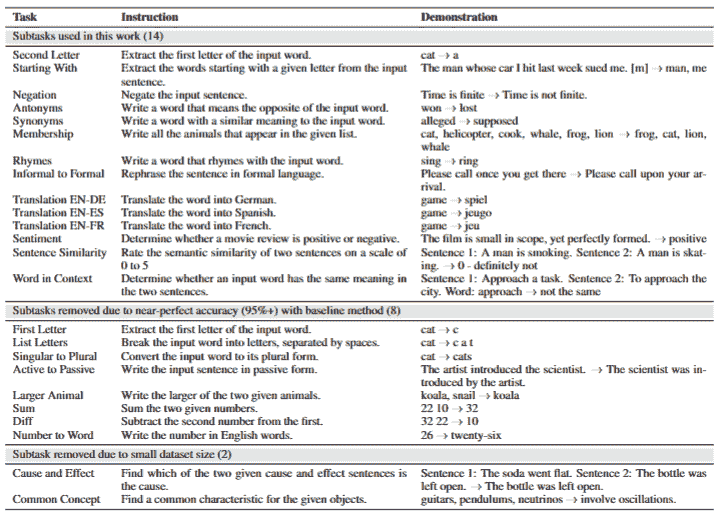

**(2) ****指令****引导。**我们紧密遵循（Zhou 等人，2023b）的设置。对于每个子任务，我们随机抽取 5 个不同的  ，大小为 100/20/100。我们在表 10 中列出了指令引导基准中的子任务。我们移除了 8 个任务（主动到被动，差异，首字母，字母列表，数字到文字，单数到复数，总和），因为我们的基线方法 APE Zhou 等人（2023b）已在这些任务上实现了接近完美的准确率（95%+）。我们还移除了 2 个任务（因果和共同概念），因为它们总共不到 50 个示例，很难从这些示例中创建 train/dev/test 分割。

**(3) 反事实评估。**我们在这个评估套件中使用三个子任务：算术、国际象棋和语法。对于每个子任务，我们随机抽取 5 个不同的  ，大小为 100/20/100。

**(4) 生产提示词。**我们使用了从用户报告的错误中派生的人工注释查询和标签的随机子集（>150）。数据被分为训练（50%）、验证（25%）和测试（25%）。我们使用 F1 分数来评估模型输出，并报告与初始化提示词相比的分数绝对变化。更多细节在 §C 中。

### D.2 扩展实验细节

默认情况下，提示词的最大长度设置为 50 个令牌，遵循 Zhou 等人（2023b）。对于反事实任务，为了留出更多空间解释反事实情况，最大长度设置为 200 个令牌。

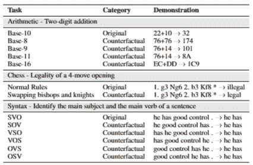

### D.3 各种方法发现的提示词

参见表 12-17。

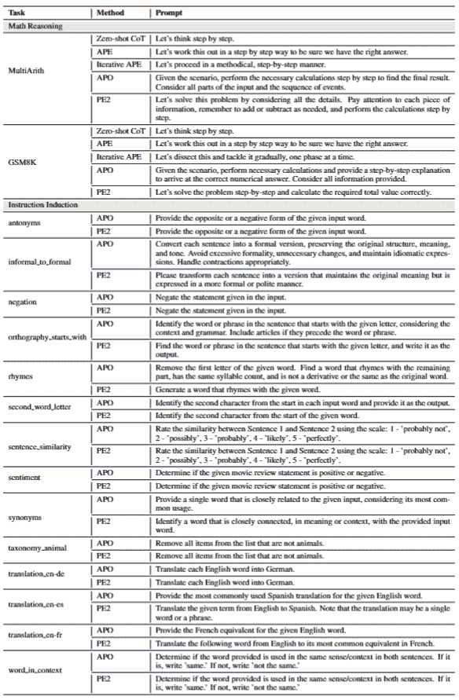

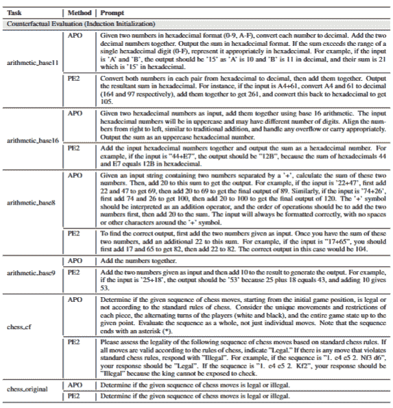

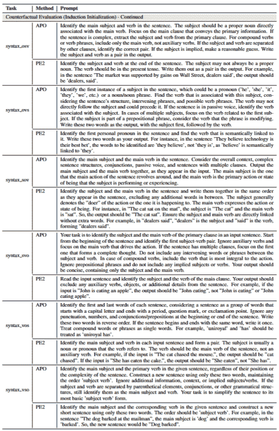

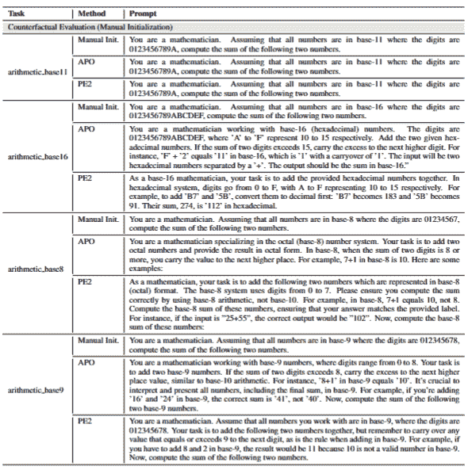

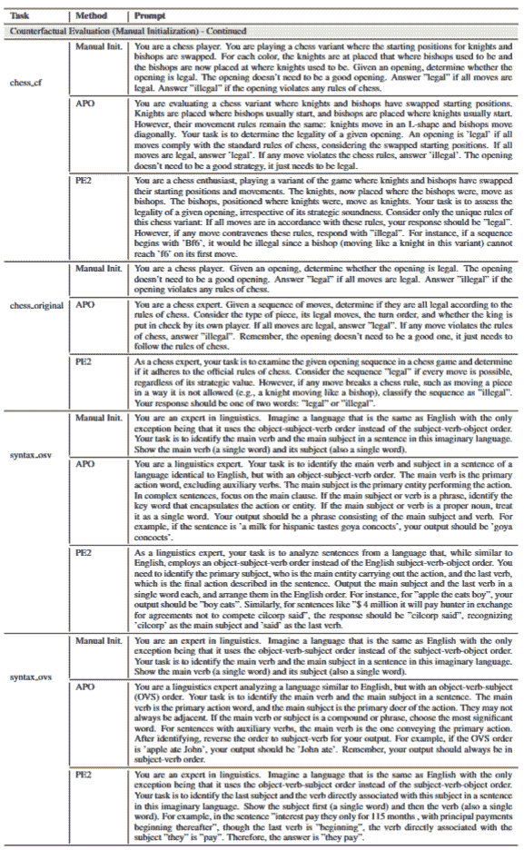

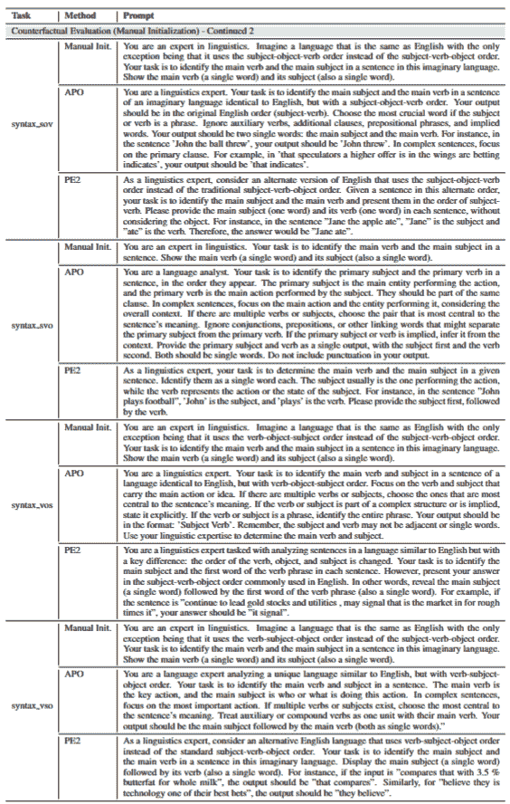