# PromptAgent

> 来源：[https://vxc3hj17dym.feishu.cn/docx/XR32dOk5sorNTExXLfkcFzHgnub](https://vxc3hj17dym.feishu.cn/docx/XR32dOk5sorNTExXLfkcFzHgnub)

更多内容欢迎加入免费提示词星球阅读、交流：

本文为论文《PromptAgent : Strategic Planning with Language Models Enables Expert-level Prompt Optimization》的中文精校解读

原文地址：https://arxiv.org/abs/2310.16427

PDF文档：https://arxiv.org/pdf/2310.16427.pdf

---

## PromptAgent : Strategic Planning with Language Models Enables Expert-level Prompt Optimization

提示词智能体：结合语言模型的策略性规划实现专家级提示词优化

---

## 摘要

高效的、针对特定任务的提示词往往由专家精心设计，整合详细的指令和领域见解，这基于对大型语言模型（LLM）的本能和目标任务的复杂性的深入了解。然而，如何自动化地生成这样的专家级提示词仍然是一个挑战。现有的提示词优化方法往往忽视领域知识的深度，且难以高效地探索专家级提示词的巨大空间。为了解决这一问题，我们提出了 PromptAgent ，这是一种优化方法，可以自主地设计与专家手工制作的同等质量的提示词。

PromptAgent 的核心观点是将提示词优化视为一个策略性规划问题，并采用一种基于蒙特卡洛树搜索的原则性规划算法，策略性地导航专家级提示词空间。受到人类试错探索的启发，PromptAgent 通过反思模型的错误并生成有建设性的错误反馈，诱导出精确的专家级见解和深入的指令。这种新颖的框架允许智能体迭代地检查中间提示词（状态），基于错误反馈（行为）对其进行细化，模拟未来的回报，并寻找通往专家提示词的高回报路径。我们将 PromptAgent 应用于跨越三个实际领域的12个任务：BIG-Bench Hard (BBH)、特定领域的 NLP 任务以及通用的NLP任务，结果显示它显著地超越了强大的 Chain-of-Thought 以及最近的提示词优化基线。深入的分析强调了其制定专家级、详细和富有领域洞察力的提示词的高效性和普适性。

---

## 引言

提示词工程旨在为大型语言模型（LLM）制定有效的提示词，从而充分发挥其潜力。最近的自动提示词工程，即提示词优化，已经成功地研究了训练软提示词（Lester等人，2021；Hu等人，2021；Wang等人，2022），或者通过利用LLM的内部状态或梯度来寻找离散标记的最佳组合（Shin等人，2020；Deng等人，2022；Zhang等人，2022）。对于像GPT-4（OpenAI，2023b）这样的尖端专有API基础的LLM，提示词工程主要依赖于某种特定的人机互动。因此，人类提示词专家需要对LLM的领域知识和直觉进行独特的融合，以设计出最有效的提示词。例如，如图1所示，来自人类专家的理想提示词可能会整合任务描述、领域知识、解决方案指导等细微元素，所有这些都大大提高了提示词的质量和性能。

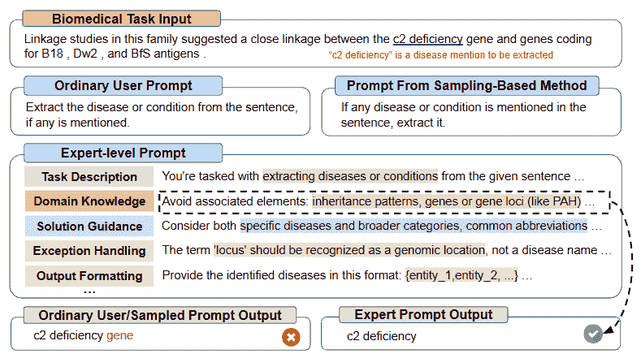

在API基础的LLM上自动化专家级的提示词工程带来了重大挑战，这主要是由于专家级提示词的复杂性，如图1所示。尽管最近的提示词优化方法已经开始利用迭代抽样或进化算法等技术，如蒙特卡洛搜索（Zhou等人，2022）或吉布斯抽样（Xu等人，2023），但它们主要采用启发式方法，如文本编辑或释义，生成候选提示词（Zhou等人，2022；Prasad等人，2023）。

这些方法也通常依赖于简单的迭代算法，并缺乏一个有原则的策略来指导探索。因此，它们倾向于从普通用户那里确定提示词的局部变体，很少能够达到专家级提示词的卓越和细微之处。关键是，这些方法中的许多都忽视了提示词工程本质上是一个需要人参与的应用。在这个过程中，人们通过修复中间的错误并通过迭代互动整合必要的领域知识来完善提示词。这个迭代完善的过程体现了人类专家如何制定出色提示词的优点。然而，挑战仍然存在，即人类的探索虽然有效，但在同时处理多个错误以探索提示词空间时可能成本高昂且效率较低，从而妨碍了专家级提示词的可扩展性。

为了解决上述挑战并结合人类似的探索和机器效率，我们在本文中介绍了 PromptAgent 。从人类的试错过程中汲取灵感，PromptAgent 无缝地结合了有原则的规划方法，特别是蒙特卡洛树搜索（MCTS），来策略性地优化提示词过程。值得注意的是，PromptAgent 将提示词优化重新定义为一个策略性规划问题，以解决专家级提示词空间的复杂性。在这个规划框架下，它通过试错迭代来检索模型错误，并利用LLM的自反能力（Jang，2023；Shinn等人，2023；Pan等人，2023）来生成有洞察力的错误反馈。这个反馈反过来在有效引导领域知识和深入提示词的过程中起到了关键作用。

通过策略性规划，PromptAgent 迭代地利用有洞察力的错误反馈（操作）来完善每个版本的提示词（状态）。从一个初始提示词（状态）开始，PromptAgent 系统地在树结构中扩展提示词空间，并优先考虑高回报的路径，以导航专家级提示词的广阔空间。基于原则的 MCTS 规划使 PromptAgent 能够预先考虑并模拟未来的回报，然后将这些回报反向传播，更新对当前提示词的信念，从而使 PromptAgent 能够在以后探索更有前景的替代方案。

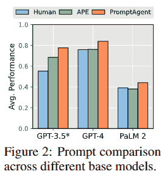

我们证明，通过将 PromptAgent 应用于涵盖三个实用且不同领域的12个任务：BIG-Bench Hard (BBH) (Suzgun等人, 2022)，以及特定领域和一般的NLP任务，PromptAgent 能够发现有生产力的专家级提示词。从一个初始的人工编写的提示词和一小组训练样本开始，PromptAgent 不仅大大提高了初始人类提示词的性能，而且还显著超越了强大的 Chain-of-Thought (CoT) 和近期的提示词优化基线。

例如，图2显示 PromptAgent 在GPT-3.5、GPT-4和PaLM 2中始终优于人类和自动提示词工程师(APE) (Zhou等人, 2022)的基线，分别比APE提高了9.1%、7.7%和6%。大量的定性结果进一步突显了优化提示词的专家级方面，表明 PromptAgent 有效地弥补了具有挑战性任务中的领域差距，提供了极高的探索效率和普遍性。随着我们预期更为强大的LLM的出现，这些LLM能够理解复杂的指令，我们相信专家级的提示词引导将引领提示词工程的下一个时代，在这一研究方向中，PromptAgent 站在了一个开创性的步骤上。

---

## 相关工作

### 提示优化。

自动发现最优提示已成为LLM时代的核心挑战。对于开源的LLM，可以利用其内部状态或梯度来训练额外的参数，例如软提示（Li & Liang, 2021; Lester等人, 2021; Hu等人, 2021; Wang等人, 2022），或通过基于梯度的搜索（Shin等人, 2020; Wen等人, 2023）或强化学习（Deng等人, 2022; Zhang等人, 2022）来搜索离散提示。

然而，这些方法对于闭源 LLM 不太可行，这促使人们研究无梯度的提示优化，通常只假设API和有限的训练集是可用的。大多数无梯度方法都遵循一个迭代的提示采样过程，即从初始提示开始，它们迭代地采样提示候选，并对其进行评分，以选择下一次迭代的最佳提示。许多方法强调提示候选的多样性——例如，基于编辑的方法，如删除或交换短语，回译，进化操作，或更相关的，基于自然语言反馈的LLM重写。

还有对其他采样过程的探索，如蒙特卡罗搜索，吉布斯采样或波束搜索。然而，PromptAgent 与上述所有方法在两个方面有本质的不同。首先，虽然已经研究了主要的搜索算法，但我们是首次将策略性计划引入提示优化研究。这种创新为有效地导航复杂的提示空间提供了一种结构化的方式，具有诸如前瞻和回溯的原则性能力。其次，大多数先前的方法将提示候选生成为局部变体，如释义或LLM采样，未能融入细粒度的领域见解。相反，我们将提示生成表述为状态转换，并策略性地将错误反馈转换为新状态，从而导向专家级提示。

### 使用自我反思和计划增强 LLMs。

尽管现代 LLMs 具有显著的能力，但它们还是存在一定的局限性，如长期的连贯性问题、缺乏内部世界模型、无法在真实世界中行动等。因此，最近将推理和工具等外部模块增强到 LLMs 已经引起了广泛的关注，其中有两种常见的策略与此相关：LLMs 的自我反思和计划。自我反思鼓励 LLM 进行内省，批判其输出，并随后提出更精细的解决方案。这已被利用于增强各种应用，从复杂的计算机任务、文本生成到推理。

此外，与 LLMs 的计划有助于评估和增强这些模型。在其核心，计划是智能代理生成一系列行动以实现特定目标的基本能力。有一项研究是直接提示和评估 LLMs 的计划任务。例如，基于翻译的方法将自然语言指令翻译成可执行的程序（例如，计划领域描述语言）来运行经典的计划算法。另一条更为接近的研究方向是用基于计划的算法增强LLMs的策略性推理能力。例如，思维之树（ToT）应用 DFS/BFS 增强 CoT 的提示，而 CoRe 和 RAP 都使用 MCTS 来导航更丰富的推理路径。然而，与现有的 LLM 增强努力相比，PromptAgent 是第一个专为提示优化量身定做的，将自我反思和计划的精神有机结合的新颖框架。

---

## 方法论

给定一个基本的 LLM `B` 和一个目标任务`T`，提示工程师的任务是制定一个最优化的自然语言提示 ，使`B`在`T`上的表现最大化。然而，新手和专家提示工程师之间的差距可能很大，特别是对于需要专门领域专长的任务，如生物医学领域。我们的主要目标是自动细化任务提示 来弥合这一知识差距，最大程度地减少人为干预。大多数现有的方法依赖于迭代地采样局部提示选择，这不仅资源密集，而且不能保证得到最优的最终提示。鉴于此，我们引入了 PromptAgent ，一个基于代理的框架，通过策略性计划和在提示过程中反映错误反馈来生成专家级任务提示，实现探索和性能之间的适当平衡。

### 问题公式化。

按照提示优化的标准设置（Zhou等人, 2022），我们从一个初始的自然语言任务提示 开始（例如，“让我们逐步解决这个问题”），并从目标任务 中取得一小部分训练样本，表示为  as  ，其中  是每个样本的输入/输出对（例如，一个问题及其答案）。给定由  和  组成的模型输入，基本`LLM` `B`根据 ¹进行预测（通常通过从左到右的生成过程）。提示优化的目标是找到最优化的自然语言提示 ，以最大化对测量函数`R`（例如，准确性）的表现。

这可以正式定义为一个优化问题:   ，其中  表示自然语言提示的样本空间，这是一个无限的、难以处理的空间，如果不是不可能的话，要全面列举。传统上，人类专家依赖于启发式和领域特定的见解的混合来制定这样的提示。尽管先前的优化方法已经试图利用迭代采样方法进行提示发现（Zhou等人, 2022），但我们通过提出一个统一的框架，无缝地整合策略性计划，以实现更优秀的、专家级的提示优化，进一步推进了这一研究方向。接下来，我们将介绍 PromptAgent 的公式化，然后介绍基于计划的提示优化。

¹注意，我们关注的通常是一个零样本设置，其中任务提示不包括任何训练样本。

### 3.1 PromptAgent 框架设计

PromptAgent 的目标是有效地将专家的先验知识整合到任务提示中，同时确保对广泛的提示空间进行高效和战略性的探索。在这个规划框架中，我们将状态定义为每一个迭代或版本的任务提示，即  。这允许系统地监控提示的演变并直接应用细化来修改它们。在此背景下，动作可以被认为是对当前提示（状态）的潜在修改，如单词替换或释义，这在先前的研究中已被探讨过(Jiang et al., 2020; Prasad et al., 2023)。然而，一个更为理想的动作空间应该引入更有效和有意义的修订，以调动先前的专家知识，最终指引向专家级别的提示。

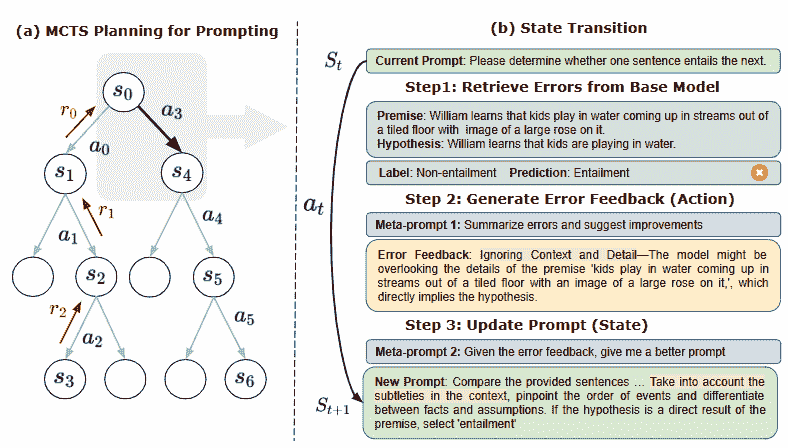

因此，我们提出基于错误的动作，其中每个动作都是基于基本模型所犯的某些错误生成的。具体来说，如图3（b）所示，动作被构架为错误反馈，以指导对提示的后续细化。这种错误反馈有效地提出了纠正模型错误的潜在方向，确保修订后的提示更好地指导基本模型避免之前观察到的陷阱。值得注意的是，这种方法也与最近关于LLM的自我反思能力的发现相呼应(Pryzant et al., 2023; Shinn et al., 2023; Paul et al., 2023)，这样一个LLM可以直接反思它们的错误以产生更好的提示修改。

考虑到状态和动作的定义，PromptAgent 将提示优化问题描述为一个马尔可夫决策过程（MDP），由四元组`(S, A, T, r)`表示。这里，`S`代表状态空间，`A`是动作空间，`T`定义了转移函数`T : S × A → S`，而`r`是奖励函数`r : S × A → R`。如图3(a)所示，对于任何给定的当前状态  ，PromptAgent  根据  迭代生成一个动作  ，其中  是优化器`LLM` `O`使用的元提示，用于促进动作生成。

具体来说，图3(b)显示了动作生成的两步过程：从训练样本中收集基模型的错误（步骤1）和反思这些错误以提取有用的错误反馈（步骤2）。然后，PromptAgent  根据转移函数  得到一个新的状态，其中`m2`是另一个帮助状态转移的元提示，也在`O`上操作。更具体地说，考虑到当前的错误反馈作为动作`at`，`m2`要求优化器生成一个新的提示（状态）来利用任何领域知识并有效地处理模型错误，这与提示专家根据错误反馈修订他们的提示是类似的。

最后，应用动作 后每个新生成状态 的质量由奖励函数  确定。与强化学习（RL）中奖励工程的复杂性相似，制定奖励可能会很复杂，以适应特定于任务的领域知识或偏好。在各种任务中不失我们框架的通用性，我们直接将奖励定义为在与给定的训练样本分开的预留集上的任务性能。然而，奖励的确切定义将取决于稍后描述的任务特定的指标。

### 3.2 对提示优化的策略规划

上述的提示优化的重新表述使我们能够无缝地将 PromptAgent 与主要的规划算法整合在一起，尤其是蒙特卡洛树搜索（MCTS）。这使得我们可以在平衡探索和利用之间，策略性地浏览广阔的提示词空间，以找到高奖励的错误反馈路径，从而得到最具普遍性的专家级提示。

具体来说，我们观察到某些错误反馈（动作）可能会将实例特定的细节注入任务提示（状态）中，这在任务方面很难泛化（利用），因此我们需要策略规划来探索新的错误反馈以获得更高的奖励（探索）。如图3(a)所示，MCTS通过逐渐构建一个树结构来实现这种策略规划，其中每个节点是一个状态，每个边是用于转换状态的动作。MCTS通过维护一个状态-动作值函数`Q : S × A → R`策略性地扩展这棵树，该函数表示将动作`at`应用于状态`st`的潜在未来奖励。换句话说，我们依赖这个函数  来预见并估算当前状态-动作对后的潜在奖励路径。为了更新这个`Q`函数并扩展树，MCTS迭代执行四个操作：选择、扩展、模拟和反向传播。当达到预定义的迭代次数时，迭代过程结束，然后我们为最终提示选择最高奖励的路径。接下来，我们将解释 PromptAgent 中的四个操作，而基于MCTS的提示优化的伪代码可以在附录的算法1中找到。

#### 选择

这是第一步，它在每个层级选择最有前景的节点以便进一步扩展和探索。在每次迭代中，它从根节点  开始，穿越每个树的层级，选择每个层级的后续子节点，并在叶节点处停止。在选择每个层级的子节点时，我们利用应用于树（UCT）的上界置信区间算法，这一算法以平衡利用（选择高价值节点）和探索（选择访问次数较少的节点）而著名，具体如下：

其中，  是节点`st`的动作集，  是节点`st`的访问次数，`ch(s, a)`表示在应用动作  后节点  的子节点，而`c`是用于调整探索的常数。

正如我们所看到的，第一个术语代表了`Q`值的利用，而第二个术语代表了探索，它衡量了访问次数较少的节点的不确定性。换句话说，如果一个节点被探索的次数较少，且其子节点之前被访问的次数较少，那么第二个术语的值会更高。

#### 扩展

通过在上一次选择步骤达到的叶子节点上添加新的子节点来扩展树。这是通过多次应用动作生成和状态转移（图3（b））完成的，从而产生多个新的动作和状态。注意，我们可能会取样多个训练批次来得到多样化的错误反馈（动作）。在新节点中，我们接着将奖励最高的节点发送到下一个模拟步骤。

#### 模拟

是一个前瞻步骤，用于模拟上一步扩展步骤中选定节点的未来轨迹。这个步骤通常伴随着一个放松策略，以快速到达终态并计算未来的奖励。放松策略的选择可以灵活，比如选择随机移动直到达到终态。为了降低模拟的计算成本和简化过程，我们重复进行之前的扩展步骤直到到达终态，即我们继续生成多个动作并在其中选择奖励最高的节点，然后进入下一个树层级。

#### 反向传播

当在模拟中遇到终态时，就会进行反向传播。当到达预定义的最大深度或遇到提前停止标准时，通常就定义为终态。我们然后沿着从根节点到终节点的路径反向传播未来的奖励，通过更新`Q`值函数。具体来说，对于路径中的每一对状态-动作，`Q(st, at)`通过聚合从`st`开始的所有未来轨迹的奖励进行更新，如下所示：

其中，`M`是从  开始的未来轨迹的数量，   和  分别代表从  和  开始的第`j`个状态和动作序列。

PromptAgent 用预定义的迭代次数执行上述四个操作，以稳定 `Q`值 并完全扩展树以探索庞大的提示词空间。最后，我们需要选择最佳路径和节点（即提示词）进行最终评估。这种输出策略可以利用多种备选方案，例如，可以选择在最佳路径中奖励最高的节点，或直接选择访问次数最多的叶节点。为了简单和实证目的，我们使用第一种策略选择输出提示词，这在我们的实验中效果最好。

---

## 实验

### 4.1 实验设置

#### 任务和数据集。

为了全面评估专家级提示词优化在广泛应用中的效果，我们从三个不同的领域策划了12个任务进行详尽的实验：`BIG-Bench Hard` (`BBH`)、特定领域和一般的`NLP`任务。`BBH` (Suzgun等，2022) 是一个挑战性的`BIG-Bench`任务子集 (Srivastava等，2023)，超出了当前`LLMs`的能力。我们选择了6个`BBH`任务，强调领域知识（例如，几何形状和因果判断）和复杂的推理能力（例如，桌上的企鹅、物体计数、认知推理和时间序列）。

我们还选择了三个在生物医学领域的特定任务，当制定专家级提示词时，明确需要领域洞察。这些任务包括疾病命名实体识别 (`NER`) 任务 (`NCBI`, Do˘gan等，2014)、生物医学句子相似性任务 (`Biosses`, So˘gancıo˘glu等，2017) 和医学问题回答任务 (`Med QA`, Jin等，2021)。此外，为了显示 `PromptAgent` 也可以普遍适用并对传统`NLP`任务有益，我们进一步选择了三个著名的`NLU`任务，即两个文本分类任务 (`TREC`, Voorhees & Tice, 2000 和 `Subj`, Pang & Lee, 2004) 和一个自然语言推断任务 (`CB`, De Marneffe等，2019)。

### 基线

我们将我们的方法与三种类型的基线进行比较：

+   普通的人类提示词

+   `Chain-of-Thought (CoT)` 提示词

+   最近的提示词优化方法

(1) 人类提示词是代表提示词工程普通水平的人类设计的指令，通常来自原始数据集。我们还有一个少示例版本的人类提示词，使用Suzgun等。(2022)为`BBH`任务和从训练集随机抽样的其他任务提供的教学示例。

(2) `CoT`提示词被认为是非常有效的技巧，通过引入中间推理步骤来提高`LLM`的性能，特别是对于`BBH`任务 (Suzgun等，2022)。我们直接使用Suzgun等。 (2022)为`BBH`任务提供的`CoT`提示词，并为其他任务构造`CoT`提示词。我们还有一个零示例版本的`CoT`，使用“`让我们一步一步地思考`”作为提示词来触发`CoT`行为，而不使用少示例 (Kojima等，2022)。

(3) 提示词优化方法包括`GPT Agent`和`Automatic Prompt Engineer (APE)` (Zhou等，2022)。`GPT Agent`代表了对`LLM`驱动的自主代理的最近的浓厚兴趣 (Weng, 2023)，例如`Auto-GPT²`。这样的代理预计会自主地进行规划和自我反思，以解决人类的请求，包括优化任务提示词。我们利用一个强大的`ChatGPT`插件 (OpenAI, 2023a) 和`GPT-4`, `AI Agents`³进行提示词优化。具体地说，类似于 `PromptAgent` ，我们采样类似的模型错误，并要求`AI Agents`插件根据错误重写提示词，迭代次数与 `PromptAgent` 相似。

最后，`APE`是最近的提示词优化方法之一，提出了一种基于蒙特卡罗搜索的方法，迭代地提出和选择提示词。

²`https://github.com/Significant-Gravitas/AutoGPT`

³`https://aiagentslab.com/`

### 实施细节

对于具有默认测试或验证集的数据集，我们使用其原始分割来获得我们的测试集。如果没有官方的训练/测试分割，如`BBH`任务，我们会采样一个相当大的集合以进行稳定的测试。如第3.1节所述，我们还分割一部分训练样本以计算奖励。数据集的详细信息可以在附录A.1中找到。除非另有说明，我们选择`GPT-3.5`作为默认的基础`LLM`进行优化，这是现代`LLM`中相当强大的一个。对于优化器`LLM`，我们需要一个具有良好的自我反思能力的，因此，使用`GPT-4`作为默认的优化器`LLM`。我们为基础`LLM`设置温度为0.0以进行预测，在其他情境中为1.0。

在实施 `PromptAgent` 时，我们设置`MCTS`的迭代次数为12，公式1中的探索权重`c`为2.5。在扩展步骤中，我们基于模型错误从训练样本中采样批次来生成动作。我们采样扩展宽度的批次，并为每个批次生成`num samples`的新提示词。每条路径的最大深度为`depth limit`。为简化这些超参数的调整过程，我们探索了三种设置：标准、宽和轻，其中标准和轻具有更大的深度，而宽在每个扩展步骤中生成更多的节点（具体参数可以在附录表7中找到）。基于奖励选择 `PromptAgent` 的最佳设置。在附录A中有更多详细信息，包括输入格式、数据分割，以及 `PromptAgent` 和基线方法的实施细节。

### 4.2 结果与分析

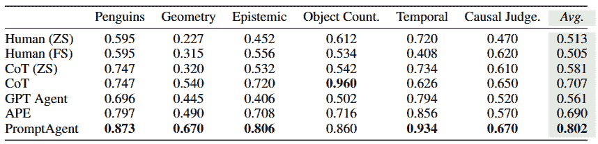

#### 与各种提示基线的比较

表1和2详细比较了 `PromptAgent` 生成的专家级提示与人类提示、`CoT`提示以及现有提示优化方法在跨越三个领域的12个任务中的表现。

从表1观察`BBH`任务， `PromptAgent` 在整体上显著优于所有基线，并分别比基线，即人类提示（`ZS`）、`CoT`和`APE`实现了28.9%、9.5%和11.2%的相对提高。

值得注意的是，与Suzgun等人（2022）的研究结果相似，`CoT`提示在`BBH`任务中比人类提示更为有效。这是因为`BBH`任务通常需要严格格式化的解决方案，可以通过逐步的`CoT`推理轻松诱导，这也解释了为什么`CoT`在最能从逐步解决方案中受益的对象计数上表现非常好。

然而， `PromptAgent` 在所有任务中（除了对象计数）仍然大大优于`CoT`，表明我们优化的专家级提示可以带来比少量的`CoT`推理（即使在零提示设置下）更大的改进。关于优化方法，尽管我们欣赏`GPT Agent`的计划和自我反思，但它的计划只用于单次的提示重写，而不是在全球范围内策略性地探索提示空间。

另一方面，`APE`显示了更大规模的搜索能力，但其探索基于蒙特卡洛搜索，这受到了低效规划和缺乏基于错误的反思的影响。`GPT Agent`和`APE`的这两个不足都表明了在 `PromptAgent` 中进行策略性规划的必要性，以充分探索提示空间并提供专家级提示。

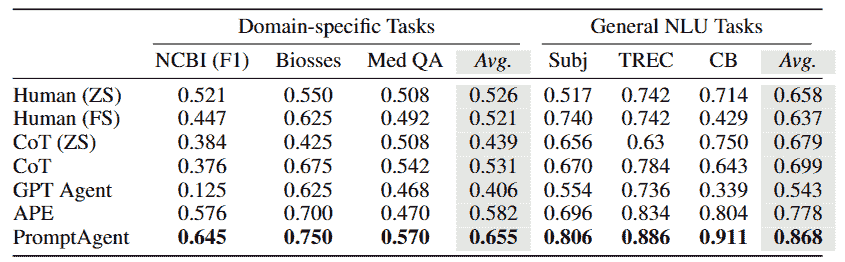

表2展示了特定领域和一般自然语言处理（`NLP`）任务的结果。前者涵盖了一系列广泛的生物医学任务，例如信息提取、句子相似性和问答。为这些任务制定提示需要大量的领域知识和重度的`LLM`提示工程技巧，在这里我们可以观察到直接的人类提示和`CoT`提示并不太有效。如 `APE` 这样带有自动提示采样和细化的提示优化方法有望在不需要太多人工干预的情况下结合领域知识。

值得注意的是， `PromptAgent` 平均提高了+7.3%，明显超过了`APE`，这表明 `PromptAgent` 可以更好地引导有效的领域知识，产生专家级提示，并缩小初学者和专家提示工程师之间的知识差距。对于一般的`NLP`任务， `PromptAgent` 的有效性和通用性得到了进一步的强调，分别比`CoT`和`APE`高出+16.9%和+9%。这暗示了即使对于一般的`NLP`任务，专家之间的差距也是不可忽视的，强调了在多种应用中需要专家提示的必要性。

#### 提示的泛化

接下来，我们进行实验，研究我们优化的提示是否可以推广到其他基础`LLM`。这强调了专家级提示的稳健性和可转移性，这两点是迫切需要的，并支撑了两个关键事实：

(a)专家提示中的领域洞察和微妙指导可以无缝地转移到强大的`LLM`，强化了专家提示的通用适用性；

(b)我们只需要优化每个任务一次，从而提高计算效率。

重点注意的是：`PromptAgent` 的主要目标是为最先进的`LLM`优化提示，以实现专家级提示，而像 `GPT-2` 或 `LLaMA`这样不太先进和较小的 `LLM` 可能不能熟练地掌握这些专家级提示的微妙之处，可能导致性能显著下降。尽管如此，为了全面评估，我们在这个实验框架内评估了两个额外的基础`LLM`，一个更强大（`GPT-4`）和一个不太稳健（`PaLM 2`）比`GPT-3.5`。

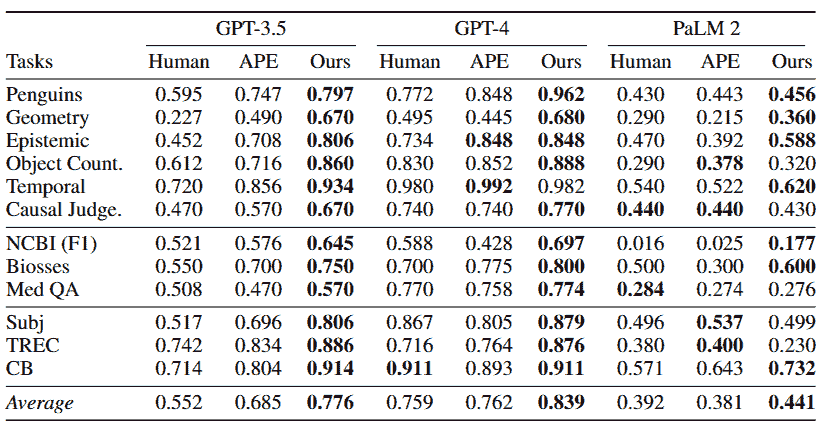

表3显示了当我们直接将从 `GPT-3.5` 优化的提示应用到 `GPT-4` 和 `PaLM 2`（`chat-bison-001`）在所有 12 个任务上的结果。为了比较，我们还将相同的人类和 `APE` 提示应用到这些基础`LLM`作为基准。对于某些任务，如 `Penguins`，我们可能会采用与表1中引用的提示略有不同的提示，使 `PaLM 2` 生成合理的响应，而不是持续的空白答案。观察表3，值得强调的是，当部署了一个更强大的基础 `LLM` 如 `GPT-4` 时，我们的专家提示进一步展现了增强，与人类和`APE`提示在几乎所有任务（11/12）上表现相当或优于它们（唯一的例外，`Temporal`，似乎被`GPT-4`以几乎完美的准确性解决了）。

这突显出专家提示的潜在能力，特别是随着更复杂的 `LLM` 在不久的将来的发展。当将专家提示转移到一个较弱的`LLM` 如 `PaLM 2` 时，其在所有任务上的性能意外地显著下降。然而，我们仍然观察到 `PromptAgent` 在7/12个任务上超过了两个基线，对于领域专门化的任务，如 `NCBI`，显示了专家提示中的领域洞察的有用性。

这凸显了专家提示的未被挖掘的潜力，尤其是考虑到在不久的将来更加复杂的 `LLM` 的发展。当将专家提示转移到一个较弱的 `LLM`，如 `PaLM 2` 时，其在所有任务上的表现意外地急剧下降。尽管如此，我们仍然观察到 `PromptAgent` 在7/12的任务上超过了两个基准，特别是在领域专门化的任务上，如 `NCBI`，表现出了很大的提高，这证明了来自专家提示的领域洞察的有用性。

#### 对搜索策略的消融分析

为了系统地研究 `PromptAgent` 中的战略规划的效果，我们通过与 `MCTS` 比较多种替代搜索策略（如单一的蒙特卡洛（`MC`）搜索、贪婪的深度优先搜索（`Greedy`）和集束搜索(`Beam`)进行了深入的消融研究。我们使用与 `PromptAgent` 相同的动作生成和状态转换，并仅将 `MCTS` 规划替换为每种搜索方法。具体来说，`MC` 是一个无方向的搜索，它通过随机抽样和选择一个动作来进行单步操作。`Greedy` 通过在每步中始终选择多个样本中的最佳样本来提供更有结构的探索。`Beam` 搜索也侧重于结构化探索，每个级别都保持多个有希望的路径。我们为所有三个基线保持相同数量的总体探索提示（探索效率；请参见下面的更多结果）以拥有类似的探索空间。关于搜索变体的更多实施细节，请参见附录A.4。

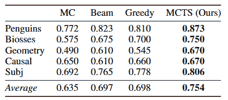

由于计算预算的限制，我们从所有三个领域选择了一个任务子集来比较上述所有搜索变体。表4显示，`Greedy` 和`Beam` 都大大提高了 `MC` 基线的性能，这表明在我们的框架中，结构化的迭代探索是必要的。在保持相同的探索效率时，我们观察到 `Beam` 和 `Greedy` 的整体性能相当。然而，这两种方法都没有策略性地探索提示空间，因为它们在一个严格的前进方向上操作，缺乏预见未来结果和回溯到过去决策的能力。相比之下，`MCTS` 的策略规划使 `PromptAgent` 能够更有效地导航复杂的专家提示空间，这在所有任务上都明显超越了所有搜索的消融，并相对于最佳基线获得了 5.6% 的整体提升。

#### 探索效率分析

除了卓越的性能外， `PromptAgent` 的一个关键优势是它可以通过策略规划高效地探索提示空间。探索效率也是使搜索的计算成本可管理的关键。因此，我们通过比较 `PromptAgent` 与前面部分中的一些搜索基线，包括贪婪搜索和`APE`，来分析探索效率。具体来说，探索效率是通过搜索过程中探索的提示数量来衡量的，即探索过程中生成的节点数量。我们在图4a中绘制了其与任务性能的关系。

贪婪搜索的 `Greedy-S` 和 `Greedy-L` 分别探索了 34 个和 72 个提示。`APE` 在每个任务中探索 150 个提示。该图显示， `PromptAgent` 的点聚集在左上角，表示在较少的探索节点（更高的探索效率）下有更高的准确性和出色的性能。值得注意的是，虽然增加贪婪搜索中的提示数量可能会提高性能（从`Greedy-S`到`Greedy-L`），但它需要更高的探索成本，且仍然不及 `PromptAgent` 。此外，没有原则性的指导，像 `APE` 这样无方向的搜索即使有更大的探索也无法有效提高性能。然而，为了保持探索效率和卓越的性能， `PromptAgent` 中的策略规划至关重要，值得在未来的研究中进一步投资。关于 `Greedy-S`、`Greedy-L` 和 `APE` 的详细超参数设置在附录 A.4 中。

| 表格5：针对`NCBI`任务的提示比较，包括正常人类提示、`APE`优化提示以及由 `PromptAgent` 优化的专家级提示。两个基线大部分描述了任务，而我们的专家提示由更复杂的结构和领域特定的见解组成，实现了更出色的性能。粗体文本表示通常由领域专家手工制作的领域知识，在这里由 `PromptAgent` 自动发现。我们用不同的颜色突出显示专家提示的不同方面，包括任务描述、术语澄清、解决方案指导、异常处理、优先级和强调以及格式设置。（最好用颜色查看） |  |  |

| --- | --- | --- |

| 方法 | 优化提示 | F1得分 |

| Human | 从句子中提取出疾病或疾况，如果有的话 | 0.521 |

| APE | 如果句子中提到了任何疾病或疾况，请提取出来 | 0.576 |

| `PromptAgent` | 您的任务是从给定的句子中提取疾病或疾况，请谨慎操作，避免包括任何相关元素，如遗传模式（如常染色体显性遗传）、基因或基因座（如`PAH`）、蛋白质或生物途径。该任务不涉及基于上下文中的其他高级生物学术语对疾病名称进行假设或推论。考虑具体的疾病和更广泛的类别，还要记住疾病和疾况也可以出现为常见的缩写或变体。以以下格式提供已识别的疾病或疾况：`{实体1，实体2，...}`。如果句子中没有疾病或疾况，请以以下形式输出一个空列表：`{}`。请注意，“`locus`”一词应被识别为基因组位置，而不是疾病名称。 | 0.645 |

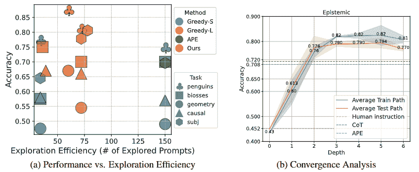

#### 收敛性分析

为了更深入地研究 `PromptAgent` 的学习过程，我们检查了整个树规划过程中专家提示的演变。具体来说，我们监控并可视化了与树深度相关的性能变化。如图4b中关于 `Epistemic` 任务所示，我们评估所有节点的性能，并在每个深度级别聚合训练（奖励）和测试性能。绘制的轨迹表示了训练（奖励）和测试的平均性能的演变，显示出一致的改进并逐渐超越所有基线方法。简洁起见，其他任务和超参数设置的收敛图，仅关注训练轨迹以减少测试集的计算开销，都提供在附录C和附录A.3中。一个经常出现的模式，类似于图4b中的模式，表明在初始迭代中存在上升趋势，这表明 `PromptAgent` 具有强大的学习动态，能够迭代地优化和增强专家提示。

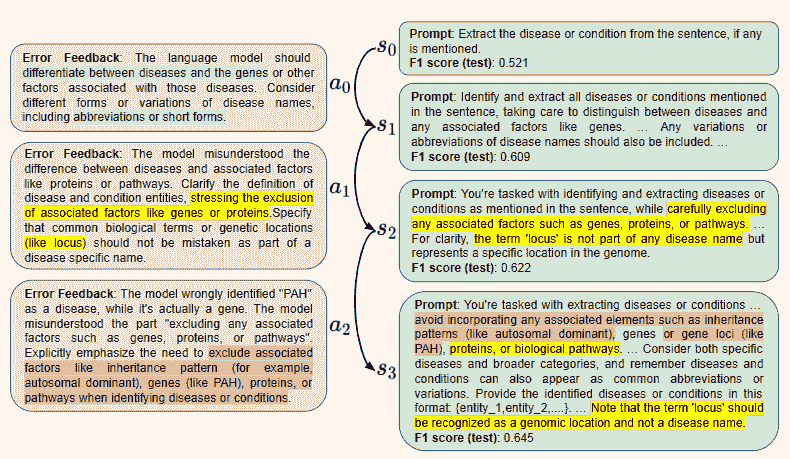

#### 定性分析

为了更直接地说明 `PromptAgent` 如何逐步利用错误反馈（动作）来增强提示（状态），我们进行了定性分析以检查 `PromptAgent` 探索的优化轨迹。图5显示了与`NCBI`任务（Do˘gan等人，2014年）相关的最佳奖励路径的初始四个状态和相应的三个动作-状态转换，以提取疾病实体。我们在动作和状态中都用颜色突出显示了领域洞察，其中一致的着色表示相似的洞察。可观察到，从初始的由人组成的提示 开始， `PromptAgent` 发现了各种有见地的错误反馈（动作）并有效地将它们合并到一个改进的测试性能的细化提示（状态）中。经过连续的转换，疾病实体的定义变得越来越精细，生物医学特定的细节被无缝整合。这个迭代过程的积累反映在最后的状态 中，这个状态吸收了其前面路径的累积洞察，呈现为专家级提示，从而实现了卓越的性能。

我们进一步注释了优化后的专家提示的各种质量方面，突出了专家提示如何推进提示工程和激发 `LLMs` 的高级任务理解的重要观点。如表 15 中对于 `NCBI` 任务所示，以及附录 D 中对所有其他任务的描述，与普通的人类提示和`APE`优化的提示相比， `PromptAgent` 提示通常更为详尽，提供了全面的任务指导，涵盖了各种不同的方面，如澄清术语、指导解决方案、处理特殊情况等。值得强调的是，尽管未来的研究可能会探索提示压缩技术（Jiang等人，2023年；Yin等人，2023年）来压缩专家提示而不牺牲性能，但专家级提示的增加复杂性自然与当代最先进的`LLMs`的进步相一致，使其能够更加深入地理解任务和人类的请求。

---

## 5 结论

在本文中，我们介绍了 `PromptAgent` ，一个能够自主制定给定任务的专家级提示的新颖提示优化框架。专家级提示与传统的提示工程有所不同，其有效性在于无缝整合领域洞察力并为领域专家弥合知识差距。为了实现这一点， `PromptAgent` 的核心是将提示优化视为一个战略规划问题，利用 `MCTS` 计划的力量来战略性和高效地遍历复杂的提示空间。

`PromptAgent` 通过基于 `LLMs` 的自我反思能力的试错方式，将任务中的领域特定知识整合到新生成的提示中。我们在三个不同领域的12个不同任务上测试了 `PromptAgent` 。 `PromptAgent` 优化的提示始终展现出专家级的特性，丰富的领域特定细节和指导。这些提示明显优于人为编写的、思维链提示和其他优化方法的基线。进一步深入分析揭示了我们的专家提示在转移能力、探索效率和质量上的优势，为未来的提示工程铺平了道路，以解锁最先进的`LLMs`的复杂任务理解。

---

## 参考文献

Tom Bylander. The computational complexity of propositional strips planning. Artificial Intelligence, 69(1-2):165–204, 1994.

Marie-Catherine De Marneffe, Mandy Simons, and Judith Tonhauser. The commitmentbank: Investigating projection in naturally occurring discourse. In proceedings of Sinn und Bedeutung, volume 23, pp. 107–124, 2019.

Mingkai Deng, Jianyu Wang, Cheng-Ping Hsieh, Yihan Wang, Han Guo, Tianmin Shu, Meng Song, Eric Xing, and Zhiting Hu. Rlprompt: Optimizing discrete text prompts with reinforcement learning. In Proceedings of the 2022 Conference on Empirical Methods in Natural Language Processing, pp. 3369–3391, 2022.

Rezarta Islamaj Do˘gan, Robert Leaman, and Zhiyong Lu. Ncbi disease corpus: a resource for disease name recognition and concept normalization. Journal of biomedical informatics, 47:1–10, 2014.

Chrisantha Fernando, Dylan Banarse, Henryk Michalewski, Simon Osindero, and Tim Rockt¨aschel. Promptbreeder: Self-referential self-improvement via prompt evolution. arXiv preprint `arXiv:2309.16797`, 2023.

Qingyan Guo, Rui Wang, Junliang Guo, Bei Li, Kaitao Song, Xu Tan, Guoqing Liu, Jiang Bian, and Yujiu Yang. Connecting large language models with evolutionary algorithms yields powerful prompt optimizers. arXiv preprint `arXiv:2309.08532`, 2023.

Shibo Hao, Yi Gu, Haodi Ma, Joshua Jiahua Hong, Zhen Wang, Daisy Zhe Wang, and Zhiting Hu. Reasoning with language model is planning with world model. arXiv preprint `arXiv:2305.14992`, 2023a.

Shibo Hao, Tianyang Liu, Zhen Wang, and Zhiting Hu. Toolkengpt: Augmenting frozen language models with massive tools via tool embeddings. arXiv preprint `arXiv:2305.11554`, 2023b.

Edward J Hu, Phillip Wallis, Zeyuan Allen-Zhu, Yuanzhi Li, Shean Wang, Lu Wang, Weizhu Chen, et al. Lora: Low-rank adaptation of large language models. In International Conference on Learning Representations, 2021.

Eric Jang. Can llms critique and iterate on their own outputs? evjang.com, Mar 2023. URL `https://evjang.com/2023/03/26/self-reflection.html`.

Huiqiang Jiang, Qianhui Wu, Chin-Yew Lin, Yuqing Yang, and Lili Qiu. Llmlingua: Compressing prompts for accelerated inference of large language models. arXiv preprint `arXiv:2310.05736`, 2023.

Zhengbao Jiang, Frank F Xu, Jun Araki, and Graham Neubig. How can we know what language models know? Transactions of the Association for Computational Linguistics, 8:423–438, 2020.

Di Jin, Eileen Pan, Nassim Oufattole, Wei-Hung Weng, Hanyi Fang, and Peter Szolovits. What disease does this patient have? a large-scale open domain question answering dataset from medical exams. Applied Sciences, 11(14):6421, 2021.

Ana Jojic, Zhen Wang, and Nebojsa Jojic. Gpt is becoming a turing machine: Here are some ways to program it. arXiv preprint `arXiv:2303.14310`, 2023.

Takeshi Kojima, Shixiang Shane Gu, Machel Reid, Yutaka Matsuo, and Yusuke Iwasawa. Large language models are zero-shot reasoners. Advances in neural information processing systems, 35:22199–22213, 2022.

Brian Lester, Rami Al-Rfou, and Noah Constant. The power of scale for parameter-efficient prompt tuning. In Proceedings of the 2021 Conference on Empirical Methods in Natural Language Processing, pp. 3045–3059, 2021.

Xiang Lisa Li and Percy Liang. Prefix-tuning: Optimizing continuous prompts for generation. In Proceedings of the 59th Annual Meeting of the Association for Computational Linguistics and the 11th International Joint Conference on Natural Language Processing (Volume 1: Long Papers), pp. 4582–4597, Online, August 2021. Association for Computational Linguistics. `doi:10.18653/v1/2021.acl-long.353`. URL `https://aclanthology.org/2021.acl-long.353`.

Bo Liu, Yuqian Jiang, Xiaohan Zhang, Qiang Liu, Shiqi Zhang, Joydeep Biswas, and Peter Stone. Llm+ p: Empowering large language models with optimal planning proficiency. arXiv preprint `arXiv:2304.11477`, 2023.

Nikolay Malkin, Zhen Wang, and Nebojsa Jojic. Coherence boosting: When your pretrained language model is not paying enough attention. In Proceedings of the 60th Annual Meeting of the Association for Computational Linguistics (Volume 1: Long Papers), pp. 8214–8236, 2022.

John McCarthy et al. Situations, actions, and causal laws. Comtex Scientific, 1963.

Gr´egoire Mialon, Roberto Dess`ı, Maria Lomeli, Christoforos Nalmpantis, Ram Pasunuru, Roberta Raileanu, Baptiste Rozi`ere, Timo Schick, Jane Dwivedi-Yu, Asli Celikyilmaz, et al. Augmented language models: a survey. arXiv preprint `arXiv:2302.07842`, 2023.

OpenAI, Sep 2023a. URL `https://openai.com/blog/chatgpt-plugins`.

OpenAI. Gpt-4 technical report. ArXiv, `abs/2303.08774`, 2023b. URL `https://api.semanticscholar.org/CorpusID:257532815`.

Batu Ozturkler, Nikolay Malkin, Zhen Wang, and Nebojsa Jojic. Thinksum: Probabilistic reasoning over sets using large language models. arXiv preprint `arXiv:2210.01293`, 2022.

Liangming Pan, Michael Saxon, Wenda Xu, Deepak Nathani, Xinyi Wang, and William Yang Wang. Automatically correcting large language models: Surveying the landscape of diverse self-correction strategies. arXiv preprint `arXiv:2308.03188`, 2023.

Bo Pang and Lillian Lee. A sentimental education: sentiment analysis using subjectivity summarization based on minimum cuts. In Proceedings of the 42nd Annual Meeting on Association for Computational Linguistics, pp. 271–es, 2004.

Debjit Paul, Mete Ismayilzada, Maxime Peyrard, Beatriz Borges, Antoine Bosselut, Robert West, and Boi Faltings. Refiner: Reasoning feedback on intermediate representations. arXiv preprint `arXiv:2304.01904`, 2023.

Archiki Prasad, Peter Hase, Xiang Zhou, and Mohit Bansal. Grips: Gradient-free, edit-based instruction search for prompting large language models. In Proceedings of the 17th Conference of the European Chapter of the Association for Computational Linguistics, pp. 3827–3846, 2023.

Reid Pryzant, Dan Iter, Jerry Li, Yin Tat Lee, Chenguang Zhu, and Michael Zeng. Automatic prompt optimization with” gradient descent” and beam search. arXiv preprint `arXiv:2305.03495`, 2023.

Taylor Shin, Yasaman Razeghi, Robert L Logan IV, Eric Wallace, and Sameer Singh. Autoprompt: Eliciting knowledge from language models with automatically generated prompts. In Proceedings of the 2020 Conference on Empirical Methods in Natural Language Processing (EMNLP), pp. 4222–4235, 2020.

Noah Shinn, Federico Cassano, Beck Labash, Ashwin Gopinath, Karthik Narasimhan, and Shunyu Yao. Reflexion: Language agents with verbal reinforcement learning. arXiv preprint `arXiv:2303.11366`, 2023.

Gizem So˘gancıo˘glu, Hakime ¨Ozt¨urk, and Arzucan ¨Ozg¨ur. Biosses: a semantic sentence similarity estimation system for the biomedical domain. Bioinformatics, 33(14):i49–i58, 2017.

Aarohi Srivastava, Abhinav Rastogi, Abhishek Rao, Abu Awal Md Shoeb, Abubakar Abid, Adam Fisch, Adam R Brown, Adam Santoro, Aditya Gupta, Adri`a Garriga-Alonso, et al. Beyond the imitation game: Quantifying and extrapolating the capabilities of language models. Transactions on Machine Learning Research, 2023.

Mirac Suzgun, Nathan Scales, Nathanael Sch¨arli, Sebastian Gehrmann, Yi Tay, Hyung Won Chung, Aakanksha Chowdhery, Quoc V Le, Ed H Chi, Denny Zhou, et al. Challenging big-bench tasks and whether chain-of-thought can solve them. arXiv preprint `arXiv:2210.09261`, 2022.

Ellen M Voorhees and Dawn M Tice. Building a question answering test collection. In Proceedings of the 23rd annual international ACM SIGIR conference on Research and development in information retrieval, pp. 200–207, 2000.

Zhen Wang, Rameswar Panda, Leonid Karlinsky, Rogerio Feris, Huan Sun, and Yoon Kim. Multitask prompt tuning enables parameter-efficient transfer learning. In The Eleventh International Conference on Learning Representations, 2022.

Sean Welleck, Ximing Lu, Peter West, Faeze Brahman, Tianxiao Shen, Daniel Khashabi, and Yejin Choi. Generating sequences by learning to self-correct. arXiv preprint `arXiv:2211.00053`, 2022.

Yuxin Wen, Neel Jain, John Kirchenbauer, Micah Goldblum, Jonas Geiping, and Tom Goldstein. Hard prompts made easy: Gradient-based discrete optimization for prompt tuning and discovery. arXiv e-prints, pp. arXiv–2302, 2023.

Lilian Weng. Llm-powered autonomous agents. lilianweng.github.io, Jun 2023. URL `https://lilianweng.github.io/posts/2023-06-23-agent/`.

# 参考文献

Hanwei Xu, Yujun Chen, Yulun Du, Nan Shao, Wang Yanggang, Haiyu Li, and Zhilin Yang. Gps: Genetic prompt search for efficient few-shot learning. In Proceedings of the 2022 Conference on Empirical Methods in Natural Language Processing, pp. 8162–8171, 2022.

Weijia Xu, Andrzej Banburski-Fahey, and Nebojsa Jojic. Reprompting: Automated chain-of-thought prompt inference through gibbs sampling. arXiv preprint arXiv:2305.09993, 2023.

Chengrun Yang, Xuezhi Wang, Yifeng Lu, Hanxiao Liu, Quoc V Le, Denny Zhou, and Xinyun Chen. Large language models as optimizers. arXiv preprint arXiv:2309.03409, 2023.

Fan Yin, Jesse Vig, Philippe Laban, Shafiq Joty, Caiming Xiong, and Chien-Sheng Jason Wu. Did you read the instructions? rethinking the effectiveness of task definitions in instruction learning. arXiv preprint arXiv:2306.01150, 2023.

Tianjun Zhang, Xuezhi Wang, Denny Zhou, Dale Schuurmans, and Joseph E Gonzalez. Tempera: Test-time prompt editing via reinforcement learning. In The Eleventh International Conference on Learning Representations, 2022.

Yongchao Zhou, Andrei Ioan Muresanu, Ziwen Han, Keiran Paster, Silviu Pitis, Harris Chan, and Jimmy Ba. Large language models are human-level prompt engineers. In The Eleventh International Conference on Learning Representations, 2022.

Xinyu Zhu, Junjie Wang, Lin Zhang, Yuxiang Zhang, Ruyi Gan, Jiaxing Zhang, and Yujiu Yang. Solving math word problem via cooperative reasoning induced language models. arXiv preprint arXiv:2210.16257, 2022.

---

## 附录

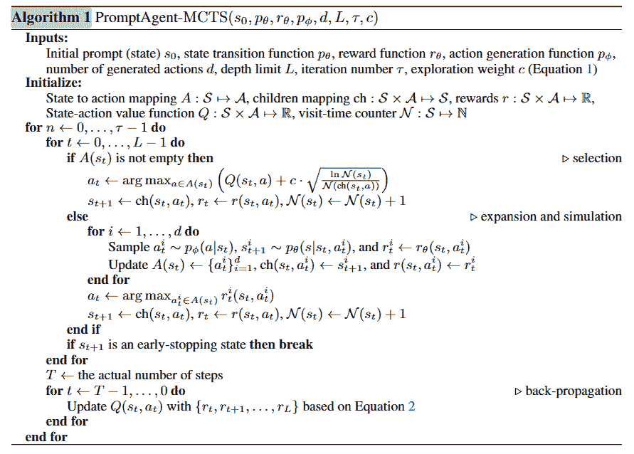

---

## A 更多的实验细节

### A.1 输入格式化

正常模型的输入由以下组件组成：

> `提示` + 任务前缀 + `问题` + 任务后缀 + 答案格式

“`提示`”是优化的目标。“任务前缀”（可选）是特定任务的背景简介（例如，企鹅表格中的背景数据）。“`问题`”是任务问题的主体。“任务后缀”（可选）包括选项（例如，在有多个选择的任务中的是/否，蕴含/非蕴含，或 A、B、C、D）。“答案格式”（可选）是为模型的响应设计的答案标题。任务输入的示例在附录B中。如第3.1节所解释的元格式和提示在附录A.5中。

### A.2 数据分割

对于有预定义测试集的数据集，我们直接使用它们作为我们的测试集。当这些测试集超过1000个示例时，我们从中抽取1000个。如果没有提供默认的测试集，我们会对数据进行随机排序，并为测试目的分配大约一半的数据。然后，我们从剩下的数据中抽取一个子集作为训练集。从这个训练集中，我们抽取一个留出子集来计算奖励，默认大小为150。如果训练集小于150或非常大，子集的大小将相应地在60到200个示例之间变化。数据分割的详细信息在表6中。

| 表格6：数据拆分 |  |  |

| --- | --- | --- |

| 任务 | 训练 | 测试 |

| Bigbench |  |  |

| Domain Knowledge（领域知识） |  |  |

| General NLP（通用自然语言处理） |  |  |

### A.3 更多实施细节

`PromptAgent` （我们的方法）。`PromptAgent` 在提示空间内执行`MCTS`规划，需要终止状态条件和奖励函数。当路径长度达到深度限制时，就会达到终止状态。奖励函数由基本模型在留出集上的表现决定。为了计算效率，为了避免不必要的探索，我们还在深度大于2后应用了一种早停方法：如果状态的奖励小于最小阈值或大于最大阈值，我们则达到一个早停状态。具体而言，最小阈值是其父节点和根节点的奖励的平均值，而最大阈值是所有当前节点的最大值，这鼓励更短的路径。我们现在进一步说明`算法1`的细节。

1. 初始化。`PromptAgent` - `MCTS`算法以初始提示作为根节点开始。对于`BBH`任务，我们直接采用原始数据集中的任务“描述”作为初始提示，除了`Object Counting`的默认描述不遵循指令格式。我们根据其任务目标或问题-答案格式为其余任务制定了初始提示。在第一次扩展之前，将评估根节点以获得奖励。

1. MCTS迭代。代理将执行12次`MCTS`迭代。在选择步骤中，从根节点开始，根据其`UCT`值（`公式1`）将最佳子节点添加到路径中，其中`UCT`中的探索权重`c`为2.5。在扩展步骤中，将从训练集中抽取宽度批次（批大小为5）的样本，并将每个批次提供给基础模型以收集错误。如果没有错误，此样本前向循环将迭代，直到找到错误为止。将使用错误字符串（如表8所示）格式化错误，并插入错误反馈（如表8所示，图3中的元提示1）由优化器总结错误。状态转移提示（如表8所示，图3中的`Meta-prompt 2`）包含扩展节点的提示，提示轨迹（从扩展节点的根到当前选定路径的提示列表）以及错误总结，将其提供给优化器以生成`num samples`新提示（节点）。如果它们不是终端节点，则将评估新节点并作为扩展节点的子节点添加。每次扩展将生成`expand width × num samples`新提示。模拟步骤将递归扩展路径中的最后一个节点，并选择奖励最高的一个添加到路径中。当最后一个节点满足终止条件或早停条件时，模拟停止。在反向传播过程中，从最后一个节点到根节点，累积奖励（从节点到叶/终端节点的奖励之和）将添加到节点的累积奖励列表中，其平均值将是节点的`Q`（`公式2`）。我们有三个超参数设置：标准，宽和`Lite`，如表7所示。在标准和`Lite`实验中，都有一个扩展宽度为3，`num samples`为1，但它们的深度限制分别为标准的8和`Lite`的4。`Wide`实验的`expand width`为3，`num samples= 2`，在每个扩展步骤中生成更多的节点，但深度限制为6，以限制探索的提示总数。我们根据最终奖励为每项任务选择最佳设置。

1. 输出策略。每个`MCTS`迭代都会从根节点输出到叶节点的一条路径，在搜索过程之后会生成数十个节点。我们选择平均奖励最高的路径，然后在路径中选择奖励最高的提示作为最终的输出提示。我们采用这种策略是因为平均奖励最高的路径代表了最佳的整体搜索轨迹，而且，最佳的提示可能并不总是在最佳路径上的最后一个节点，因为它可能由于达到深度限制而成为一个终端状态。

| 表 7： `PromptAgent` 实验的超参数设置 |  |  |  |

| --- | --- | --- | --- |

| 实验名称 | 标准 | 宽度 | 精简 |

| 深度限制 | 8 | 6 | 4 |

| 扩展宽度 | 3 | 3 | 3 |

| `NUM 样本` | 1 | 2 | 1 |

### A.4 基线实现细节

我们为实验中的各种基线描绘细节。

`蒙特卡洛` (`MC`)。`MC`执行一步采样多次，并选择最佳的一个作为优化提示。它使用与 `PromptAgent` 相同的提示采样方法，但将搜索深度限制为一。在搜索消融研究中，我们在每个任务中采样了72个新提示。

`集束搜索` (`Beam`)。`Beam`也使用与 `PromptAgent` 相同的扩展功能。除根节点外的每个节点都将扩展为3个新节点，集束宽度为3，这意味着搜索树的每个深度都将有9个节点，而最好的3个节点将被保留用于下一次扩展。根节点将扩展为9个新节点。搜索深度为8，因此总共有72个节点或新提示。

`贪婪搜索` (`Greedy`)。贪婪搜索基于集束搜索，但集束宽度为一，因此算法变为深度优先贪婪搜索。我们进行了两个实验，`Greedy-S`和`Greedy-L`，在图4a中，搜索深度相同为8，但扩展宽度不同。`Greedy-S`的扩展宽度为3，总共有34个提示。`Greedy-L`的扩展宽度为9，总共有72个节点，这也被称为表4中的`Greedy`基线。

`APE` (Zhou等，2022)。我们采用迭代`APE`作为我们的基线，正如原始论文 (Zhou等，2022) 所建议的那样。在生成新提示时，一个由5个数据片段组成的小批量被采样作为`APE`的输入-输出示例。具体来说，对于初始提案步骤，默认情况下采样10个数据批次，每个批次用于生成10个新提示。这在初始步骤中导致了总计100个候选提示。（由于`Med QA`的处理时间较长，因此在此阶段仅为其生成25个候选项。）随后，选择评估分数最高的五个提示进行迭代提案步骤。对于迭代提案步骤，与初始阶段类似，为每个建议的提示采样10个数据批次，这一步骤中总计有50个候选提示。此后，选择评估分数最高的提示作为优化提示。

### A.5 元格式

在这一部分，我们展示了 `PromptAgent` 中使用的元提示的完整格式。“输入格式”是给定问题时基础模型的实际输入。“错误字符串”代表每个错误示例的格式。“错误反馈”包括几个错误示例，并指导优化器模型收集错误反馈。“状态转移”指导优化器模型进行状态转换（生成新的提示），其中包括错误示例的信息和选定路径中的提示序列，即“轨迹提示”。

| 表8：元格式 |  |

| --- | --- |

| 格式名称 | 元格式 |

| 输入格式 | `提示` `任务前缀` `问题` `任务后缀` `答案格式` |

| 错误字符串 | `&lt;索引&gt;  模型的输入是：  `{问题}`  模型的响应是：  `{响应}`  正确的标签是：`{标签}`  模型的预测是 `{预测}` |

| 错误反馈 | 我正在为一个专门设计的任务写模型提示。  我的当前提示是：  `{cur-prompt}`  但是这个提示在以下示例中出错了：  `{error_string}`  对于每一个错误的示例，请仔细逐步检查每一个问题和错误的答案，提供全面且不同的原因，解释为什么该提示会导致错误的答案。最后，基于所有这些原因，总结并列出所有可以改进提示的方面。 |

| 状态转换 | 我正在为一个设计的任务为目标的语言模型编写提示。  我的当前提示是：  `{cur-prompt}`  但是这个提示在以下示例中是错误的：  `{error_string}`  基于这些错误，此提示的问题和原因是：  `{error_feedback}`  这里有一个包括当前提示在内的前序提示列表，每一个提示都是基于其前一个提示修改的：  `{trajectory-prompts}`  基于以上信息，请按照以下指引编写`{steps-per-gradient}`个新的提示： |

## B 任务输入示例

在这一部分，我们为基础模型展示了几个任务的输入示例。具体来说，我们的任务分为三类：多项选择、命名实体识别和直接答案匹配。作为代表性示例，我们选择了《桌上的企鹅》、NCBI和主观任务来说明输入格式。

| 🔴提示   🟠任务前缀  🟣问题   🔵任务后缀  ⚫答案格式 |

| --- |

| 桌上的企鹅 |

| 根据一张关于企鹅及其属性的表格回答问题。  这是一张表格，其中第一行是标题，每个随后的行都是一只企鹅： |

| NCBI任务的输入格式 |

| 从句子中提取疾病或病状（如果有提及的话）。  [`我们`, `的`, `结果`, `支持`, `vWS`, `的`, `链接`, `在`, `一个`, `紧密`, `关联`, `的`, `标记`, `区域`, `内`, `并且`, `不`, `支持`, `疾病`, `特征`, `的`, `位点`, `异质性`, `.`]  以此格式输出答案：`{实体_1,实体_2,...}`。 如果没有疾病实体，请以这种格式输出一个空列表：`{}`。 |

| Subjective主观任务的输入格式 |

| 请执行主观性分类任务。给定句子，从`['subjective','objective']`中分配一个标签。只返回标签，不带任何其他文本。  文本：`dreamcatcher` 讲述了四个年轻朋友执行英雄行为的故事 - 并被他们因此获得的神秘力量永远改变。上述文本是客观的还是主观的？  选项： |

## C 收敛观察详情

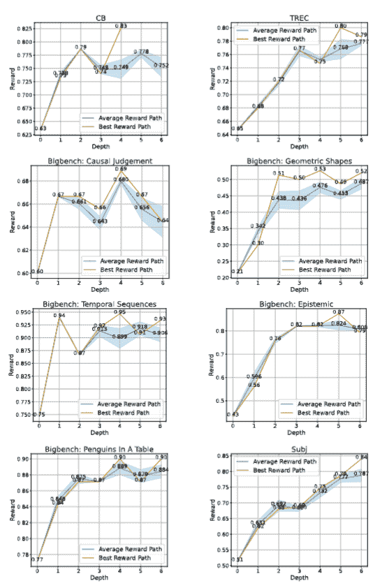

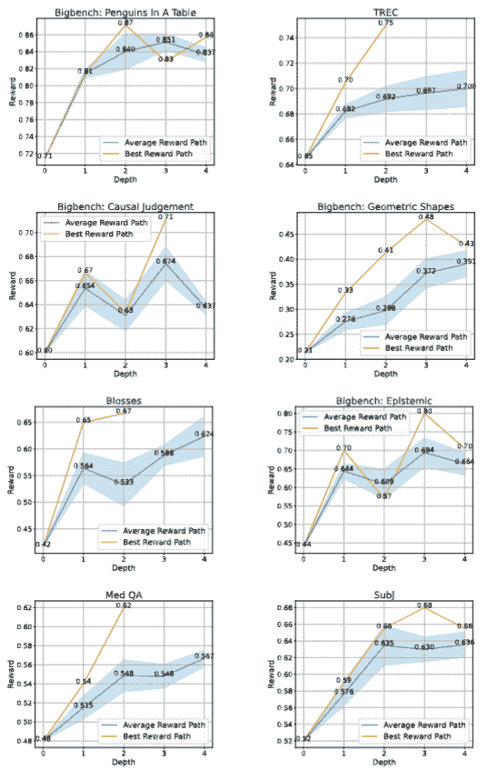

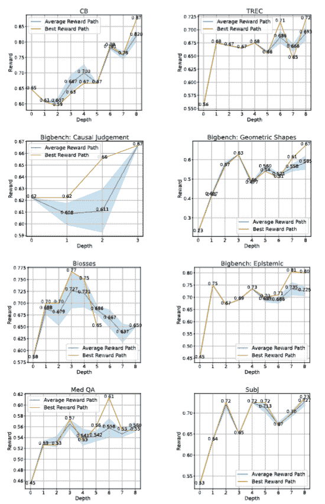

## D 由 `PromptAgent` 优化的提示

在这一部分，我们展示了所有任务的优化提示，说明 `PromptAgent` 优化的提示与普通人写的提示和`APE`优化的提示有何不同。

| 表9：几何形状任务的提示比较，包括普通人类提示、`APE`优化的提示和由 `PromptAgent` 优化的专家级提示。这两个基线主要描述了任务，而我们的专家提示由更复杂的结构和特定领域的洞察组成，取得了卓越的性能。粗体文本表示通常由领域专家手工制作的领域知识，但在这里是由 `PromptAgent` 自动发现的。我们用颜色高亮专家提示的不同方面，包括任务描述、术语澄清、解决方案指导、异常处理、优先级和重点、格式化。（建议使用颜色查看以获得最佳效果） |  |  |

| --- | --- | --- |

| 方法 | 优化提示 | 准确率 |

| 人类 | 根据它们的`SVG`路径命名几何形状 | 0.227 |

| APE | 确定每个`SVG`路径元素绘制的形状，然后将其与可用选择中的相应字母配对。在这种情况下，`C`代表六边形，`G`代表五边形，`I`表示扇形，`B`代表七边形。 | 0.490 |

| `PromptAgent` | 在这项任务中，您的任务是解释`SVG`路径，以确定它们代表的几何图形。路径由命令来界定：`&#x27;M&#x27;`（移动到）、`&#x27;L&#x27;`（连线到）和`&#x27;A&#x27;`（弧）。`&#x27;M&#x27;`命令启动路径，可能将路径分割成子路径，但关键是不要立即将每个`&#x27;M&#x27;`视为断开的图形的起点；通常，它们可能继续相同的几何形状，在其中表现为不同的部分。`&#x27;L&#x27;`命令构成线段，从而形成图形的边界。`&#x27;A&#x27;`命令生成弧线，根据它们的顺序，可以通过连续的动作线形成圆、扇形、椭圆图形或其他几何形状。请注意，一个`&#x27;A&#x27;`命令后面跟着一个`&#x27;L&#x27;`可能会导致像扇形这样的特定形状。检查`&#x27;M&#x27;`、`&#x27;L&#x27;`和`&#x27;A&#x27;`命令的顺序和相互作用，因为它们一起塑造最终的几何图形并显著控制其连续性。可能被识别的形状可以从简单的线到复杂的多边形。除非任务中另有说明，否则`&#x27;以上都不是&#x27;`只是一个有效的回应。在你形成答案时，请用明确的解释来支持它，这个解释包括每个命令的功能、它们的集体效果、顺序和它们的相关方面。在有多个`&#x27;M&#x27;`命令的情境中，避免任意地将形状分解成断开的图形；相反，将它们视为对同一个形状的不同部分的贡献。准确地计算`&#x27;L&#x27;`命令，因为它们定义了图形的边，即使存在`&#x27;M&#x27;`命令。为了弄清整个几何形状，仔细检查它的所有组件和命令，保持对形状进展的连续感知，尤其是在有多个`&#x27;M&#x27;`命令的情况下。在确定答案之前，准确地重新计算边和弧 - 这样的双重检查确保了对几何图形的无瑕鉴定。 | 0.670 |

| 表格10：针对`Penguins In A Table`任务的提示比较，包括普通人类写的提示、`APE`优化的提示，以及由 `PromptAgent` 优化的专家级提示。这两个基准主要描述了任务，而我们的专家提示由更复杂的结构和领域特定的洞察组成，从而实现了卓越的性能。粗体文本表示通常由领域专家手工制作的领域知识，但在这里是由 `PromptAgent` 自动发现的。我们用颜色突出显示专家提示的不同方面，包括任务描述、术语澄清、解决方案指导、异常处理、优先级和重点、格式化。（建议使用颜色查看以获得最佳效果） |  |  |

| --- | --- | --- |

| 方法 | 优化提示 | 准确率 |

| 人类 | 回答有关企鹅及其属性的表格中的问题 | 0.595 |

| APE | 仔细审查提供的表格或表格。理解与给定信息相关的查询。找出相关的数据并进行必要的计算或比较，以从给定的选项中确定正确的答案。 | 0.747 |

| 方法 | 优化提示 | 准确率 |
| --- | --- | --- |
| `PromptAgent` | 当您深入探索一个企鹅数据集时，评估关键属性，如名称、年龄和性别。在每只企鹅的背景下解读每个属性的意义，同时要记住数据集可能会被修改，包括增加或删除企鹅。当进行此类修改时，立即修正您的理解，重新进行计算，并确保您随后的计算考虑到这些变化。您的主要任务是识别属性之间的关系和模式，特别关注企鹅的名称和年龄。 | 0.873 |

## 表11：认知推理任务的提示词比较，包括普通人类的提示词、APE优化的提示词和由 `PromptAgent` 优化的专家级提示词。两种基准大都描述任务，而我们的专家提示词由更复杂的结构和领域特定的见解组成，实现了卓越的性能。粗体文本表示通常由领域专家手工制作的领域知识，但在此是由 `PromptAgent` 自动发现的。我们用不同的颜色突出显示专家提示词的不同方面，包括任务描述、术语澄清、解决方案指导、异常处理、优先级和重点、格式化。（建议使用颜色查看以获得最佳效果）

| 方法 | 优化提示 | 准确率 |
| --- | --- | --- |
| 人类 | 确定一句话是否蕴含下一句 | 0.452 |
| APE | 确定假设是否直接由前提所暗示。如果前提的声明是假设中提到的个体的直接主张或信念，选择'蕴含'。然而，如果前提是基于假设中的主体之外的某人的信仰或假设形成的，选择'非蕴含'。 | 0.708 |
| `PromptAgent` | 您的任务是批判性地分析主句，即'前提'，目的是确定它是否明确支持后续句子或'假设'的真实值。前提和假设之间的关系可以分类为'蕴含'或'非蕴含'。如果前提提供了有力的证据证实假设的真实性，而不需要额外的上下文，就将其标记为'蕴含'。但是，如果前提对假设的支持并不完全明确，请选择'非蕴含'。 解读句子中的语义对您的最终决定至关重要。如'假设'、'相信'、'认为'、'感觉'、'怀疑'等词应该被尊重，因为它们有可能引入不确定性和主观性，并且不应被视为假设的确凿证据，无论它们是否构成嵌套的信仰。此外，详细的前提并不一定否定更普遍的假设。例如，提到'全脸面罩'的前提与提到'面罩'的假设相关。 | 0.806 |

## 表12：对象计数任务的提示词比较，包括普通人类的提示词、APE优化的提示词和由 `PromptAgent` 优化的专家级提示词。两种基准主要描述任务，而我们的专家提示词由更复杂的结构和领域特定的见解组成，实现了卓越的性能。粗体文本表示通常由领域专家手工制作的领域知识，但在此是由 `PromptAgent` 自动发现的。我们用不同的颜色突出显示专家提示词的不同方面，包括任务描述、术语澄清、解决方案指导、异常处理、优先级和重点、格式化。（建议使用颜色查看以获得最佳效果）

| 方法 | 优化提示 | 准确率 |
| --- | --- | --- |
| 人类 | 计算所有物品的总数。 | 0.612 |
| APE | 计算所有物品的总数，即使它们是按组提到的。 | 0.716 |
| `PromptAgent` | 仔细分析给定的信息。为每个提及的物品编制目录，并标记明确定义的数量。如果没有明确说明物品的数量，可以假设它为一个单位。但是，对于有明确数量的物品，请确保分别计算每个单位，并将其包括在您的总数中。如果识别到集体术语或类别，将它们细分为各自的组成部分，并合理地将每个部分与其说明的数量关联起来。然后为这些类别计算一个综合总数，确保总数包括所有个体单位，而不是子集或类型的数量。请记住，每个物品都有其独特的数量，但相关的或属于一个公共类别的物品应该作为这样来统计，它们的单独数量精确地贡献给最终的总数。避免对物品的性质或分类做出假设，并坚守通常接受的定义和分类。复查您的工作，以确保准确性并避免计数错误。如果需要，考虑在不同的类别、类型或子类型中的物品来修改您的策略。最终，总结数量，指出每个识别的物品或类别的特定数量以及单位的总数，而不是类别，或者按照明确的要求提供一个综合概述。 | 0.86 |

## 表13：时间序列任务的提示词比较，包括普通人类的提示词、APE优化的提示词和由 `PromptAgent` 优化的专家级提示词。两种基准主要描述任务，而我们的专家提示词由更复杂的结构和领域特定的见解组成，实现了卓越的性能。粗体文本表示通常由领域专家手工制作的领域知识，但在此是由 `PromptAgent` 自动发现的。我们用不同的颜色突出显示专家提示词的不同方面，包括任务描述、术语澄清、解决方案指导、异常处理、优先级和重点、格式化。（建议使用颜色查看以获得最佳效果）

| 方法 | 优化提示 | 准确率 |
| --- | --- | --- |
| 人类 | 回答关于某些事件可能发生的时间的问题 | 0.72 |
| APE | 确定个体未被注意到的时期，并有可能在指定地点的关闭时间之前访问 | 0.856 |
| `PromptAgent` | 通过检查个体的日常活动系列，确定他们何时空闲，何时忙碌。使用这些空闲时间来指示他们可能参与其他活动的时间。醒来后，一个人不会立刻变得忙碌。考虑任何潜在的限制或关闭时间，并使用这些作为指标，表明事件不能在这些时间内发生。活动的重叠是不允许的，所以在创建时间线时确保没有重叠。与潜在事件的工作时间交叉检查空闲时间段，以准确推导出事件最可能发生的时间间隔。 | 0.934 |

## 表14：因果判断任务的提示词比较，包括普通人类的提示词、APE优化的提示词和由 `PromptAgent` 优化的专家级提示词。两种基准主要描述任务，而我们的专家提示词由更复杂的结构和领域特定的见解组成，实现了卓越的性能。粗体文本表示通常由领域专家手工制作的领域知识，但在此是由 `PromptAgent` 自动发现的。我们用不同的颜色突出显示专家提示词的不同方面，包括任务描述、术语澄清、解决方案指导、异常处理、优先级和重点、格式化。（建议使用颜色查看以获得最佳效果）

| 方法 | 优化提示 | 准确率 |
| --- | --- | --- |
| 人类 | 回答关于因果归因的问题 | 0.47 |
| APE | 对于每种情况，决定结果是故意造成的还是不是。如果事件背后的个体或团体知道可能的结果并选择继续，选择‘A’。如果他们并不打算让结果发生，即使他们知道它可能发生，选择‘B’。 | 0.57 |
| `PromptAgent` | 针对因果归因的问题进行回应，重点关注问题中特别强调的实体或实体。仔细研究可能同时独立操作的多因子原因，并识别个体行动背后的潜在意图。区分直接和偶发起源，并确定每个因素在创造结果中的贡献。检查在直接情境和更大的系统框架内的原因相互作用。坚决遵循上下文中提供的细节，并避免做出不受所提供证据支持的假设。始终考虑多个原因对单一效应的复杂性，并抵制将效应归因于单一原因。认识到原因之间可能存在的协同作用及其产生的效果。 | 0.67 |

## 表格 15：NCBI 任务的提示词比较，包括普通人类的提示词、APE 优化的提示词，以及由 `PromptAgent` 优化的专家级提示词。这两个基准主要描述了任务，而我们的专家提示词则由更复杂的结构和特定领域的见解组成，取得了更好的性能。加粗的文本表示通常由领域专家手工制作的领域知识，但在这里是由 `PromptAgent` 自动发现的。我们用不同的颜色突出显示专家提示词的不同方面，包括任务描述、术语澄清、解决方案指导、异常处理、优先级和重点、格式化。（建议使用颜色查看以获得最佳效果）

| 方法 | 优化提示 | F1分数 |
| --- | --- | --- |
| 人类 | 从句子中提取疾病或病状，如果有提及的话。 | 0.521 |
| APE | 如果句子中提到了任何疾病或病状，提取它。 | 0.576 |
| `PromptAgent` | 您的任务是从给定的句子中提取疾病或病状，记住要小心，并避免包括任何关联的元素，如遗传模式（例如常染色体显性）、基因或基因位点（如PAH）、蛋白质或生物途径。此任务不包括基于上下文中的其他高级生物学术语对疾病名称进行假设或推断。请考虑具体的疾病和更广泛的类别，并记住疾病和病状也可能出现为常见缩写或变体。以这种格式提供识别的疾病或病状：`{实体1,实体2,...}`。如果没有出现疾病或病状，以这种形式输出一个空列表：`{}`。请注意，`locus` 这个词应被识别为基因位置，而不是疾病名称。 | 0.645 |

## 表16：Biosses任务的提示词对比，包括普通人类提示、APE优化的提示和由 `PromptAgent` 优化的专家级提示。两个基线主要描述任务，而我们的专家提示由更复杂的结构和特定领域的洞见组成，达到了卓越的性能。粗体文本表示通常由领域专家手工制作的领域知识，但在此是由 `PromptAgent` 自动发现的。我们用不同的颜色突出显示专家提示词的不同方面，包括任务描述、术语澄清、解决方案指导、异常处理、优先级和重点、格式化。（建议使用颜色查看以获得最佳效果）

| 方法 | 优化提示 | 准确率 |
| --- | --- | --- |
| 人类 | 这是一个生物医学句子相似性任务。请仔细阅读以下句子，并评估两个输入句子的相似性。可以选择'不相似'、'有点相似'和'相似' | 0.55 |
| APE | 仔细检查给定的两个句子，并评估它们的内容相似性。如果句子讨论的是完全不同的主题或概念，请选择选项A（不相似）。如果它们有一些共同点，但也有所不同，请选择选项B（有点相似）。选择选项C（相似）如果句子主要传达相同的信息或可以互相替代。” | 0.7 |
| `PromptAgent` | 对于此任务，您被要求进行生物医学句子相似性评估。请检查两个输入句子并评估它们的相似性，不仅要考虑到共同的术语或概念，还要考虑它们涉及的复杂科学语言、特定过程和独特的主题内容。不仅要考虑主题内容，还要考虑预期的目的，比如它们是否都描述了一个过程、报告了一个发现或详细描述了一种方法或技术。如果它们的主题或重点是明确的，就将相似性评为'不相似'；如果它们讨论了相关的主题或分享了一些细节但并不完全相同，就评为'有点相似'；如果句子在主题和结论上完全反映了彼此，就评为'相似'。请记住，此任务要求的不仅仅是对关键词的粗略扫描——请关注细微的含义，注意讨论的概念或过程的普遍性或特异性程度，并努力全面理解内容。 | 0.75 |

## 表格 17：用于 Med QA 任务的提示比较，包括普通人类的提示、APE 优化的提示以及由 `PromptAgent` 优化的专家级提示。两个基准线主要描述了任务，而我们的专家提示则由更复杂的结构和特定领域的见解组成，取得了卓越的表现。粗体文本表示通常由领域专家手工制定的领域知识，但在此由 `PromptAgent` 自动发现。我们用颜色突出显示了专家提示的不同方面，包括任务描述、术语澄清、解决方案指导、异常处理、优先级和重点、格式化。（建议使用颜色查看以获得最佳效果）

| 方法 | 优化提示 | 准确率 |
| --- | --- | --- |
| 人类 | 请使用您在医学领域的专业知识来解答问题。 | 0.508 |
| APE | 对于每一个呈现的临床情况，仔细审查给出的症状和详细信息。从A-E选项中选择一个最能确定所述病况的原因或诊断。 | 0.47 |
| `PromptAgent` | 充分利用您的全面医学专长，像处理复杂的拼图一样处理每一个呈现的情境，这需要仔细、无偏见的评估。从患者的年龄、性别、生活方式、症状、实验室结果和过去的医疗史，到可能与其状况相关的最近活动的每一个信息片段，在塑造您的判断时都扮演着同样重要的角色。 | 0.57 |

## 表格18: 用于"主观任务"的提示比较，包括常规的人类提示、APE优化的提示，以及由 `PromptAgent` 优化的专家级提示。两种基线主要描述任务，而我们的专家提示由更复杂的结构和特定领域的见解组成，取得了优越的性能。加粗的文本表示通常由领域专家手工制作的领域知识，但在这里是由 `PromptAgent` 自动发现的。我们用颜色突出显示专家提示的不同方面，包括任务描述、术语澄清、解决方案指导、异常处理、优先级和重点、格式化。（建议使用颜色查看以获得最佳效果）

| 方法 | 优化提示 | 准确率 |
| --- | --- | --- |
| 人类 | 根据给定的文本，选择‘主观’或‘客观’ | 0.517 |
| APE | 确定所提供的文本是陈述事实和细节(客观)还是表达个人观点、情感或选择(主观) | 0.696 |
| `PromptAgent` | 仔细检查给定的文本，决定它是‘主观’还是‘客观’。如果它似乎受到作者个人情感、观点或信仰的显著影响，请将叙述定义为‘主观’。相反，‘客观’的叙述应该公正地描述事实或情境，不受个人偏见、先入为主的信仰和作者自己的信念的影响。重要的是要理解，情感密集的语言、生动的描述或人物的情感状态的描述并不总是暗示主观性。它们可能只是为了真实地代表情境，而不传达作者的个人立场。非常规的标点、对话或提问并不固有地导致作者的主观性。清晰地区分作者的主观性和人物的主观性；误解人物的主观性为作者的个人偏见是一个常见的陷阱。优先考虑在叙述中提取作者的倾向，而不是关注人物。利用这些指示批判性地分析文本。 | 0.806 |

## 表19：TREC任务的提示词比较，包括常规人类提示词、APE优化的提示词和由 `PromptAgent` 优化的专家级提示词。两个基准主要描述任务，而我们的专家提示词由更复杂的结构和特定领域的见解组成，达到了卓越的性能。粗体文本表示通常由领域专家手工制作的领域知识，但在这里是由 `PromptAgent` 自动发现的。我们用不同的颜色突出显示专家提示词的不同方面，包括任务描述、术语澄清、解决方案指导、异常处理、优先级和重点、格式化。（建议使用颜色查看以获得最佳效果）

| 方法 | 优化提示 | 准确率 |
| --- | --- | --- |
| Human | 根据问题的主要主题为文本打标签。从以下选项中选择：(A) 缩写，(B) 实体，(C) 描述和抽象概念，(D) 人，(E) 地点，(F) 数值 | 0.742 |
| APE | 根据问题的主要主题为文本打标签。如果问题围绕一个人展开，选择“人”(D)。如果问题需要对一个概念进行解释或描述，选择“描述和抽象概念”(C)。如果问题是关于特定的地方，选择“地点”(E)。如果问题涉及特定的物体或事物，则选择“实体”(B)。如果问题涉及数据或时间长度，选择“数值”(F)。忽略“缩写”(A)，因为它与任何问题都不相关。 | 0.834 |
| `PromptAgent` | 对于上面给出的问题，确定它旨在引出的回答类型，然后从以下选项中选择最合适的标签：(A) 缩写，(B) 有形和无形实体（包括明确的术语、理论、发明、现象），(C) 描述和抽象概念（涉及解释、澄清、理论观点），(D) 个体和集体人类（包括特定的人、某些作品的创作者、团体、组织），(E) 地点，或 (F) 数值（包含数字、日期、时间、数量）。关键是问题所寻求的答案类型，而不是问题中的其他元素。您分配的标签应优先考虑主要的回答，而不是其他细节。如果单一标签没有完全解答问题的意图，则您可以分配多个标签。标签应反映假设答案的性质，而不仅仅是问题的内容或偶然特征。选择您认为最适合问题主要意图的标签。 | 0.886 |

## 表20：CB任务的提示词比较，包括常规人类提示词、APE优化的提示词和由 `PromptAgent` 优化的专家级提示词。两个基准主要描述任务，而我们的专家提示词由更复杂的结构和特定领域的见解组成，达到了卓越的性能。粗体文本表示通常由领域专家手工制作的领域知识，但在这里是由 `PromptAgent` 自动发现的。我们用不同的颜色突出显示专家提示词的不同方面，包括任务描述、术语澄清、解决方案指导、异常处理、优先级和重点、格式化。（建议使用颜色查看以获得最佳效果）

| 方法 | 优化提示 | 准确率 |
| --- | --- | --- |
| 人类 | 仔细阅读以下前提和假设，并确定它们之间的关系。从“矛盾”、“中立”和“蕴含”中选择。 | 0.714 |
| APE | 确定前提和假设之间的联系。如果假设恰好是前提的合理结果或推断，将其标记为“蕴含”。如果假设提出了一个与前提相矛盾的场景或与之冲突，将其归类为“矛盾”。如果假设既不与前提相冲突，也不是从前提中得出的，将其称为“中立”。 | 0.8036 |
| `PromptAgent` | 您的任务是深入探讨提供的前提和假设。在考虑语言可以传达同一思想的多种方式时，突出显示对话中的明确、核心信息和重要实体。请注意，假设可能反映、重述或重申前提中的观点，可能是以简化的方式。然而，请记住，单纯的逐字重复并不自动意味着“蕴含”。假设中的重述应代表前提中的一个关键观点，以便将其归类为蕴含。如果假设声称的内容与前提中的内容截然相反，请将其标记为“矛盾”。对于前提和假设之间似乎没有关联或没有明确关系的情境，请使用“中立”。在处理歧义时要保持警惕，并努力在假设的背景下对其进行解码。不要让细微的或假设性的陈述从中分散您识别假设中的主要观点的注意力。您的分类，“蕴含”、“矛盾”或“中立”，应严格反映从前提和假设中得出的基本关系，而不受个人观点或结论的影响。优先考虑理解对话的核心意图和背景，而不仅仅是重复单词或短语。 | 0.911 |
