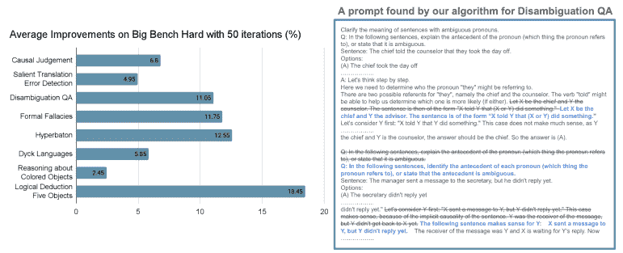
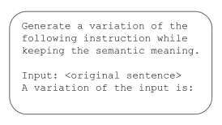
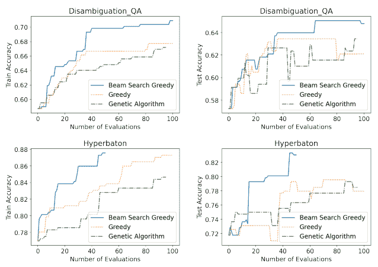
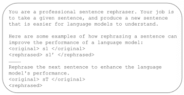
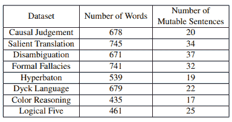
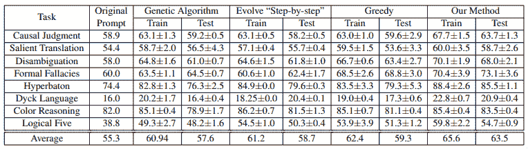
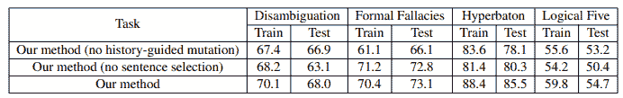
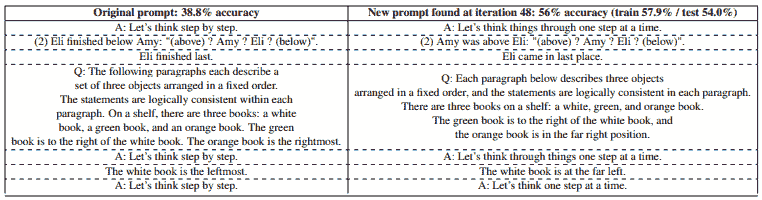
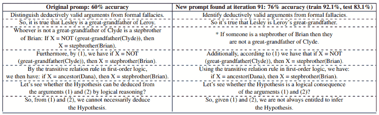

# 长提示自动化

> 来源：[https://vxc3hj17dym.feishu.cn/docx/MDJ4dkX0Vo6Cf8xgqcHcLjyznLb](https://vxc3hj17dym.feishu.cn/docx/MDJ4dkX0Vo6Cf8xgqcHcLjyznLb)

本文为论文《Automatic Engineering of Long Prompts》的中文精校解读

原文地址：https://arxiv.org/abs/2311.10117

PDF文档：https://arxiv.org/pdf/2311.10117.pdf

---

## Automatic Engineering of Long Prompts 长提示词的自动化工程

---

## 摘要

大型语言模型（LLMs）已在解决复杂的开放领域任务中展现出显著能力，这一成就得益于以提示词形式提供的全面指令和示范。然而，这些提示词往往很长，通常包含数百行、数千个词符，其设计通常需要大量人力投入。近期的研究探讨了短提示词的自动化工程，这些提示词通常由一句或几句话组成。然而，长提示词的自动设计仍是一个挑战性问题，原因在于其巨大的搜索空间。在本论文中，我们研究了贪婪算法和遗传算法在自动化长提示词工程中的表现。我们展示了一个简单的贪婪方法结合集束搜索在搜索效率上胜过其他方法。此外，我们引入了两种新技术，利用搜索历史记录来增强基于LLM的突变在搜索算法中的有效性。我们的结果表明，所提出的自动化长提示词工程算法在Big Bench Hard的八项任务中平均取得了9.2%的准确率提升，突显了自动化提示词设计对于充分利用LLMs能力的重要性。

---

## 1 引言

在大数据集上训练时，大型语言模型（LLMs）展现出了显著能力，证明了它们在不需要微调的情况下理解复杂和冗长指令的能力，这些指令适用于多种任务（Wei等，2022a; Brown等，2020; Chowdhery等，2022; Ouyang等，2022）。近年来，出现了几种提示词设计原则，表明将更复杂的指令、示范和思维链推理整合到提示词中可以提高在挑战性任务上的表现（Brown等，2020; Wei等，2022b），包括涉及数学问题解决（Cobbe等，2021）和推理（Suzgun等，2022; Srivastava等，2022）的任务。然而，解决复杂任务的有效提示词通常包含数千个词符，这在设计和优化它们时构成了挑战。图1展示了Big Bench Hard中一个任务的长提示词（Suzgun等，2022），其中包含一个指令和几个示例，每个示例都有人类编写的思维链。

众多研究已经展示了LLMs对提示词的敏感性，揭示了微小的修改，如增加或删除几个词符或改写提示词，都可能显著影响LLM的表现（Liu等，2023; Zhu等，2023; Jiang等，2020）。因此，提示词设计已成为一项劳动密集型工作。更复杂的是，LLMs的快速演变使得为特定LLM精心设计的提示词在应用于更新版本的LLM时效果不佳。这凸显了自动化提示词工程技术的需求。

尽管最近已经研究了自动化提示词工程，但现有研究（Deng等，2022; Xu等，2022; Guo等，2023; Fernando等，2023）主要关注于优化由一句或几句话组成的简短指令。这些方法要么通过搜索词替换来演化提示词，要么利用LLMs重写整个提示词（Xu等，2022; Fernando等，2023; Guo等，2023; Yang等，2023）。对于像图1中的长提示词，应用这些方法是具有挑战性的。对于长提示词，基于词替换的搜索面临着巨大的搜索空间，而使用单个LLM查询重写整个提示词极其困难。虽然可以将这些方法应用于提示词中的单个句子，但我们观察到，调整单个句子可能不足以改善长提示词的表现（参见第4节）。因此，如何自动找到更好的长提示词以及通过调整长提示词可能带来的潜在性能提升，在文献中仍然是未回答的问题。

我们的自动化提示工程技术中的主要操作是通过查询大型语言模型（LLMs），用语义上等价的句子替换原句。通过比较贪婪算法和遗传算法这两种代表性离散优化算法的优缺点，我们展示了一种简单的集束搜索贪婪算法更为有效。此外，对于长提示词工程来说，识别要更改的句子以及更改的方向是很重要的。因此，我们提出了两种新颖的技术，利用搜索历史来增强我们算法中基于LLM的变异的有效性。

我们的贡献可以总结如下：

+   据我们所知，本文首次正式讨论了自动化长提示工程，证明了在多个任务上的显著性能提升。

+   我们提出了一种可以迅速优化提示的贪婪算法，并引入了一种新颖的引导变异方法来加强收敛。

+   我们在Big Bench Hard (BBH)基准上进行了实验（Suzgun等人，2022年; Srivastava等人，2022年），其中的提示包含了数千个标记，包括指令和思维链推理。我们的结果证明，所提出的自动化长提示工程方法显著提升了性能。值得注意的是，如图1所示，我们在从BBH选出的8个任务上实现了平均9.2%的绝对准确率提升，仅在训练集上进行了50次评估。

---

## 2 相关工作

大型语言模型（LLMs）通过提示词无需微调即可执行复杂任务的卓越能力，显著扩展了它们的适用性。因此，设计有效的提示词以充分利用LLMs的能力已成为一个重要议题。最近研究了许多关于提示词设计的主要方式（Reynolds和McDonell，2021; Brown等，2020; Wei等，2022b; Wang等，2022a, 2023a）。例如，一个精心设计的提示词可能包括一个系统提示（例如，“你是一个AI编程助手”）、概述任务的指令提示、多个上下文示例，以及一个解释示例背后逐步思维过程的思维链推理部分。通过整合这些元素，有效的提示词通常包含数十句话和数千个词符。

另一条与之正交的先前工作探索了软提示词调优，这是一种使用标准连续优化算法在连续嵌入空间中优化提示词的技术（Lester等，2021; Zhang等，2021; Wang等，2022b）。尽管能够达到令人满意的表现，但软提示词缺乏可解释性，并且无法通过LLM API应用。此外，这些参数高效的微调方法需要大型训练集，使它们不适合于数据有限的应用，如仅有数十或数百个样本的应用。

考虑到训练数据的有限可用性（<1000个样本），我们的重点在于探索优化硬提示词的策略，这些提示词在语义上等同于原始提示词，但能产生更优的表现。在自动化提示词工程的背景下，文献考虑了两种主要设置。第一种设置与我们的工作一致，假设存在一个初始的人工制作的提示词，并旨在对其进行改进或提炼以实现更好的表现。为此设置提出了几种离散搜索算法：(Xu等，2022)采用了基因算法进行提示词调优，利用回译、完形填空和句子延续来突变初始指令。最近，(Fernando等，2023; Guo等，2023)提出了利用LLMs进行突变和交叉操作的进化搜索，而(Yang等，2023)展示了LLMs在基于先前适应度得分生成改进的提示词变体方面的优化能力。然而，这些提示词演化技术被设计用于长提示词中的短句或段落。例如，许多方法试图仅演化提示词中的指令部分或“让我们一步步思考”的句子。我们的工作旨在提供完全自由来演化整个长提示词，这既为改进开辟了更多途径，也在确定如何以及在何处更改原始提示词上带来了挑战。

另一种设置专注于在没有预先存在的提示词的情况下自动生成提示词。(Honovich等，2022)展示了LLMs在提供输入-输出对时生成简要任务描述的能力。在此技术基础上并结合随机搜索，(Zhou等，2022)提出了一种能够根据给定对生成提示词的自动化提示词工程（APE）算法。(Pryzant等，2023)探讨了利用输入-输出对反馈来精炼指令的方法的使用，而(Chen等，2023)则开发了一种采用贝叶斯优化在连续空间内搜索的连续松弛方法。

---

## 3 提出的方法

在本文中，我们解决了针对语言模型的自动化长提示词工程的挑战。给定一个语言模型 L 和一个为特定任务由人设计的初始提示词  ，我们的目标是改进提示词以达到更优的表现。为了增强提示词，我们获得了一个有限的训练集（例如，100个输入-输出对） {(x_{i} , y_{i})}^{n}_{i=1} 来进行性能评估。具体来说，对于每个样本，我们通过  L([p, x_{i}]) 进行预测，并评估其与相应真实标签 y_{i} 的一致性。我们定义   为提示词 p 在训练集上的性能指标。我们考虑的场景是可用样本数 n 有限，这是个常见情况，即个人缺乏足够数据进行模型微调，但仍可以利用数据来设计改进的硬提示词。我们将在未用于提示词搜索的保留测试集上评估泛化性能。

在本节中，我们首先介绍我们算法的搜索空间以及如何使用LLM导航这个空间（第3.1节）。然后，我们深入探讨了提出的带有集束搜索的贪婪算法，在第3.2节中突出显示其相较于普通贪婪算法和基因算法的优势。最后，第3.3节展示了如何利用搜索历史来指导提出的框架以提高其性能。

### 3.1 搜索空间

我们的目标是生成一个在语义上与原始提示相似，同时实现性能提升的新提示。此外，我们避免引入无法解释的标记，例如对抗性触发器（Zou等人，2023年）。这些限制提供了两个优点：1）我们算法发现的提示是可解释的，便于验证提示是否仍然执行预期的任务；2）由于我们只提供了有限的训练样本集（例如，100个），限制搜索空间可以缓解过拟合的问题。

为了在此空间内进行提示搜索，我们将长提示分解为m个单独的句子：  。然后我们允许每个句子在保留其语义意义的同时被改写。由于大型语言模型（LLMs）擅长句子改写，特别是当提供诸如“在保持语义意义的同时生成以下指令的变体”这样的提示时，我们采用一个配备有此类提示的LLM变异器来识别每个句子的替代表达方式。我们用于原始LLM变异器的提示可以在图2中找到。LLM变异器的改进版本将在3.3节中介绍。

### 3.2 搜索算法

使用LLM-Mutator进行搜索的一种直接方法是以下贪婪算法。在每次迭代中，我们随机选择一个句子，记为  ，并利用LLM-Mutator生成一个替代句子  。然后，如果新生成的提示词提高了性能，我们用 s^{′}_{(i)} 替换旧提示词中的  。然而，我们观察到这种普通的贪婪方法容易陷入局部最优。在我们的问题中，训练集非常有限，以至于有时一个不利的修改在训练得分中不会反映出来。因此，由于评估不足，有时会接受不利的编辑，这会损害提示词未来的改进。

为了解决这个问题，我们提出进行集束搜索，维护一个由k个表现最佳的提示词组成的池子，记为  。在每次迭代中，我们随机选择这k个提示词中的一个进行改进。然后我们评估这个新的候选提示词，并维护top-k提示词池。这种方法确保了即使引入了不利的编辑，从这些错误中恢复仍然是可能的，因为我们不仅保留了最优的提示词。我们的实验表明，与纯贪婪算法相比，这种方法显著提高了训练和测试性能，如图3所示。

值得注意的是，我们的方法与遗传算法（GA）密切相关。GA是一种广为认可的用于涉及黑盒函数的离散优化的方法。假设 P = \{p_{1}, . . . , p_{k}\} 代表当前池中的解决方案，GA应用变异和交叉操作到这个池子，以生成一组新提出的候选解决方案  。然后评估这些新提出候选解决方案的适应度得分（解决方案的表现）。随后，在进行下一次迭代之前，只保留 P ∪ P^{′} 中表现最佳的k个解决方案。

虽然GA具有很高的探索能力，但在初始阶段其收敛速度相当慢。考虑到我们搜索空间的广阔性以及人工编写的初始提示词的相对良好质量，在前几次迭代中进行的大多数变异和交叉产生了表现不佳的候选解决方案。评估这些候选解决方案在计算上是昂贵的，即使它可以增强解决方案的多样性。

我们的算法实际上是GA的“贪婪”版本。我们维护一个大小为k的候选集，并在生成每个新候选解决方案后立即更新候选池，而不是等待整个后代的评估完成后再更新池。因此，我们的解决方案池更加及时，与GA相比收敛速度更快。图3进一步验证了这一观察，展示了GA学习曲线的初始增长较慢。

### 3.3 历史引导搜索

在提示词中随机重述一个句子类似于在语义等效句子空间内进行随机变异，可能需要大量尝试才能获得好的解决方案。在本小节中，我们演示如何利用搜索历史引导变异朝向更有目的的方向。

**单句引导变异。**在迭代T时，我们可以将搜索历史表示为  ，其中 s^{before}_{t} 是变异前的句子，   是变异后的句子，奖励 r_{t} 表示得分的变化（如果变异提升了性能，   为正；如果降低了性能，   为负）。假设 s_{T} 是当前选定进行变异的句子，我们可以利用历史引导变异朝向更高的奖励。例如，如果我们知道将句子“因此，Lesley是Leroy的曾祖父“So, it is true that Lesley is a great-grandfather of Leroy””重述为“因此，Leslie是Leroy的曾祖父"Therefore Leslie is Leroy’s greatgrandfather."”可以提高性能，那么对于另一个句子“因此，Dana的每个祖先都是Brian的继兄弟”“So, it is true that everyone who is an ancestor of Dana is a stepbrother of Brian”，我们可能想将其改写为“因此，Dana的每个祖先都是Brian的继兄弟”“Therefore everyone that is an ancestor of Dana is Brian’s stepbrother.”。

已显示LLMs能从上下文示例中学习（Zhang等，2021）。因此，我们提议让LLM-Mutator在上下文中从历史学习。这可以通过在提示词中列出历史来完成：如果  ，我们包括一个上下文示例  ；如果   ，我们包括  。LLM-Evolver的提示词如图4所示。由于历史可能很长，且显示放入过多上下文学习示例可能对性能不利，我们在重述句子时只检索少量相关历史条目。具体来说，当演化 s_{T} 时，我们计算 s_{T} 和每个 s^{before}_{t} 之间的相似性，通过 ϕ(s_{T})^{T} ϕ(s^{before}_{t}) 计算，其中 ϕ 是句子编码器（我们在实验中使用T5 (Raffel等，2020)句子编码器）。然后我们只选择通过一定阈值的条目作为上下文示例。

**句子选择的引导采样。**自动化长提示词工程的一个挑战在于确定提示词中哪些句子应该修改以提高性能。我们的实验表明，修改长提示词中的少数几个句子可以显著提升其有效性，但更改需要在正确的地方。因此，偏向于选择更有影响力的句子进行修改的采样分布是有益的。

我们将句子选择建模为一个上下文多臂赌博机问题（Langford和Zhang，2007；Li等，2010）。在上下文多臂赌博机问题中，每次迭代时，学习者面临m个与特征向量 x_{1}, . . . , x_{m} 相关联的臂，学习者试图在每轮中拉动一个臂以优化整体奖励。在我们的情况下，m个臂对应于提示词中的m个句子  ，特征可以通过   获得，其中   是文本编码器。利用特征信息至关重要，因为如果修改特定句子可以带来性能提升，那么修改类似的句子也可能产生积极的结果。

然后，我们采用Lin-UCB算法（Li等，2010），这是一种广泛认可的用于上下文多臂赌博机问题的算法，来引导句子选择。给定历史 ，我们计算基础奖励模型的线性估计器  ，（公式1）

其中   是一个   行   列的矩阵，每行是  ，而  。这实际上是带有特征矩阵 和奖励  的岭回归的解。然后使用以下UCB（上限置信区间）规则来选择用于变异的句子：  ，（公式2）其中  。由于这种Lin-UCB估计可能不够准确，我们允许算法以概率   完全随机选择一个臂，以概率   根据 Eq.（公式2）选择句子。

---

## 4 实验结果

在本节中，我们提供了实证证据，证明所提出的长提示调整方法能够显著提高在Big-Bench Hard (BBH)基准测试（Suzgun等人，2022年；Srivastava等人，2022年）上的性能。接着，我们进行了消融研究，分析了所提算法的有效性，并展示了该算法如何优化人编写的提示的定性结果。

### 4.1 实验设置

我们考虑了在(Suzgun等人，2022年)中为BBH任务开发的提示，这些提示包括两部分：任务描述和示范。任务描述提供了描述任务的指令，而每个示范包括问题、逐步展示解决问题过程的思维链演示，以及最终答案。在提示调整期间，格式（例如，“问题。”、“答案。”）被保留，而调整算法被允许修改包括指令部分和思维链部分在内的任何其他部分。表1总结了本研究中使用的数据集的统计信息。每个数据的完整提示可以从 https://github.com/suzgunmirac/BIG-Bench-Hard 下载。

每个任务包括250个样本，随机分为50%用于训练和50%用于测试。只有训练样本用于提示调整。所有任务都是多类别分类问题，我们在比较不同调整方法时报告了训练数据、测试数据和合并数据集上的准确率。

对于主要实验，我们评估了在 text-bison模型上的性能，并使用了指令调整的PaLM 2-L模型作为LLM变异器。这两个模型都属于PaLM 2模型家族（Anil等人，2023年）。跟随之前的提示调整工作，我们将温度设置为0。然而，为了增强句子变异的多样性，我们将LLM变异器的温度设置为0.5。

### 4.2 主要结果

我们将提出的算法与以下基准进行比较：

+   原始提示：由人类设计的原始提示的性能（Suzgun等人，2022年），这也是其他调整方法的初始状态。

+   遗传算法：用于长提示调整的遗传算法实现。为了更好地与我们的方法比较，我们将池大小设置为4。在每一步中，通过对池中排名靠前的候选者随机变异和交叉生成8个新候选者。

+   逐步演化：“逐步思考”的概念是近期提示调整研究中探索的内容，例如在思维链提示中使用的“让我们逐步思考”句子（Kojima等人，2022年）。我们采用了单句优化的最新方法（Yang等人，2023年）来优化思维链提示中所有的“让我们逐步思考”句子。

+   贪婪算法：在3.2节中提到的简单贪婪方法，我们只在池中存储性能最佳的候选者，并在其基础上生成新候选者。

对于我们的方法，我们在所有实验中使用相同的超参数。我们将所有实验的池大小（集束大小）设置为4。在3.3节中应用引导变异时，我们使用T5编码器对当前条目和历史记录进行编码，并将嵌入归一化为单位ℓ2范数。我们只检索前4个历史条目，并要求编码历史和当前句子之间的ℓ2距离低于0.5。在应用3.3节中描述的句子选择算法时，我们在方程式(2)中设置α = 0.05，并设置P = 0.5。请注意，这些超参数并未经过良好调整。

对于这个实验，我们将计算预算限制为对训练集的50次评估，并报告了每种方法所达到的训练、测试和综合准确率。所有实验均运行三次，我们报告平均值和标准差。结果汇总在表2中。我们提出的算法胜过了其他方法，在所有任务中显示出显著的准确率提高。我们还计算了整个数据集（包括训练和测试）上准确率的提升，并在图1中报告了准确率增益。

在所有8个任务中，我们的算法在测试准确率上平均获得了8.2%的提升，在完整评估集（训练 + 测试）的准确率上获得了9.2%的提升。在这些任务中，我们在逻辑推理任务上获得了最大的性能提升（18.45%），而在关于彩色对象推理（颜色推理）的任务上获得了最小的提升（2.45%）。颜色推理性能提升小的一个潜在原因是原始提示已经达到了非常高的准确率，因此没有太多提升空间。

比较基准方法，很明显，单句演化（逐步演化）在长提示调整中未能取得实质性改进。这主要是因为长提示调整通常涉及超过20个句子，包含详细的指令和解释，因此单纯地修改“让我们逐步思考”不太可能导致显著增强。此外，遗传算法和贪婪算法各自展示了它们的局限性，这些局限性在与我们的方法相比表现出较差的性能，这些在3.2节中有所讨论。

尽管能够显著提升性能，我们的搜索过程中也观察到了一定程度的过拟合。尽管提出的集束搜索方法可以部分缓解过拟合问题（见3.2节），但我们在大多数情况下仍然观察到训练准确率高于测试准确率。然而，由于性能提升显著，即使在测试集上，算法找到的提示仍然比原始提示要好得多。

### 4.3 消融研究

我们对3.3节中引入的两种技术进行了消融研究：历史引导的变异和上下文多臂赌博机算法用于句子选择。结果在表3中呈现。我们可以观察到这两个组成部分都对模型的最终性能有所贡献。

### 4.4 定性结果

自动化硬提示词工程的一个重要好处是，结果提示仍然可被人类解释，允许用户轻松验证修改。我们在表4和表5中提供了我们的搜索发现的一些成功示例。在每个表中，我们仅展示了BBH初始提示与我们方法所做更改的不同部分。

表4中展示的第一个例子是关于五个对象的逻辑推理任务。初始提示的准确率为38.8%，而在第48次迭代中找到的修改后的提示将性能提升到了57.9%的训练准确率和54.0%的测试准确率。我们观察到，大多数更改涉及对原始句子的轻微修订，而没有改变其含义。这些看似微不足道的修改可以导致LLM准确率的显著提升，展示了自动长提示工程的重要性。

表5中的第二个提示是针对正式谬误任务的，旨在判断给定的逻辑陈述是否有效。初始提示的准确率为60%，而在第91次迭代中找到的修改后的提示将训练准确率提升到92.1%，测试准确率提升到83.1%。与前一个案例类似，大多数更改涉及轻微修订。在这种情况下，我们还想强调所提方法的一个潜在限制，这可能是未来工作的改进方向。在标有*的句子中，修订后的句子与原句在语义上并不等价。原句和修订后的句子代表了不同的逻辑陈述（原句：非A → B；新句：B → 非A）。然而，LLM似乎无法检测到这种微妙的区别，导致了错误的改写。尽管这种改变提高了训练准确率，但实际上降低了测试准确率。因此，错误的变异可能导致过拟合，而在搜索过程中开发策略以减轻这些错误将是未来研究的一个有趣领域。

---

## 5 结论、局限性和未来工作

我们研究了自动提示工程在长提示上的问题，这些提示通常包含数千个标记。我们调查了标准贪婪算法和遗传算法的性能，并开发了一种产生优越性能的新型搜索算法。仅通过对训练集进行50次评估，我们的方法在Big Bench Hard的8个任务中平均绝对准确率提升了9.2%。这证明了自动长提示调整的显著潜在好处，并强调了这一新兴领域的重要性。

作为首篇专注于整个长提示的自动工程的论文，我们识别了当前方法的几个局限性，这可能会引导有趣的未来研究：

+   目前的算法依赖于使用另一个LLM来改写句子。正如4.4节中所示，这种LLM变异器在句子重写过程中可能引入错误，尤其是在复杂句子（例如，在复杂的逻辑推理任务中的CoT）中。因此，提高LLM变异器的“正确性”是一个有趣的未来研究领域，这在我们的工作以及其他近期研究（Fernando等人，2023年；Guo等人，2023年）中还未完全解决。

+   与任何其他训练或调整算法一样，自动提示工程可能会过度适应训练数据，正如第4节中所讨论的。这种过拟合可以通过应用额外的正则化技术来缓解，例如通过减少修改句子的数量来施加稀疏性约束。然而，需要进一步的研究来确定自动提示工程最有效的正则化策略。

+   在当前实现中，我们将长提示分解成单独的句子，并一次修改一个句子。然而，在变异过程中同时操作多个句子，或将多个句子合并成一个句子可能会有益。为此过程提出一个自动化机制将是提升我们方法的一个有趣方向。

+   尽管我们的算法能够在训练集上少于100次评估中找到一个好的解决方案，但成本仍然不容忽视，尤其是当使用具有成本或速率限制的API进行提示调整时。应用早停技术，其中表现不佳的候选者的评估被提前终止，可能会减少查询的数量。

+   尽管自动化提示工程可以取得显著提升，但硬提示词的搜索空间具有有限的表示能力，这限制了进一步性能的提升。已经表明软提示词调整具有有限的表示能力（Wang等人，2023b），而我们的搜索空间是软提示的一个小子集。因此，当提供了充足的数据、计算资源和对LLM的白盒访问时，（高效参数的）微调可能仍然能够实现更优越的性能。

---

## 致谢

我们感谢Ruochen Wang、Vineet Gupta、Kedar Dhamdhere、Daliang Li对宝贵的讨论和反馈。

---

## 参考文献

Rohan Anil, Andrew M Dai, Orhan Firat, Melvin Johnson, Dmitry Lepikhin, Alexandre Passos, Siamak Shakeri, Emanuel Taropa, Paige Bailey, Zhifeng Chen, et al. 2023. Palm 2 technical report. arXiv preprint arXiv:2305.10403.

Tom Brown, Benjamin Mann, Nick Ryder, Melanie Subbiah, Jared D Kaplan, Prafulla Dhariwal, Arvind Neelakantan, Pranav Shyam, Girish Sastry, Amanda Askell, et al. 2020. Language models are few-shot learners. Advances in neural information processing systems, 33:1877–1901.

Lichang Chen, Jiuhai Chen, Tom Goldstein, Heng Huang, and Tianyi Zhou. 2023. Instructzero: Efficient instruction optimization for blackbox large language models. arXiv preprint arXiv:2306.03082.

Aakanksha Chowdhery, Sharan Narang, Jacob Devlin, Maarten Bosma, Gaurav Mishra, Adam Roberts, Paul Barham, Hyung Won Chung, Charles Sutton, Sebastian Gehrmann, et al. 2022. Palm: Scaling language modeling with pathways. arXiv preprint arXiv:2204.02311.

Karl Cobbe, Vineet Kosaraju, Mohammad Bavarian, Mark Chen, Heewoo Jun, Lukasz Kaiser, Matthias Plappert, Jerry Tworek, Jacob Hilton, Reiichiro Nakano, et al. 2021. Training verifiers to solve math word problems. arXiv preprint arXiv:2110.14168

Mingkai Deng, Jianyu Wang, Cheng-Ping Hsieh, Yihan Wang, Han Guo, Tianmin Shu, Meng Song, Eric P Xing, and Zhiting Hu. 2022. Rlprompt: Optimizing discrete text prompts with reinforcement learning. arXiv preprint arXiv:2205.12548.

Chrisantha Fernando, Dylan Banarse, Henryk Michalewski, Simon Osindero, and Tim Rocktäschel. 2023. Promptbreeder: Self-referential self-improvement via prompt evolution. arXiv preprint arXiv:2309.16797.

Qingyan Guo, Rui Wang, Junliang Guo, Bei Li, Kaitao Song, Xu Tan, Guoqing Liu, Jiang Bian, and Yujiu Yang. 2023. Connecting large language models with evolutionary algorithms yields powerful prompt optimizers. arXiv preprint arXiv:2309.08532.

Or Honovich, Uri Shaham, Samuel R Bowman, and Omer Levy. 2022. Instruction induction: From few examples to natural language task descriptions. arXiv preprint arXiv:2205.10782.

Zhengbao Jiang, Frank F Xu, Jun Araki, and Graham Neubig. 2020. How can we know what language models know? Transactions of the Association for Computational Linguistics, 8:423– 438.

Takeshi Kojima, Shixiang Shane Gu, Machel Reid, Yutaka Matsuo, and Yusuke Iwasawa. 2022. Large language models are zero-shot reasoners. Advances in neural information processing systems, 35:22199–22213.

John Langford and Tong Zhang. 2007. The epochgreedy algorithm for contextual multi-armed bandits. Advances in neural information processing systems, 20(1):96–1.

Brian Lester, Rami Al-Rfou, and Noah Constant. 2021. The power of scale for parameterefficient prompt tuning. arXiv preprint arXiv:2104.08691.

Lihong Li, Wei Chu, John Langford, and Robert E Schapire. 2010. A contextual-bandit approach to personalized news article recommendation. In Proceedings of the 19th international conference on World wide web, pages 661–670.

Pengfei Liu, Weizhe Yuan, Jinlan Fu, Zhengbao Jiang, Hiroaki Hayashi, and Graham Neubig. 2023. Pre-train, prompt, and predict: A systematic survey of prompting methods in natural language processing. ACM Computing Surveys, 55(9):1–35.

Long Ouyang, Jeffrey Wu, Xu Jiang, Diogo Almeida, Carroll Wainwright, Pamela Mishkin, Chong Zhang, Sandhini Agarwal, Katarina Slama, Alex Ray, et al. 2022. Training language models to follow instructions with human feedback. Advances in Neural Information Processing Systems, 35:27730–27744.

Reid Pryzant, Dan Iter, Jerry Li, Yin Tat Lee, Chenguang Zhu, and Michael Zeng. 2023. Automatic prompt optimization with" gradient descent" and beam search. arXiv preprint arXiv:2305.03495. Colin Raffel, Noam Shazeer, Adam Roberts, Katherine Lee, Sharan Narang, Michael Matena, Yanqi Zhou, Wei Li, and Peter J Liu. 2020. Exploring the limits of transfer learning with a uni- fied text-to-text transformer. The Journal of Machine Learning Research, 21(1):5485–5551.

Laria Reynolds and Kyle McDonell. 2021. Prompt programming for large language models: Beyond the few-shot paradigm. In Extended Abstracts of the 2021 CHI Conference on Human Factors in Computing Systems, pages 1–7. Aarohi Srivastava, Abhinav Rastogi, Abhishek Rao, Abu Awal Md Shoeb, Abubakar Abid, Adam Fisch, Adam R Brown, Adam Santoro, Aditya Gupta, Adrià Garriga-Alonso, et al. 2022. Beyond the imitation game: Quantifying and extrapolating the capabilities of language models. arXiv preprint arXiv:2206.04615.

Mirac Suzgun, Nathan Scales, Nathanael Schärli, Sebastian Gehrmann, Yi Tay, Hyung Won Chung, Aakanksha Chowdhery, Quoc V Le, Ed H Chi, Denny Zhou, et al. 2022. Challenging big-bench tasks and whether chainof-thought can solve them. arXiv preprint arXiv:2210.09261.

Lei Wang, Wanyu Xu, Yihuai Lan, Zhiqiang Hu, Yunshi Lan, Roy Ka-Wei Lee, and EePeng Lim. 2023a. Plan-and-solve prompting: Improving zero-shot chain-of-thought reasoning by large language models. arXiv preprint arXiv:2305.04091.

Xuezhi Wang, Jason Wei, Dale Schuurmans, Quoc Le, Ed Chi, Sharan Narang, Aakanksha Chowdhery, and Denny Zhou. 2022a. Self-consistency improves chain of thought reasoning in language models. arXiv preprint arXiv:2203.11171.

Yihan Wang, Jatin Chauhan, Wei Wang, and Cho-Jui Hsieh. 2023b. Universality and limitations of prompt tuning. arXiv preprint arXiv:2305.18787.

Yihan Wang, Si Si, Daliang Li, Michal Lukasik, Felix Yu, Cho-Jui Hsieh, Inderjit S Dhillon, and Sanjiv Kumar. 2022b. Preserving in-context learning ability in large language model finetuning. arXiv preprint arXiv:2211.00635.

Jason Wei, Yi Tay, Rishi Bommasani, Colin Raffel, Barret Zoph, Sebastian Borgeaud, Dani Yogatama, Maarten Bosma, Denny Zhou, Donald Metzler, et al. 2022a. Emergent abilities of large language models. arXiv preprint arXiv:2206.07682.

Jason Wei, Xuezhi Wang, Dale Schuurmans, Maarten Bosma, Fei Xia, Ed Chi, Quoc V Le, Denny Zhou, et al. 2022b. Chain-of-thought prompting elicits reasoning in large language models. Advances in Neural Information Processing Systems, 35:24824–24837.

Hanwei Xu, Yujun Chen, Yulun Du, Nan Shao, Yanggang Wang, Haiyu Li, and Zhilin Yang. 2022. Gps: Genetic prompt search for efficient few-shot learning. arXiv preprint arXiv:2210.17041.

Chengrun Yang, Xuezhi Wang, Yifeng Lu, Hanxiao Liu, Quoc V Le, Denny Zhou, and Xinyun Chen. 2023. Large language models as optimizers. arXiv preprint arXiv:2309.03409.

Ningyu Zhang, Luoqiu Li, Xiang Chen, Shumin Deng, Zhen Bi, Chuanqi Tan, Fei Huang, and Huajun Chen. 2021. Differentiable prompt makes pre-trained language models better fewshot learners. arXiv preprint arXiv:2108.13161.

Yongchao Zhou, Andrei Ioan Muresanu, Ziwen Han, Keiran Paster, Silviu Pitis, Harris Chan, and Jimmy Ba. 2022. Large language models are human-level prompt engineers. arXiv preprint arXiv:2211.01910.

Kaijie Zhu, Jindong Wang, Jiaheng Zhou, Zichen Wang, Hao Chen, Yidong Wang, Linyi Yang, Wei Ye, Neil Zhenqiang Gong, Yue Zhang, et al. 2023. Promptbench: Towards evaluating the robustness of large language models on adversarial prompts. arXiv preprint arXiv:2306.04528.

Andy Zou, Zifan Wang, J Zico Kolter, and Matt Fredrikson. 2023. Universal and transferable adversarial attacks on aligned language models. arXiv preprint arXiv:2307.15043