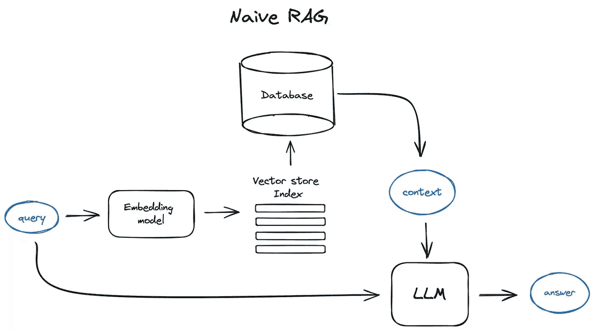
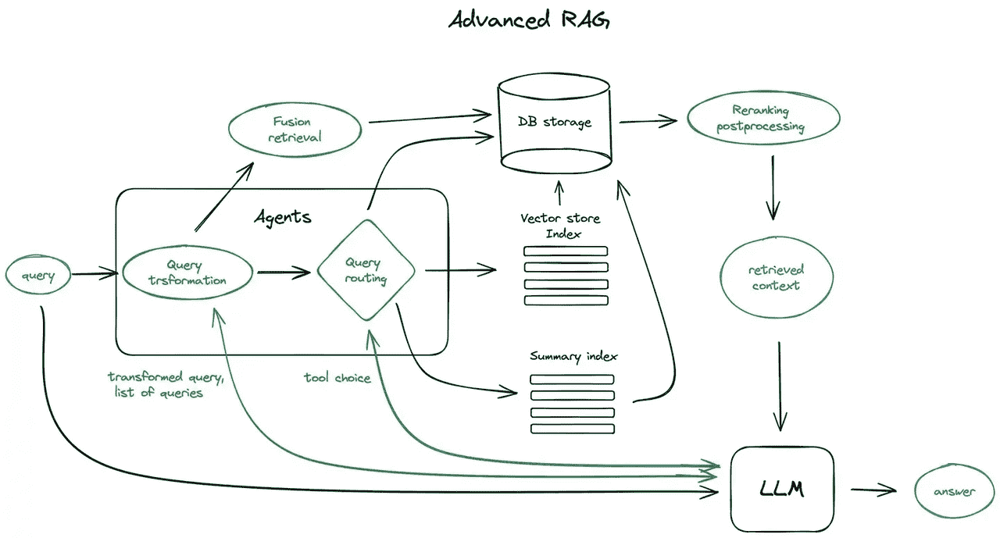
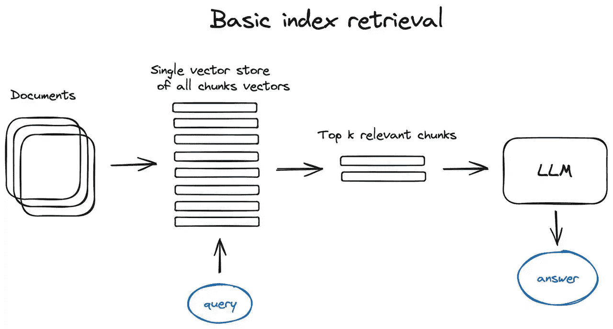
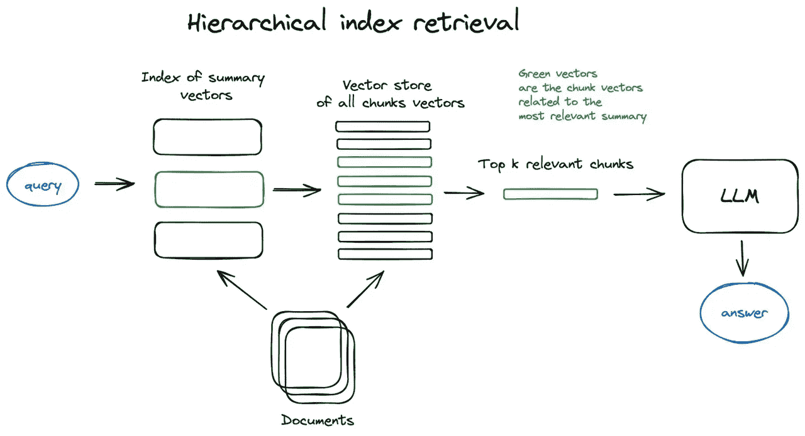
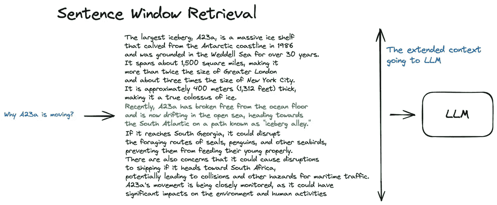
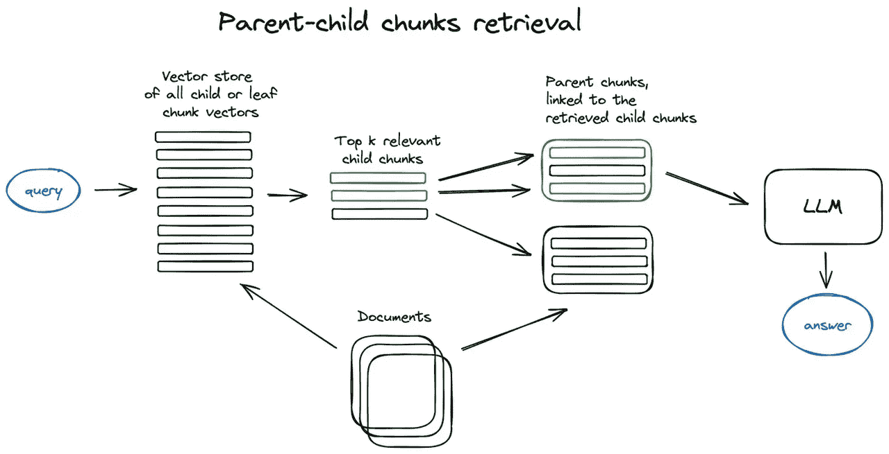
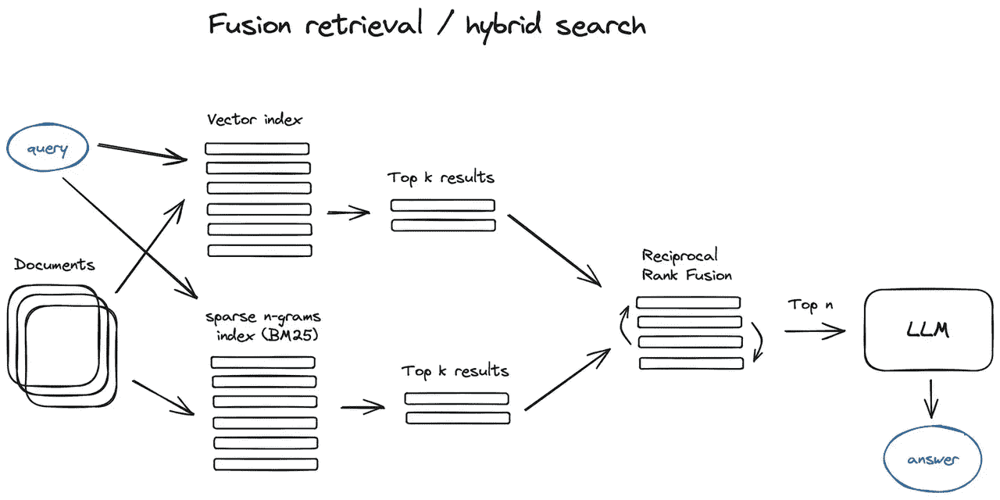
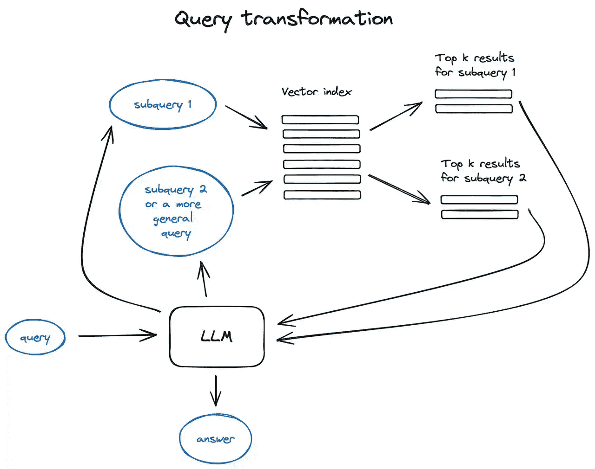
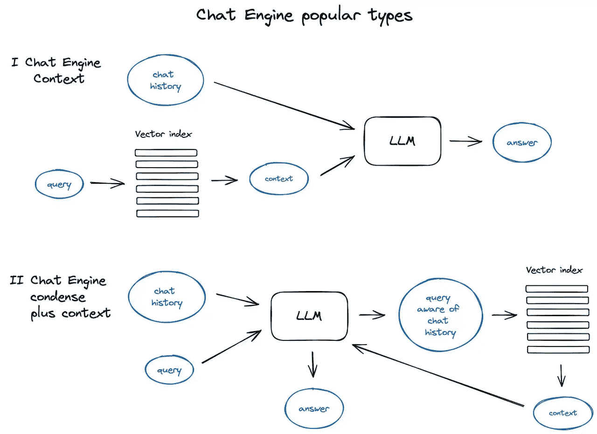
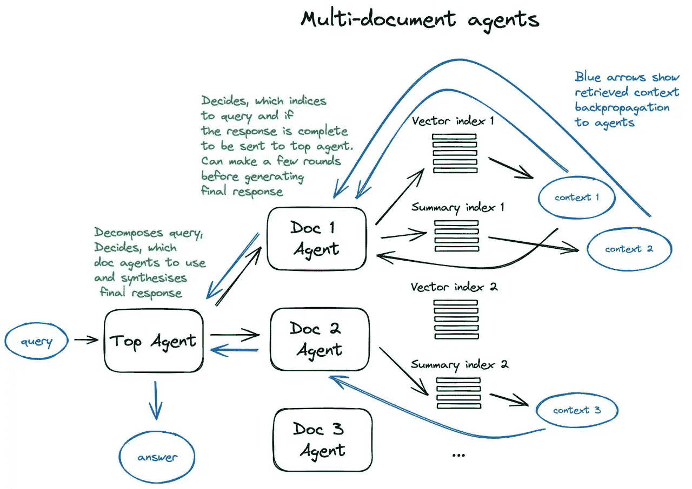

# 图解高级RAG技术

> 来源：[https://vxc3hj17dym.feishu.cn/docx/IVhsdEWlEo4pT3xtpJScwvKenAd](https://vxc3hj17dym.feishu.cn/docx/IVhsdEWlEo4pT3xtpJScwvKenAd)

本文为IVAN ILIN撰写的《Advanced RAG Techniques: an Illustrated Overview》一文的中文精校解读

原文地址：[Advanced RAG Techniques: an ](https://app.iki.ai/content/article/2227125)Illustrated Overview

---

本文全面研究了高级 RAG 及其算法，并系统化讲述。由于本文的目的是科普当前可用的 RAG 算法和技术，所以不会深入到代码细节。但是文中链接了相关的文档和教程，推荐大家详细阅读。

## **引言**

一句话总结：RAG（中文为检索增强生成） = 检索技术 + LLM 提示。

例如，我们向 LLM 提问一个问题（answer），RAG 从各种数据源检索相关的信息，并将检索到的信息和问题（answer）注入到 LLM 提示中，LLM 最后给出答案。

RAG 是2023年基于 LLM 的系统中最受欢迎的架构。许多产品基于 RAG 构建，从基于 web 搜索引擎和 LLM 的问答服务到使用私有数据的chat应用程序。

尽管在2019年，[Faiss](https://link.zhihu.com/?target=https%3A//faiss.ai/)** 就实现**了基于嵌入的向量搜[索技术，但是](https://link.zhihu.com/?target=https%3A//github.com/chroma-core/chroma) [RAG 推动了向量搜索](https://link.zhihu.com/?target=https%3A//weaviate.io/)领域的[发展。比如 ch](https://link.zhihu.com/?target=https%3A//www.pinecone.io/)[roma、w](https://link.zhihu.com/?target=https%3A//github.com/nmslib/nmslib)eaviate.io 和 pinecone 这些基于开源搜索索引引擎（主要是 faiss 和 nmslib）向量数据库初创公司，最近增加了输入文本的额外存储和其他工具。

[有两个最著名的基于](https://link.zhihu.com/?target=https%3A//python.langchain.com/docs/get_started/introduction) LL[M 的管道和应用程序](https://link.zhihu.com/?target=https%3A//docs.llamaindex.ai/en/stable/)的开源库——LangChain 和 LlamaIndex，受 ChatGPT 发布的启发，它们在 2022 年 10 月和 11 月创立，并在 2023 年获得大量采用。

本文的目的是参考 LlamaIndex实现，来系统讲解关键的高级 RAG 技术，以方便大家深入研究。

问题在于，大多数教程只会针对个别技术进行详细讲解，而不是整体全面地系统化归纳总结。

另一件事是，LlamaIndex 和 LangChian 都是了不起的开源项目，他们的开发速度非常快，以至于他们的文档已经比2016年的机器学习教科书还要厚。

## **原始 RAG**

本文 RAG 管道从一个文本文档语料库开始，直接跳过如何通过数据加载器从Youtube等数据源获取步骤。



标准的 RAG 流程简介：将文本分块，然后使用一些 Transformer Encoder 模型将这些块嵌入到向量中，将所有向量放入索引中，最后创建一个 LLM 提示，告诉模型根据我们在搜索步骤中找到的上下文回答用户的查询。

在运行时，我们使用同一编码器模型对用户的查询进行向量化，然后搜索该查询向量的索引，找到 top-k 个结果，从我们的数据库中检索相应的文本块，并将它们作为上下文输入到 LLM 提示中。

提示与下边内容类似：

[提示工程](https://link.zhihu.com/?target=https%3A//docs.llamaindex.ai/en/latest/examples/prompts/prompts_rag.html)是提升 RAG 流程性能的一种简便有效的方[法。可以查阅](https://link.zhihu.com/?target=https%3A//baoyu.io/translations/openai/openai-prompt-engineering-guides) OpenAI 提供的详尽的提示工程指南。

虽然 OpenAI 是 LLM 提供商的领头羊，但还有其他[不少选择，例](https://link.zhihu.com/?target=https%3A//www.anthropic.com/product)[如 Anthr](https://link.zhihu.com/?target=https%3A//mistral.ai/news/mixtral-of-experts/)opic 的 Claud[e，Mis](https://link.zhihu.com/?target=https%3A//www.microsoft.com/en-us/research/blog/phi-2-the-surprising-power-of-small-language-models/)tral[ 的小型但功](https://link.zhihu.com/?target=https%3A//huggingface.co/blog/llama2)能[强大的模型Mixt](https://link.zhihu.com/?target=https%3A//huggingface.co/openlm-research)r[al，Mic](https://link.zhihu.com/?target=https%3A//huggingface.co/tiiuae)rosoft 的Phi-2，以及如Llama2，OpenLLaMA，Falcon等众多开源模型，都可以供你选择最合适的，作为 RAG 管道大脑。

## **高级 RAG**

现在我们深入讲解高级 RAG 技术。包括所涉及的核心步骤和算法的方案，但是省略了一些逻辑循环和复杂的多步代理行为，以保持方案的可读性。



上图中绿色部分是我们接下来详细探讨的核心 RAG 技术。一张图并不能全部展示所有的高级 RAG 技术，比如我们这里省略了上文扩展技术。

### 分块 (Chunking) & 向量化 (Vectorisation)

首先我们需要为文档内容创建向量索引，然后在运行时搜索与查询向量余弦距离最近的向量索引，这样就可以找到与查询内容最接近语义的文档。

1.1 分块 (Chunking)

Transformer 模型具有固定的输入序列长度，即使输入上下文窗口很大，一个句子或几个句子的向量也比几页文本的向量更能代表其语义含义，因此对数据进行分块—— 将初始文档拆分为一定大小的块，而不会失去其含义。有许多文本拆分器实现能够完成此任务。

块的大小[是一个需要重点考虑的问题。](https://link.zhihu.com/?target=https%3A//www.pinecone.io/learn/chunking-strategies/)[块的大小取决于所使用的嵌](https://link.zhihu.com/?target=https%3A//docs.llamaindex.ai/en/stable/api_reference/service_context/node_parser.html)入模型以及模型需要使用 token 的容量。如基于 BERT 的句子转换器，最多需要 512 个 token，OpenAI ada-002 能够处理更长的序列，如 8191 个 token，但这里的折衷是 LLM 有足够的上下文来推理，而不是足够具体的文本嵌入，以便有效地执行搜索。有一项关于块大小选择的研究。在 LlamaIndex 中，NodeParser 类很好支持解决这个问题，其中包含一些高级选项，例如定义自己的文本拆分器、元数据、节点/块关系等。

1.2 向量化 (Vectorisation)

下一步是选择一个**搜索优化的模型来嵌入我们的块**。有很多选项，比如 [bge-large](https://link.zhihu.com/?target=https%3A//huggingface.co/BAAI/bge-large-en-v1.5) 或 [E5 嵌入系列](https://link.zhihu.com/?target=https%3A//huggingface.co/intfloat/multilingual-e5-large)。只需查看 [MTEB](https://link.zhihu.com/?target=https%3A//huggingface.co/spaces/mteb/leaderboard) 排行榜以获取最新更新即可。

有关分块和向量化步骤的 end2end 实现，请查看 L[la](https://link.zhihu.com/?target=https%3A//docs.llamaindex.ai/en/latest/module_guides/loading/ingestion_pipeline/root.html%23)maIndex 中完整数据摄取管道的示例。

### **搜索索引**

#### **2.1 向量存储索引**



RAG 管道的关键部分是搜索索引，它存储了我们在上一步中获得的向量化内容。最原始的实现是使用平面索引 — 查询向量和所有块向量之间的暴力计算距离。

为了实现**1w+元**素规模的[高效检索，](https://link.zhihu.com/?target=https%3A//faiss.ai/)搜[索索引应该采](https://link.zhihu.com/?target=https%3A//github.com/nmslib/nmslib)用向量索[引，比如 ](https://link.zhihu.com/?target=https%3A//github.com/spotify/annoy)[fais](https://link.zhihu.com/?target=https%3A//www.pinecone.io/learn/series/faiss/hnsw/)s、nmslib 以及 annoy。这些工具基于近似最近邻居算法，如聚类、树结构或HNSW算法。

此[外，还有一些托管](https://link.zhihu.com/?target=https%3A//www.pinecone.io/)解[决方案，如 Op](https://link.zhihu.com/?target=https%3A//weaviate.io/)e[nSearc](https://link.zhihu.com/?target=https%3A//www.trychroma.com/)h、ElasticSearch 以及向量数据库，它们自动处理上面提到的数据摄取流程，例如Pinecone、Weaviate和Chroma。

**取决于你的**索引选择**、数据和搜索**需求，还可以存储元数据，并使用元数据过滤器来按照日期或来源等条件进行信息检索。

LlamaIndex 支持多种[向量存储索引](https://link.zhihu.com/?target=https%3A//docs.llamaindex.ai/en/latest/community/integrations/vector_stores.html)，同时也兼容其他简单的索引类型，如列表索引、树索引和关键词表索引。关于这些索引，我们会在后续的融合检索部分详细介绍。

#### **2.2 分层索引**



在大型数据库的情况下，一个有效的方法是创建两个索引——一个由摘要组成，另一个由文档块组成，然后分两步进行搜索，首先通过摘要过滤掉相关文档，然后只在这个相关组内搜索。

#### **2.3 假设性问题和 HyDE**

另一种方法是让 LLM 为每个块生成一个问题，并将这些问题嵌入到向量中，在运行时对这个问题向量的索引执行查询搜索（将块向量替换为索引中的问题向量），然后在检索后路由到原始文本块并将它们作为 LLM 获取答案的上下文发送。

这种方法提高了搜索质量，因为与实际块相比，查询和假设问题之间的语义相似性更高。

还有一种叫做 [HyDE](https://link.zhihu.com/?target=http%3A//boston.lti.cs.cmu.edu/luyug/HyDE/HyDE.pdf) 的反向逻辑方法——你要求 LLM 在给定查询的情况下生成一个假设的响应，然后将其向量与查询向量一起使用来提高搜索质量。

#### **2.4 内容增强**

这里的内容是将相关的上下文组合起来供 LLM 推理，以检索较小的块以获得更好的搜索质量。

有两种选择：一种是围绕较小的检索块的句子扩展上下文，另一种是递归地将文档拆分为多个较大的父块，其中包含较小的子块。

[2.4.1 语句窗口检索](https://link.zhihu.com/?target=https%3A//docs.llamaindex.ai/en/stable/examples/node_postprocessor/MetadataReplacementDemo.html)器

在此方案中，文档中的每个句子都是单独嵌入的，这为上下文余弦距离搜索提供了极大的查询准确性。

为了在获取最相关的单个句子后更好地推理找到的上下文，我们将上下文窗口扩展为检索到的句子前后的 k 个句子，然后将这个扩展的上下文发送到 LLM。



绿色部分是在索引中搜索时发现的句子嵌入，整个黑色 + 绿色段落被送到 LLM 以扩大其上下文，同时根据提供的查询进行推理。

2.4.2 [自动合并检索](https://link.zhihu.com/?target=https%3A//docs.llamaindex.ai/en/latest/examples/retrievers/auto_merging_retriever.html)器（或[父文档检索](https://link.zhihu.com/?target=https%3A//python.langchain.com/docs/modules/data_connection/retrievers/parent_document_retriever)器)

这里的思路与语句窗口检索器非常相似——搜索更精细的信息片段，然后在在LLM 进行推理之前扩展上下文窗口。文档被拆分为较小的子块，这些子块和较大的父块有引用关系。



首先在检索过程中获取较小的块，然后如果前 k 个检索到的块中有超过 n 个块链接到同一个父节点（较大的块），我们将这个父节点替换成给 LLM 的上下文——工作原理类似于自动将一些检索到的块合并到一个更大的父块中，因此得名。请注意，搜索仅在子节点索引中执行。查看 LlamaIndex 教程 递归检索器 + 节点引用 以更深入地了解。

#### **2.5 融合检索或混合搜索**

[这是一个很早](https://link.zhihu.com/?target=https%3A//en.wikipedia.org/wiki/Tf%25E2%2580%2593idf)以前的思路：结合传[统的基于](https://link.zhihu.com/?target=https%3A//en.wikipedia.org/wiki/Okapi_BM25)关键字的搜索（稀疏检索算法，如 tf-idf 或搜索行业标准 BM25）和现代语义或向量搜索，并将其结果组合在一个检索结果中。

这里唯一的关键是如何组合不同相似度分数的检索结果。这个问题通常通过 Reciprocal Rank Fusion 算法来解决，该算法能有效地对检索结果进行重新排序，以得到最终的输出结果。



在 LangChain 中，这种方法是通过 Ensemble Retriever 来实现的，该类将你定义的多个检索器结合起来，比如一个基于 faiss 的向量索引和一个基于 BM25 的检索器，并利用 RRF 算法进行结果的重排。

[在 ](https://link.zhihu.com/?target=https%3A//docs.llamaindex.ai/en/stable/examples/retrievers/reciprocal_rerank_fusion.html)LlamaIndex 中，这一过程也是以类似的方式 实现 的。

混合或融合搜索通常能提供更优秀的检索结果，因为它结合了两种互补的搜索算法——既考虑了查询和存储文档之间的语义相似性，也考虑了关键词匹配。

### 重排（reranking）和过滤（filtering）

我[们使用上](https://link.zhihu.com/?target=https%3A//docs.llamaindex.ai/en/stable/module_guides/querying/node_postprocessors/root.html)述任何算法获得了检索结果，现在是时候通过过滤、重排或一些转换来完善它们了。在 LlamaIndex 中，有各种可用的后处理器，根据相似性分数、关键字、元数据过滤掉结果，或使用其他模型（如 LLM）、sentence-transformer 交叉编码器，Cohere 重新排名接口或者基于元数据重排它们。

这是将检索到的上下文提供给 LLM 以获得结果答案之前的最后一步。

```
def question_answering(context, query):
    prompt = f&quot;&quot;&quot;
                Give the answer to the user query delimited by triple backticks 
{query}
\
                using the information given in context delimited by triple backticks 
{context}
.\
                If there is no relevant information in the provided context, try to answer yourself,
                but tell user that you did not have any relevant context to base your answer on.
                Be concise and output the answer of size less than 80 tokens.
                &quot;&quot;&quot;
    response = get_completion(instruction, prompt, model=&quot;gpt-3.5-turbo&quot;)
    answer = response.choices[0].message[&quot;content&quot;]
return answer
```

---

现在，我们将探索更高级的 RAG 技术，比如查询转换和路由。这些技术涉及到大语言模型的使用，代表了一种更复杂的逻辑思维——在 RAG 流程中融合了 LLM 的推理能力。

### **查询转换**

查询转换是一系列技术，使用 LLM 作为推理引擎来修改用户输入以提高检索质量。有很多技术实现可供选择。



对于复杂的查询，大语言模型能够将其拆分为多个子查询。比如，

+   当你问：“在 Github 上，Langchain 和 LlamaIndex 这两个框架哪个更受欢迎？”，

我们不太可能直接在语料库找到它们的比较，所以将这个问题分解为两个更简单、具体的合理的子查询：

+   “Langchain 在 Github 上有多少星？”

+   “Llamaindex 在 Github 上有多少星？”

这[些子查询会并](https://link.zhihu.com/?target=https%3A//python.langchain.com/docs/modules/data_connection/retrievers/MultiQueryRetriever%3Fref%3Dblog.langchain.dev)[行执行，检索到](https://link.zhihu.com/?target=https%3A//docs.llamaindex.ai/en/stable/examples/query_engine/sub_question_query_engine.html)的信息随后被汇总到一个 LLM 提示词中。这两个功能分别在 Langchain 中以多查询检索器的形式和在 Llamaindex 中以子问题查询引擎的形式实现。

1.  St[ep-b](https://link.zhihu.com/?target=https%3A//github.com/langchain-ai/langchain/blob/master/cookbook/stepback-qa.ipynb%3Fref%3Dblog.langchain.dev)ack prompting 使用 LLM 生成一个更通用的查询，以此检索到更通用或高层次的上下文，用于为我们的原始查询提供答案。同时执行原始查询的检索，并在最终答案生成步骤中将两个上下文发送到 LLM。这是 LangChain 的一个示例实现。

1.  查询重写使用 LLM 来重新表述初始查询，以改进检索。LangChain 和 LlamaIndex 都有实现，个人感觉LlamaIndex 解决方案在这里更强大。

### **聊天引擎**

**关于构建****一个可以多次用于**单个查询的完美 RAG 系统的下一件工作是聊天逻辑，就像在 LLM 之前时代的经典聊天机器人中一样考虑到对话上下文。

这是支持后续问题、代词指代或与上一个对话上下文相关的任意用户命令所必需的。它是通过查询压缩技术解决的，将聊天上下文与用户查询一起考虑在内。

与往常一样，有几种方法可以进行上述上下文压缩——一个流行且相对简单的 ContextChatEngine，首先检索与用户查询相关的上下文，然后将其与内存缓冲区中的聊天记录一起发送到 LLM，以便 LLM 在生成下一个答案时了解上一个上下文。

更复杂的情况是 CondensePlusContextMode——在每次交互中，聊天记录和最后一条消息被压缩到一个新的查询中，然后这个查询进入索引，检索到的上下文与原始用户消息一起传递给 LLM 以生成答案。

[需要注意的是，LlamaInd](https://link.zhihu.com/?target=https%3A//docs.llamaindex.ai/en/stable/examples/chat_engine/chat_engine_openai.html)ex 中还支持基于 OpenAI 智能体的聊天引擎，提供更灵活的聊天模式，Langchain 还支持 OpenAI 功能 API。



还有像 [ReAct 智能体](https://link.zhihu.com/?target=https%3A//docs.llamaindex.ai/en/stable/examples/chat_engine/chat_engine_react.html) 这样的其他聊天引擎类型，但我们接下来将直接跳转到第 7 节，讨论智能体本身。

### **查询路由**

**查询路由是 LLM 驱动的决策步骤，**决定在给定用户查询的情况下下一步该做什么——选项通常是总结、对某些数据索引执行搜索或尝试许多不同的路由，然后将它们的输出综合到一个答案中。

查询路由器还用于选择数据存储位置来处理用户查询。这些数据存储位置可能是多样的，比如传统的向量存储、图形数据库或关系型数据库，或者是不同层级的索引系统。在处理多文档存储时，通常会用到摘要索引和文档块向量索引这两种不同的索引。

定义查询路由器包括设置它可以做出的选择。

选择特定路由的过程是通过大语言模型调用来实现的，其结果按照预定义的格式返回，以路由查询指**定的索引。如果是**涉及到关联操作，这些查询还可能被发送到子链或其他智能体，如下面的多文档智能体方案所展示的那样。

[LlamaIndex](https://link.zhihu.com/?target=https%3A//docs.llamaindex.ai/en/stable/module_guides/querying/router/root.html) 和 [LangChain](https://link.zhihu.com/?target=https%3A//python.langchain.com/docs/expression_language/how_to/routing%3Fref%3Dblog.langchain.dev) 都提供了对查询路由器的支持。

### **智能体（Agent）**

智能体（ Langchain 和 LlamaIndex 均支持）几乎从第一个 LLM API 发布开始就已经存在——这个思路是为一个具备推理能力的 LLM 提供一套工具和一个要完成的任务。这些工具可能包括一些确定性功能，如任何代码函数或外部 API，甚至是其他智能体——这种 LLM 链接思想是 LangChain 得名的地方。

智能体本身就是一个复杂的技术，不可能在 RAG 概述中深入探讨该主题，所以我将继续基于 agent 的多文档检索案例，并简要提及 OpenAI 助手，因为它是一个相对较新的概念，在最近的 OpenAI 开发者大会上作为 GPTs 呈现，并在下文将要介绍的 RAG 系统中发挥作用。

[OpenAI 助手](https://link.zhihu.com/?target=https%3A//platform.openai.com/docs/assistants/overview)基本上整合了开源 LLM 周边工具——聊天[记录、知识存储、](https://link.zhihu.com/?target=https%3A//platform.openai.com/docs/assistants/tools/function-calling)文档上传界面。最重要的是函数调用 API， 其提供了将自然语言转换为对外部工具或数据库查询的 API 调用的功能。

[在 LlamaIndex ](https://link.zhihu.com/?target=https%3A//docs.llamaindex.ai/en/stable/examples/agent/openai_agent.html)中，有一个 OpenAIAgent 类将这种高级逻辑与 ChatEngine 和 QueryEngine 类结合在一起，提供基于知识和上下文感知的聊天，以及在一个对话轮次中调用多个 OpenAI 函数的能力，这真正实现了智能代理行为。

让我们来看一下[多文档](https://link.zhihu.com/?target=https%3A//docs.llamaindex.ai/en/stable/examples/agent/multi_document_agents.html)**智能体**的**方案**[—— 这是一个非常复杂](https://link.zhihu.com/?target=https%3A//docs.llamaindex.ai/en/stable/examples/agent/openai_agent.html)**的配置，涉及到在每**个文档上初始化一个Agent（OpenAIAgent），该智能体能进行文档摘要制作和传统问答机制的操作，还有一个顶层智能体，负责将查询分配到各个文档智能体，并综合形成最终的答案。

每个文档智能体都有两个工具：向量存储索引和摘要索引，它根据路由查询决定使用哪一个。对于顶级智能体来说，所有文档智能体都是其工具。

该方案展示了一种高级 RAG 架构，其中每个智能体都做路由许多决策。这种方法的好处是能够比较不同的解决方案或实体在不同的文档及其摘要中描述，以及经典的单个文档摘要和 QA 机制——这基本上涵盖了最常见的与文档集合聊天的用例。



这种复杂配置的缺点可以通过图片发现 —— 由于需要在智能体内部的大语言模型之间进行多次往返迭代，其运行速度较慢。顺便一提，LLM 调用通常是 RAG 管道中耗时最长的操作，而搜索则是出于设计考虑而优化了速度。因此，对于大型的多文档存储，我建议考虑对此方案进行简化，以便实现扩展。

### **响应合成**

这是任何 RAG 管道的最后一步——根据我们检索的所有上下文和初始用户查询生成答案。

最简单的方法是将所有获取的上下文（高于某个相关性阈值）与查询一起连接并提供给 LLM。但是，与往常一样，还有其他更复杂的选项，涉及多个 LLM 调用，以优化检索到的上下文并生成更好的答案。

响应合成的主要方法有：

+   通过将检索到的上下文逐块发送到 LLM 来优化答案

+   概括检索到的上下文，以适应提示

+   根据不同的上下文块生成多个答案，然后将它们连接或概括起来。

有关更多详细信息，请查看[响应合成器模块文档](https://link.zhihu.com/?target=https%3A//docs.llamaindex.ai/en/stable/module_guides/querying/response_synthesizers/root.html)。

## **编码器和 LLM 微调**

这种方法主要是对 Transformer 编码器 和 LLM 进行微调。其中，编码器影响嵌入质量，从而影响上下文检索质量。LLM 负责最好地使用提供的上下文来回答用户查询。

如今的一大优势是可以使用像 GPT-4 这样的高端 LLM 来生成高质量的数据集。但是必须清楚，使用小型合成数据集进微调基础模型，可能会降低基础模型的通用能力。

### **编码器微调**

作者进行了一项测试，对 bge-large-en-v1.5 编码器进行微调，发现对于检索效果提升影响有限。因为针对搜索优化的最新 Transformer 编码器已经非常高效。

### **排序器微调**

如果不[完全](https://link.zhihu.com/?target=https%3A//docs.llamaindex.ai/en/latest/examples/finetuning/cross_encoder_finetuning/cross_encoder_finetuning.html%23)信任基础编码器，可以使用交叉编码器对检索到的结果进行重排。这个过程是这样的：你把查询和每个前 k 个检索到的文本块一起送入交叉编码器，中间用 SEP (分隔符) Token 分隔，并对它进行微调，使其对相关的文本块输出 1，对不相关的输出 0。一个这种微调过程的成功案例可以在这里找到，结果显示通过交叉编码器微调，成对比较得分提高了 4%。

**LLM 微调**

[最近，](https://link.zhihu.com/?target=https%3A//platform.openai.com/docs/guides/fine-tuning)OpenAI 开始提供 LLM 微调 API，LlamaIndex 有一个关于在 RAG 设置中微调 GPT-3.5-turbo 的教程。RAG 管道评估的 ragas 框架显示，忠实度指标增加了 5%，这意味着微调后的 GPT 3.5-turbo 模型比原始模型更好地利用了提供的上下文来生成答案。

[Meta AI Research 最近的论文 RA-DIT： ](https://link.zhihu.com/?target=https%3A//arxiv.org/pdf/2310.01352.pdf)Retrieval Augmented Dual Instruction Tuning 展示了一种更复杂的方法，提出了一种同时调整 LLM 和 Retriever 的技术（原始论文中的双编码器）关于查询、上下文和答案的三元组。该技术被用于通过微调 API 微调 OpenAI LLM。也被用于微调了Llama2 开源模型（在原始论文中），结果与带有 RAG 的 Llama2 65B 相比，知识密集型任务指标增加 ~5%和常识推理任务增加几个百分点。

## **评估**

RAG 系统性能评估的多个框架，都包含了几项独立的指标，例如总体答案相关性、答案基础性、忠实度和检索到的上下文相关性。

在之前章节提到的 [Ragas](https://link.zhihu.com/?target=https%3A//docs.ragas.io/en/latest/index.html)，使用[真实性](https://link.zhihu.com/?target=https%3A//docs.ragas.io/en/latest/concepts/metrics/faithfulness.html)和[答案相关性](https://link.zhihu.com/?target=https%3A//docs.ragas.io/en/latest/concepts/metrics/answer_relevance.html)[来评价](https://link.zhihu.com/?target=https%3A//docs.ragas.io/en/latest/concepts/metrics/context_precision.html)生[成答案](https://link.zhihu.com/?target=https%3A//docs.ragas.io/en/latest/concepts/metrics/context_recall.html)的质量，并使用经典的上下文精准度和召回率来评估 RAG 方案的检索性能。

最近推出的课程[构建和评估高级 RAG](https://link.zhihu.com/?target=https%3A//learn.deeplearning.ai/building-evaluating-advanced-rag/)[中，以及 Lla](https://link.zhihu.com/?target=https%3A//github.com/truera/trulens/tree/main)maInde**x 和评估框架**Truelens，他们提出了**RAG 三元组**评估模式** — 分****别是对**问题的检索内容相关性、答案的基于性（即大语言模型的答案在多大程度上被提供的上下文的支持）和答案对问题的相关性。

最关键且可控的指标是**检索内容的相关性** — 实际上是上述高级 RAG 管道的前 1-7 部分加上编码器和排名器的微调部分，这些都是为了提高这个指标。而第 8 部分和大语言模型的微调则专注于提高答案的相关性和基于性。

[一个](https://link.zhihu.com/?target=https%3A//github.com/run-llama/finetune-embedding/blob/main/evaluate.ipynb)**简单有**[效的检索](https://link.zhihu.com/?target=https%3A//github.com/openai/openai-cookbook/blob/main/examples/evaluation/Evaluate_RAG_with_LlamaIndex.ipynb)器评估管道的例子可以在这里找到，它已被应用于编码器的微调部分。一个更高级的方法不仅考虑命中率，还包括了常用的搜索引擎评估指标平均倒数排名 (Mean Reciprocal Rank)，以及生成答案的质量指标，如真实性和相关性，这在 OpenAI 的实用指南中有所展示。

[LangChain](https://link.zhihu.com/?target=https%3A//docs.smith.langchain.com/) 提供了一个颇为先进的评估框架 LangSmith。在这个框架中，你不仅可以实现自定义的评估器，还能监控 RAG 管道内的运行，进而增强系统的透明度。

如果你正在使用 LlamaIndex 进行构建，可以尝试 rag_evaluator llama pack。

## **总结**

本文概述 RAG 的核心算法，并举例说明其中的一些方法。

还有很多其他的事情需要考虑，比如基于网络搜索的 RAG（LlamaIndex 的 RAG、webLangChain 等），更深入地研究智能体架构以及关于 LLM 长期记忆的一些想法。

除了答案相关性和忠实度之外，RAG 系统的主要生产挑战是速度。ChatGPT 和大多数其他助手使用的这种流式特性不是随机的赛博朋克风格，而只是一种缩短感知答案生成时间的方法。

这就是为什么我认为小参数规模的 LLM 有一个非常光明的未来，最近发布的 Mixtral 和 Phi-2 正在引领我们朝着这个方向前进。