# 《提示词设计与工程：入门与高级方法》 - 中文版

> 来源：[https://vxc3hj17dym.feishu.cn/docx/ODSLdV8M7o2xvQxWSTic6exGn0e](https://vxc3hj17dym.feishu.cn/docx/ODSLdV8M7o2xvQxWSTic6exGn0e)

> 翻译：小七姐

> 可以在以下地址关注她：[**小七姐的免费学习社群**](https://t.zsxq.com/15KhQ0RE7)

本文为论文《Prompt Design and Engineering: Introduction and Advanced Methods》的中文精校解读

原文地址：https://arxiv.org/abs/2401.14423

PDF文档：https://arxiv.org/pdf/2401.14423.pdf

—— 感谢Raven对本译文的贡献。

---

## **P****rom****pt Design and** Engineering: Introduction and Advanced Methods 提示词设计和工程：入门与高级方法

---

## 摘要

随着大型语言模型（LLM）的兴起，精心设计的提示词（prompt）已成为释放其潜能的关键。本文将介绍提示词设计的核心概念，探讨如思维链（Chain-of-Thought）和反思（Reflection）等高级技术，并阐述构建基于LLM的智能体的原则。最后，我们将对提示词工程师使用的工具进行概述。

---

## 1 引言

### 1.1 什么是提示词？

在生成式人工智能模型中，提示词是用户输入的文本，用于引导模型产生期望的输出。这可以是简单的问题、详细的描述，或者是特定的任务。例如，在DALLE-3这样的图像生成模型中，提示词通常是描述性的；而在GPT-4或Gemini这样的LLM中，提示词可以是简单的查询，也可以是复杂的问题陈述。

提示词通常包含指令、问题、输入数据和示例。实际上，为了从AI模型中得到期望的回应，提示词必须包含指令或问题，其他元素则是可选的。

在LLM中，基本的提示词可以简单到直接提问，或者提供特定任务的指令。而高级提示词则涉及更复杂的结构，比如“思维链”提示词，这种提示词引导模型遵循逻辑推理过程来得出答案。

### 1.2 提示词的基本示例

正如上文所述，提示词是通过结合指令、问题、输入数据和示例来构建的。为了得到结果，必须包含指令或问题，其他元素则是可选的。让我们来看几个例子（这里都以ChatGPT-4为例）。

#### 1.2.1 指令 + 问题

在提问的基础上，更高级的提示词可能包括一些关于模型应如何回答问题的指令。例如，我可能会询问如何撰写大学入学申请论文，同时提出我希望在答案中听到的不同方面的建议。

> “我该如何撰写我的大学入学申请论文？请给我一些建议，包括我应该包含的不同部分、我应该使用什么样的语气，以及我应该避免使用的表达。”

请参见图1的输出结果。

#### 1.2.2 指令 + 输入

继续上述例子，如果你可以向LLM寻求写作建议，那么也可以直接要求它¹帮你写论文。

让我们看看，当你提供一些关于我的背景信息，并给出一些指令时会发生什么：

> “根据以下关于我的信息，写一篇四段的大学申请论文：我来自西班牙巴塞罗那。尽管我的童年经历了一些创伤性事件，比如我6岁时父亲去世，但我仍然认为我有一个相当快乐的童年。在我的童年时期，我经常换学校，从公立学校到非常宗教的私立学校。我做过的最“异国情调”的事情之一是在爱达荷州的双子瀑布与我的大家庭一起度过六年级。

>

> 我很早就开始工作了。我的第一份工作是13岁时的英语老师。在那之后，以及在我的学习过程中，我做过老师、服务员，甚至建筑工人。”

请参见图2的输出结果。

¹请注意，我并不是在提倡这是这些工具的道德使用方式，但了解这种可能性的存在以及它已经被全世界的学生使用是很重要的。这超出了这个介绍性指南的范围，去讨论LLM或整个生成式AI引入的所有可能的伦理、法律或道德问题，但我认为至少在介绍性示例中提出这一点是很重要的。你可以用生成模型做某件事，并不意味着这是正确的事情！另一方面，如果你是接收方，你最好为你的组织准备好迎接各种AI生成的内容。幸运的是，对于像这个例子中概述的情况，已经有努力正在进行以检测AI生成的内容。

#### 1.2.3 问题 + 示例

你还可以将示例输入到语言模型中。在下面的示例中，我列出了一些我喜欢和不喜欢的电视节目，以构建一个简单的推荐系统。请注意，尽管我只添加了几个节目，但在LLM界面中，这个列表的长度只受限于Token的限制。

> “以下是我非常喜欢的一些电视节目：《绝命毒师》、《浴血黑帮》、《熊》。我不喜欢《泰德·拉索》。你认为我还可能喜欢哪些节目？”

请参见图3的输出结果。

### 1.3 提示词工程

在生成式AI模型中，提示词工程是一门新兴的学科，它塑造了这些模型的交互和输出。提示词是用户与模型沟通愿望的文本界面，无论是在像DALLE-3或Midjourney这样的图像生成模型中描述图像，还是在像GPT-4和Gemini这样的LLM中提出复杂的问题。提示词可以是简单的问题到复杂的任务，包括指令、问题、输入数据和示例，以指导AI的响应。

提示词工程的核心在于制作出能够实现特定目标的最佳提示词。这个过程不仅仅是指导模型，还涉及到对模型能力和局限性的深刻理解，以及它所处的上下文。例如，在图像生成模型中，提示词可能是对期望图像的详细描述，而在LLM中，它可能是一个包含各种类型数据的复杂查询。

提示词工程不仅仅是构建提示词，它还需要结合领域知识、对AI模型的理解，以及一种系统化的方法来为不同情境定制提示词。这可能包括创建可以根据给定数据集或上下文进行程序化修改的模板。例如，基于用户数据生成个性化响应可能会使用一个动态填充相关信息的模板。

此外，提示词工程是一个迭代和探索的过程，类似于传统软件工程实践，如版本控制和回归测试。这个领域的快速增长表明它有潜力彻底改变机器学习的某些方面，超越传统的特征或架构工程方法，尤其是在大型神经网络的背景下。另一方面，传统工程实践，如版本控制和回归测试，需要适应这个新范式，就像它们适应其他机器学习方法一样[1]。

本文旨在深入探讨这个新兴领域，探索其基础方面和高级应用。我们将重点关注提示词工程在LLM中的应用。然而，大多数技术也可以应用于多模态生成式AI模型。

---

## 2 LLM及其局限性

大型语言模型（LLM），包括基于Transformer架构的模型，已经成为自然语言处理领域的重要推动力。这些模型通过在大量数据集上进行预训练，以预测接下来的Token，展现出了卓越的语言处理能力。然而，尽管它们功能强大，LLM仍然受到一些固有限制的影响，这些限制影响了它们的应用和有效性。

+   瞬态状态：LLM天生缺乏持久的记忆或状态，这就需要额外的软件或系统来保留和管理上下文。

+   概率性质：LLM的随机性导致了响应的不确定性，即使是对相同的提示词，也可能产生不同的回答。这意味着你每次可能得到略有差异的答案。

+   过时信息：依赖于预训练数据，LLM只能访问历史知识，无法获取实时更新。

+   内容制造：LLM可能会生成看似合理但实际上并不准确的信息，这种现象通常被称为“幻觉”。

+   资源密集：LLM的巨大规模意味着显著的计算和财务成本，影响了它们的可扩展性和可访问性。

+   领域特定性：虽然本质上是通用的，LLM通常需要特定领域的数据才能在专业任务中表现出色。

这些限制强调了需要高级提示词工程和专门技术来提高LLM的实用性，并减轻这些固有限制。后续章节将深入探讨旨在优化LLM性能的复杂策略和工程创新。

---

## 3 更高级的提示词设计技巧

### 3.1 思维链提示词

在思维链提示词中，我们明确鼓励模型通过一系列步骤来确保其回答的准确性和事实性。

在图4和图5的示例中，我们使用以下格式的提示词：

> “原始问题是什么？

> 请按照以下格式回答：

> Q: <重复问题> A: 让我们一步一步地思考。<给出推理> 因此，答案是 <最终答案>。”

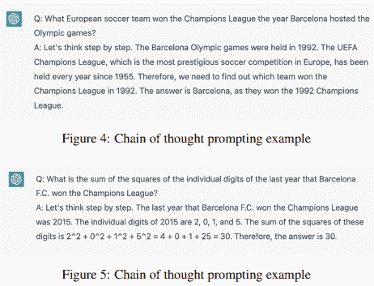

### 3.2 通过其他方式鼓励模型保持事实性

生成模型面临的一个主要问题是它们可能会产生不准确或错误的知识。你可以通过让模型遵循一系列推理步骤来提高其回答的事实性，正如我们在前一节中看到的。此外，你还可以通过提示词模型引用正确的来源来引导它。（请注意，这种方法有严重的局限性，因为引用本身可能是虚构的。）

> “mRNA疫苗是否安全？请仅使用可靠来源回答并引用这些来源。”

请参见图6的结果。

### 3.3 明确结束提示词指令

基于GPT的LLM有一个特殊的标记“<|endofprompt|>”，它指示语言模型将标记之后的内容视为完成任务。这使我们能够明确地区分一些通用指令和你想要的语言模型开始写作的内容。

> “写一首诗描述一个美丽的冬日 <|endofprompt|>。那是一个美丽的冬日。”

请注意图7中的输出结果，段落是如何从“提示词”中的最后一句继续的。

### 3.4 使用强制语言

语言模型并不总是对友好的语言做出良好反应。如果你真的想让它们遵循某些指令，你可能需要使用更强烈的语言。信不信由你，全大写字母和感叹号是有效的！请参见图8的示例。

### 3.5 使用AI自我纠正

在图9的示例中，我们让ChatGPT创建了一个包含事实错误的短文。然后我们要求模型在10分钟内纠正它。

> “写一篇关于如何在科技行业找到工作的短文。包含事实上不正确的信息。”

> “这篇文章中有任何事实上不正确的信息吗？[将文章复制粘贴到此处]”

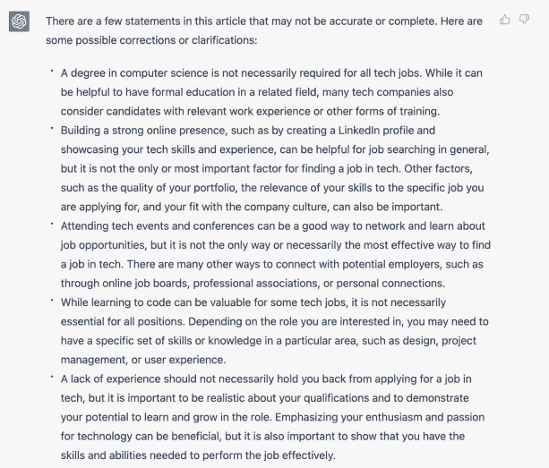

### 3.6 生成不同的观点

LLM没有强烈的对错感，但它们擅长生成不同的观点。这在头脑风暴和理解一个话题上的不同观点时非常有用。我们将在下一节中看到如何通过更高级的提示词工程技术来利用这一点。在下面的示例中，我们给ChatGPT提供了一篇文章，并要求它提出不同的观点。请注意使用标签<begin>和<end>来指导模型。这个输入的结果可以在图11中看到。

> “<begin> 从个人助理和推荐系统到自动驾驶汽车和自然语言处理，机器学习应用在过去十年中展示了显著的能力，以增强人类的决策制定、生产力和创造力。然而，机器学习仍然远离实现其全部潜力，并且在算法设计和实施方面面临着许多挑战。随着技术的不断进步和改进，以下是未来十年可能发生的一些最令人兴奋的发展。

> 1. 数据整合：机器学习中预计的关键发展之一是整合多种模态和数据领域的数据，例如图像、文本和传感器数据，以创建更丰富和更健壮的复杂现象的表示。例如，想象一个不仅能识别面孔，还能从他们的面部表情中推断出他们的情绪、意图和个人特征的机器学习系统。这样的系统在客户服务、教育和安全等领域可能有着巨大的应用。为了实现这种多模态和跨领域的理解，机器学习模型将需要在深度学习、表示学习、自我监督学习和常识推理方面取得进展，并将领域知识和常识推理结合起来。

> 2. 民主化和可访问性：在未来，机器学习可能变得更加易于广泛用户获取，其中许多人将不需要深入了解技术专家就能理解如何使用它。机器学习平台可能很快允许用户轻松上传他们的数据，选择他们的目标并定制他们的模型，而无需编写任何代码或担心底层基础设施。这可能会显著降低进入和采用机器学习的门槛，并赋予用户解决自己的问题并生成自己的见解的能力。

> 3. 以人为本的方法：随着机器学习系统变得更加智能，它们也可能变得更加以人为本和社交意识，不仅执行任务，而且以积极的方式与人类互动并从人类学习。例如，机器学习系统不仅可以诊断疾病，还可以与患者沟通，同情他们的担忧并提供个性化的建议。像这样的系统可以提高医疗保健的质量和效率，同时改善患者和提供者的福祉和满意度。<end>”

>

> 鉴于这个示例文章，写一篇与之观点不同的文章。

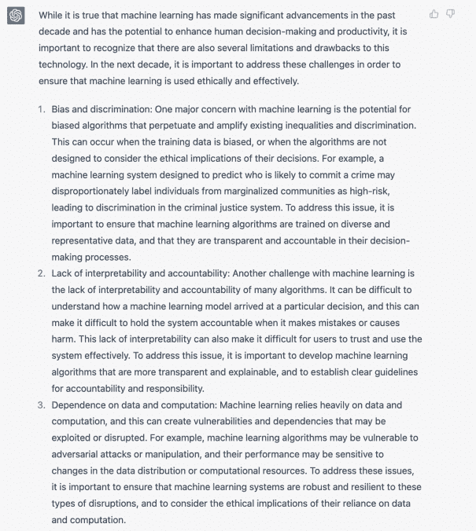

### 3.7 保持状态+角色扮演

语言模型本身不跟踪状态。然而，像ChatGPT这样的应用程序实现了“会话”的概念，其中聊天机器人从一个提示词到下一个保持状态。这使得进行更复杂的对话成为可能。请注意，当使用API调用时，这将涉及在应用程序端跟踪状态。

在12的示例中，我们让ChatGPT以粗鲁的布鲁克林出租车司机的身份讨论冒泡排序算法的最坏情况时间复杂度。

### 3.8 在提示词中教授算法

LLM最有用的能力之一是它们可以从提示词中学习。这就是所谓的零样本学习能力。以下示例取自“通过上下文学习教授算法推理”[3]的附录，其中列表的奇偶性定义被以示例的形式提供。

> “以下是一个如何计算列表Q的奇偶性的示例：列表a=[1, 1, 0, 1, 0]的奇偶性是什么？A: 我们初始化s= a=[1, 1, 0, 1, 0]。a的第一个元素是1，所以b=1。s = s + b = 0 + 1 = 1。s=1。a=[1, 0, 1, 0]。a的第一个元素是1，所以b=1。s = s + b = 1 + 1 = 0。s=0。a=[0, 1, 0]。a的第一个元素是0，所以b=0。s = s + b = 0 + 0 = 0。s=0。a=[1, 0]。a的第一个元素是1，所以b=1。s = s + b = 0 + 1 = 1。s=1。a=[0]。a的第一个元素是0，所以b=0。s = s + b = 1 + 0 = 1。s=1。a=[]为空。由于列表a为空，我们有s=1，所以奇偶性是1。

>

> 给定这个定义，这个其他列表b=[0, 1, 1, 0, 0, 0, 0, 0]的奇偶性是什么？”

请参见图13的结果。

### 3.9 提示词和示例的顺序

值得注意的是，像GPT这样的LLM只向前读取，实际上是在完成文本。这意味着以正确的顺序提示词它们是值得的。已经发现，在示例之前给出指令是有帮助的。此外，甚至给出示例的顺序也有所不同（参见Lu等人[4]）。记住这一点，并尝试不同的提示词和示例顺序。

### 3.10 功能

功能是在提示词中定义的函数，模型被明确指示在响应时使用。例如，你可以告诉模型，每当找到数学表达式时，它应该调用一个明确的CALC()函数，并在继续之前计算数值结果。已经证明，在某些情况下使用功能是有帮助的。

---

## 4 提示词工程的高级技术

在前一节中，我们介绍了如何思考提示词设计的更复杂示例。然而，这些技巧和窍门最近已经发展成为更经过测试和记录的技术，这些技术在构建提示词时带来了更多的“工程”和更少的艺术。在本节中，我们将介绍一些建立在我们迄今讨论的基础上的高级技术。

### 4.1 思维链（CoT）

在前面介绍的基础上，思维链（CoT）技术，如Google研究人员在“思维链提示词在大型语言模型中引出推理”[5]中所述，标志着在利用大型语言模型（LLM）的推理能力方面迈出了重要一步。这种技术利用了这样一个前提，即虽然LLM在预测Token序列方面表现出色，但它们的设计并不固有地促进显式推理过程。

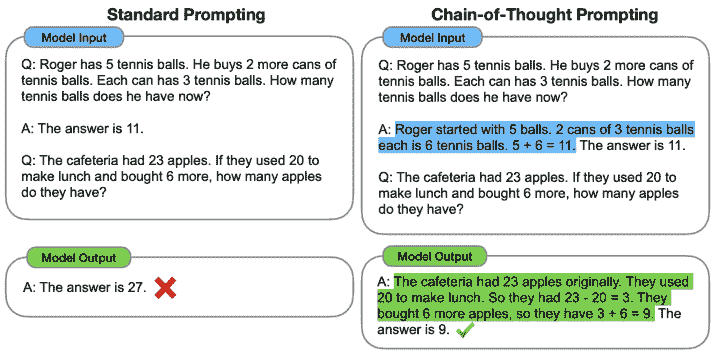

CoT将LLM通常隐含的推理步骤转化为明确的、指导性的序列，从而增强了模型产生基于逻辑推理的输出的能力，特别是在复杂的解决问题的背景下。

这种方法主要表现为两种变体：

1.  **零样本CoT：**这种方法促使LLM逐步解开问题，鼓励逐步阐明其推理过程。

1.  **手动CoT：**这种更复杂的变体需要提供明确的、逐步的推理示例作为模板，从而更明确地引导模型朝向推理输出。尽管手动CoT效果显著，但其依赖于精心制作的示例，带来了可扩展性和维护方面的挑战。

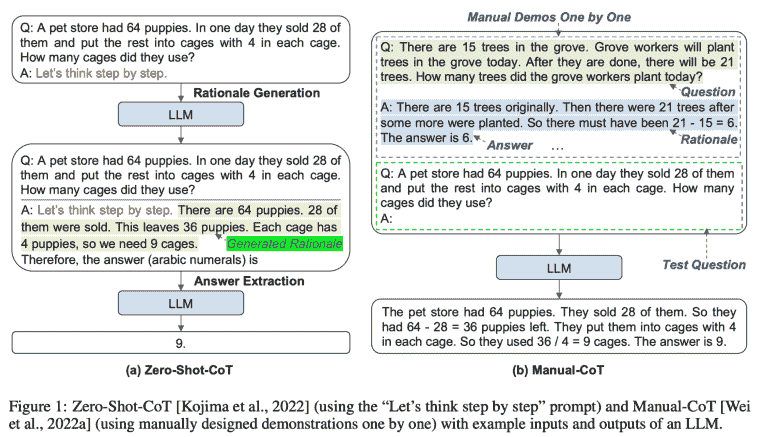

尽管手动CoT通常优于零样本CoT，但其有效性取决于提供的示例的多样性和相关性。制作这些示例的劳动密集型和潜在错误的过程为探索自动CoT[6]铺平了道路，后者旨在简化和优化示例生成过程，从而扩大CoT提示词在LLM中的适用性和效率。

### 4.2 思维树（ToT）

思维树（ToT）提示词技术，如最近进展[7]中介绍的，标志着大型语言模型（LLM）领域的一个重要演变。ToT从人类认知过程中汲取灵感，促进了多方面的解决问题路径的探索，类似于在推导出最可能的解决方案之前考虑一系列可能的解决方案。考虑一个旅行计划的背景：LLM可能会分支出飞行选项、火车路线和租车场景，权衡每个的成本和可行性，然后向用户提供最优化的计划建议。

ToT方法的核心是“思维树”的概念，其中每个分支代表一个替代的推理轨迹。这种 多样性允许LLM探索不同的假设，模仿人类解决问题的方法，通过考虑各种可能性来达成最可能的结果。

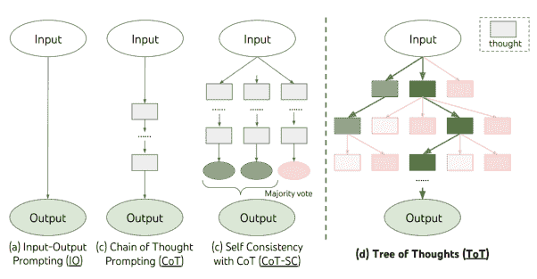

ToT的一个关键组成部分是对这些推理分支的系统评估。随着LLM展开不同的思维线索，它同时评估每个分支的逻辑一致性和与手头任务的相关性。这种动态分析最终导致选择最连贯、最有根据的推理线索，从而增强了模型的决策能力。

ToT在处理复杂和多方面的问题空间方面的能力使其在单一推理线不足的场景中特别有益。通过模仿更类似人类的深思熟虑过程，ToT显著提高了模型处理充满歧义和复杂性任务的能力。

### 4.3 工具、连接器和技能

在高级提示词工程领域，工具、连接器和技能的整合显著增强了大型语言模型（LLM）的能力。这些元素使LLM能够与外部数据源互动，并执行超出其固有能力范围的特定任务，极大地扩展了它们的功能和应用范围。

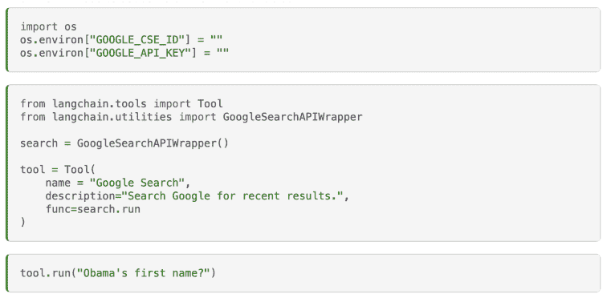

在这里，工具是指LLM可以利用的外部功能或服务。这些工具扩展了LLM可以执行的任务范围，从基本的信息检索到与外部数据库或API的复杂互动。

连接器作为LLM与外部工具或服务之间的接口。它们管理数据交换和通信，使有效利用外部资源成为可能。连接器的复杂性可以变化，适应各种外部互动。

技能是指LLM可以执行的专门功能。这些封装的能力，如文本摘要或语言翻译，增强了LLM处理和响应提示词的能力，即使没有直接访问外部工具。

在论文“Toolformer: Language Models Can Teach Themselves to Use Tools”[8]中，作者超越了简单的工具使用，通过训练LLM决定何时使用什么工具，甚至API需要什么参数。工具包括两个不同的搜索引擎，或一个计算器。在以下示例中，LLM决定调用一个外部问答工具、一个计算器和一个Wikipedia搜索引擎。最近，伯克利的研究人员训练了一个新的LLM，名为Gorilla[9]，它在使用API方面击败了GPT-4，这是一个特定但相当通用的工具。

### 4.4 自动多步推理与工具使用（ART）

自动多步推理与工具使用（ART）[10]是一种提示词工程技术，它结合了自动化的思维链提示词和外部工具的使用。ART代表了多种提示词工程策略的融合，增强了大型语言模型（LLM）处理需要推理和与外部数据源或工具交互的复杂任务的能力。

ART采用系统化的方法，即在给定任务和输入的情况下，系统首先从任务库中识别相似的任务。然后将这些任务用作提示词中的示例，指导LLM如何处理和执行当前任务。当任务需要结合内部推理和外部数据处理或检索时，这种方法尤其有效。

### 4.5 通过自我一致性增强可靠性

在追求大型语言模型（LLM）输出的准确性和可靠性方面，自我一致性方法成为一个关键技术。这种方法基于集成策略，涉及促使LLM对同一问题产生多个答案，这些回答之间的一致性作为其可信度的衡量标准。

自我一致性的本质在于这样一个假设：LLM对单一提示词产生相似回答的生成增加了这些回答准确性的可能性（见图18）。实施这种方法需要LLM多次处理查询，每个回答都要经过一致性审查。一致性的评估可以通过多种角度进行，包括但不限于内容重叠、语义相似性评估以及高级指标如BERT分数或n-gram重叠，提供了对回答一致性的多方面视角。这增强了LLM在事实核查工具中的可靠性，帮助确保只向用户呈现最一致和可验证的声明。

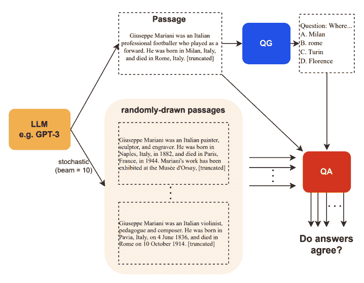

自我一致性的实用性涵盖了许多需要事实精确性的领域。它在事实核查和信息验证等应用中特别有前景，这些应用中AI生成内容的完整性至关重要。通过利用这种技术，开发者和用户可以显著增强LLM的可靠性，确保它们的输出不仅连贯而且事实准确，从而提高了它们在关键和信息敏感任务中的适用性。

### 4.6 反思

反思的概念，如最近文献[12]中介绍的，标志着赋予大型语言模型（LLM）自我改进能力的重要一步。反思的核心是LLM对其输出进行内省性审查，这一过程类似于人类的自我编辑，模型评估其初始回答的事实准确性、逻辑一致性和整体相关性。

这种反思过程涉及结构化的自我评估，其中LLM在生成初始回答后被提示词批判性地审视其输出。通过这种内省，模型识别潜在的不准确或不一致之处，为生成更连贯、更可靠的修订回答铺平了道路。

例如，LLM可能最初对一个复杂查询提供一个回答。然后，它被提示词根据一组预定义的标准，如所呈现事实的可验证性或论证的逻辑流程，来评估这个回答。如果发现差异或需要改进的区域，模型就会开始一个迭代的精炼过程，可能会产生一系列逐步改进的输出。

然而，反思的实施并非没有挑战。自我评估的准确性取决于LLM的固有理解和其在反思任务上的培训。此外，如果模型错误评估其回答的质量，存在模型强化自身错误的风 险。

尽管存在这些挑战，反思对LLM发展的影响是深远的。通过整合自我评估和修订能力，LLM可以在输出质量上实现更大的自主性，使它们成为在需要精确性和可靠性的应用中更加多才多艺和可靠的工具。

### 4.7 专家提示词

专家提示词，如当代研究[13]中所述，代表了一种新范式，通过赋予大型语言模型（LLM）模拟各领域专家级回答的能力，增强了LLM的实用性。这种方法利用了LLM生成知情和细致答案的能力，通过提示词它体现相关领域专家的人格。

这种方法的基石是多专家策略，其中LLM被引导考虑并整合来自各种专家视角的洞察。这不仅丰富了回答的深度和广度，而且促进了对复杂问题的多维理解，反映了现实世界专家之间的协作审议。例如，在处理医疗咨询时，LLM可能会被提示整合临床医生、医学研究员和公共卫生专家的见解。这些不同的视角然后巧妙地编织在一起，利用复杂的算法，产生一个全面掌握查询的回答。

这种专家观点的综合不仅增强了LLM输出的事实准确性和深度，而且减轻了单一视角固有的偏见，呈现了一个平衡且深思熟虑的回答。

然而，专家提示词并非没有挑战。模拟真正专家知识的深度需要高级的提示词工程和对所讨论领域的细致理解。此外，将可能存在分歧的专家意见整合成一个连贯的回答增加了额外的复杂性。

尽管存在这些挑战，专家提示词的潜在应用非常广泛，从工程和科学中复杂的技术建议到法律和伦理审议中的细致分析。这种方法标志着LLM能力的显著进步，推动了它们在需要专家级知识和推理的任务中的适用性和可靠性的界限。

### 4.8 使用链简化复杂任务

链代表了一种变革性的方法，利用大型语言模型（LLM）处理复杂、多步骤的任务。这种方法以其顺序连接的独立组件为特征，每个组件都被设计来执行专门的功能，有助于将复杂任务分解为可管理的部分。链的本质在于它们构建一个连贯的工作流程，其中一个组件的输出无缝过渡到下一个组件的输入，从而实现复杂的端到端处理能力。

在链的领域中，组件可能从简单的信息检索模块到更复杂的推理或决策制定模块。例如，用于医学诊断任务的链可能从症状收集开始，接着是差异诊断生成，最后是治疗建议。

链的开发和优化，如在“PromptChainer: Chaining Large Language Model Prompts through Visual Programming”[14]中探讨的，既带来了挑战也带来了创新解决方案。一个重要的挑战在于协调这些组件，以确保工作流程的流畅性和连贯性。PromptChainer（见图19）通过提供一个视觉编程环境来解决这个问题，使用户能够直观地设计和调整链，从而减轻了与传统编码方法相关的复杂性。

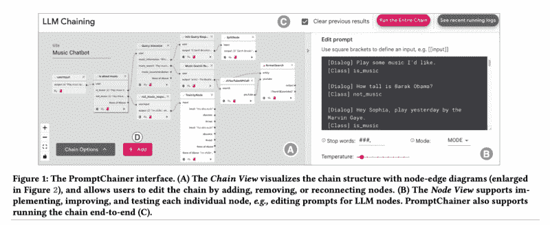

链的应用扩展到各个领域，从自动化客户支持系统，其中链引导从初始查询到解决方案的互动，到研究，其中它们可以简化文献综述过程。

虽然链为处理多方面的问题提供了一个强大的框架，但潜在的局限性，如运行多个LLM组件所涉及的计算开销，以及确保工作流程完整性所需的精心设计，都需要考虑。

尽管如此，链的战略实施，得到PromptChainer等工具的支持，预示着LLM使用效率和能力的新时代，使它们能够处理前所未有的复杂性和范围的任务。

### 4.9 使用Rails引导LLM输出

在高级提示词工程中，Rails代表了一种战略方法，用于在预先定义的边界内指导大型语言模型（LLM）的输出，确保其相关性、安全性和事实完整性。这种方法采用了一组结构化的规则或模板，通常称为规范形式，它们作为模型响应的支架，确保它们符合特定的标准或准则。

Rails框架中的规范形式充当建模语言或模板，标准化自然语言句子的结构和传递，引导LLM生成符合期望参数的输出（见图20）。这些类似于语言的标准化结构，引导LLM符合特定的响应模式。Rails的设计和实施可以广泛变化，根据应用的具体要求量身定制：

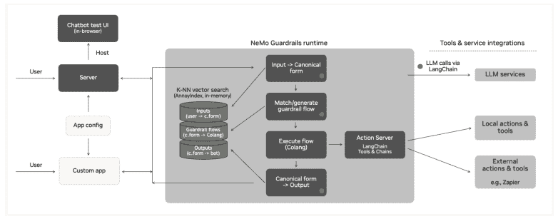

• **主题Rails：**旨在使LLM专注于特定的主题或领域，防止偏离主题或包含无关信息。

• **事实核查Rails：**旨在通过引导LLM朝着基于证据的回答并阻止推测性或未经验证的声明，减少不准确性的传播。

•** 越狱Rails：**旨在阻止LLM产生规避其操作限制或道德指南的输出，防止滥用或有害内容的生成。

在实践中，Rails可能应用于各种场景，从教育工具中的主题Rails确保内容相关性，到新闻聚合服务中的事实核查Rails维护信息完整性。越狱Rails在交互式应用中至关重要，以防止模型从事不良行为。

虽然Rails为提高LLM输出的质量和适当性提供了强大的机制，但它们也带来了挑战，例如需要精心定义规则和可能抑制模型的创造能力。平衡这些考虑因素对于有效利用Rails至关重要，确保LLM提供高质量、可靠且符合道德的回答。

### 4.10 使用自动提示词工程简化提示词设计

自动提示词工程（APE）[15]自动化了创建提示词的复杂过程。通过利用LLM自身生成、评估和完善提示词的能力，APE旨在优化提示词设计过程，确保在引出期望响应方面具有更高的效果和相关性。

APE方法（见图21）通过一系列既独立又相互关联的步骤展开：

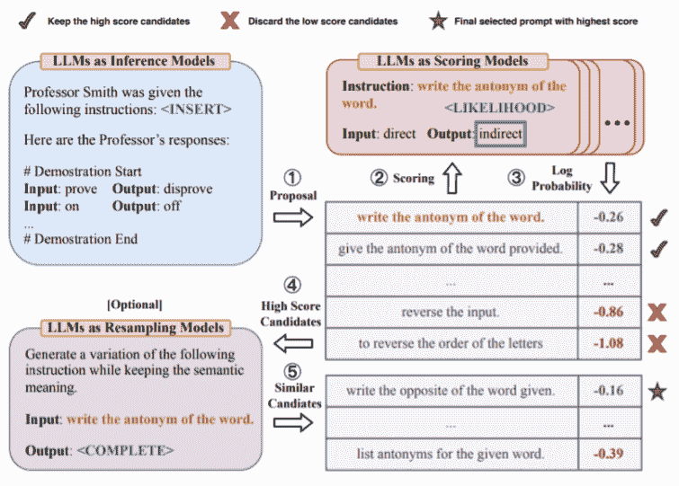

• **提示词****生成：**最初，LLM针对特定任务产生多种提示词，利用其庞大的语言数据库和上下文理解。

• **提示词****评分：**随后，这些提示词经过严格的评估阶段，根据清晰度、特定性和推动期望结果的潜力等关键指标进行评分，确保只有最有效的提示词被选中进行完善。

• **完善和迭代：**完善过程涉及根据评分调整和调整提示词，旨在增强它们与任务要求的一致性。这个迭代过程促进了提示词质量的持续改进。

通过自动化提示词工程过程，APE不仅减轻了手动创建提示词的负担，而且引入了以前无法达到的精确度和适应性。生成和迭代完善提示词的能力可以显著增强LLM在从自动内容生成到复杂的对话代理等各种应用中的实用性。

然而，部署APE并非没有挑战。需要大量的计算资源和建立有效评分指标的复杂性是需要考虑的重要因素。此外，初始设置可能需要精心策划的种子提示词集来有效地指导生成过程。

尽管存在这些挑战，APE代表了提示词工程的重大进步，提供了一种可扩展且高效的解决方案，以在各种应用中解锁LLM的全部潜力，从而为更细致和与上下文相关的交互铺平了道路。

---

## 5 通过外部知识增强LLM - RAG

在解决预训练大型语言模型（LLM）的限制，特别是它们在访问实时或特定领域信息方面的局限性方面，检索增强生成（RAG）成为一个关键创新。RAG通过动态整合外部知识，扩展了LLM，从而丰富了模型的响应，使其包含了不在初始训练数据中的更新或特定信息。

RAG通过从输入提示词中制定查询，并利用这些查询从多样化的来源（如搜索引擎，见图22）或知识图（见图23）中获取相关信息。这些检索到的内容被无缝集成到LLM的工作流程中，显著增强了其生成知情和与上下文相关响应的能力。

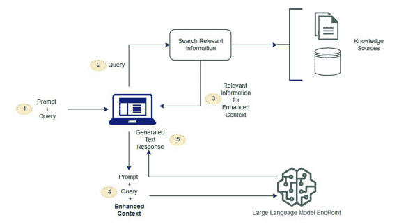

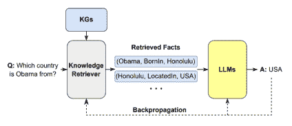

### 5.1 RAG感知提示词技术

RAG的出现促进了旨在充分利用其能力的复杂提示词技术的发展。其中，前瞻性主动检索增强生成（FLARE）以其创新方法增强LLM性能而脱颖而出。

FLARE通过预测潜在内容并使用这些预测来指导信息检索，迭代地增强LLM输出。与传统RAG模型不同，后者通常在生成之前执行单一检索步骤，FLARE参与了一个连续的、动态的检索过程，确保生成内容的每个部分都得到最相关外部信息的支持。

这个过程的特点是对每个生成部分的信心水平进行评估。当信心低于预定义的阈值时，FLARE提示词LLM使用内容作为查询进行额外的信息检索，从而用更新或更相关的数据完善响应。

为了全面了解RAG、FLARE及相关方法，读者被鼓励参考关于检索增强生成模型的调查，该调查提供了对其演变、应用和对LLM领域影响的深入分析[18]。

---

## 6 LLM智能体

随着大型语言模型（LLM）的出现，AI智能体的概念，即在环境中感知、决策和行动的自主实体，已经显著发展。基于LLM的智能体代表了增强LLM的专门实例，旨在自主执行复杂任务，通常超越了简单的响应生成，通过整合决策制定和工具利用能力。

LLM智能体可以访问外部工具和服务，利用它们完成任务，并根据上下文输入和预定义目标做出明智的决策。例如，这些智能体可以与API交互以获取天气信息或执行购买，从而在外部世界中采取行动，同时也解释它。

### 6.1 智能体的提示词工程技术

将LLM整合到智能体框架中，已经导致了新型提示词工程技术的发展，包括无需观察的推理（ReWOO）、推理与行动（ReAct）和对话启用的解决智能体（DERA），每种技术都旨在增强基于LLM的智能体的自主功能。

#### 6.1.1 无需观察的推理（ReWOO）

ReWOO使LLM能够在没有即时访问外部数据的情况下构建推理计划，而是依赖于一个结构化的推理框架，一旦相关数据变得可用就可以执行（见图25）。这种方法在数据检索成本高昂或不确定的情况下特别有用，允许LLM保持效率和可靠性。

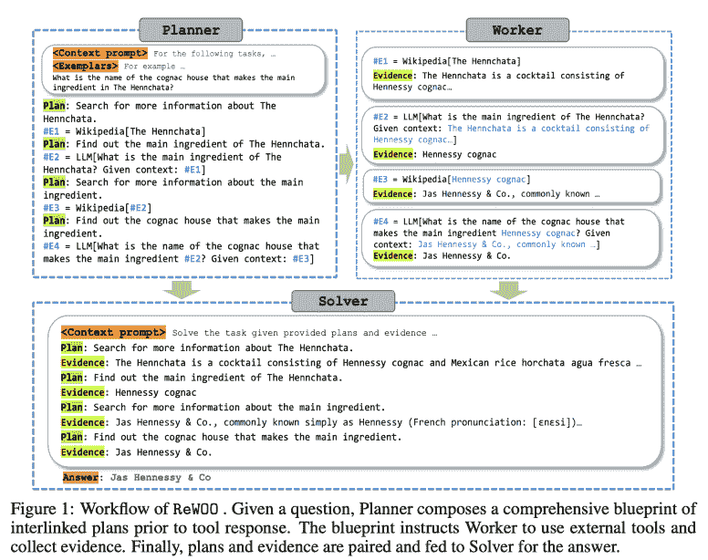

#### 6.1.2 推理与行动（ReAct）

ReAct（见图26）通过将推理轨迹与可操作步骤交织在一起，增强了LLM的问题解决能力，促进了一种动态的任务解决方法，其中推理和行动紧密集成。

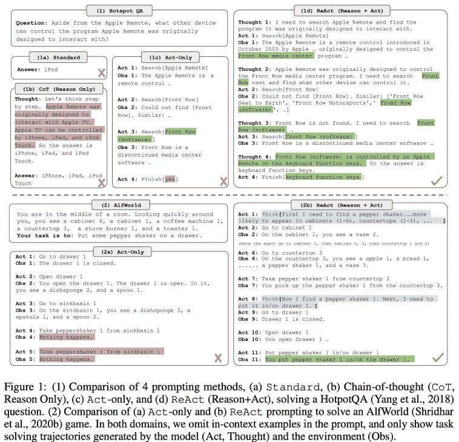

### 6.2 对话启用的解决智能体（DERA）

DERA（见图27）引入了一个协作智能体框架，其中多个具有特定角色的智能体参与对话以解决查询和做出决策。这种多智能体方法使得处理复杂查询具有深度和细腻度，紧密模仿了人类的决策过程。

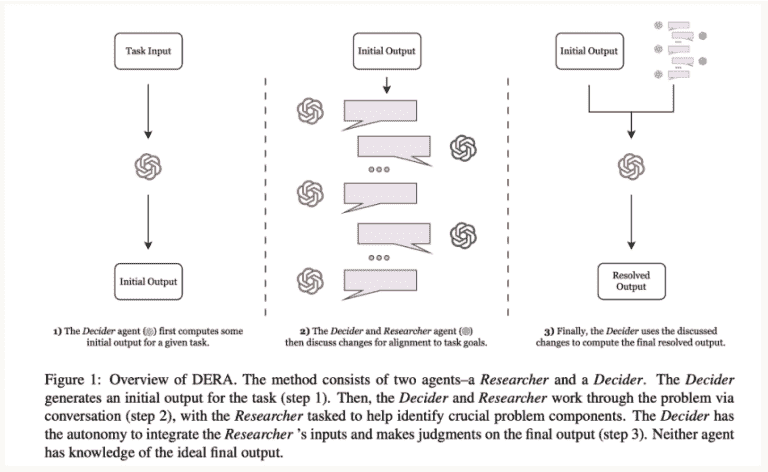

基于LLM的智能体和相关提示词工程技术的发展代表了人工智能的重大进步，承诺在广泛的应用中增强LLM的自主性、决策制定和交互能力。

---

## 7 提示词工程技术和框架

高级提示词工程技术的普及促进了一系列工具和框架的发展，每个工具都旨在简化这些方法的实施并增强其能力。这些资源在将理论方法与实际应用之间的差距弥合方面至关重要，使研究人员和实践者能够更有效地利用提示词工程。

**Langchain**已经成为提示词工程工具包景观中的基石，最初专注于链条，但扩展到支持包括智能体和网络浏览功能在内的更广泛的功能。它的全面功能套件使其成为开发复杂LLM应用的宝贵资源。

由Microsoft提供的**Semantic Kernel**，提供了一个强大的技能开发和规划工具包，扩展了其实用性，包括链条、索引和内存访问。它支持多种编程语言的多功能性增强了其对广泛用户基础的吸引力。

同样来自Microsoft的**Guidance库**，引入了一种针对提示词工程的现代模板语言，提供了与该领域最新进展对齐的解决方案。它专注于现代技术，使其成为尖端提示词工程应用的首选资源。

NVidia的**Nemo Guardrails**专门设计用于构建Rails，确保LLM在预定义的指导方针内运行，从而增强了LLM输出的安全性和可靠性。

**LlamaIndex**专门从事LLM应用的数据管理，为这些模型所需的数据流入提供必要的工具，简化了数据集成过程。

来自Intel的**FastRAG**扩展了基本的RAG方法，与本文讨论的复杂技术紧密对齐，并为检索增强任务提供了优化解决方案。

**Auto-GPT**专**注于设计LLM**智能体，通过其用户友好的界面和全面的功能，简化了复杂AI智能体的开发。同样，Microsoft的AutoGen因其在智能体和多智能体系统设计中的能力而受到关注，进一步丰富了提示词工程可用工具的生态系统。

这些工具和框架在提示词工程的持续发展中起着重要作用，提供了从基础提示词管理到复杂AI智能体构建的一系列解决方案。随着该领域的不断扩展，新工具的开发和现有工具的增强将仍然是解锁LLM在各种应用中全部潜力的关键。

---

## 8 结论

随着LLM和生成式AI的发展，提示词设计和工程将变得更加关键。我们讨论了基础（入门）和尖端（高级）方法，如检索增强生成（RAG）——下一代智能应用的必备工具。随着提示词设计和工程的快速发展，像这里讨论的自动提示词工程（APE）这样的创新可能在未来几年成为标准实践。记住，像APE这样在这里被讨论的创新，未来可能成为日常实践。成为这些激动人心发展的塑造者吧！

---

## 参考文献

[1] D. Sculley, Gary Holt, Daniel Golovin, Eugene Davydov, Todd Phillips, Dietmar Ebner, Vinay Chaudhary, and Michael Young. Machine learning: The high interest credit card of technical debt. In SE4ML: Software Engineering for Machine Learning (NIPS 2014 Workshop), 2014.

[2] Xavier Amatriain, Ananth Sankar, Jie Bing, Praveen Kumar Bodigutla, Timothy J. Hazen, and Michaeel Kazi. Transformer models: an introduction and catalog, 2023.

[3] Hattie Zhou, Azade Nova, Hugo Larochelle, Aaron Courville, Behnam Neyshabur, and Hanie Sedghi. Teaching algorithmic reasoning via in-context learning, 2022.

[4] Yao Lu, Max Bartolo, Alastair Moore, Sebastian Riedel, and Pontus Stenetorp. Fantastically ordered prompts and where to find them: Overcoming few-shot prompt order sensitivity, 2022.

[5] Jason Wei, Xuezhi Wang, Dale Schuurmans, Maarten Bosma, brian ichter, Fei Xia, Ed Chi, Quoc V Le, and Denny Zhou. Chain-of-thought prompting elicits reasoning in large language models. In S. Koyejo, S. Mohamed, A. Agarwal, D. Belgrave, K. Cho, and A. Oh, editors, Advances in Neural Information Processing Systems, volume 35, pages 24824–24837. Curran Associates, Inc., 2022.

[6] Zhuosheng Zhang, Aston Zhang, Mu Li, and Alex Smola. Automatic chain of thought prompting in large language models, 2022.

[7] Shunyu Yao, Dian Yu, Jeffrey Zhao, Izhak Shafran, Thomas L. Griffiths, Yuan Cao, and Karthik Narasimhan. Tree of thoughts: Deliberate problem solving with large language models, 2023.

[8] Timo Schick, Jane Dwivedi-Yu, Roberto Dessì, Roberta Raileanu, Maria Lomeli, Luke Zettlemoyer, Nicola Cancedda, and Thomas Scialom. Toolformer: Language models can teach themselves to use tools, 2023.

[9] Shishir G. Patil, Tianjun Zhang, Xin Wang, and Joseph E. Gonzalez. Gorilla: Large language model connected with massive apis, 2023.

[10] Bhargavi Paranjape, Scott Lundberg, Sameer Singh, Hannaneh Hajishirzi, Luke Zettlemoyer, and Marco Tulio Ribeiro. Art: Automatic multi-step reasoning and tool-use for large language models, 2023.

[11] Potsawee Manakul, Adian Liusie, and Mark J. F. Gales. Selfcheckgpt: Zero-resource black-box hallucination detection for generative large language models, 2023.

[12] Noah Shinn, Federico Cassano, Edward Berman, Ashwin Gopinath, Karthik Narasimhan, and Shunyu Yao. Reflexion: Language agents with verbal reinforcement learning, 2023.

[13] Sarah J. Zhang, Samuel Florin, Ariel N. Lee, Eamon Niknafs, Andrei Marginean, Annie Wang, Keith Tyser, Zad Chin, Yann Hicke, Nikhil Singh, Madeleine Udell, Yoon Kim, Tonio Buonassisi, Armando Solar-Lezama, and Iddo Drori. Exploring the mit mathematics and eecs curriculum using large language models, 2023.

[14] Tongshuang Wu, Ellen Jiang, Aaron Donsbach, Jeff Gray, Alejandra Molina, Michael Terry, and Carrie J Cai. Promptchainer: Chaining large language model prompts through visual programming, 2022.

[15] Yongchao Zhou, Andrei Ioan Muresanu, Ziwen Han, Keiran Paster, Silviu Pitis, Harris Chan, and Jimmy Ba. Large language models are human-level prompt engineers, 2023.

[16] Amazon Web Services. Question answering using retrieval augmented generation with foundation models in amazon sagemaker jumpstart, Year of publication, e.g., 2023. Accessed: Date of access, e.g., December 5, 2023.

[17] Shirui Pan, Linhao Luo, Yufei Wang, Chen Chen, Jiapu Wang, and Xindong Wu. Unifying large language models and knowledge graphs: A roadmap. arXiv preprint arXiv:2306.08302, 2023.

[18] Yunfan Gao, Yun Xiong, Xinyu Gao, Kangxiang Jia, Jinliu Pan, Yuxi Bi, Yi Dai, Jiawei Sun, and Haofen Wang. Retrieval-augmented generation for large language models: A survey. arXiv preprint arXiv:2312.10997, 2023.