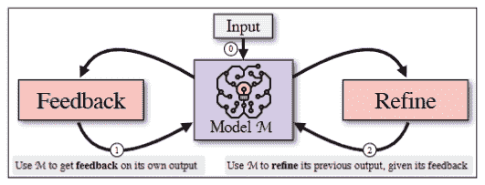
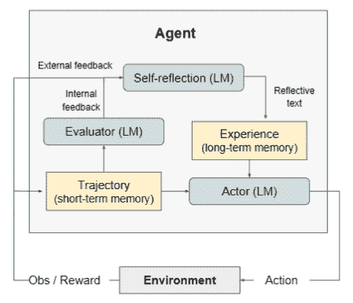
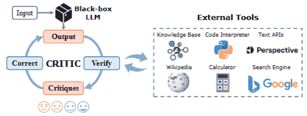

# Reflection：模型自我评估与完善的3种框架

> 来源：[https://vxc3hj17dym.feishu.cn/docx/BrwvdFPsDoKYSvxx9VFcnTGVnFh](https://vxc3hj17dym.feishu.cn/docx/BrwvdFPsDoKYSvxx9VFcnTGVnFh)

> 翻译整理：小七姐

> 免费知识星球：[**Prompt 星球**](https://t.zsxq.com/15KhQ0RE7)

“Reflection（反思）”是吴恩达教授提出的AI Agent工作流中的一个关键设计模式，它在人工智能的发展中扮演着至关重要的角色。这种设计模式的核心思想是让AI模型能够自动地对自己的输出进行批判性思考和改进，而不是仅仅生成一次性的最终结果。

在传统的AI模型中，如ChatGPT或Gemini，用户提出问题或任务后，模型会生成一个答案或输出。然而，这个输出可能并不总是令人满意。在“反思”模式下，AI模型被赋予了一种能力，即在生成初步输出后，能够自我审视和评估这个输出的质量，识别其中的不足，并据此进行改进。

以编写代码为例，AI模型首先会根据给定的任务生成一段代码。然后，模型会被提示对自己的代码进行反思，检查代码的正确性、风格和效率，并给出建设性的批评。这个过程可能会使模型发现问题并提出改进建议。接下来，模型会根据这些反馈重新编写代码，从而得到一个更好的结果。通过重复批评和重写的过程，可以进一步优化输出。

此外，“反思”模式还可以通过给AI模型提供工具来加强，这些工具可以帮助评估模型的输出。例如，可以让模型将其生成的代码运行一些单元测试，以检查代码在测试用例上的正确性，或者通过搜索网络来核实文本输出的准确性。然后，模型可以根据发现的错误进行反思，并提出进一步的改进措施。

更进一步，可以通过多智能体框架来实现“反思”。吴恩达教授提到，可以创建两个不同的智能体，一个负责生成好的输出，另一个负责对第一个智能体的输出给出建设性的批评。这两个智能体之间的讨论将有助于提升响应的质量。

总的来说，“反思”是一种基础但极为有效的AI Agent工作流设计模式。它通过自我批评和自我改进的过程，显著提高了AI模型在各种任务上的表现，包括编写代码、撰写文本和回答问题等。

《SELF-REFINE: Iterative Refinement with Self-Feedback(自我完善：通过自我反馈进行迭代精炼)》、《Reflexion: language agents with verbal reinforcement learning(反思：语言驱动型智能体的言语强化学习)》、《CRITIC: Large Language Models Can Self-Correct with Tool-Interactive Critiquing(批评者：大型语言模型可以通过工具交互批评进行自我纠正)》是其中较为经典的三篇论文。分别介绍了三种不同的AI Agent Reflection框架。

## **SELF-REFINE框架**

[《](https://arxiv.org/pdf/2303.17651.pdf)[Self-Refine:Iterative Refinemen](https://arxiv.org/pdf/2303.17651.pdf)[**t**](https://arxiv.org/pdf/2303.17651.pdf) with Self-Feedback》自我完善：通过自我反馈进行迭代精炼

> **摘要**

> 这篇论文介绍了一种名为 SELF-REFINE 的框架，它可以通过自我反馈和迭代改进来提高语言模型（LLM）的初始输出质量。该框架首先使用 LLM 生成一个输出，然后让同一个模型对其输出提供多方面的反馈，最后根据反馈来改进之前生成的输出。与以前的工作不同，这种迭代改进框架不需要监督训练数据或强化学习，且只需使用一个 LLM。在 7 种不同的任务中进行了实验，从评论重写到数学推理，证明该方法优于直接生成。在所有任务中，使用 SELF-REFINE 生成的输出都被人类和自动化指标认为是优于使用 GPT-3.5 和 GPT-4 直接生成的输出，平均改进幅度为 20%。

SELF-REFINE框架，通过交替执行生成（Generate）、反馈（Feedback）和细化（Refine）步骤来迭代改善输出。

该框架包含两个组件：**FEEDBACK**和**REFINE**,它们协同工作来生成高质量的输出。

+   FEEDBACK模块负责对初始输出进行评估，并提供如何改进的反馈。

+   REFINE模块根据收到的反馈和之前生成的输出对输出进行改进。

+   FEEDBACK和REFINE都通过少量提示(few-shot prompting)实现，使用预训练的语言模型。

**内容结构：**

1.  **初始输出生成**

使用大型语言模型（如GPT-4）和特定的生成提示（pgen）来生成任务的初始输出。

1.  **反馈生成**

将初始输出传递回同一个模型，并使用“特定的反馈提示（pfb）”来生成对该输出的反馈。这个反馈应该是具体的、可操作的，指出初始输出的不足之处和可能的改进方向。

> “特定的反馈提示（specific feedback prompt, pfb）”是指用于引导LLM生成反馈的输入文本。这个提示是设计来让模型评估并提供对其先前生成输出的批评和建议，以便进行下一步的细化改进。

> 特定的反馈提示通常包含以下元素：

+   **任务描述**：清晰地说明模型需要提供的反馈类型，例如，在代码优化任务中，提示可能会要求模型提供关于代码效率的反馈。

+   **输入输出示例**：提供一些输入输出对的示例，这些示例展示了期望的反馈格式和内容，帮助模型理解应该如何生成反馈。

+   **反馈标准**：明确指出反馈应该关注的关键方面，如代码的可读性、效率、错误处理等。

+   **指导性问题**：可能包括一些指导性问题，引导模型思考并指出初始输出的潜在问题和改进空间。

+   **反馈格式**：指定模型生成反馈的格式，例如，是否需要生成具体的改进建议，或者仅仅是指出问题所在。

1.  **输出细化**

根据生成的反馈，使用“细化提示（prefine）”来指导模型生成改进后的输出。这个过程可能涉及对输出的具体修改，以解决反馈中指出的问题。

> “细化提示（prefine）”是指用于指导大型语言模型（LLM）根据先前生成的反馈来改进和细化其初始输出的输入文本。这个提示是设计来让模型理解如何根据反馈进行具体的修改，以提高输出的质量。

> 细化提示通常包含以下元素：

+   **改进目标**：明确指出模型需要关注的改进方面，例如，提高文本的准确性、清晰度、相关性或说服力。

+   **反馈内容**：包括之前生成的反馈，这些反馈指出了初始输出中的问题和不足之处。

+   **指导性建议**：提供具体的修改建议或问题，引导模型生成更符合要求的输出。

+   **格式和结构**：指定输出的格式和结构要求，确保细化后的输出组织清晰、逻辑性强。

+   **迭代历史**：可能还包括之前迭代的输出和反馈历史，以便模型可以从中学习并避免重复错误。

1.  **迭代过程**

这个过程可以迭代多次，每次迭代都基于前一次的输出和反馈。迭代会持续进行，直到满足某个停止条件，例如达到预定的迭代次数或输出质量达到预期标准。

## Reflexion框架

[《](https://arxiv.org/pdf/2303.11366.pdf)Reflexion:language agents with verbal reinforcement learning》

反思：语言驱动型智能体的言语强化学习

> **摘要**

> 这篇论文介绍了一种名为 Reflexion 的新框架，用于强化语言代理通过语言反馈进行学习，而不是通过更新权重。具体来说，Reflexion 代理会口头反思任务反馈信号，并将自己的反思文本保存在一个情景记忆缓冲区中，以便在后续试验中做出更好的决策。Reflexion 框架足够灵活，可以整合各种类型（标量值或自由形式语言）和来源（外部或内部模拟）的反馈信号，并在多样化的任务（顺序决策、编程、语言推理）中取得显著改进。例如，Reflexion 在 HumanEval 编程基准测试中实现了 91% 的 pass@1 准确率，超过了之前最先进的 GPT-4（达到 80%）。

**实验结果：**

Reflexion是一个通过语言反馈来增强语言模型代理的框架，它在决策、推理和编程任务中都取得了显著的效果。以下是Reflexion在各个任务中的具体实现和实验结果：

**决策任务(ALFWorld):**

+   在ALFWorld环境中，Reflexion代理通过自我反思来识别错误并改进决策。实验结果显示，与仅使用ReAct的基准相比，Reflexion可以将成功率从22%提高到91%。

**推理任务(HotPotQA):**

+   在HotPotQA问答任务中，Reflexion代理通过语言反馈来改进其推理能力。实验结果显示，Reflexion可以将准确率从26%提高到44%。

**编程任务：**

+   在HumanEval、MBPP和LeetcodeHardGym等代码生成基准测试中，Reflexion代理通过编写单元测试来自我评估和改进代码。实验结果显示，Reflexion在Python和Rust编程任务上均取得了新的最先进成果，例如在HumanEval上达到了91%的pass@1准确率。

总体来说，Reflexion框架通过语言反馈来增强语言模型代理的决策、推理和编程能力，在多个任务上都取得了显著的效果提升，表明其作为一种新的强化学习范式是有效的。

Reflexion框架的结构由执行者（Actor）、评估者（Evaluator）、自我反思模型（Self-Reflection Model）、记忆存储（Memory Storage）组成，它通过语言反馈来增强语言模型代理的能力。

1.  **Actor**：Actor模型基于大型语言模型（LLM），被提示生成所需的文本和行动，这些行动会根据状态观察进行条件化。Actor模型可以是Chain of Thought或ReAct等。

1.  **Evaluator**：Evaluator模型对Actor产生的输出进行评分，评估其在给定任务中的表现。对于推理任务，可以使用基于精确匹配的评分，确保生成的输出与预期的解决方案高度一致。对于决策任务，可以采用预定义的启发式函数。根据任务要求，提供奖励或惩罚作为反馈。

1.  **Self-Reflection**：Self-Reflection模型是一个LLM，它通过生成语言反馈来提供有价值的反馈，帮助Actor进行自我改进。Self-Reflection模型分析当前轨迹和奖励信号，生成具体的反馈，并将其存储在Actor的记忆中。

1.  **记忆核心**：Reflexion过程的核心是短期和长期记忆的概念。在推理时，Actor根据短期和长期记忆做出决策。短期记忆由轨迹历史组成，而长期记忆则存储Self-Reflection模型的输出。

**主要工作流程：**

在第一次试验中，Actor产生一个轨迹，Evaluator产生一个评分，然后Self-Reflection模型生成一个总结，并将其存储在记忆中。在后续的试验中，Actor、Evaluator和Self-Reflection模型协同工作，直到Evaluator认为轨迹是正确的。记忆组件对于Reflexion的有效性至关重要，因为它允许Actor利用过去的经验快速适应不同的环境。

**执行方式：**

1.  **初始化**:

+   定义任务和初始策略。

+   初始化执行者、评估者和自我反思模型。

1.  **执行动作**:

+   执行者根据当前策略和环境状态生成动作。

+   动作在外部环境中执行，并接收反馈。

1.  **评估和反馈**:

+   评估者对执行者的输出进行评估，并提供奖励或惩罚。

+   反馈可以是简单的标量值（如成功/失败），也可以是更复杂的评价。

1.  **自我反思**:

+   自我反思模型分析评估者的反馈和执行者的输出。

+   生成文本形式的反思，总结经验教训。

1.  **记忆更新**:

+   将自我反思的结果存储在记忆中。

+   记忆作为情景记忆缓冲区，为执行者提供历史经验和教训。

1.  **策略迭代**:

+   执行者在新的环境中采取动作时，考虑记忆中的反思。

+   利用历史经验来改进策略和决策。

1.  **终止条件**:

+   达到预定的迭代次数或评估者确认输出满足特定标准。

+   任务完成，执行者和评估者停止交互。

Reflexion框架的优点包括：

它轻量级，不需要微调LLM；

它允许更细微形式的反馈（例如，针对行动的特定更改），而不是难以进行精确信用分配的标量或向量奖励；

它允许更明确和可解释的基于情节的记忆；它为未来的情节提供了更明确的提示。

## CRITIC 框架

[《CRITIC:Large Language Models Can Self-C](https://arxiv.org/pdf/2305.11738.pdf)orrect with Tool-Interactive Critiquing》

批评者：大型语言模型可以通过工具交互批评进行自我纠正

> **摘要**

> 这篇论文介绍了CRITIC框架，该框架允许大型语言模型（LLMs）通过与工具的交互来自我修正。大型语言模型的发展令人印象深刻，但这些模型有时会表现出不一致和问题行为，如捏造事实、生成有缺陷的代码或创建具有攻击性和毒性内容。与这些模型不同，人类通常会利用外部工具来交叉检查和修改初始内容，例如使用搜索引擎进行事实核查，或使用代码解释器进行调试。受到这一观察的启发，作者引入了CRITIC框架，该框架允许LLMs（基本上是“黑盒子”）以类似于人类与工具互动的方式验证并逐步修改自己的输出。具体来说，CRITIC从初始输出开始，与适当的工具进行交互以评估文本的某些方面，然后根据验证过程中的反馈修改输出。自由形式问题回答、数学程序合成和毒性降低的综合评估表明，CRITIC一致地提高了LLMs的性能。

CRITIC框架由以下几个主要部分组成：

1.  **黑盒LLM**：作为核心的生成模型，它基于输入生成初始输出。

1.  **外部工具**：与LLM交互的组件，如搜索引擎、代码解释器、计算器等，用于验证和修正LLM的输出。

1.  **交互式提示**（prompt）：用于引导LLM与外部工具交互的指令或问题。

1.  **迭代过程**：验证和修正过程可以重复执行，以持续改进输出。

**内容结构：**

1.  **初始输出**：LLM根据给定的输入生成初始答案或输出。

1.  **验证**：LLM与**外部工具交互**，通过搜索查询、代码执行等操作来验证初始输出的准确性和合理性。

1.  **批评**：基于外部工具的反馈，生成对初始输出的批评，指出问题和提出建议。

1.  **修正**：LLM根据批评信息调整和修正初始输出，生成新的、改进的输出。

1.  **迭代**：重复验证和修正步骤，直到满足停止条件（如达到预定的迭代次数或输出质量达到预期）。

## 不同之处

这三种框架共同的核心思想是**通过某种形式的自我反思和评估**来提高大型语言模型（LLMs）的性能。但在具体执行上还有不同之处。

我来进一步明确这三个框架在执行流程和内容结构上的具体不同之处：

1.  **CRITIC框架**：

+   **执行流程**：依赖于外部工具（如搜索引擎、代码解释器）来验证模型的输出。例如，在数学问题解答任务中，模型生成的答案会通过外部工具（计算器或数学求解器）来验证正确性，然后基于工具的反馈来修正答案。

+   **内容结构**：涉及到与外部系统的直接交互，需要模型能够调用API或使用其他服务来获取反馈。

1.  **SELF-REFINE框架**：

+   **执行流程**：是一个闭环的自我评估和修正过程。模型生成初步输出后，使用相同的模型来评估输出的质量，并根据自我评估的结果进行修正。例如，在情感分析任务中，模型可能会生成一个初步的情感标签，然后自我评估这个标签的准确性，并进行必要的调整。

+   **内容结构**：不需要外部验证工具，完全依赖于模型自身的能力来生成、评估和修正输出。

1.  **Reflexion框架**：

+   **执行流程**：引入了“反思性”的概念，模型在生成输出后，会将反馈以文本形式存储在“情景记忆”中，这个记忆在后续的决策中起到指导作用。例如，在对话生成任务中，模型生成的回应会基于先前存储的反馈进行调整，以生成更合适的对话。

+   **内容结构**：强调了模型内部的记忆和学习机制，模型不仅生成输出，还存储和利用过去的经验来改进未来的输出。

**不同点总结**：

+   **CRITIC** 依赖外部工具的反馈来指导修正。

+   **SELF-REFINE** 完全在模型内部进行自我评估和修正，不需要外部工具。

+   **Reflexion** 通过内部存储的“情景记忆”来持续改进输出，强调了模型的连续学习和适应能力。

这三个框架在设计上各有侧重，CRITIC强调工具辅助的验证，SELF-REFINE侧重于模型自身的迭代改进，而Reflexion则引入了记忆机制来促进模型的学习和发展。