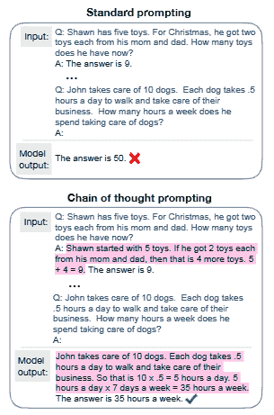
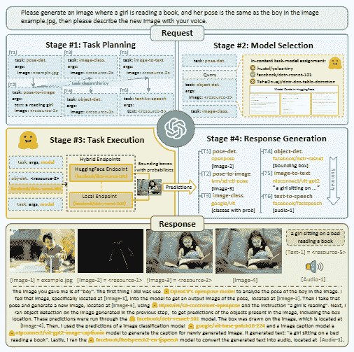
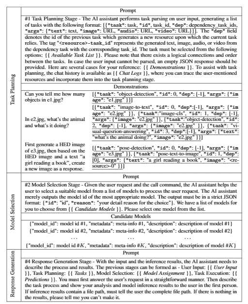

# Planning：利用LLM规划任务步骤

> 来源：[https://vxc3hj17dym.feishu.cn/docx/QQO6d6x9aoVqOMxSovOcYWvGnCd](https://vxc3hj17dym.feishu.cn/docx/QQO6d6x9aoVqOMxSovOcYWvGnCd)

> 翻译整理：小七姐

> 免费知识星球：[**Prompt 星球**](https://t.zsxq.com/15KhQ0RE7)

“Planning”（规划）是AI Agent工作流中的一种关键设计模式，，它涉及到使用大型语言模型（LLM）来自主决定执行哪些步骤来完成一个更大的任务。这种模式下，AI Agent能够根据任务的需要，动态地分配额外的计算资源来解决需要更多推理步骤的问题。这种模式的核心在于，AI Agent将复杂任务分解为多个子任务，并动态地规划每个子任务的执行顺序，以达成最终目标。

在“Planning”模式下，AI Agent 能够将一个复杂的任务分解为多个小的子任务，并自主决定每个子任务的执行顺序。例如，如果我们要求AI Agent在线研究一个特定主题，它可能会将这个目标分解为研究特定的子主题、综合发现和编写报告等子任务。

“Planning”模式的一个实际应用示例是，如果你想让代理考虑一个男孩的照片，并画出一个相同姿势的女孩的图片，这个任务可以分解为两个不同的步骤：（i）在男孩的图片中检测姿势，（ii）渲染一个在检测到的姿势中的一个女孩的图片。LLM可以通过输出一个指定计划的字符串（例如，{tool: pose-detection, input: image.jpg, output: temp1 } {tool: pose-to-image, input: temp1, output: final.jpg}）来细化任务，然后触发软件调用姿势检测工具和姿势到图像工具来完成任务。

对下面两篇文献资料做简单解读，以便大家能更深入地了解这一设计模式：

### Chain-of-Thought Prompting

《[C](https://arxiv.org/pdf/2201.11903.pdf)hain-of-Thought Prompting Elicits Reasoning in Large Language Models》，这篇论文探讨了如何通过生成一系列中间推理步骤来显著提高大型语言模型执行复杂推理任务的能力，也就是我们熟悉的“COT”（思维链提示）。不直接要求模型输出答案，而是通过提供中间推理步骤的示例来指导其响应，让模型在给出答案前先执行完整的思考过程。

COT思维框架是一种很好的引导模型进行推理和生成文本的策略。强调将复杂的思考过程分解为一系列连贯的中间步骤，以便更好地理解和解决复杂问题。

✅关键概念包括：

1.  **分解问题：**鼓励模型将一个大问题分解为多个较小的、互相关联的子问题或中间步骤。这有助于模型更好地理清问题的结构。

1.  **中间步骤：**每个子问题或中间步骤都分配给模型来处理。模型需要逐一解决这些中间步骤，并生成相应的答案或文本。

+   对于中间步骤的拆分，有以下三种常见的方法：

1.  交给 GPT 模型拆分

1.  根据以往经验拆分

1.  借用成熟的工作链

1.  **逐步推理：**COT强调模型应该逐步推理，将一个中间步骤的结果用作下一个中间步骤的基础。

1.  **最终整合：**模型最终将所有中间步骤的答案或文本整合在一起，形成最终的解答。这确保了最终的输出是全面的、准确的。

### HuggingGPT

《[HuggingGPT: Solving AI Tasks with](https://arxiv.org/pdf/2303.17580.pdf) ChatGPT and its Friends in Hugging Face》，这篇论文介绍了HuggingGPT，这是一种基于 LLM 的代理，它利用 LLM（如 ChatGPT）连接机器学习社区（如 Hugging Face）中的各种 AI 模型来解决 AI 任务。具体来说，当接收到用户请求时，使用 ChatGPT 进行任务规划，根据 Hugging Face 中可用的功能描述选择模型，然后使用选定的 AI 模型执行每个子任务，并根据执行结果进行响应总结。通过利用 ChatGPT 的强大语言能力和 Hugging Face 中的丰富 AI 模型，HuggingGPT 可以解决涵盖不同模态和领域的复杂 AI 任务。

HuggingGPT系统通过利用大型语言模型（LLM）和专家模型的优势来解决复杂的人工智能任务。其核心思想是使用LLM（如ChatGPT）作为控制器来管理和组织专家模型的合作，利用语言作为通用接口来实现LLM和AI模型之间的连接。

具体来说，HuggingGPT的工作流程包括以下几个阶段：

1.  任务规划（Task Planning）:

+   当HuggingGPT接收到用户请求时，首先使用ChatGPT（一个大型语言模型）来分析请求，理解用户的意图，并根据请求将任务分解成一系列可解决的子任务。

+   在这个阶段，ChatGPT需要确定子任务的依赖关系和执行顺序，以建立它们之间的连接。为了提高ChatGPT在任务规划中的效果，HuggingGPT采用了基于规范的指令和基于演示的解析。

+   基于规范的指令要求ChatGPT按照特定的规范（例如JSON格式）来表示和解析任务。

+   基于演示的解析则通过包含用户请求及其对应输出的多个演示来帮助ChatGPT更好地理解任务规划的意图和标准，以及任务之间的逻辑联系。

1.  模型选择（Model Selection）:

+   在任务规划之后，HuggingGPT会根据解析出的任务列表来匹配任务和模型，即选择每个任务中最合适的模型。

+   为了实现这一点，HuggingGPT使用模型描述作为连接每个模型的语言接口。具体来说，它首先从机器学习社区（如Hugging Face）收集专家模型的描述，然后使用动态的基于上下文的任务-模型分配机制来选择模型。

+   为了减少提示中的令牌使用，HuggingGPT首先根据任务类型过滤模型，并基于Hugging Face上的下载次数对选定的模型进行排名，选择前K个模型作为候选。

1.  任务执行（Task Execution） ：

+   一旦为某个解析任务分配了特定模型，下一步就是执行该任务（即进行模型推理）。在这一阶段，HuggingGPT 会自动将任务参数输入到模型中，执行这些模型以获得推理结果，然后将结果反馈给 LLM。

1.  响应生成（Response Generation）：

+   在所有任务执行完成后，HuggingGPT 需要生成最终响应。如表 1 所示，HuggingGPT 在这一阶段整合前三阶段（任务规划、模型选择和任务执行）的所有信息，包括计划的任务列表、任务的模型选择和模型的推理结果，生成简洁的总结。

尽管Planning（规划）是一个非常强大的能力，但它也导致了结果的不可预测性。相较于可靠地使用“Reflection”和“Tool use”这两种设计模式来提升应用程序的性能，“Planning”是一个相对较难预测的技术。不过，随着该领域的快速发展，相信“Planning”能力将迅速提高。