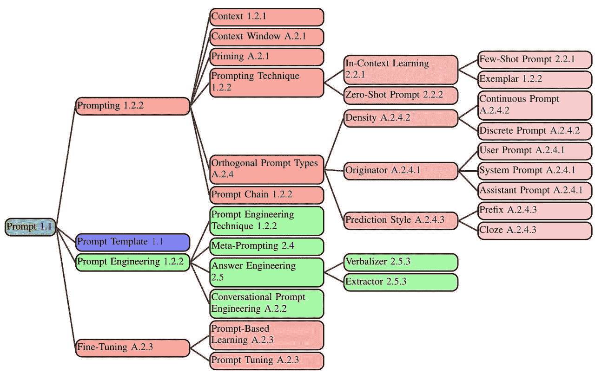
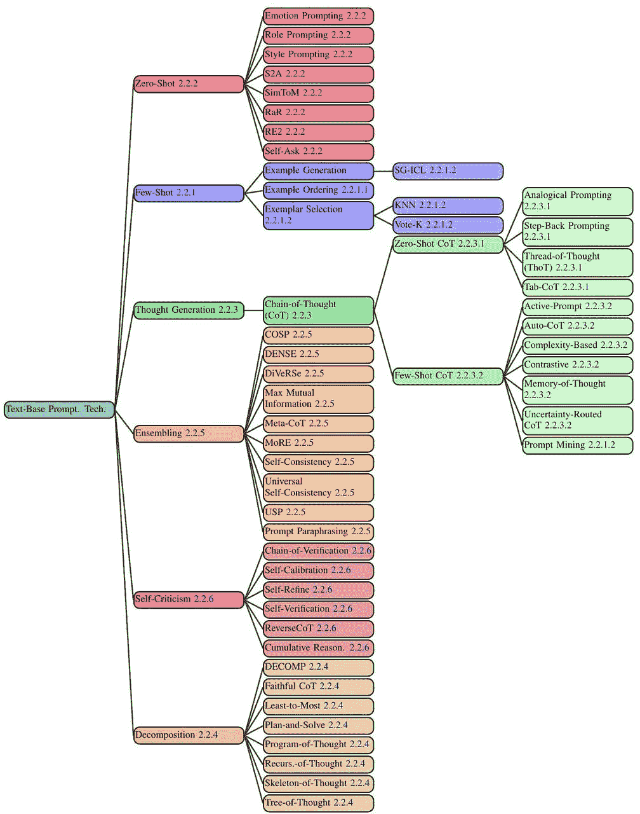
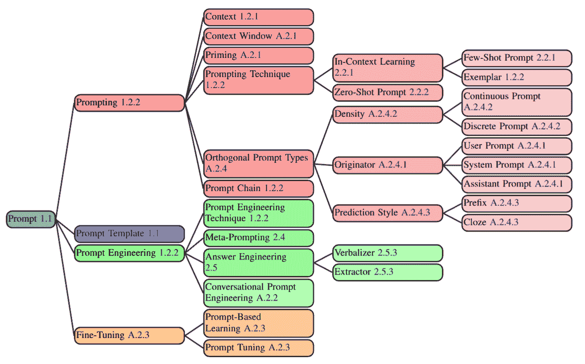
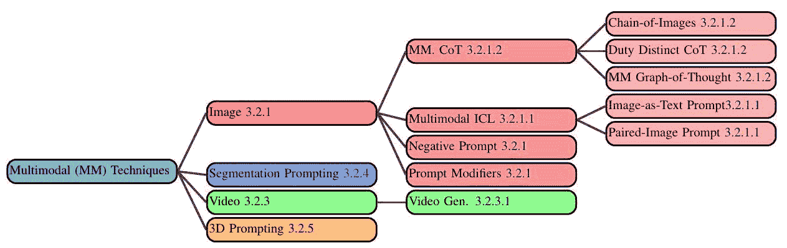

# 《提示技术》术语汇编

> 来源：[https://vxc3hj17dym.feishu.cn/docx/XgDHdpnF6oqh4oxqNKTcchaOnnc](https://vxc3hj17dym.feishu.cn/docx/XgDHdpnF6oqh4oxqNKTcchaOnnc)

## The Prompt Report: A Systematic Survey of Prompting Techniques 提示报告：提示词技术的系统调查

原文地址：`https://arxiv.org/abs/2406.06608`

PDF文档：`https://arxiv.org/pdf/2406.06608`

### 论文概要

本文对提示技术进行了系统性的调查。生成式人工智能系统正在被越来越多地部署在各个工业和研究环境中。开发者和最终用户通过使用提示或提示工程与这些系统互动。尽管提示是一个广泛研究且概念成熟的领域，但由于该领域的初创性，存在着术语冲突和对构成提示的范畴理解不足的问题。本文通过汇编提示技术的分类并对它们的使用进行分析，建立了对提示的结构性理解。提出了一个包含33个词汇术语的全面词汇表，一个58个仅文本提示技术的分类，以及40个其他感知方式的提示技术。

这篇论文通过汇编提示技术的分类并对它们的使用进行分析，建立了对提示的结构性理解，重点是对用于生成性人工智能（GenAI）系统中使用的不同类型的提示进行结构化理解和分类。

## 33 个词汇术语及其解释

> 33个词汇术语的全面词汇表：这部分文章建立了一套定义明确的术语，这些术语在提示工程领域内常用。这些词汇对于在提示技术研究中清晰地交流概念和方法论至关重要。此词汇表有助于新学习者和经验丰富的实践者理解和开发基于提示的模型。

| 序号 | 英文术语 | 中文翻译 | 解释 |
| --- | --- | --- | --- |
| 1 | Prompt | 提示 | 输入到生成型 AI 模型的指令，用于引导其输出。 |
| 2 | Prompting | 提示过程 | 使用提示来引导生成型 AI 的行为或过程。 |
| 3 | Context | 上下文 | 提示中用于增加生成型 AI 理解的附加信息。 |
| 4 | Context Window | 上下文窗口 | 定义模型在进行预测时可以考虑的信息量。 |
| 5 | Priming | 引导 | 在提示过程中用来设置特定情境或任务环境的技术。 |
| 6 | Prompting Technique | 提示技术 | 描述如何结构化提示、提示或多个提示的动态序列的蓝图。 |
| 7 | In-Context Learning | 上下文学习 | 生成型 AI 通过在提示中提供示例和/或相关指令来学习技能和任务的能力。 |
| 8 | Exemplar | 示例 | 作为模型任务示范的实例。 |
| 9 | Few-Shot Prompt | 少样本提示 | 使用少量示例来教导模型完成任务的提示。 |
| 10 | Zero-Shot Prompt | 零示例提示 | 不使用示例即可激发模型生成答案的提示。 |
| 11 | Orthogonal Prompt Types | 正交提示类型 | 提示的不同基本类型，与主流类型正交。 |
| 12 | Density | 密度 | 提示中信息的密集程度，影响模型输出的详细程度和复杂性。 |
| 13 | Continuous Prompt | 连续提示 | 提示在内容或结构上不断变化或发展。 |
| 14 | Discrete Prompt | 离散提示 | 提示具有固定和明确的结构或内容。 |
| 15 | Originator | 创始人 | 最初提出或创建特定提示或技术的个体或团队。 |
| 16 | User Prompt | 用户提示 | 直接由用户定义或输入的提示。 |
| 17 | System Prompt | 系统提示 | 系统自动生成或预定义的提示。 |
| 18 | Assistant Prompt | 助理提示 | 辅助系统使用的提示，旨在提供帮助或信息。 |
| 19 | Prediction Style | 预测风格 | 提示中用于指导模型预测输出风格的指示。 |
| 20 | Prefix | 前缀 | 放在输入前的固定文本，用于调整或指定模型的行为。 |
| 21 | Cloze | 填空 | 一种提示类型，要求填入空白处以完成文本。 |
| 22 | Prompt Chain | 提示链 | 两个或更多提示模板的连续使用，其中每个模板的输出用于参数化下一个模板。 |
| 23 | Prompt Template | 提示模板 | 包含一个或多个变量的函数，这些变量会被替换以创建提示。 |
| 24 | Prompt Engineering | 提示工程 | 开发提示的迭代过程，通过修改或更改正在使用的提示技术。 |
| 25 | Prompt Engineering Technique | 提示工程技术 | 用于迭代改进提示的具体方法或策略。 |
| 26 | Meta-Prompting | 元提示 | 提示生成或改进另一个提示或提示模板的过程。 |
| 27 | Answer Engineering | 回答工程 | 开发或选择从生成型 AI 输出中提取精确答案的算法的迭代过程。 |
| 28 | Verbalizer | 口述器 | 在标签任务中，将输出映射到标签的工具，反之亦然。 |
| 29 | Extractor | 提取器 | 用于从生成型 AI 的响应中提取答案的算法或工具。 |
| 30 | Conversational Prompt Engineering | 会话式提示工程 | 在对话设置中应用提示工程的实践。 |
| 31 | Fine-Tuning | 微调 | 通过小的梯度更新调整模型的权重以优化性能的过程。 |
| 32 | Prompt Tuning | 提示调整 | 调整提示以改善生成型 AI 的响应的过程。 |
| 33 | Prompt-Based Learning | 基于提示的学习 | 通过提示而不是通过梯度更新进行学习的过程。 |

## 58 种文本基础提示技术分类

> 58种仅文本提示技术的分类：文章对58种使用仅文本提示的技术进行了分类。这些技术以一种明确它们的应用和区别的方式系统化，有助于理解如何使用不同的提示策略来优化GenAI系统在不同场景下的表现，比如提高准确性、减少偏见或增强模型从有限示例中泛化的能力。

| 序号 | 英文术语 | 中文翻译 | 解释 |
| --- | --- | --- | --- |
| 1 | Zero-Shot | 零样本 | 在没有先前例子或训练数据的情况下，直接使用模型进行问题解答或任务执行的技术。 |
| 2 | Emotion Prompting | 情感提示 | 通过提示引导模型产生或识别特定情感的输出。 |
| 3 | Role Prompting | 角色提示 | 指定模型扮演某一角色或具有特定身份来回答问题或生成内容。 |
| 4 | Style Prompting | 风格提示 | 引导模型按照特定风格或格式生成文本。 |
| 5 | System 2 Attention, S2A | 系统2注意力 | 让模型重写提示，消除与问题无关的信息。 |
| 6 | SimToM | 情境模拟 | 涉及多人或对象的复杂问题解答，确立每个人所知事实的集合。 |
| 7 | Rephrase and Respond, RaR | 改述并回应 | 指导模型先改述问题再生成答案。 |
| 8 | Re-reading, RE2 | 重读 | 在提示中增加“再读一遍问题”这样的短语。 |
| 9 | Self-Ask | 自问 | 模型自我提问以深入探索问题或主题，以改善答案的质量或完整性。 |
| 10 | Few-Shot | 少样本 | 使用少量示例来训练或调整模型的技术，通常用于小样本学习。 |
| 11 | Example Generation | 示例生成 | 生成用于训练或引导模型的示例。 |
| 12 | SG-ICL Self-Generated In-Context Learning | 自生成情景学习 | 利用生成模型自动生成示例。在训练数据不可用的情况下，这种方法比零样本场景更有效，但生成的示例效果不如真实数据 。 |
| 13 | Example Ordering | 示例排序 | 调整示例在提示中的顺序，以优化模型的输出。 |
| 14 | Exemplar Selection | 示例选择 | 从大量数据中选择最具代表性或最有用的示例来训练或指导模型。 |
| 15 | KNN K-Nearest Neighbor | 最邻近算法 | 最近邻方法，通常用于选择与当前任务最相关的示例。 |
| 16 | Vote-K | Vote-K | 一种投票机制，通过多个模型或多次运行来确定最佳答案。 |
| 17 | Thought Generation | 思考生成 | 促使模型展开思考过程，以逐步解答问题或生成复杂内容。 |
| 18 | Chain-of-Thought (CoT) | 思维链 | 引导模型显示其解决问题的逐步思维过程。 |
| 19 | Zero-Shot CoT | 零样本思维链 | 在零样本设置下实施思维链的技术，不依赖先前的例子。 |
| 20 | Analogical Prompting | 类比提示 | 使用类比来帮助模型建立概念之间的联系，通常用于解决复杂问题。 |
| 21 | Step-Back Prompting | 后退提示 | 在回答之前，模型先回顾或重新考虑问题的各个方面。 |
| 22 | Thread-of-Thought | 思维线索 | 进一步发展的思维链技术，强调在解答过程中串联多个思考点。 |
| 23 | Tab-CoT | 表格思维链 | 使用表格格式来组织和显示模型的思维过程。 |
| 24 | Few-Shot CoT | 少样本思维链 | 结合少样本学习和思维链技术，以少量示例促进模型的思考过程。 |
| 25 | Active-Prompt | 主动提示 | 动态调整提示策略，根据模型反馈或任务性能来优化提示。 |
| 26 | Auto-CoT | 自动思维链 | 自动化生成思维链，无需人工干预来设计或选择提示。 |
| 27 | Complexity-Based | 基于复杂性的提示 | 根据任务的复杂性调整提示策略，以应对不同难度的问题。 |
| 28 | Contrastive | 对比提示 | 使用对比例子来强调不同答案之间的差异，帮助模型识别正确答案。 |
| 29 | Memory-of-Thought | 思维记忆 | 记录并利用之前的思考过程，以改进当前的解答策略。 |
| 30 | Uncertainty-Routed CoT | 不确定性导向CoT | 在存在不确定性时优化思维链的路线，以提高答案的准确性。 |
| 31 | Prompt Mining | 提示挖掘 | 分析大量数据，寻找最有效的提示方式或模板。 |
| 32 | Decomposition | 分解 | 把复杂问题分解成若干更易管理的小问题，然后逐个解决。 |
| 33 | DECOMP | 解构提示 Decomposed Prompting | 将复杂问题分解为更易管理的子问题，以帮助模型更有效地解决这些问题的技术 |
| 34 | Faithful CoT | 忠实CoT | 确保模型在执行思维链时，其推理过程和事实保持一致。 |
| 35 | Least-to-Most | 从少到多 | 从最简单的组件开始，逐步增加问题的复杂性。 |
| 36 | Plan-and-Solve | 计划和解决 | 先制定解决策略，再逐步执行解决问题的步骤。 |
| 37 | Program-of-Thought | 思维程序 | 利用编程方法来指导模型的思维过程，通常用于解决数学或逻辑问题。 |
| 38 | Recursion-of-Thought | 思维递归 | 在遇到复杂问题时，模型将问题分解并递归求解。 |
| 39 | Skeleton-of-Thought | 思维骨架 | 创建问题解答的框架或骨架，然后逐部分填充细节。 |
| 40 | Tree-of-Thought | 思维树 | 通过构建思维的树状结构，探索不同的解决路径，最终确定最优解。 |
| 41 | Ensembling | 集成 | 使用多个模型或多次运行的结果，通过某种形式的聚合来得到最终答案。 |
| 42 | Consistency-based Self-adaptive Prompting, COSP | 基于一致性的自适应提示 | 使用自洽在示例集中选择高一致性子集。 |
| 43 | Demonstration Ensembling, DENSE | 示范集成 | 使用不同示例子集创建多个提示。 |
| 44 | DiVeRSe | 多样化推理示例（Diverse Reasoning Experts） | 创建多个提示并对每个执行自洽。 |
| 45 | Max Mutual Information | 最大互信息 | 优选能够最大化输入与输出之间互信息的提示策略。 |
| 46 | Meta-CoT | 多思维链元推理 | 在元学习框架下实现思维链的应用，通过学习如何更好地学习来优化模型表现。 |
| 47 | MoRE | 多推理专家 (Mixture of Reasoning Experts） | 结合多种推理专家的见解来提高问题解决的准确性和深度。 |
| 48 | Self-Consistency | 自我一致性 | 通过多次运行检验结果的一致性来提高模型的可靠性。 |
| 49 | Universal Self-Consistency | 通用自我一致性 | 扩展自我一致性技术，应用于更广泛的任务和场景。 |
| 50 | USP | 通用自适应提示 (Universal Self-Adaptive Prompting） | 优化自适应提示策略，实现更高效和准确的模型训练和应用。 |
| 51 | Prompt Paraphrasing | 提示重写 | 通过改写提示来探索不同表述的效果，以寻找最优的表达方式。 |
| 52 | Self-Criticism | 自我批评 | 让模型评估自己的输出，并根据评估结果调整答案。 |
| 53 | Chain-of-Verification | 验证链 | 通过构建一系列验证问题来测试和确认模型的输出结果。 |
| 54 | Self-Calibration | 自我校准 | 通过反馈调整模型对其置信度的估计，以提高输出的准确性。 |
| 55 | Self-Refine | 自我完善 | 让模型在迭代过程中不断完善其输出，以达到更高的质量标准。 |
| 56 | Self-Verification | 自我验证 | 实施一系列自我检测措施，确保模型输出的正确性。 |
| 57 | ReverseCoT | 反向CoT | 通过反向应用思维链来检测和改正错误推理。 |
| 58 | Cumulative Reasoning | 累积推理 | 在解答过程中累积推理结果，逐步构建最终答案。 |

## 40 种其他模态的提示类型

> 40种其他模态的提示类型：除了文本，该文还探讨了40种适用于其他模态如图像、音频和视频的提示技术。了解如何有效地提示处理不同数据输入的模型对于在多媒体内容分析、游戏中的互动AI或机器人技术中利用AI至关重要。

| 序号 | 英文术语 | 中文翻译 | 解释 |
| --- | --- | --- | --- |
| 1 | Multilingual Techniques | 多语言技术 | 指的是一系列技术和方法，用于处理、分析和生成多种语言的文本数据。 |
| 2 | Chain-of-Thought | 思维链 | 引导模型展现其逐步推理过程的技术，常用于解决复杂问题。 |
| 3 | XLT | Cross-Lingual Transfer 跨语言转移技术 | 一种能够将从一种语言中学到的知识应用到其他语言的机器学习方法。 |
| 4 | In-Context Learning | 内置上下文学习 | 在给定的上下文中训练模型理解和适应，以增强其对相似情境的响应能力。 |
| 5 | CLSP | Cross-Lingual Semantic Parsing 跨语言语义解析 | 是一种用于解析和理解多种语言中的语义信息的技术。它允许模型不仅仅翻译文本，而是能够理解不同语言中的语义结构，并将这些结构映射到统一的语义框架中。 |
| 6 | X-InSTA | Cross-lingual Instance-Aware Semantic Transformation and Adaptation | 它目标是在不同语言间转换语义信息时，保持对特定实例的敏感性和准确性，如在处理具体的命名实体或特定上下文时维持语义的一致性和准确性。 |
| 7 | In-CLT | In-Context Language Transfer 上下文内语言转移 | 指的是在给定的上下文中，将信息从一种语言转移至另一种语言的技术。 |
| 8 | In-Context Ex. Selection | 内置上下文示例选择 | 选择适合当前上下文的示例来优化模型的学习过程。 |
| 9 | PARC | Predictive Auto-Regressive Context | 一种利用自回归模型预测和维持上下文的连续性的技术。它通过预测接下来可能出现的词汇或短语来自动维护和更新上下文，增强了语言模型对上下文变化的适应性和预测能力。 |

| 序号 | 术语 | 中文翻译 | 描述 |
| --- | --- | --- | --- |
| 10 | `Semantically-Aligned` | 语义上接近 | 选择语义上接近的提示或内容，以增强模型的语义理解能力。 |
| 11 | `Semantically-Distant` | 语义上距离 | 使用与当前上下文语义上有距离的提示，挑战模型处理复杂或非直观关系的能力。 |
| 12 | `Human-in-the-Loop` | 人在回路中 | 在模型的训练或推理过程中，加入人类的判断和反馈，以提高决策的准确性。 |
| 13 | `Interactive Chain` | 交互式链 | 在交互环境中使用链式提示，允许用户与模型的输出动态互动，优化结果。 |
| 14 | `Iterative` | 迭代 | 通过反复迭代的方式细化模型的输出，逐步接近最优解。 |
| 15 | `Translation` | 翻译 | 将一种语言的文本转换为另一种语言，同时保持原意的技术。 |
| 16 | `Chain-of-Dictionary` | 字典链 | 利用词典或词汇数据库链接信息，帮助模型理解和生成语言内容。 |
| 17 | `DecoMT` | `Decomposed Machine Translation` | 涉及将复杂的翻译任务分解成更小、更易管理的子任务。这种方法通过专注于特定语言对或语言特性的细分问题，可以提高翻译的准确性和效率。 |
| 18 | `DiPMT` | `Differential Privacy Machine Translatio` | 一种融合机器翻译与差分隐私技术的方法，目的是在不牺牲用户数据隐私的前提下提供高质量的翻译服务。通过在翻译过程中应用差分隐私原则，`DiPMT`能够保护个人数据不被泄露，同时确保翻译输出的实用性和准确性。 |
| 19 | `MAPS` | `Multilingual Adaptive Processing Systems` | 指的是能够自动适应并优化多语言内容处理的系统。这种系统通过学习不同语言间的相似性和差异性，自动调整处理策略，以提高跨语言任务的效率和效果。 |
| 20 | `Translate First Prompting` | 首先翻译提示 | 一种处理多语言任务的技术，它涉及在执行任何其他自然语言处理任务之前先将输入数据从源语言翻译成目标语言。 |
| 21 | `External MT Systems` | 外部`MT`系统 | 使用外部机器翻译系统，通常为独立开发的高性能系统，以支持特定任务。 |
| 21 | `Standard LLMs` | 标准`LLMs` | 使用标准的大型语言模型处理任务，不涉及特定优化或调整。 |
| 22 | `Multilingual LLMs` | 多语言`LLMs` | 支持处理多种语言的大型语言模型，适用于全球化应用。 |
| 23 | `Prompt Language` | 提示语言 | 指定用于模型提示的语言，通常选择模型训练中使用的主要语言。 |
| 24 | `English` | 英语 | 使用英语作为主要的交互和处理语言。 |
| 25 | `Task Language` | 任务语言 | 定义用于执行特定任务的语言，可能与提示语言不同。 |
| 26 | `Multimodal (MM) Techniques` | 多模态技术 | 指的是结合使用来自不同模态（如文本、图像、音频、视频等）的数据来提升信息处理和分析能力的技术。 |
| 27 | `Image` | 图像 | 使用图像作为输入或参照的提示技术。 |
| 28 | `MM CoT` | 多模态`CoT` | 在多模态环境下应用链式思考（`CoT`）的技术，结合不同模态的信息进行推理。 |
| 29 | `Chain-of-Images` | 图像链 | 通过一系列相关联的图像展示信息或叙述故事，形成视觉上的链式逻辑。 |
| 30 | `Duty Distinct CoT` | 职责区分`CoT` | 明确不同组件或角色的职责，以优化多模态链式思考的过程。 |
| 31 | `MM Graph-of-Thought` | 多模态思维图 | 创建包含多种模态元素（如图像、文本）的思维图谱，以展示复杂思考过程。 |
| 32 | `Multimodal ICL` | `Multimodal In-Context Learning`，多模态内置上下文学习 | 一种结合多种数据模态（如文本、图像、音频等）进行学习的技术，特别强调在给定的上下文中，利用来自各种模态的数据进行信息理解和决策的能力 |
| 33 | `Image-as-Text Prompt` | 图像-文本提示 | 将图像信息转换为文本描述作为提示，帮助理解或生成相关内容。 |
| 34 | `Paired-Image Prompt` | 配对图像提示 | 使用一对图像作为提示，通常用于比较、对比或关联分析。 |
| 35 | `Negative Prompt` | 负面提示 | 是一种特定类型的提示技术，用于引导模型生成与预设条件相反的结果或反应。 |
| 36 | `Prompt Modifiers` | 提示修饰 | 是在自然语言处理（`NLP`）中使用的一种技术，用于修改或调整初始提示，以影响和指导机器学习模型的输出。 |
| 37 | `Segmentation Prompting` | 分割提示 | 在图像或视频处理中，使用提示来指导模型对特定区域进行分割和识别。 |
| 38 | `Video` | 视频 | 使用视频作为输入或生成视频作为输出的提示技术。 |
| 39 | `Video Gen.` | 视频生成 | 利用提示生成或编辑视频内容的技术。 |
| 40 | `3D Prompting` | 3D提示 | 利用三维模型或场景进行提示，常用于增强现实或虚拟现实技术中。 |
