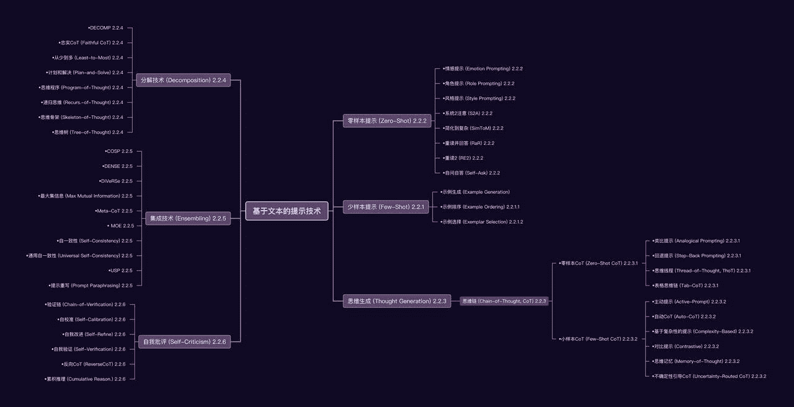

# 《提示词技术的系统调查》- 基于文本的提示技术部分

> 来源：[https://vxc3hj17dym.feishu.cn/docx/G4Ihdl0AgoHB1ExK0lWcMItinuc](https://vxc3hj17dym.feishu.cn/docx/G4Ihdl0AgoHB1ExK0lWcMItinuc)

## **T**he Prompt Report: A Systematic Survey of Prompting Techniques 提示报告：提示词技术的系统调查

原文地址：https://arxiv.org/abs/2406.06608

PDF文档：https://arxiv.org/pdf/2406.06608

---

**论文概要**

本文对提示技术进行了系统性的调查。生成式人工智能系统正在被越来越多地部署在各个工业和研究环境中。开发者和最终用户通过使用提示或提示工程与这些系统互动。尽管提示是一个广泛研究且概念成熟的领域，但由于该领域的初创性，存在着术语冲突和对构成提示的范畴理解不足的问题。本文通过汇编提示技术的分类并对它们的使用进行分析，建立了对提示的结构性理解。提出了一个包含33个词汇术语的全面词汇表，一个58个仅文本提示技术的分类，以及40个其他感知方式的提示技术。

---

这篇论文通过汇编提示技术的分类并对它们的使用进行分析，建立了对提示的结构性理解，重点是对用于生成性人工智能（GenAI）系统中使用的不同类型的提示进行结构化理解和分类。

本文重点摘录及翻译了“基于文本的提示技术”部分：

# 少样本学习 (Few-Shot) 2.2.1

### **示例生成 (**Example Generation) 2.2.1

示例生成是通过生成合适的示例来增强语言模型的能力。在没有现成数据的情况下，通过构造合理的示例来引导模型更好地理解和完成任务。Few-Shot Prompting（小样本提示）是一种在生成人工智能设置中特定于提示的技术，不涉及更新模型参数 。

### **示例**排序 (Example Ordering) 2.2.1.2

示例排序涉及在提示中按特定顺序排列示例，以便模型能够更好地利用这些示例进行学习。例如，可以按照相关性或复杂度对示例进行排序。示例的顺序会显著影响模型的表现，在某些任务上，示例顺序会导致准确率从低于50%到超过90%的变化  。

### **示例**选择 (Exemplar Selection) 2.2.1.2

示例选择是从训练集中选择最合适的示例来提示模型。这通常包括选择与测试样本最相似的示例，以提高模型的性能。不同的算法如KNN（K-最近邻）和Vote-K可以用于选择相似的示例 。

### 最邻近算法（KNN）2.2.1.2

KNN K-Nearest Neighbor，最邻近算法，是一种基于实例的学习方法，广泛应用于分类和回归任务中。该算法的核心思想是在特征空间中找到测试点最近的K个训练样本，然后根据这些最近邻的已知标签来预测测试点的标签。

### Vote-K

是一种集成学习策略，通常与KNN或其他基于实例的学习方法结合使用。在这种策略中，不是简单地使用最近邻的标签直接决定预测结果，而是让每个邻居“投票”，最常见的类别标签（在分类任务中）或平均值（在回归任务中）被选为最终预测结果。

# 零样本学习 (Zero-Shot) 2.2.2

### 情感提示 （Emotion Prompting）2.2.2

Emotion Prompting 情感提示，是指通过提示引导模型产生或识别特定情感的输出。

### **角色提示****（**Role Prompting）2.2.2

Role Prompting 角色提示，指定模型扮演某一角色或具有特定身份来回答问题或生成内容。

### **风格提示（S****t**yle Prompting) 2.2.2

Style Prompting，风格提示，引导模型按照特定风格或格式生成文本。

### **系统2注意力**** (****System **2 Attention) 2.2.2

System 2 Attention, S2A，系统2注意力，让模型重写提示，消除与问题无关的信息。

### **情境模拟**** (****SimToM****) 2.2.1.2**

SimToM，Simulated to Maximum，涉及多人或对象的复杂问题解答，确立每个人所知事实的集合。通常指的是情景模拟到最大化的方法，这是一种通过模拟不同情景或条件，并在这些条件下测试系统性能或反应的方法，以评估系统在极端或多变环境中的最大潜力和稳定性。

### **改述并回应（**Rephrase and Respond） 2.2.2

Rephrase and Respond, RaR，改述并回应，指导模型先改述问题再生成答案。

### **重读 ****(****RE2****) 2.2.2**

Re-reading, RE2，重读，在提示中增加“再读一遍问题”这样的短语。

### 自问（Self-Ask）2.2.2

Self-Ask，自问，模型自我提问以深入探索问题或主题，以改善答案的质量或完整性。

#

# 思维生成 (Thought Generation) 2.2.3

### **思维**链 (Chain-of-Thought, CoT) 2.2.3.1

思维链提示 (Chain-of-Thought, CoT) 利用少量示例提示，鼓励大型语言模型在给出最终答案之前表达其思维过程 。这种技术显著提高了大型语言模型在数学和推理任务中的表现。例如，一个示例问题包含问题、推理路径和正确答案 。

### **零样**本CoT (Zero-Shot CoT) 2.2.3.1

最简单的CoT版本不包含示例。它在提示中附加一个诱导思维的短语，如“让我们一步一步思考” 。其他诱导思维的短语包括“让我们逐步解决这个问题，以确保我们得到正确的答案”和“首先，让我们逻辑地思考这个问题” 。

### 类比提示 (Analogical Prompting) 2.2.3.1

类比提示 (Analogical Prompting) 类似于自生成上下文学习 (SG-ICL)，自动生成包含思维链的示例。它在数学推理和代码生成任务中表现出色 。

### 回退提示 (Step-Back Prompting) 2.2.3.1

回退提示 (Step-Back Prompting) 是对CoT的一种修改，其中大型语言模型首先被问及关于相关概念或事实的通用、高层次问题，然后再进行推理 。这种方法在多个推理基准测试中显著提高了表现 。

### **思维线程 (Thread-of-Th**ought, ThoT) 2.2.3.1

思维线程 (Thread-of-Thought, ThoT) 提示改进了CoT推理的思维诱导器 。它使用“逐步带我走过这个背景，逐步总结和分析”，而不是“让我们一步一步思考” 。这种思维诱导器在处理复杂背景时特别有效 。

### 表格思维链 (Tab-CoT) 2.2.3.1

表格思维链 (Tabular Chain-of-Thought, Tab-CoT) 包含一个零样本CoT提示，使大型语言模型以Markdown表格的形式输出推理过程 。这种表格式设计有助于改进输出的结构和推理 。

### **少**样本CoT (Few-Shot CoT) 2.2.3.2

这组技术向大型语言模型提供多个包含思维链的示例，可以显著提高性能 。这种技术有时被称为手动CoT或黄金CoT 。

### 主动提示 (Active-Prompt) 2.2.3.2

主动提示 (Active-Prompting) 从一些训练问题/示例开始，要求大型语言模型解决这些问题，然后计算不确定性（在这种情况下是分歧），并要求人工标注者重写不确定性最高的示例 。

### 自动CoT (Auto-CoT) 2.2.3.2

自动思维链 (Auto-CoT) 提示使用Wei等人提出的零样本提示，自动生成思维链 。这些思维链用于为测试样本构建少样本CoT提示 。

### 基于复杂性的提示 (Complexity-Based) 2.2.3.2

基于复杂性的提示涉及对CoT的两个主要修改 。首先，它选择复杂的示例进行注释和包含在提示中，例如基于问题长度或所需的推理步骤。其次，在推理过程中，它采样多个推理链（答案），并在超过某个长度阈值的链中进行多数投票 。

### 对比提示 (Contrastive) 2.2.3.2

对比思维链提示 (Contrastive CoT Prompting) 将包含正确和错误解释的示例添加到CoT提示中，以向大型语言模型展示不应该如何推理 。这种方法在算术推理和事实问答等领域表现出显著改进 。

### 思维记忆 (Memory-of-Thought) 2.2.3.2

思维记忆提示 (Memory-of-Thought Prompting) 利用未标注的训练示例，在测试时构建少样本CoT提示 。这种技术在算术、常识和事实推理等基准测试中表现出显著改进 。

### **不确定性引导CoT (Uncertainty**-Routed CoT) 2.2.3.2

不确定性引导的思维链提示 (Uncertainty-Routed CoT Prompting) 采样多个CoT推理路径，然后选择超过某个阈值的多数 。如果不满足该阈值，它将进行贪婪采样并选择该响应 。这种方法在MMLU基准测试中表现出改进 。

# 分解技术 (Decomposition) 2.2.4

### 分解提示 **DECOMP 2.2.4**

分解提示 (Decomposed Prompting, DECOMP) 技术是通过将复杂问题分解为多个简单子问题来提高模型的推理能力。这种方法使用少样本提示展示如何使用某些功能，例如字符串拆分或互联网搜索；这些功能通常实现为单独的语言模型调用 。

### 忠实CoT (Faithful CoT) 2.2.4

忠实思维链 (Faithful Chain-of-Thought, Faithful CoT) 是一种基于链式思维的方法，确保模型在推理过程中保持一致和准确。该方法通过引导模型逐步推理，确保每一步都基于先前步骤的正确性，从而提高整体推理的可靠性 。

### 从少到多 (Least-to-Most) 2.2.4

从少到多提示 (Least-to-Most Prompting) 首先提示大型语言模型将给定问题分解为子问题，而不解决它们。然后，模型按顺序逐个解决这些子问题，每次将模型的响应附加到提示中，直到得出最终结果。这种方法在符号操作、组合泛化和数学推理任务中表现出显著改进 。

### 计划和解决 (Plan-and-Solve) 2.2.4

计划和解决提示 (Plan-and-Solve Prompting) 包含一个改进的零样本思维链提示，即“让我们首先理解问题并制定一个解决计划。然后，让我们按照计划一步步解决问题”。这种方法在多个推理数据集上生成了比标准零样本思维链更稳健的推理过程 。

### 思维程序 (Program-of-Thought) 2.2.4

思维程序提示 (Program-of-Thought Prompting) 将问题直接翻译为代码，发送到Python解释器以生成答案。这种方法通过编程方式解决问题，有效提高了任务的自动化程度 。

### 递归思维 (Recurs.-of-Thought) 2.2.4

递归思维提示 (Recursion-of-Thought Prompting) 允许模型在推理过程中反复调用自己。这种技术通过允许模型在每一步中检查和修正自己的答案，增强了推理的准确性和灵活性 。

### 思维骨架 (Skeleton-of-Thought) 2.2.4

思维骨架提示 (Skeleton-of-Thought Prompting) 是一种并行解码技术，允许大型语言模型同时生成多个推理路径。通过这种方法，模型可以在多个推理路径中选择最佳答案，从而提高推理效率和准确性 。

### 思维树 (Tree-of-Thought) 2.2.4

思维树 (Tree-of-Thought, ToT) 创建一个树状搜索问题，通过从初始问题开始生成多个可能的步骤（类似于思维链中的思考）。它通过提示评估每一步解决问题的进展，并决定继续哪些步骤，然后继续创建更多的思维步骤。ToT 对需要搜索和计划的任务特别有效 。

# 集成技术 (Ensembling) 2.2.5

### **一致性自适应提示 ****COSP 2.2.5**

一致性自适应提示 (Consistency-based Self-adaptive Prompting, COSP) 构建少样本思维链提示，通过对一组示例运行零样本思维链并进行自一致性，再选择高一致性子集的输出作为最终提示中的示例 。

### **示例集成  DENSE**** 2.2.5**

示例集成 (Demonstration Ensembling, DENSE) 创建多个少样本提示，每个提示包含训练集的不同子集。然后，汇总这些输出以生成最终响应 。

### **多样化推理示例 ****DiVeRSe 2.2.5**

多样化推理示例 (Diverse Reasoning Experts, DiVeRSe) 创建多个针对不同推理类型（如检索增强提示用于事实推理、思维链推理用于多步和数学推理、生成知识提示用于常识推理）的专门提示。然后，基于一致性分数选择最佳答案 。

### **最大互信息 (Max Mutua**l Information) 2.2.5

最大互信息方法 (Max Mutual Information Method) 创建多种提示模板，并选择最大化提示和语言模型输出之间互信息的最佳模板 。

### 多思维链元推理 **Meta-CoT 2.2.5**

多思维链元推理 (Meta-Reasoning over Multiple CoTs) 生成多个推理链（不一定是最终答案），然后将这些链插入一个提示模板中，生成最终答案 。

### **多推理专家 ****MoRE 2.2.5**

多推理专家 (Mixture of Reasoning Experts, MoRE) 使用不同的专门提示创建一组多样化的推理专家，并根据一致性分数选择最佳答案 。

### 自一致性 (Self-Consistency) 2.2.5

自一致性 (Self-Consistency) 基于不同的推理路径可以导致相同答案的直觉。首先，使用非零温度多次提示语言模型执行思维链，从而产生多样化的推理路径。然后，对所有生成的响应进行多数投票，选择最终响应 。

### **通用自一致性 (Universal Sel**f-Consistency) 2.2.5

通用自一致性 (Universal Self-Consistency) 与自一致性类似，但选择多数响应的方法是通过提示模板插入所有输出，这对于自由形式文本生成和不同提示输出相同答案的情况特别有用 。

### **通用自适应提示 ****USP 2.2.5**

通用自适应提示 (Universal Self-Adaptive Prompting, USP) 构建于COSP的成功之上，旨在使其对所有任务普适。USP 使用未标注数据生成示例，并使用更复杂的评分函数选择它们。USP 不使用自一致性 。

### 提示重写 (Prompt Paraphrasing) 2.2.5

提示重写 (Prompt Paraphrasing) 通过改变原提示的一些措辞，同时保持整体意义，从而有效地生成提示的多种变体，是一种数据增强技术 。

# 自我批评 (Self-Criticism) 2.2.6

### 验证链 (Chain-of-Verification) 2.2.6

验证链提示 (Chain-of-Verification) 要求模型生成多个候选解决方案，然后对每个解决方案进行评分。评分方法包括屏蔽原问题的某些部分，然后根据生成的解决方案预测这些部分 。

### 自校准 (Self-Calibration) 2.2.6

自校准提示 (Self-Calibration) 首先提示大型语言模型回答问题，然后构建一个新提示，其中包含问题、模型的答案和一个额外的指令，询问答案是否正确。这对于在应用大型语言模型时评估信心水平非常有用，特别是在决定何时接受或修改原始答案时  。

### 自我改进 (Self-Refine) 2.2.6

自我改进提示 (Self-Refine) 是一种迭代框架，首先由大型语言模型生成初始答案，然后提示相同的模型对答案提供反馈，并根据反馈改进答案。这个迭代过程会持续进行，直到达到停止条件（例如，达到最大步数）。自我改进在多个推理、编码和生成任务中显示出改进效果  。

### 自我验证 (Self-Verification) 2.2.6

自我验证提示 (Self-Verification) 生成多个候选解决方案，然后通过遮蔽原问题的某些部分，要求模型根据生成的解决方案预测这些部分，从而对每个解决方案进行评分。这种方法在多个推理数据集上显示了改进 。

### 反向CoT (ReverseCoT) 2.2.6

反向思维链提示 (Reverse Chain-of-Thought, ReverseCoT) 首先提示大型语言模型根据生成的答案重建问题，然后生成细粒度的比较，将原问题与重建的问题进行对比，以检查是否存在任何不一致。这些不一致之处将转化为反馈，以便模型修改生成的答案  。

### 累积推理 (Cumulative Reasoning) 2.2.6

累积推理 (Cumulative Reasoning) 是一种通过逐步累积和验证模型的推理步骤，确保每一步都基于之前的步骤，最终形成完整且正确的解决方案 。