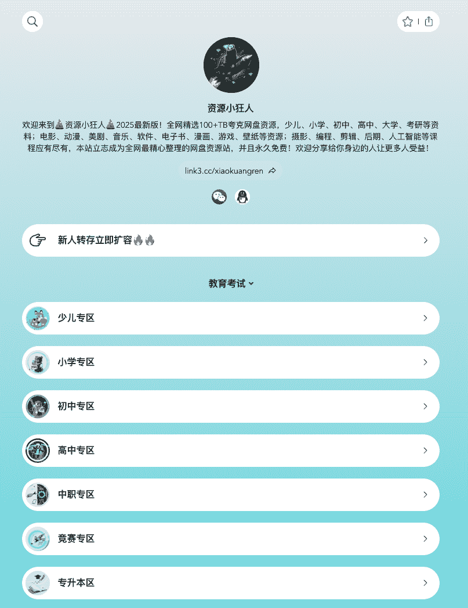
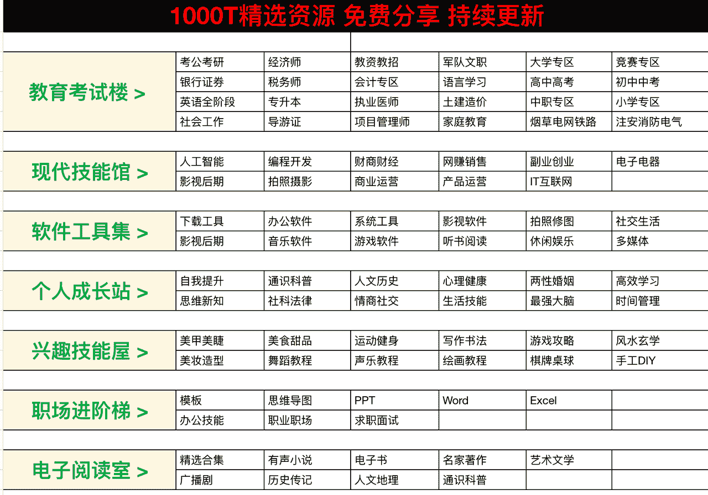
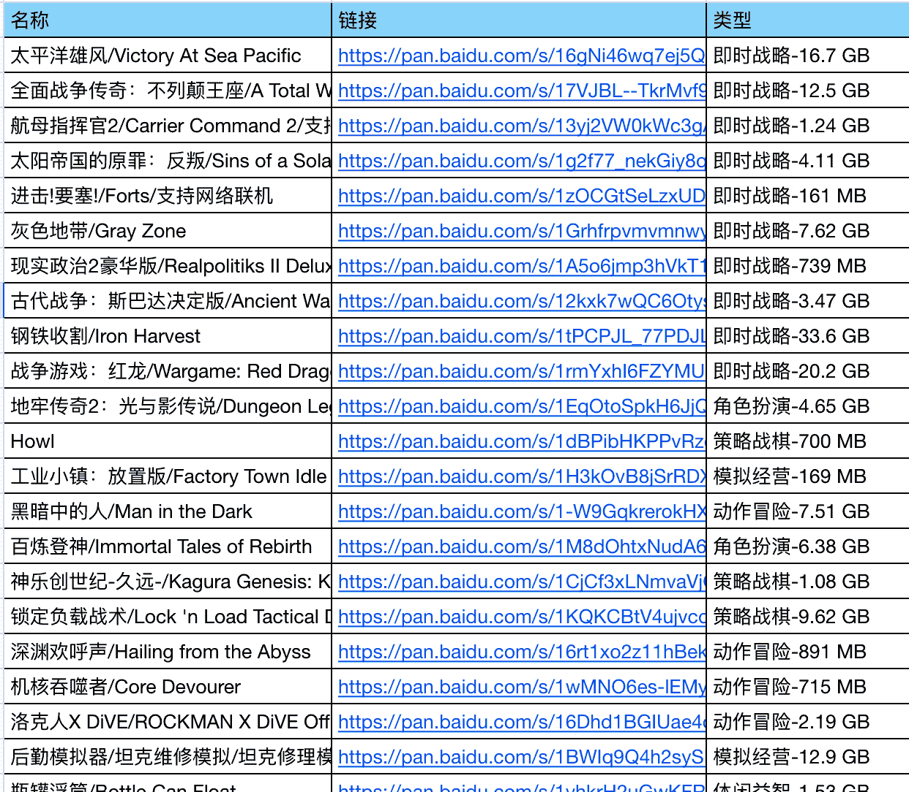

# 万航宇的藏宝箱📦

> 来源：[https://my.feishu.cn/docx/SzWUdW2ecovEmUxpAkqcVD9Bngg](https://my.feishu.cn/docx/SzWUdW2ecovEmUxpAkqcVD9Bngg)

> 哎呀，我的宝藏被你发现了！

> 🔥资**源小狂人：**https://link3.cc/xiaokuangren

# 20250316

> 🔥资**源小狂人：**ht**tps:**//link3.cc/xiaokuangren （主站）

> 🔥影**视小狂人：**https://link3.cc/ysxiaokuangren

> 🔥英**语小狂人：**https://link3.cc/yyxiaokuiangren

决定用Link3来承接资源，更加直观使用起来也更方便了，点击资源包之后直接会跳转到网盘链接。

欢迎来到⛵资源小狂人⛵2025最新版！全网精选100+TB夸克网盘资源，少儿、小学、初中、高中、大学、考研等资料；电影、动漫、美剧、音乐、软件、电子书、漫画、游戏、壁纸等资源；摄影、编程、剪辑、后期、人工智能等课程应有尽有，本站立志成为全网最精心整理的网盘资源站，并且永久免费！欢迎分享给你身边的人让更多人受益！

# 20250223

飞书多维表格容易被和谐，所以很多资源都放在腾讯文档了！

> 【腾讯文档】数据铁皮箱

> https://docs.qq.com/sheet/DTFd3V3pzWmJFRWpY?tab=BB08J2

# 20241015

多维表格承接资源，容易被封禁，而且资源比较多，是散的，对于用户来说不太方便。

[【藏宝箱】夸克网盘资源](https://ghlf0s3q3l.feishu.cn/wiki/JmvywHCN5iGBY1kpqyfc9HUAnNe)

[【藏宝箱】百度网盘资源](https://ghlf0s3q3l.feishu.cn/wiki/UTmJw3dYLiBUA1kGulAcLLT3nSg)