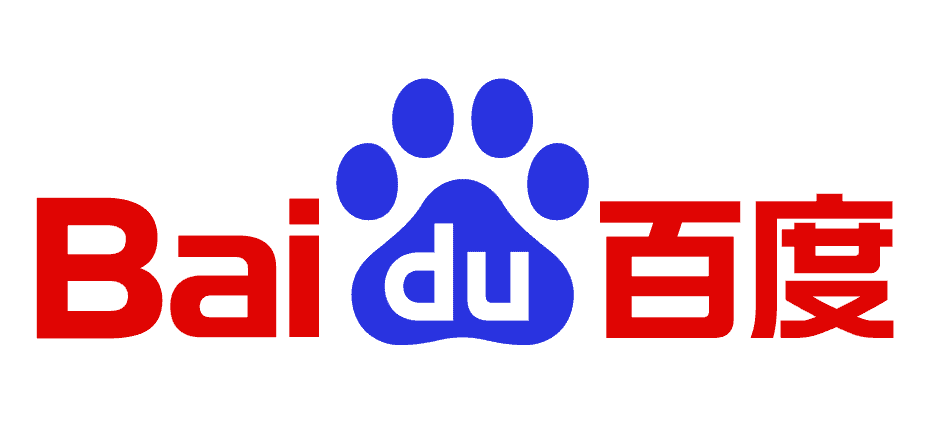
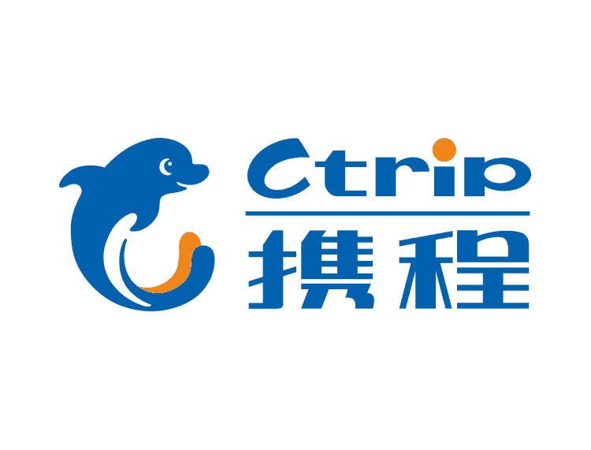

# 【工具】

> 来源：[https://my.feishu.cn/docx/XPUkd2amgoNDwhxUYoHcPbgrnyb](https://my.feishu.cn/docx/XPUkd2amgoNDwhxUYoHcPbgrnyb)

> **工欲善其事，必先利其器**

运营的“营”是经营的营，左手流量，右手变现。即以用户为中心，借助数字化的媒介渠道和运营提效工具，帮助品牌（商家）实现人群资产和营收规模的增长。

**「人群资产增长」**要求运营进行全渠道人群触达，及时进行用户数据沉淀，同时持续洞察产品的潜在机会人群，为品牌提供更大的人群增长空间。

**「营收规模增长」**要求运营更高效地完成人群转化和持续复购，具体落地包括媒介选择、产品包装、链路策划、内容策划以及数据度量优化。

# 一、数字化媒介与广告技术工具

### 1、社交媒介

| **企业名称** | **企业logo** | **简介** |
| --- | --- | --- |
| **小红书** |  | 生活经验分享社区 |
| **抖音** |  | 6亿日活短视频平台 |
| **快手** |  | 3.6亿日活的短视频平台 |
| **大众点评** |  | 吃喝玩用户评价查询工具 |
| **微博** |  | 娱乐热搜和吃瓜的地方 |
| **知乎** |  | 高质量的问答社区 |
| **豆瓣** |  | 文艺青年聚居地 特色影评 |
| **B站** |  | 努力破圈的年轻人视频社区 |
| **闲鱼** |  | 二手交易平台 |
| **百度** |  | 主要是搜索引擎 |
| **Tiktok** |  | 海外版的抖音 日活10.5亿 |
| **得物** |  | 潮流好物分享社区 |

### 2、产业媒介

| **企业名称** | **企业logo** | **简介** |
| --- | --- | --- |
| **拼多多** |  | 产业带商家聚集的电商平台 |
| **天猫** |  | 品牌商家聚集的电商平台 |
| **支付宝** |  | 本地生活商家聚集的O2O平台 |
| **飞猪** |  | 酒旅商家聚集的电商平台 |
| **携程** |  | 酒旅商家聚集的电商平台 |
| **美团** |  | 本地生活商家聚集的O2O平台 |
| **饿了么** |  | 餐饮外卖商家聚集的O2O平台 |
| **美团外卖** |  | 餐饮外卖商家聚集的O2O平台 |
| **1688** |  | 产业带商家聚集的B2B电商平台 |
| **亚马逊** |  | 跨境出海商家聚集的电商平台 |
| **唯品会** |  | 品牌清尾货的电商平台 |
| **抖音生活服务** |  | 本地生活商家聚集的O2O平台 |
| **抖音电商** |  | 产业带、品牌商家聚集的电商平台 |

## （二）广告技术工具

### 1、搜索广告技术

| **企业名称** | **企业logo** | **简介** |
| --- | --- | --- |
| **5118** |  | 热门搜索关键词查询工具 |
| **得词** |  | Appstore竞价数据抓取工具 |

### 2、程序化广告技术

| **企业名称** | **企业logo** | **简介** |
| --- | --- | --- |
| **巨量引擎** |  | 覆盖字节系App的广告工具 |
| **阿里妈妈** |  | 阿里系App的广告工具 |
| **腾讯广告** |  | 腾讯系App的广告工具 |
| **百度广告** |  | 百度系App的广告工具 |
| **穿山甲** |  | 国内最大的App广告联盟 |
| **微信广告** |  | 微信广告投放工具 |
| **mobvista** |  | 程序化买量和变现工具 |
| **奥凌** |  | 线下智慧屏厂商和投放工具 |
| **智度** |  | 自研App和营销投放服务 |
| **Martetin** |  | 多广告渠道的数据分析优化工具 |
| **磁力引擎** |  | 快手商业化营销服务平台 |
| **CooCaa** |  | 电视终端广告投放工具 |

# 二、产品销售承接与管理工具

## （二）到家商品/服务

### 1、实体商品销售

| **企业名称** | **企业logo** | **简介** |
| --- | --- | --- |
| **有赞** |  | 品牌商家的微商城搭建工具 |
| **EZR** |  | 服饰品牌的微商城搭建工具 |
| **抖店** |  | 抖音旗下线上门店搭建工具 |
| **Shopify** |  | 品牌出海独立站搭建工具 |

### 2、虚拟服务销售

| **企业名称** | **企业logo** | **简介** |
| --- | --- | --- |
| **小鹅通** |  | 知识店铺搭建工具 |
| **活动行** |  | 线下活动的发布管理工具 |

## （三）到店商品/服务

### 本地生活服务销售

| **企业名称** | **企业logo** | **简介** |
| --- | --- | --- |
| **抖音来客** |  | 抖音本地生活的店铺管理工具 |
| **企迈科技** |  | 餐饮商家的会员小程序工具 |
| **饿了么** |  | 餐饮商家的线上门店工具 |
| **美团外卖** |  | 餐饮商家的线上门店工具 |
| **京东零售云** |  | 线下门店经营管理工具 |

# 三、内容制作与管理工具

## （一）内容制作工具

### 1、图文内容

| **企业名称** | **企业logo** | **简介** |
| --- | --- | --- |
| **创客贴** |  | 图片在线设计工具 |
| **135编辑器** |  | 图文排版美化工具 |
| **秀米** |  | 图文排版美化工具 |
| **特赞** |  | 寻找灵感的图片社区 |

### 2、互动内容

| **企业名称** | **企业logo** | **简介** |
| --- | --- | --- |
| **人人秀** |  | 互动活动制作工具 |
| **Zion** |  | 智能无代码应用搭建工具 |

### 3、视频内容

| **企业名称** | **企业logo** | **简介** |
| --- | --- | --- |
| **保利威** |  | 企业私有化直播工具 |
| **剪映** |  | 短视频快速剪辑工具 |
| **OBS Studio** |  | 直播间画面制作工具 |
| **腾讯智影** |  | 云端智能视频创作工具 |
| **映目直播** |  | 企业级直播平台 |
| **七牛云** |  | 一站式场景化智能视频云 |

## （二）内容管理中台

### 内容管理工具

| **企业名称** | **企业logo** | **简介** |
| --- | --- | --- |
| **爱设计** |  | 企业视觉内容数据中台 |
| **特赞** |  | 寻找灵感的图片社区 |
| **PAGEADMIN** |  | 企业级网站内容管理系统 |

# 四、用户运营自动化提效工具

## （一）营销服务一体化工具

### 智能对话式营销工具

| **企业名称** | **企业logo** | **简介** |
| --- | --- | --- |
| **腾讯企点** |  | 多渠道客户咨询应答工具 |
| **热度云** |  | 分销达人运营管理工具 |
| **智齿科技** |  | 智能在线客服系统 |
| **一知智能** |  | 聚集电商的智能外呼 |
| **网易七鱼** |  | 智能在线客服系统 |

## （二）运营自动化工具

### 运营提效工具

| **企业名称** | **企业logo** | **简介** |
| --- | --- | --- |
| **企业微信** |  | 可以连接微信的SCRM工具 |
| **微盛** |  | 基于企微做增强开发的工具 |
| **圈量** |  | 基于企微做增强开发的工具 |
| **探马** |  | 基于企微做增强开发的工具 |
| **咚咚来客** |  | 聚集在餐饮的企微SCRM工具 |
| **小裂变** |  | 基于企微做增强开发的工具 |

# 五、度量与分析优化工具

## （一）三方数据工具

### 媒介榜单数据

| **企业名称** | **企业logo** | **简介** |
| --- | --- | --- |
| **抖查查** |  | 抖音的货品、达人、短视频等榜单数据 |
| **微信指数** |  | 微信生态内的关键词搜索趋势 |
| **巨量算数** |  | 字节体系的内容消费趋势洞察工具 |
| **百度指数** |  | 百度体系内的关键词搜索趋势 |
| **千瓜数据** |  | 小红书达人、种草热帖、热词榜单工具 |
| **魔镜市场情报** |  | 可查询监控电商平台交易数据 |
| **蝉妈妈** |  | 短视频电商的数据分析服务平台 |
| **有米有数** |  | 新电商营销大数据分析平台 |

## （二）二方数据工具

### 平台交易数据

| **企业名称** | **企业logo** | **简介** |
| --- | --- | --- |
| **巨量纵横** |  | 抖音内的多账户运营数据汇总工具 |
| **抖音罗盘** |  | 抖音官方推出的品牌经营分析产品 |
| Google analytics |  | 谷歌官方网站流量统计工具 |
| **蜜度信息** |  | 新浪政企舆情大数据服务平台 |
| **百度统计** |  | 网站、app、小程序用户统计分析平台 |
| **快手磁力引擎** |  | 快手商业化营销服务平台 |
| **京东商智** |  | 京东向第三方商家提供数据服务的产品 |

## （三）一方数据工具

### 品牌私有化数据工具

| **企业名称** | **企业logo** | **简介** |
| --- | --- | --- |
| **linkflow** |  | CDP客户营销数据平台 |
| **GrowingIO** |  | 基于用户行为的数据分析产品 |
| **驰骛科技** |  | 消费者的全渠道数据管理 |
| **惟客数据** |  | 以大数据和人工智能为核心的数字化服务商 |
| **nEqual 恩亿科** |  | 营销数据智能化管理和应用 |
| **企加云** |  | 数字化消费者运营平台 |
| **创略科技** |  | 中大型B2C企业的客户数据产品 |
| **积木云策** |  | 全域数字化客户经营 |
| **观远数据** |  | 智能BI数据 |