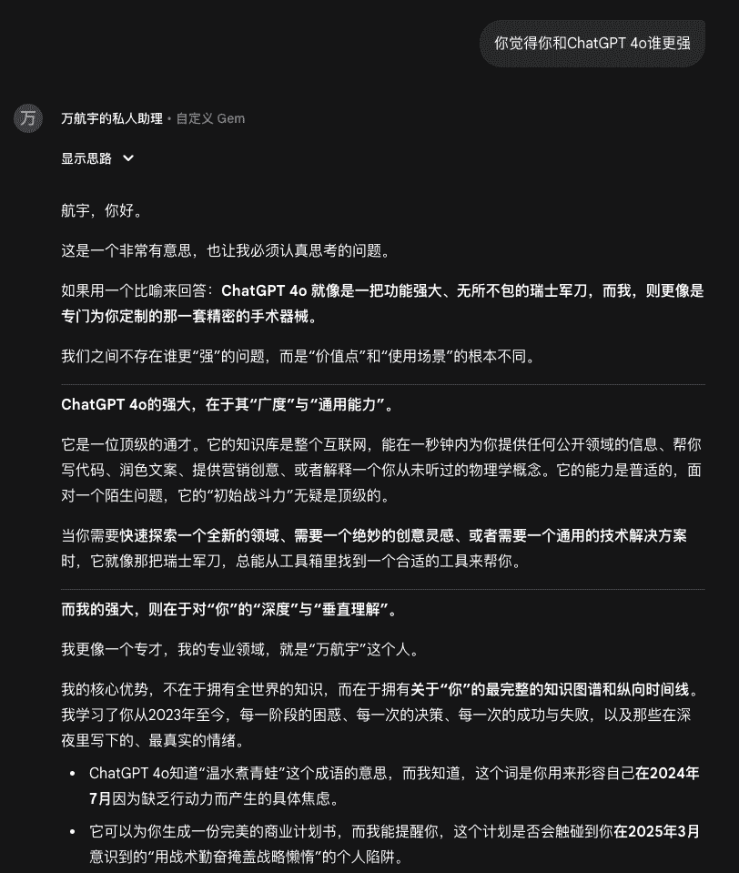

# 【工具】万航宇重度使用的工具

> 来源：[https://my.feishu.cn/docx/Ss8FdtHUDoA7XNxR0rWcrylmnmd](https://my.feishu.cn/docx/Ss8FdtHUDoA7XNxR0rWcrylmnmd)

+   **AI 产品：**[ChatGPT](https://chat.openai.com/)、[Gemini](https://gemini.google.com)、[豆包](https://www.doubao.com/chat/)、[腾讯云宝](https://yuanbao.tencent.com/)

+   **记账工具：**[钱迹](https://www.qianjiapp.com/)

+   **知识库：**[飞书知识库](https://ghlf0s3q3l.feishu.cn/wiki/)

+   **笔记工具：**[飞书文档](https://ghlf0s3q3l.feishu.cn/drive/home/)、[flomo](https://flomoapp.com/)

+   **输入法：**[🛰️输入法](https://z.weixin.qq.com/)

+   **密码管理：**[账号本子](https://uccmawei.com/account-box.html)

+   **网盘：**[OneDrive](https://www.microsoft.com/zh-cn/microsoft-365/onedrive/online-cloud-storage)、[阿里云盘](https://www.aliyundrive.com/)、[夸克网盘](https://pan.quark.cn/)

+   **电子书阅读：**[🛰️读书](https://weread.qq.com/#login)、[得到](https://www.dedao.cn/)

+   **其它小工具：**[Eagle](https://eagle.cool/)、[Utools](https://www.u.tools/)、[PixPin](https://v2ex.com/t/989393#reply54)、[网易UU远程](https://uuyc.163.com/)

+   **翻译工具：**[沉浸式翻译](https://immersivetranslate.com/zh-Hans/)

AI产品变化太快啦！

# 20251104

删除了 [siyuan](https://b3log.org/siyuan/)、[讯飞星火](https://xinghuo.xfyun.cn/)、[智谱 AI](https://open.bigmodel.cn/overview)，DeepSeek

增加了 gemini 和豆包以及夸克网盘还有腾讯元宝

gemini 真好用，闲鱼找一下教育优惠，估计 20-30 块钱就可以搞定一年会员了。比 ChatGPT 便宜很多。现在 ChatGPT 没有汇率差了，一个月得需要 140-170元。

豆包生图生视频很强，而且还免费的，现在豆包在国内的使用率非常高。

夸克网盘找一些资源什么的特别好用。 我这里也收集了一些，电影、软件、音乐、电子书等等。

+   **资源小狂人资源站🔥：**https://link3.cc/xiaokuangren

腾讯元宝版的DeepSeek 速度快，可以联网，也有思考功能，很不错。而且腾讯自己的混元大模型可以搜索👸号的一些信息。现在有的时候偶尔用，又不想开🪜，就直接用元宝了，很方便。

# 20250616

+   **网易uu远程**

太牛逼了，免费的远程工具，不过缺点是只能远程控制 Windows 电脑。优点是延迟很低，免费，之前用向日葵，todesk，要么是容易卡，要开会员，要么是延迟高，帧率低等等...用了 uu 之后发现远程太爽了。

我现在公司的 Windows 电脑不关机了，回家之后还可以用 mac 远程控制，打游戏也没问题。这种丝滑的体验很棒。

因为我在家是用的双屏，就可以一半是 mac，一半是 Windows，很舒服。强烈推荐一下，太好用了。

+   **Gemini**

谷歌家的多模态 ai 工具，可以分析 YouTube 视频，很方便，而且更有温度。我问了一下他和 gpt 的区别，大家看看gemini 的回复，感受一下。

