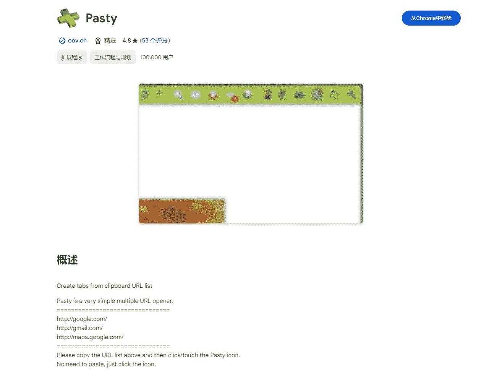
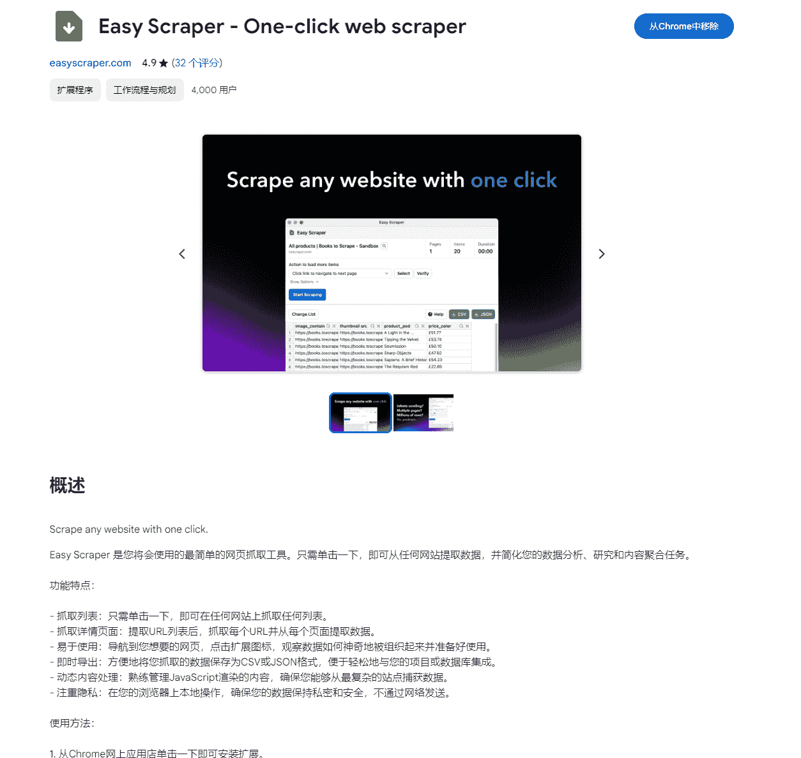
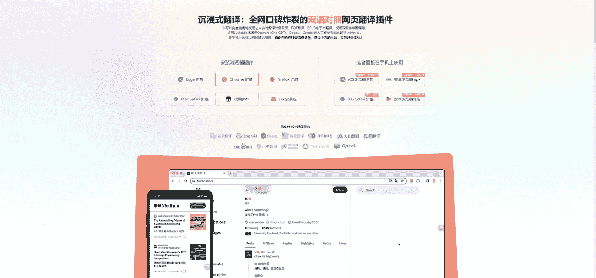
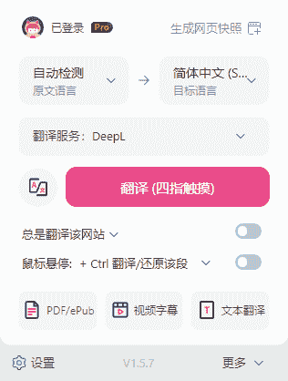
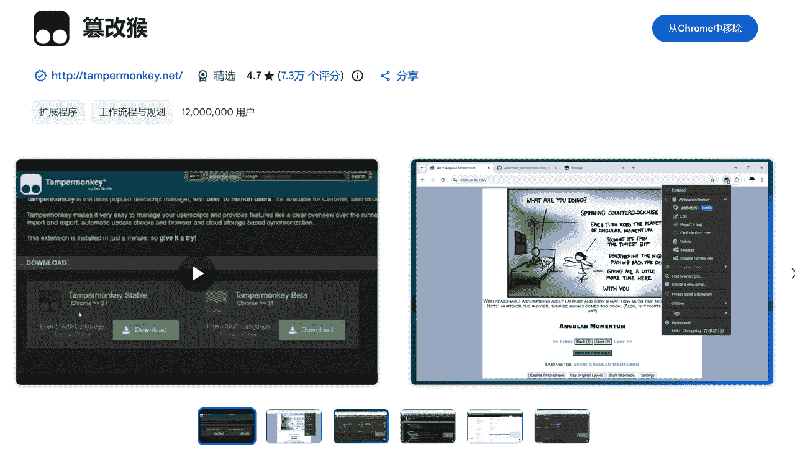
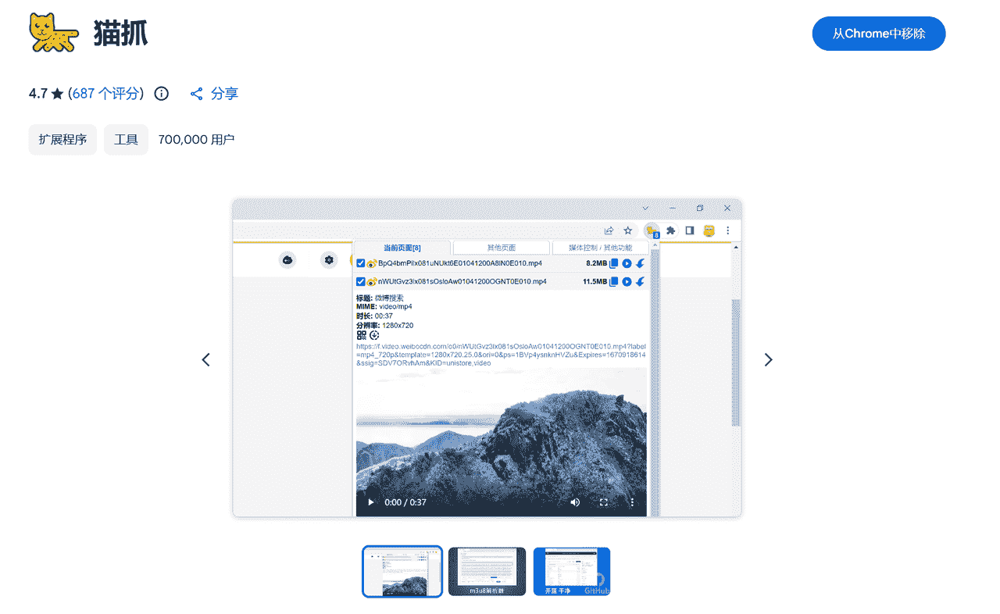

# 谷歌浏览器常用插件推荐！

> 来源：[https://my.feishu.cn/docx/CY37dEfuIo6cByxMLxmcTpymnNh](https://my.feishu.cn/docx/CY37dEfuIo6cByxMLxmcTpymnNh)

# 1、Pasty（多URL打开）

使用方式：剪切板放20个网页，点一下图标就会一下子打开20个网页。

# 2、Easy Scraper（网页数据抓取）

轻量的一些网页数据抓取，直接用这个插件就可以了，超级方便！

# 3、沉浸式翻译

超级好用，无需多解释了，就是翻译工具。官方会员比较贵，囊中羞涩的小伙伴可以用 DeepSeek API，一年多才用了十几块钱。

# 4、篡改猴（脚本工具）

更多详细的可以看这里👇我放了一些找脚本的网站

[【谷歌插件】暴力猴（油猴脚本）](https://my.feishu.cn/wiki/U717wJkrMixkb4ki4pqcSj2Yn0d?from=from_copylink)

现在有AI方便很多，有需求但是找不到脚本，可以自己用AI写一个脚本然后导入进来就可以了。属于必装的一个插件。

# 5、猫抓（网页媒体嗅探工具）

网页中的资源，比如图片，音频，视频都能够出色的完成任务。

# 6、小红搜

小红搜是一款提升浏览体验的 Chrome 扩展。当你浏览网页遇到感兴趣的内容时，无需切换标签页，只需轻轻一点，即可在屏幕侧边打开📕搜索结果，边看边搜，灵感不断。

蛮有趣的一个插件，可以随时打开📕使用..可以理解为就是一个📕网页浮窗。