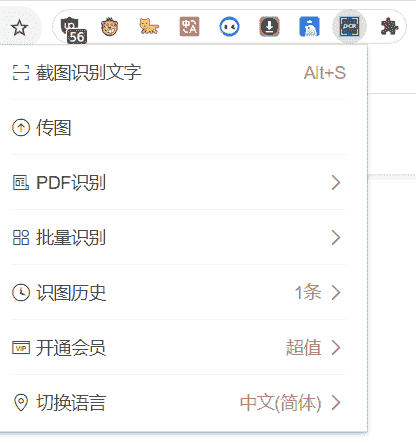

# 【谷歌插件】快识图OCR

> 来源：[https://my.feishu.cn/docx/LActdIGovobopsxIuxbcsbLOnFf](https://my.feishu.cn/docx/LActdIGovobopsxIuxbcsbLOnFf)

https://chrome.google.com/webstore/detail/fast-ocr/oefooeopdahbeimdgamlblnpegijmdem/related?utm_source=ext_sidebar&hl=zh-CN

识别的还挺快的，不过是收费软件。9.9一个月

> 20230926-用离线版的天若OCR或者用utools里面的插件OCR就好了，很方便，还免费。

> 20240330-用pixpin还挺不错的，截图后可以直接复制截图中的文字。