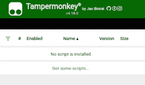
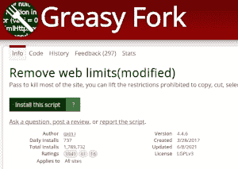

# 【谷歌插件】暴力猴（油猴脚本）

> 来源：[https://my.feishu.cn/docx/TTV3dR3fBoRegxx3KPSc9Scdn3f](https://my.feishu.cn/docx/TTV3dR3fBoRegxx3KPSc9Scdn3f)

> **脚本市场**

+   Greasy Fork: https://greasyfork.org/zh-CN

+   userscript: https://www.userscript.zone/

+   sleazyfork: https://sleazyfork.org/zh-CN

+   找脚本：https://www.zhaojiaoben.cn/

+   油小猴：https://www.youxiaohou.com/

### 用户脚本是什么？

用户脚本让您掌控网页浏览体验。安装后，它们能自动改善您访问网站的使用体验，有些能为网站添加新功能，有些能使网站更易于使用，有些能让网站隐藏烦人内容。Greasy Fork 上的用户脚本都是由用户编写并向全世界发布，您能免费安装它们，并且轻松使用。

### 第 1 步：安装一个用户脚本管理器

要使用用户脚本，您首先需要安装一个用户脚本管理器。您可以根据当前使用的浏览器来选择一个用户脚本管理器。

**桌面端** 移动端（Android） 移动端（iOS）

+   Chrome：[Tampermonkey](https://chrome.google.com/webstore/detail/tampermonkey/dhdgffkkebhmkfjojejmpbldmpobfkfo) 或 [Violentmonkey](https://chrome.google.com/webstore/detail/violent-monkey/jinjaccalgkegednnccohejagnlnfdag)

+   Firefox：[Greasemonkey](https://addons.mozilla.org/firefox/addon/greasemonkey/)、[Tampermonkey](https://addons.mozilla.org/firefox/addon/tampermonkey/) 或 [Violentmonkey](https://addons.mozilla.org/firefox/addon/violentmonkey/)

+   Safari：[Tampermonkey](https://www.tampermonkey.net/?browser=safari) 或 [Userscripts](https://apps.apple.com/app/userscripts/id1463298887)

+   Microsoft Edge：[Tampermonkey](https://microsoftedge.microsoft.com/addons/detail/tampermonkey/iikmkjmpaadaobahmlepeloendndfphd) 或 [Violentmonkey](https://microsoftedge.microsoft.com/addons/detail/violentmonkey/eeagobfjdenkkddmbclomhiblgggliao)

+   Opera：[Tampermonkey](https://addons.opera.com/extensions/details/tampermonkey-beta/) 或 [Violentmonkey](https://violentmonkey.github.io/get-it/)

+   Maxthon：[Violentmonkey](http://extension.maxthon.com/detail/index.php?view_id=1680)

+   AdGuard：[AdGuard](https://adguard.com/)（不需要其他软件）

Chrome 上的 Tampermonkey

### 第 2 步：安装一个用户脚本

[浏览本网站](https://greasyfork.org/zh-CN/scripts)，找到您想尝试的用户脚本。以下是一些最受欢迎的脚本例子：

+   [起点小说解锁手机版](https://greasyfork.org/zh-CN/scripts/420729-%E8%B5%B7%E7%82%B9%E5%B0%8F%E8%AF%B4%E8%A7%A3%E9%94%81%E6%89%8B%E6%9C%BA%E7%89%88) - 可解锁起点小说VIP付费章节

+   [起点小说vip自动换源](https://greasyfork.org/zh-CN/scripts/423852-%E8%B5%B7%E7%82%B9%E5%B0%8F%E8%AF%B4vip%E8%87%AA%E5%8A%A8%E6%8D%A2%E6%BA%90) - 对起点的vip小说自动搜索笔趣阁，要设置滚动模式，自动加载形式,支持手机和网页

+   [喜马拉雅专辑下载器](https://greasyfork.org/zh-CN/scripts/435495-%E5%96%9C%E9%A9%AC%E6%8B%89%E9%9B%85%E4%B8%93%E8%BE%91%E4%B8%8B%E8%BD%BD%E5%99%A8) - 可能是你见过最丝滑的喜马拉雅下载器啦！登录后支持VIP音频下载，支持专辑批量下载，支持添加编号，链接导出、调用aria2等功能，直接下载M4A，MP3、MP4文件。

+   [三国杀打小抄](https://greasyfork.org/zh-CN/scripts/448004-%E4%B8%89%E5%9B%BD%E6%9D%80%E6%89%93%E5%B0%8F%E6%8A%84) - 打小抄支持网页版和微端，微端文件请加群 830137048

+   [雨课堂刷课助手](https://greasyfork.org/zh-CN/scripts/466651-%E9%9B%A8%E8%AF%BE%E5%A0%82%E5%88%B7%E8%AF%BE%E5%8A%A9%E6%89%8B) - 针对雨课堂视频进行自动播放

在您找到想要的用户脚本后，点击用户脚本页面上绿色的安装按钮，您的用户脚本管理器将向您确认是否安装。

用户脚本的安装按钮

### 第 3 步：使用用户脚本

现在您可以访问这个用户脚本所针对的网站，脚本应该已经自动启动和生效。在试用一段时间之后，您可以回到用户脚本发表的页面，给用户脚本的作者留下反馈。