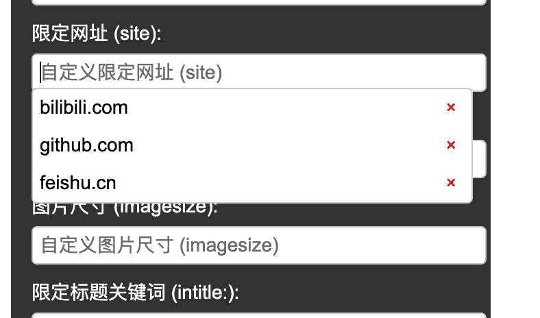

# 谷歌高级搜索指令工具

> 来源：[https://my.feishu.cn/docx/OHbPdE2p6o5oV7xIeyEcbKPCnHb](https://my.feishu.cn/docx/OHbPdE2p6o5oV7xIeyEcbKPCnHb)

脚本安装地址：https://greasyfork.org/zh-CN/scripts/522470-%E8%B0%B7%E6%AD%8C%E9%AB%98%E7%BA%A7%E6%90%9C%E7%B4%A2%E5%B7%A5%E5%85%B7

这是一个强大的谷歌高级搜索工具脚本，旨在简化谷歌搜索中的复杂操作，帮助用户快速实现高级搜索。通过本脚本，您可以轻松设置关键词、限定网址、文件格式、图片尺寸、时间范围等条件进行精准搜索，并且支持以下特色功能：

动态预设选项：每个高级搜索字段都可以使用常用选项，还支持用户自定义选项并保存到预设列表。

搜索历史记录：自动保存最近 5 条搜索记录，便于复用，点击即可快速填充。

美观且简洁的交互界面：通过嵌入式选项设计，所有操作均在输入框中完成，界面简洁美观。

工具栏可拖动：支持将工具栏拖动到屏幕的任意位置，刷新页面后位置依然保持不变。

一键搜索：支持按回车键或点击搜索按钮快速搜索，操作便捷。

无论是学术搜索、资源查找，还是图片过滤，本工具都可以大幅提升您的搜索效率！

适用场景:

适合需要精准搜索的用户，如学生、研究人员、开发者，以及其他希望提高谷歌搜索效率的人群。

