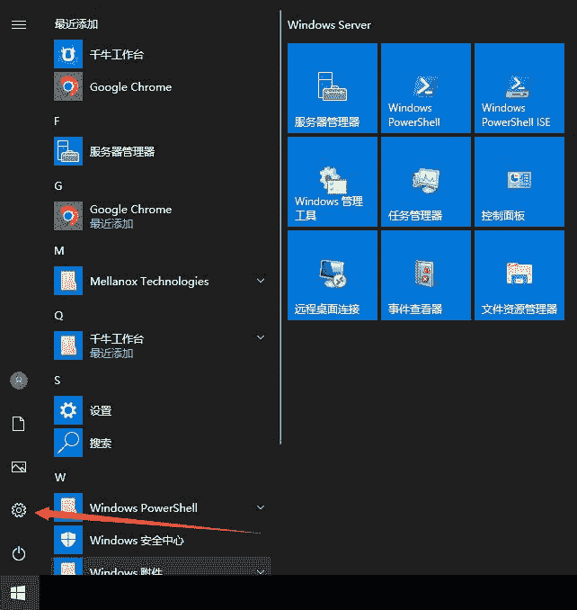
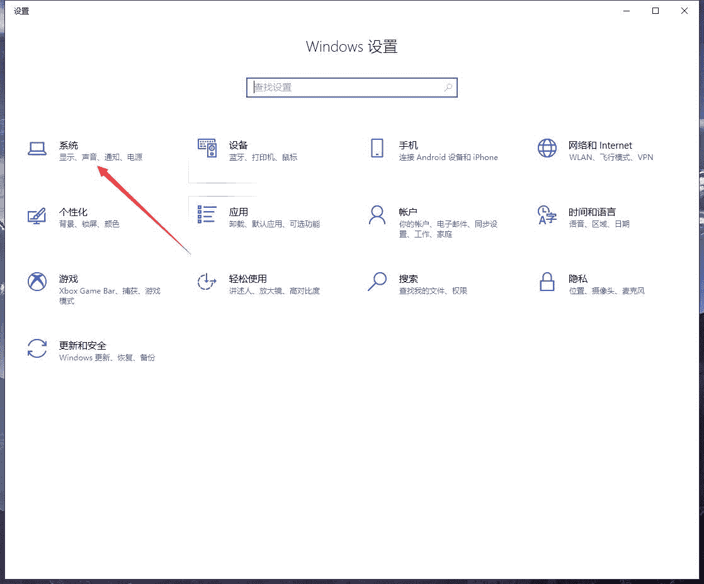
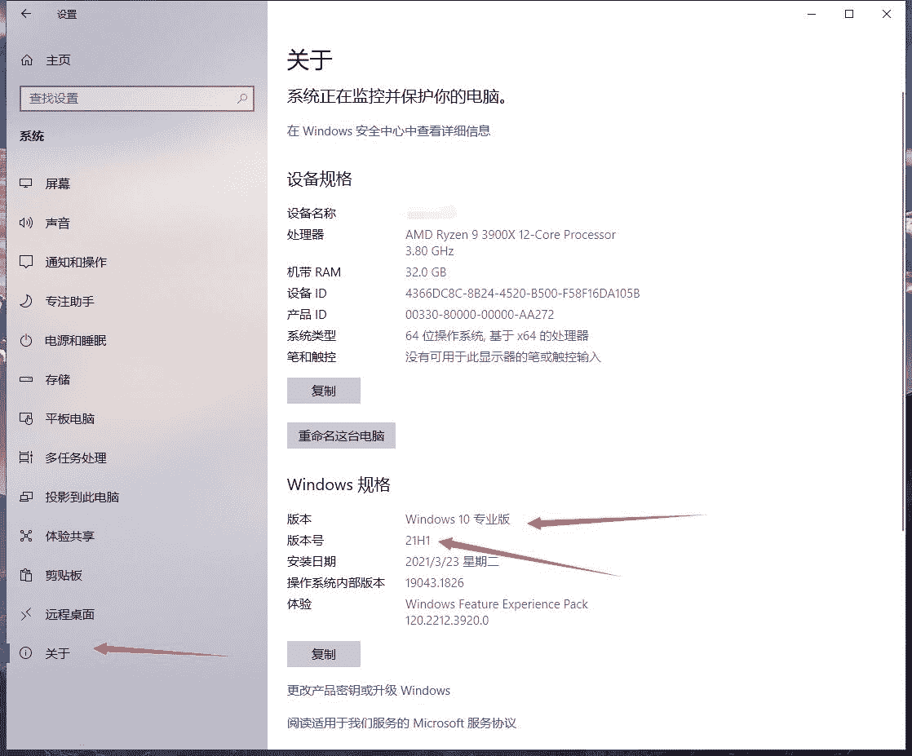

# Windows系统查看版本号方法

> 来源：[https://my.feishu.cn/docx/AmPCdOvWco8fTzxzzLQcRVB6nj4](https://my.feishu.cn/docx/AmPCdOvWco8fTzxzzLQcRVB6nj4)

# 查看系统版本号步骤一

# 查看系统版本号步骤二

# 查看系统版本号步骤三

20H1的版本号是要高于1903/1909的

版本号21H1/ 22H2的 可以安装2024或者以下版本的软件

版本号20H1的 可以安装2023或者以下版本的软件

版本号1909的 可以安装2022或者以下版本的软件

版本号1809的 可以安装2020或者以下版本的软件

版本号1709的 可以安装2018或者以下版本的软件

版本号1607的 可以安装2017或者以下版本的软件