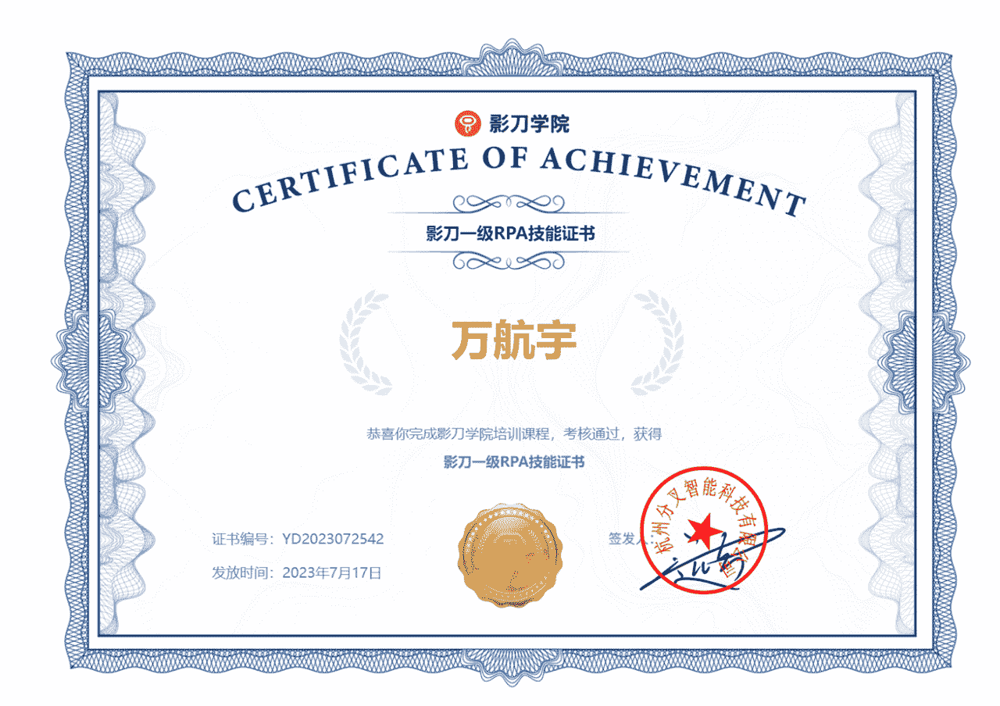
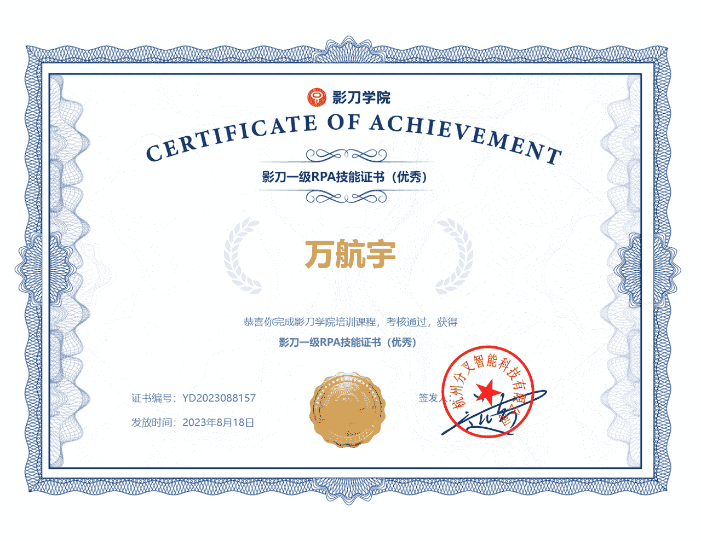
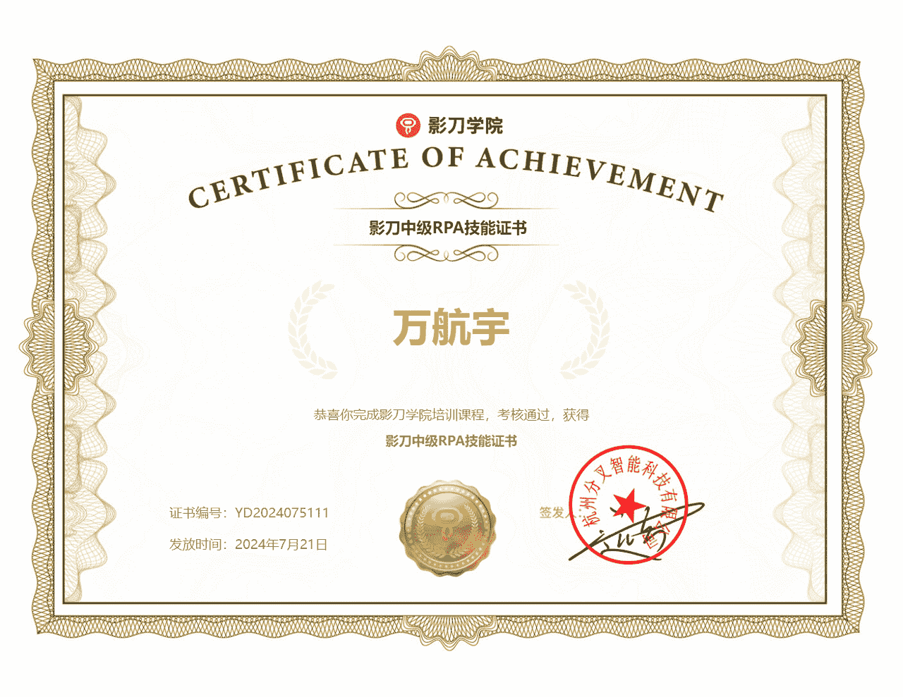
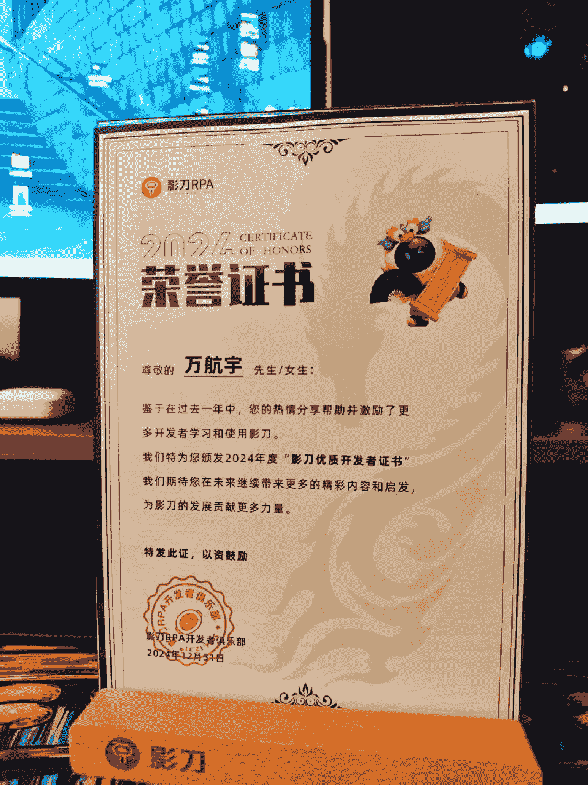

# RPA 应该怎么学？

> 来源：[https://my.feishu.cn/docx/NmfodZ2khopOGyxfIgIc10AJnjd](https://my.feishu.cn/docx/NmfodZ2khopOGyxfIgIc10AJnjd)

> **第一阶段：**熟悉软件界面和元素、指令、对象、变量、数据等等基础概念

> **第二阶段：**学习三大逻辑，判断、等待、循环

> **第三阶段：**复杂流程设计、异常处理、数据处理和分析

## **🚲初级教程**

## **🚗中级教程**

## **✈️高级教程**

+   [影刀RPA 初级考试题库（2022 版）](https://ghlf0s3q3l.feishu.cn/wiki/IsbGwn7GhiSF8uklPggcYXM5nPe)

+   [影刀RPA 中级考试题库](https://ghlf0s3q3l.feishu.cn/wiki/AtkJwHqlgiygwDkHqwsctKPdnvh)

+   [影刀RPA 高级考试题库](https://ghlf0s3q3l.feishu.cn/wiki/J9VKwlU1OiIKVWkbnvrcgkw0ndh)

