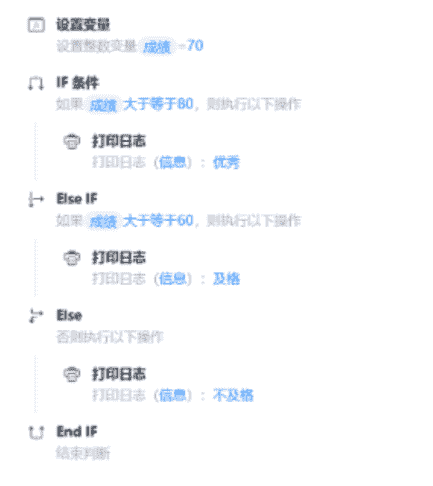
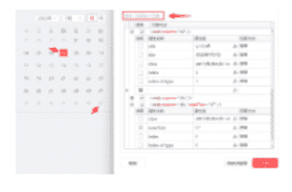
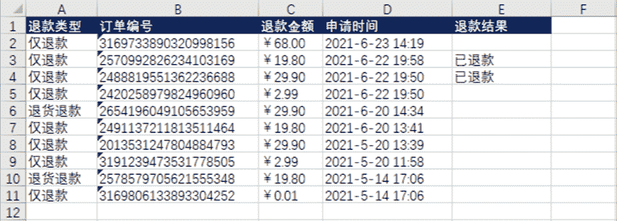
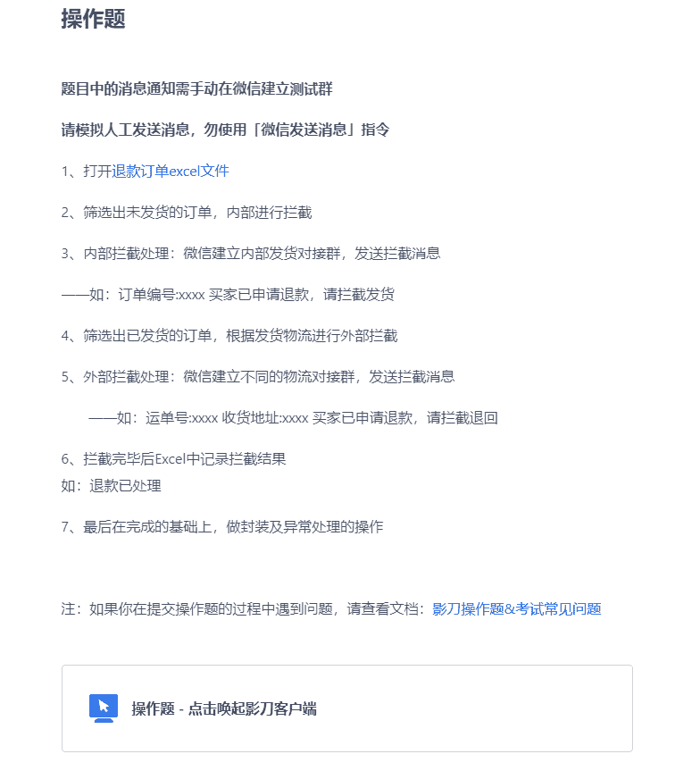
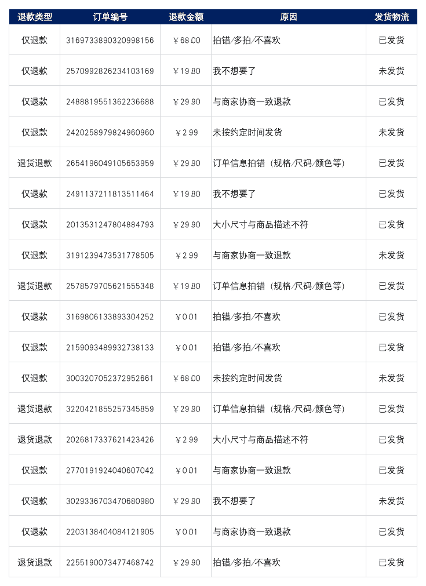
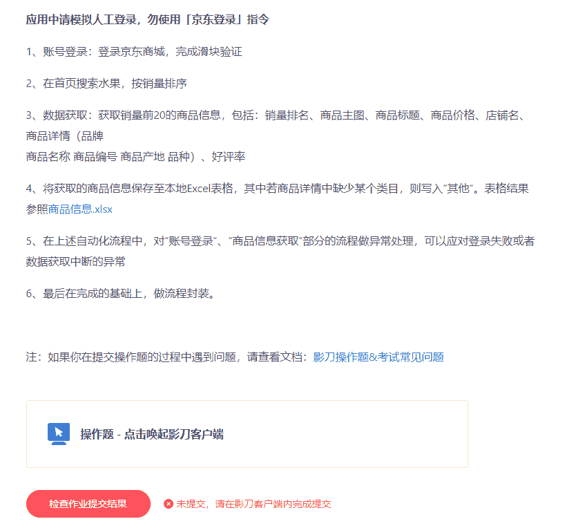
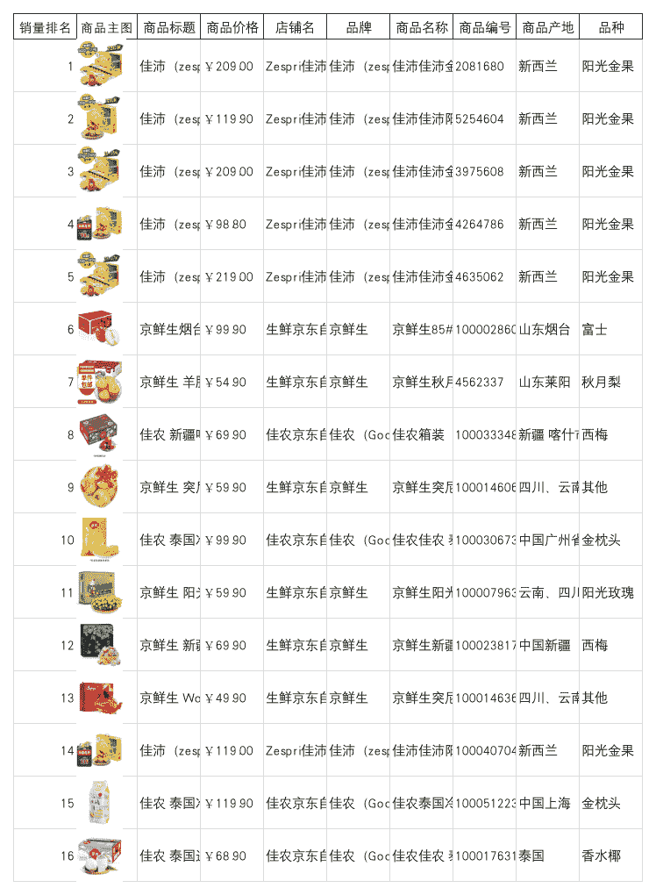
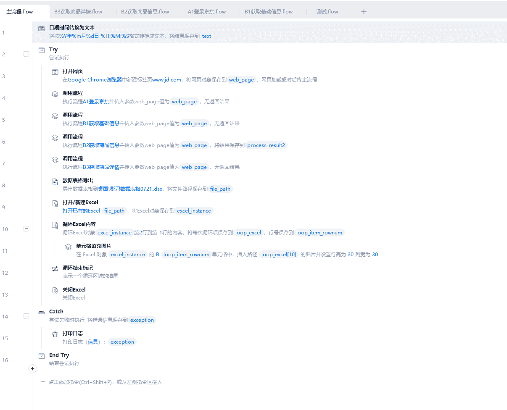
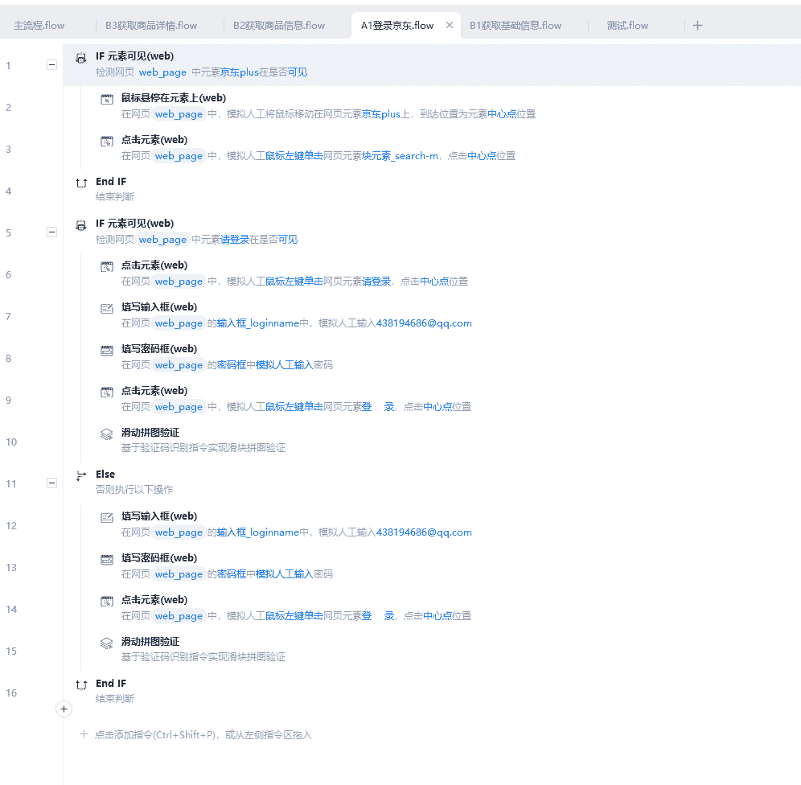
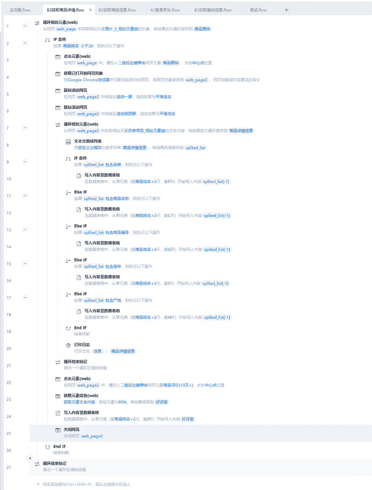

# 影刀RPA 中级考试题库

> 来源：[https://my.feishu.cn/docx/W59nd4qMEojbB2x6FZKcOfQcnJg](https://my.feishu.cn/docx/W59nd4qMEojbB2x6FZKcOfQcnJg)

> 每次考试我遇到的题目都会记录下来了，最后的实操题也截图了，后面有机会的话可以录个视频来讲一下实操题的解题思路，不是很完美，但是可能复盘的过程中就会想通一些点有新的思路。

# 一、选择题

## 1.1 单选题

### 1、关于全局变量说法错误的是？

✅**全局变量有输入和输出两种**

### 2、以下流程执行后，输出的内容是？

✅**及格**

### 3、关于批量填充公式，以下说法错误的是？

✅原先有数据的区域，不支持填充公式

### 4、下列关于子流程参数的说法错误的是？

✅流程参数的类型只有字符串、整数和小数。

### 5、如图，已知找到两个日期元素，以下哪个操作可以限制为唯一元素？

✅勾选“title”属性

### 6、在编辑界面上如何设置断点？

✅在需要设置断点的指令上左侧点击鼠标左键，即“设置断点”

### 7、以下不属于封装子流程的优点的是？

**✅可以减少代码数量**

### 8、如果元素的内容变化，但是位置不变，我们可以通过什么属性定位它？

**✅ Index**

### 9、要想从Excel中进行数据筛选，以下说法正确的是？

✅可 设置一个筛选条件，或两个筛选条件。

### 10、以下哪个因素不会直接影响软件机器人的稳定性？

✅业务流程变更频繁

### 11、搭建一个高效稳定的机器人，正确顺序是？

✅ 需求挖掘--画流程图--开发规范&框架--机器人的调试与维护

### 12、下列有关异常处理的说法正确的是？

✅ 异常处理可以提高代码的可靠性和稳健性

### 13、以下哪项不是指令错误处理的方式？

**✅ 跳过当前指令**

### 14、对于窗口对象，说法错误的是？

✅ 窗口位置不可移动，需提前手动调整好

### 15、下列有关流程封装的说法正确的是？

✅流程封装会让应用变得流程简洁，逻辑清晰

### 16、下列有关流程参数的说法正确的是？

✅要在子流程运行前修改其中的某个值可以使用“输入参数”

### 17、对于无法捕获的元素，可以如何处理？

✅以上都可以

### 18、以下哪个因素可能导致软件机器人的功能不完善？

✅流程逻辑错误

### 19、以下关于【错误分类】不正确的一项的是？

✅【没有搜索出数据，仍然去抓取数据】属于随机因素

### 20、在RPA开发中，流程的调试主要是为了什么？

✅确认功能是否完善

### 21、关于【获取相似元素列表（web）】，以下说法错误的是？

✅相似元素列表项个数不能为1

### 22、下列有关【IF元素可见（web）】指令说法错误的是？

✅【IF元素可见（web）】不可以检测到被遮挡的元素

### 23、在影刀RPA中，以下说法错误的是？

✅流程运行后会依次暂停在断点处 (设置断点的指令执行)

### 24、执行以下流程，运行结果是？

✅4、6、8、2、4、6、1、3、5

### 25、以下说法错误的是？

✅【循环Excel内容】指令只能循环每一行

✅【循环相似元素（web)】只能循环元素的文本信息

## 1.2 多选题

### 1、关于Excel指令，以下说法正确的是？

✅拷贝Excel内容无法拷贝单元格填充的图片

✅读取Excel内容可读取所有数据，读取筛选内容仅读取筛选后所得内容

✅Excel中使用【生成字典(数值累加)】指令，可以给不同类目进行汇总求和

### 2、以下表述正确的是

✅主流程用于体现【业务的主逻辑】

✅子流程用于将【独立功能模块化】

### 3、以下属于影响机器人稳定性的因素是？

✅元素失效

✅网页加载失败

✅人工误操作

✅环境不适配

### 4、当出现“未找到任意一幅图像“的错误时，有可能是什么原因？

✅目标图像没选对

✅换了一台电脑，导致图像库中的图像因分辨率问题失效了

✅流程在运行时有东西遮挡住了目标图像

### 5、影刀支持以下哪些手机自动化操作？

✅循环点击并列的按钮

✅获取主页各应用的名称

✅获取剪切板内容

✅截取手机上应用图标为图片

### 6、在测试流程时，想要查看运行过程中的某一个变量值可以用

✅断点调试

✅打印日志

### 7、以下关于手机自动化说法错误的是？

✅影刀同时只允许连接一台手机设备

✅每次搭建手机自动化应用前需要重新配置手机，PC端不需要重新配置

✅“手机管理器"中在PC自动化应用编辑界面中也可以找到

### 8、以下说法错误的是？

✅【循环Excel内容】指令只能循环每一行

✅【循环相似元素(web)】只能循环元素的文本信息

### 9、以下说法错误的是？

✅Try、Catch、Finally是一对组合，必须同时使用

✅只有发生异常了，才会执行Finally里的流程

### 10、下列有关条件判断类指令说法错误的是？

✅使用【IF条件】指令时必须同时使用【Else】

✅【IF多条件】指令只能判断两个条件

### 11、以下哪些场景适合使用打印日志来输出信息？

✅在流程执行过程中输出调试信息

✅在流程执行结束后输出执行结果

✅在特定条件下输出警告信息

✅在流程中输出用户交互信息

### 12、关于父子元素、关联元素，以下说法正确的是？

✅子元素也可以有其子元素和相邻元素

✅父元素也可以有其父元素和相邻元素

✅可以通过多层关联关系找到网页上元素之前的联系

✅父元素可以同时有多个同级子元素

### 13、以下哪些是用户自主开发机器人的优势？

✅开发灵活性更高

✅成本更低

✅减少需求对接沟通成本

✅维护及修复更灵活并且成本更低

### 14、关于【全局变量】说法正确的是？

✅普通变量只在当前流程内可以被访问

✅全局变量在主流程和所有子流程内，都可以被访问

✅在主流程和诸多子流程中都要用到，且变量值在整个流程中保持不变的变量适合创建成【全局变量】

✅除上述情况外，所有需要在流程间传递参数的情况，均用过使用【流程参数】

### 15、针对下图excel，说法正确的是？

✅要循环获取B列的订单编号，可以使用循环行

✅使用获取列上第一个可用行指令，获取E列第一个可用行得到的行号为5

### 16、下列有关全局变量的说法错误的是？

✅全局变量的值不可修改

✅我们应该在流程当中多使用全局变量，少用流程参数

✅全局变量只有主流程才可以使用

### 17、以下关于流程参数的创建和使用，说法正确的是？

✅可以在子流程中点击新增参数按钮，来添加一个流程参数

✅可以为流程参数修改名称、修改流程方向、修改参数类型

✅调用有输入参数的子流程，需要给输入参数传递一个值

✅有输出参数的子流程，需要在子流程中给输出参数赋一个值

### 18、以下关于手机自动化说法错误的是？

✅影刀同时只允许连接一台手机设备

✅每次搭建手机自动化应用前需要重新配置手机，PC端不需要重新配置

✅PC端自动化配置只需找到自动化插件后点击"立即配置"即可

# 二、操作题（50分）

## 2.1 操作题1

[退款订单excel文件.xlsx](https://internal-api-drive-stream.feishu.cn/space/api/box/stream/download/all/S6Xhbv3HSoyyulxVtwDcCXFYngg)

链接：https://pan.quark.cn/s/885979aa2698

快递公司列表建一个全局变量

## 2.2 操作题2

[商品信息.xlsx.xlsx](https://internal-api-drive-stream.feishu.cn/space/api/box/stream/download/all/KUa1bDnWBoZXIlxMJxqcs8DFnec)

链接：https://pan.quark.cn/s/50ffdf152adc

> [万航宇的一棵树👹](https://ghlf0s3q3l.feishu.cn/wiki/MmDCwSBTXiqV7QkbPvxcdPAWntd)是我的个人说明书和知识库，欢迎大家来玩儿！

+   [影刀RPA 初级考试题库（2022 版）](https://ghlf0s3q3l.feishu.cn/wiki/IsbGwn7GhiSF8uklPggcYXM5nPe)

+   [影刀RPA 中级考试题库](https://ghlf0s3q3l.feishu.cn/wiki/AtkJwHqlgiygwDkHqwsctKPdnvh)

+   [影刀RPA 高级考试题库](https://ghlf0s3q3l.feishu.cn/wiki/J9VKwlU1OiIKVWkbnvrcgkw0ndh)