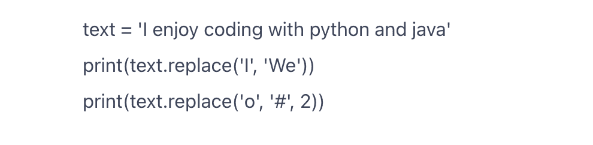
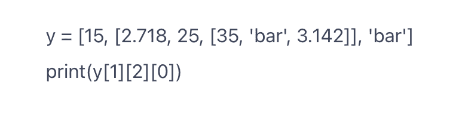
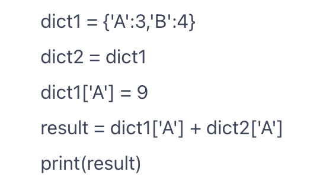
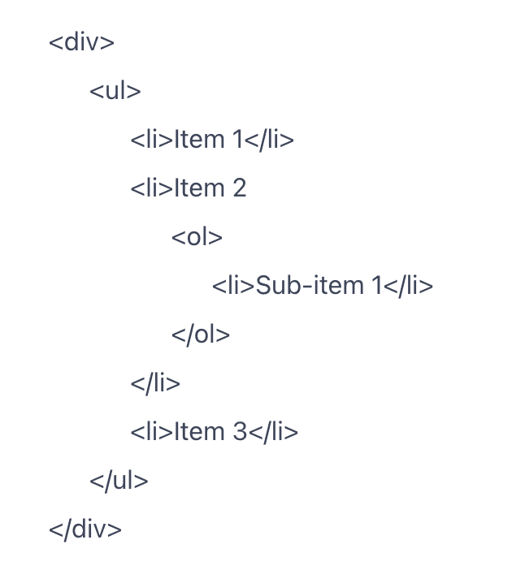
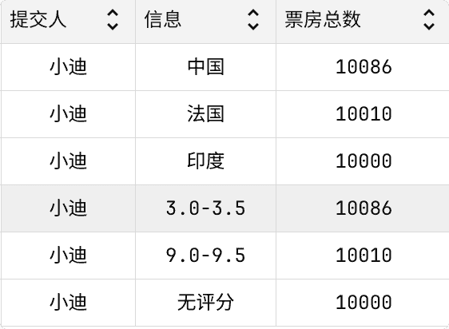
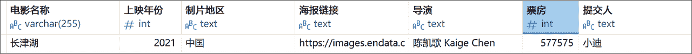

# 影刀RPA 高级考试题库

> 来源：[https://my.feishu.cn/docx/KDsSdrMbaoo52CxEvrmcDlYrnHT](https://my.feishu.cn/docx/KDsSdrMbaoo52CxEvrmcDlYrnHT)

> 高级的我还没考过。。。太忙了而且难，有段时间没学了QWQ，以后会补上的。

# 一、选择题

## 1.1 单选题

### 1、数据库中，如何查询导演为“姜文”且电影时长超过 120 分钟的电影？

✅  SELECT*FROM movies WHERE director ='姜文'AND length_minutes >120;

### 2、以下代码的输出是什么？

y = 15

def my_func():

y = 25

print(y)

my_func()

print(y)

✅  25 15

### 3、在Python中，字符串的变换结果为：

✅  'We enjoy coding with python and java'，'I enj#y c#ding with python and java'

### 4、在Python中。下列程序运行结果说明正确的是：

text = 'efgh34ijk'

print(text.upper().title())

✅‘Efgh34ijk'

### 5、在HTML中，哪个属性用于表示图片来源？

✅  src

### 6、以下代码的输出是什么？

✅  35

### 7、在MySQL中，如何删除年龄为25的所有用户？

✅  DELETE FROM users WHERE age=25;

### 8、在HTML页面中，如何让链接在新窗口打开？

✅ <a href="链接" target="_blank">

### 9、在python中，以下代码输出为：

✅ 18

### 10、在以下HTML代码中，哪个元素是 <ul> 的直接子元素？

✅  <li>

### 11、如何选择 
 元素的所有祖先元素？

✅ //div/ancestor::*

### 12、数据库中，如何查询电影时长在110到130分钟之间，但排除导演为“温子仁"的电影？

✅  SELECT * FROM movies WHERE length_minutes BETWEEN 110 AND 130 AND director != '温子仁';

### 13、数据库中，如何修改电影 id 为 5 的 title 和 director？

✅ UPDATE movies SET title='新标题', director='新导演' WHERE id=5;

### 14、以下哪个代码段能够正确反转字符串？

✅ str[::-1]

### 15、哪条 SQL 语句可以用于查询电影标题包含“疯狂”的电影？

✅ SELECT * FROM movies WHERE title LIKE '%疯狂%';

### 16、在Python中，字符串的变换结果为：

text = 'I enjoy coding with python and java'

print(text.replace('I', 'We'))

print(text.replace('o', '#', 2))

✅ We enjoy coding with python and java'，'I enj#y c#ding with python and java'

### 17、在Python中，下列程序结果为：

data = {'x': 10, 'y': 20, 'z': 30}

print(data.pop())

✅ 报错

###

## 1.2 多选题

### 1、哪些SQL命令会改变表的结构？

✅  ALTER TABLE

✅  DROP TABLE

### 2、以下哪个表达式会返回 False？

✅ 'x' in 'abc'

### 3、下列哪些语句可以用于Python中的错误处理？

✅ try

✅ except

✅ finally

### 4、下列哪些方式可以用于遍历字典？

✅ for k in my_dict.keys()

✅ for k, v in my_dict.items()

✅ for v in my_dict.values()

✅ for k in my_dict

### 5、字典 d = {1:"x", 2:"y", 3:"z"}，以下可以执行的语句有？

✅ print(d[2])

✅ list(d)

✅ print(d)

✅ d[3] = 5

### 6、哪几个函数用于在 Python 中进行 JSON 转换？

✅ json.dumps()

✅ json.loads()

### 7、如何选取 <ul> 下的第二个和第四个 <li> 元素？

✅ //ul/li[position()=2 or position()=4]

✅ //ul/li[2] | //ul/li[4]

✅ //ul/li[position()=2] | //ul/li[position()=4]

### 8、以下哪些 type 属于 input 标签的?

✅ text

✅ password

✅ radio

✅ checkbox

### 9、在 HTML 的 table 标签中，哪些标签与它的含义对照关系是正确的？

✅ <thead> - 表头

✅ <tr> - 表格行

✅ <th> - 表头单元格

# 二、操作题

## 2.1 操作题 1

编写影刀流程从API接口(http://43.143.30.32:9527/movies)中获取数据，并且完成以下操作：

1.  统计出票房总数最高的三个国家，并将统计结果填写到MySQL数据库中

1.  分别统计出 3.0-3.5，9.0-9.5 和 无评分 这三个评分区间的票房总数，并将统计结果填写到MySQL数据库中

1.  数据库信息：IP：43.143.30.32  端口号：3306 用户名：yingdao 密码：9527 库名：ydtest 表名：result（注意，该数据库只开放了写入权限，无法查询）

1.  数据表结构如下（提交人为影刀学院用户名！位于学院首页右上角）：

## 2.2 操作题 2

进入这个网站：[http://www.boxofficecn.co](http://www.boxofficecn.com/the-red-box-office)m/the-red-box-office，获取排行榜中所有电影的相关数据（具体字段参考下面的要求明细），并存入指定数据库中。

要求如下：

1.  数据库信息：IP：43.143.30.32  端口号：3306 用户名：yingdao 密码：9527 库名：ydtest 表名：movies（注意，该数据库只开放了写入权限，无法查询）

1.  字段及数据格式参考（提交人为影刀学院用户名！位于学院首页右上角）：

1.  元素对象都要使用xpath表达式获取（禁止使用【批量数据抓取】指令）

1.  使用编码版完成所有操作

<https://my.feishu.cn/sync/F02gd7b3wsQaodb0X5FcLHPknse>