# RPA+其他｜更换浏览器ip代理

> 来源：[https://my.feishu.cn/docx/WuRDdV7p1oasbaxn2G5cwja9nQh](https://my.feishu.cn/docx/WuRDdV7p1oasbaxn2G5cwja9nQh)

# 一、注册IP代理服务器平台

+   品赞HTTP代理：https://www.ipzan.com?pid=vqcjaoilg

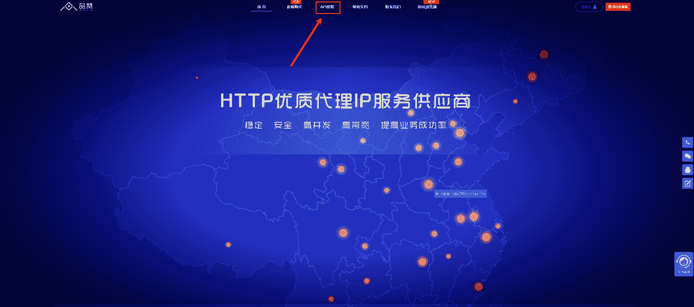

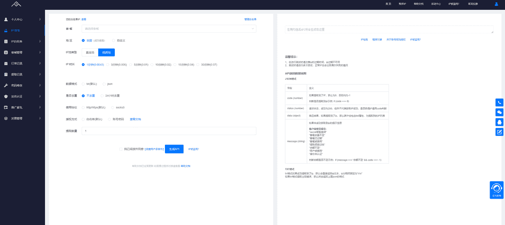

添加白名单之后还需要实名认证一下，不然提取不到IP。

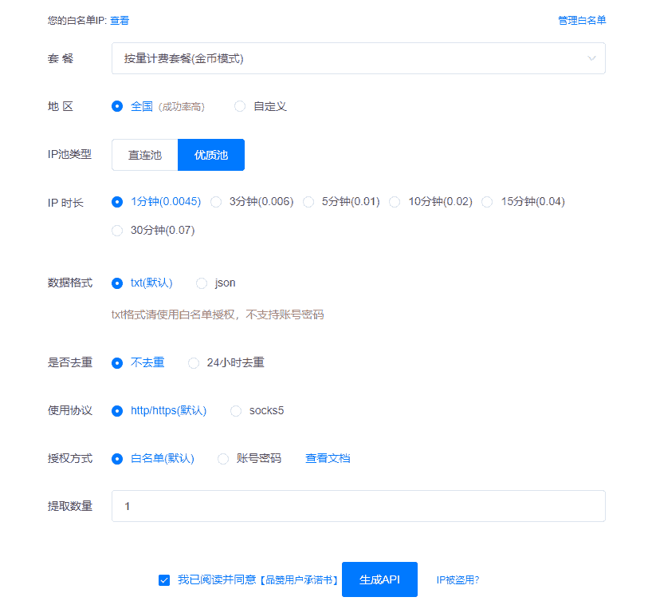

地区：全国和自定义，自定义可以选择某一个省份和城市。

IP类型：优质池

IP时长：IP的有效时间，如果选择1分钟，那说明这个IP，1分钟后会失效。

数据格式：用影刀RPA提取和替换的话，选择TXT默认的就OK。

是否去重：不去重

使用协议：http默认的就可以

授权方式：白名单

提取数量：这个很重要，意思是一次性提取几个..如果填写200，那就会一次性提取200个IP，而且因为选择了一分钟，这200个IP都会在1分钟后失效。

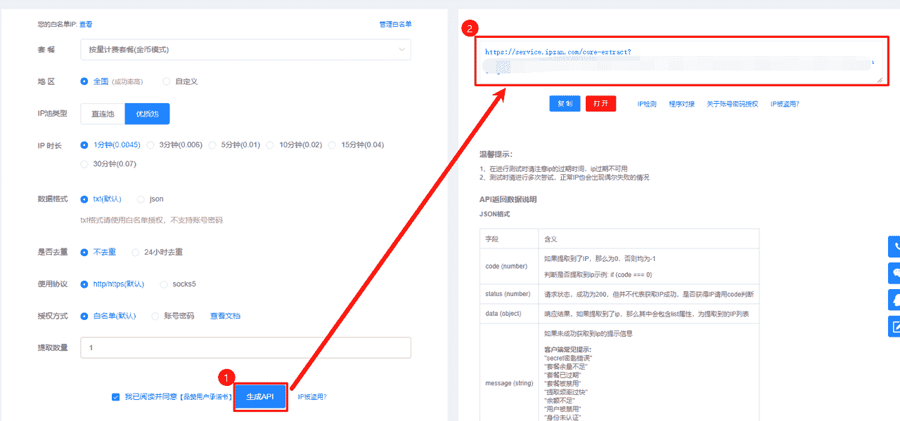

点击生成API之后就会显示链接了.

# 二、影刀调试

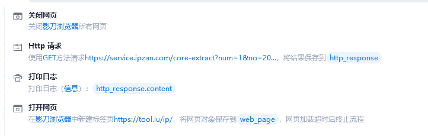

调试和测试主要分为四个流程

+   关闭网页（替换IP是需要重启的，重新恢复环境还是挺重要的，不然会出现奇奇怪怪的事情）

+   http请求（把刚刚的api链接填进去就可以提取IP了）

+   打印日志（打印出来方便查看返回的结果）

+   打开网页（这一步很重要，打开网页查询IP是否换成功，换IP的动作也是在这一步完成的）

## 2.1 关闭网页

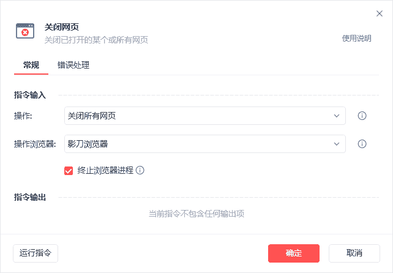

这一步没啥好说的，主要是恢复初始环境。关闭浏览器所有进程。

## 2.2 http请求

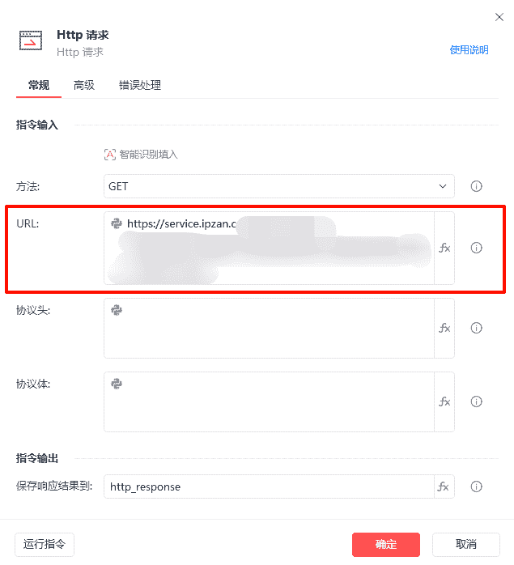

这一步是填写API提取的URL，http请求会返回网页结果，也就是IP代理。

## 2.3 打印日志

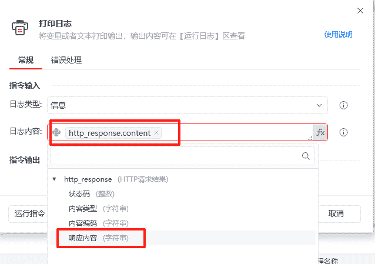

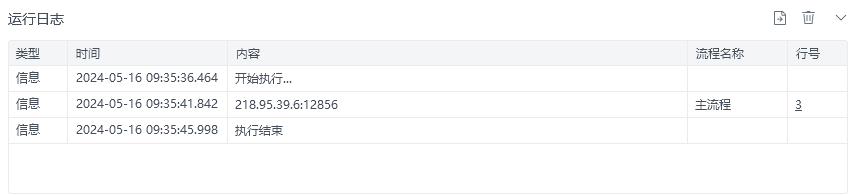

打印日志，打印响应内容，也就是IP代理。

## 2.4 打开网页

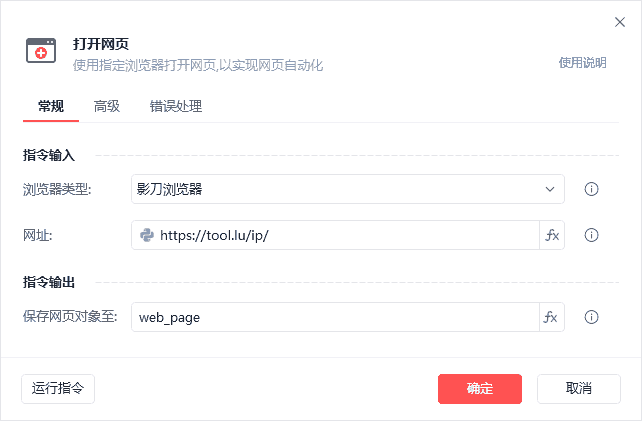

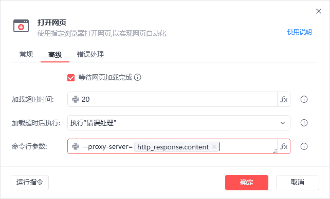

```
**--proxy-server=**117.32.77.39:4231 后面是提取的ip和端口
```

```
**--proxy-server=**http://proxy.baozi.com:808 或者后面是域名和端口
```

主要是命令行参数这边，前面填写--proxy-server= 后面选择提取的IP代理..

查询IP的网址：https://tool.lu/ip/

每次打开IP就都不一样了！

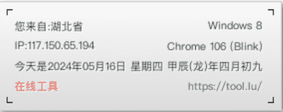

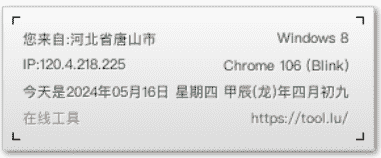