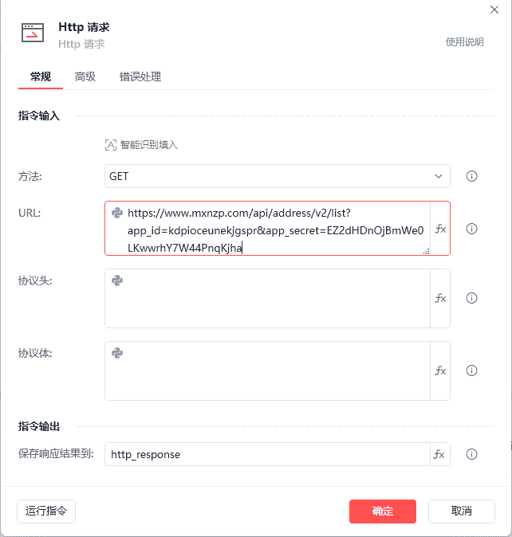
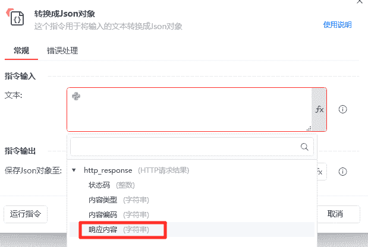
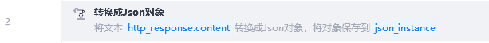
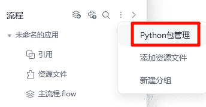
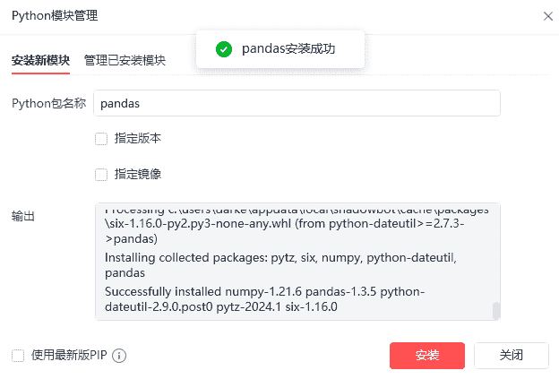
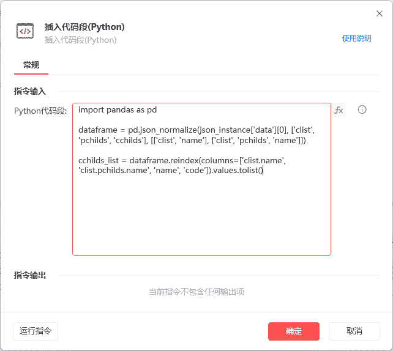
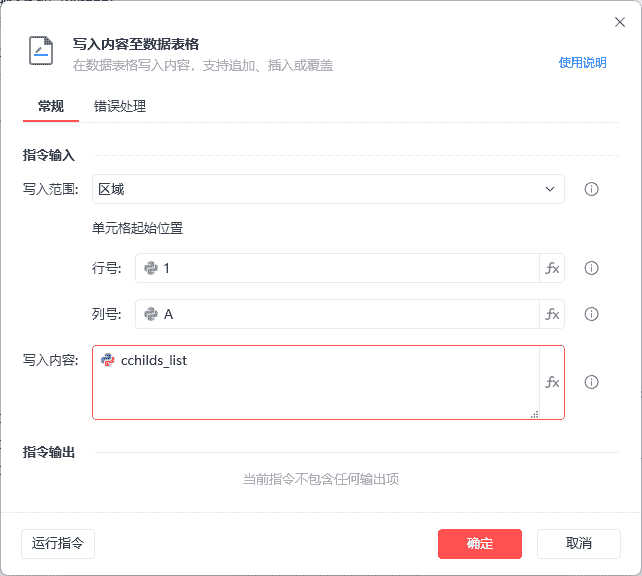
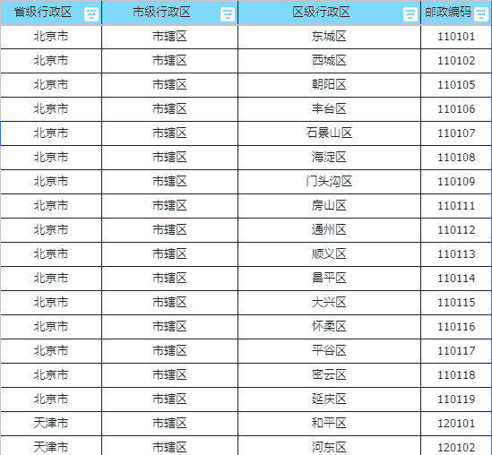
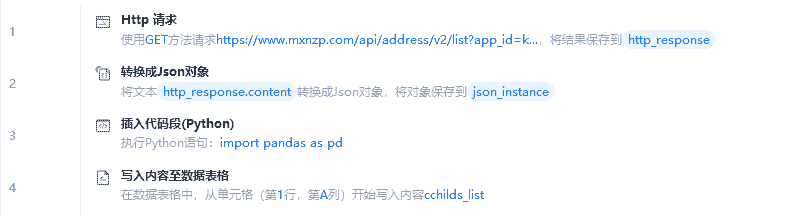

# 用影刀 RPA 抓取中国城市名称

> 来源：[https://my.feishu.cn/docx/MUWmdCpcAouPWDxtJ26ck1Twnfg](https://my.feishu.cn/docx/MUWmdCpcAouPWDxtJ26ck1Twnfg)

# 一、前言

之前一直想要提取中国所有城市的数据，我还想着从地图或者从什么平台去抓取数据，没想到前段时间看高级课程的时候，四行指令加一段 python 代码就完成了。

python 方面还得再多学一学，确实比单纯用指令要简洁很多！

# 二、详解

第 1 步，http 请求，get 这个 API 地址，获取数据。

```
https://www.mxnzp.com/api/address/v2/list?app_id=kdpioceunekjgspr&amp;app_secret=EZ2dHDnOjBmWe0LKwwrhY7W44PnqKjha
```




第 2 步，转换成 json 对象，这边要注意，是 get 到的相应内容去转换成 josn 对象。





第 2.5 步，在这之前需要先安装一下 pandas 库，方便后面提取信息。





第 3 步，插入代码段



```
import pandas as pd

dataframe = pd.json_normalize(json_instance[&#x27;data&#x27;][0], [&#x27;clist&#x27;, &#x27;pchilds&#x27;, &#x27;cchilds&#x27;], [[&#x27;clist&#x27;, &#x27;name&#x27;], [&#x27;clist&#x27;, &#x27;pchilds&#x27;, &#x27;name&#x27;]])

cchilds_list = dataframe.reindex(columns=[&#x27;clist.name&#x27;, &#x27;clist.pchilds.name&#x27;, &#x27;name&#x27;, &#x27;code&#x27;]).values.tolist()
```

1.  导入 Pandas 库。

1.  使用json_normalize函数将嵌套的 JSON 数据规范化为一个平展的 DataFrame。

1.  对生成的 DataFrame 进行重新索引，提取特定的列，并将这些列的值转换为列表。

第 4 步，写入数据表格




最终就可以获取到所有的省、市、区还有对应的邮政编码啦～



# 三、全览

