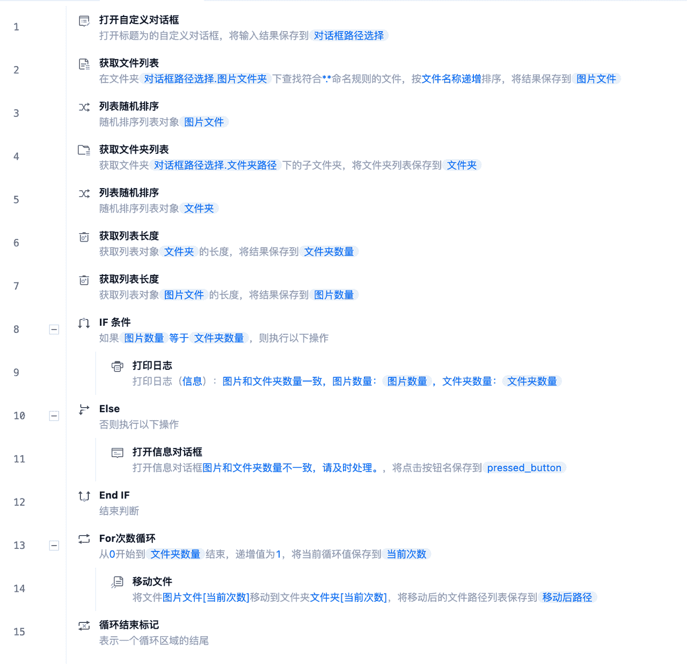
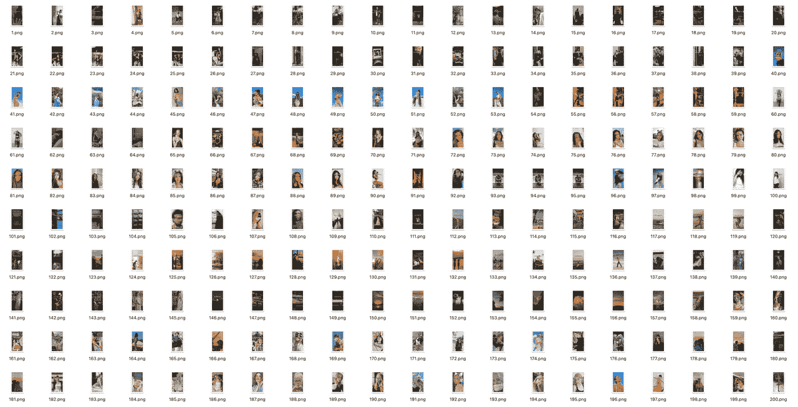
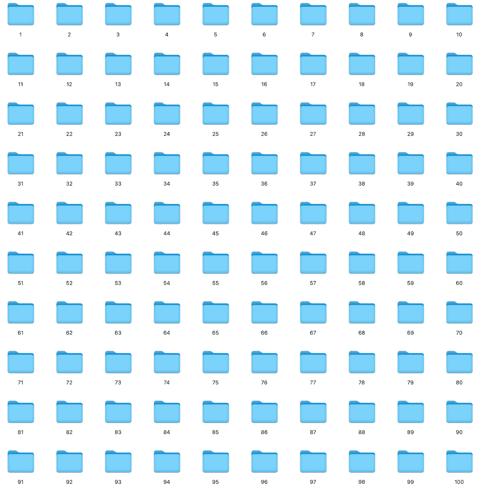
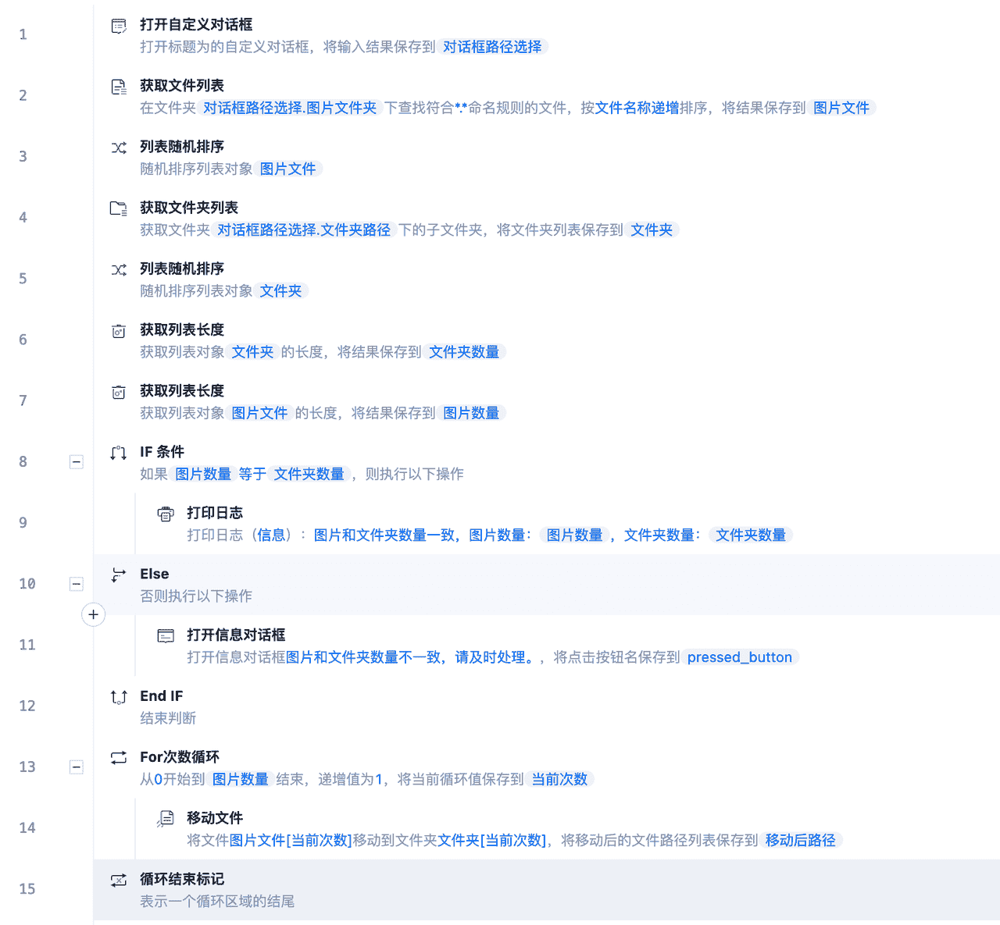
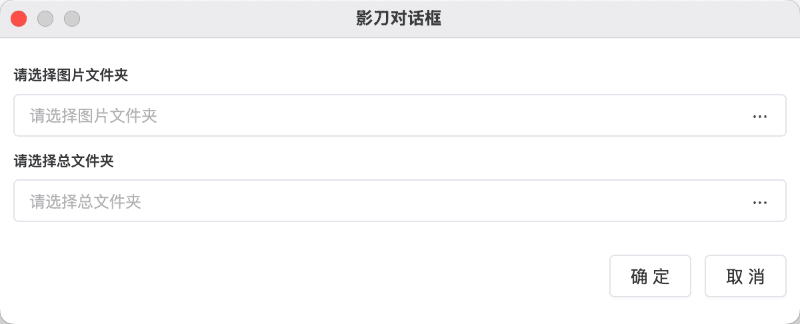
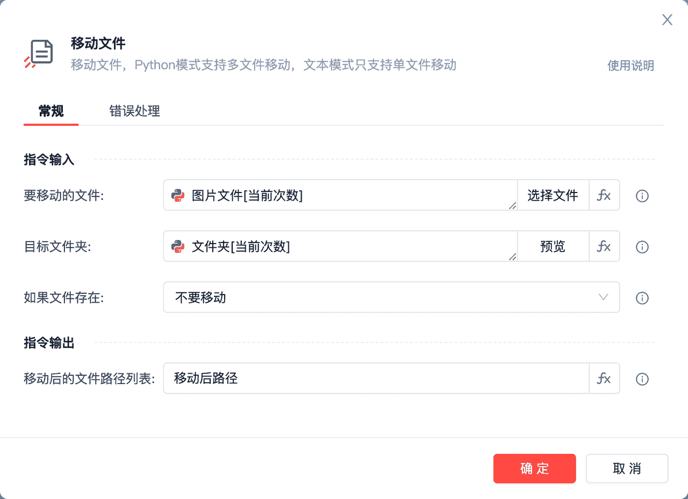

# RPA+其它｜自动将图片放入指定文件夹

> 来源：[https://my.feishu.cn/docx/EToUdpLKjoAFjyx74tScbjjSnwe](https://my.feishu.cn/docx/EToUdpLKjoAFjyx74tScbjjSnwe)

> 用影刀RPA将一个文件夹中的图片，分别放到已经创建好的每个文件夹中。

>

> 要做图文内容给运营发，因为一篇图文可能会有 2-3 张，如果全部都一起给运营可能会乱掉。所以提前做好图片 1，然后再做图片 2，之后再做图片 3。所以需要将 1、2、3 张图片都一起放到单独的文件夹中。

> 一个一个放太慢了，通过影刀rpa可以实现一件分配！效率 Max！

# 用 RPA 将图片分组

为了方便发布，第一个文件夹是第一张图，第二个文件夹是第二张图，第三个文件夹是第三张图。我们需要从中各抽出一张放在新的文件夹中。

为了解决这个问题，我用影刀 RPA 可以快速的把 100 张图片，分别放到 100 个文件夹中。这样给其他小伙伴帮忙发布就方便了很多。

比如已经批量做好了第一张图，现在需要依次放到每个文件夹中，这样一个文件夹就是一条图文。如果一个一个放就太慢了，效率也会很低。

所以就要用到 RPA 来帮我们快速完成这个需求。

没有学过 RPA 的小伙伴也没关系，按照我的搭建思路，一步一步完成就好了，很简单。

先看总览，然后我一步一步将这 15 行指令说明讲解。

第 1 行：打开自定义对话框，这一步是为了增加整个流程的通用性，这样只需要启动然后选择图片文件夹和需要放的文件夹路径就可以了。不需要每次都从流程中修改路径。

第 2-5 行 ：这里主要就是根据路径，把所有的图片放在一个列表中，然后随机排序打乱顺序。在获取文件夹放在一个列表中，然后打乱顺序。

第 6-7 行：获取列表的长度，一个是文件夹一个是图片，主要是匹配这两个是否一致。因为如果有 101 张图片，但是只有 100 个文件夹，那就会出问题了嘛。所以一定要数量对应起来。

第 8-12 行：所以我在这里加入了一个 if 条件，这样如果不一致的话就会弹窗提醒我及时处理，如果一致的话就打印日志一下，然后继续流程了。

第 13-15 行：这里我加入的是 for 次数循环，结束的数字就引用的图片数量，比如有 100 张，那就循环到 100 结束。然后循环里面放的移动文件指令，

