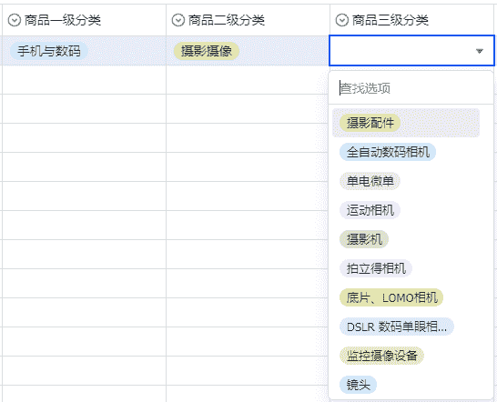
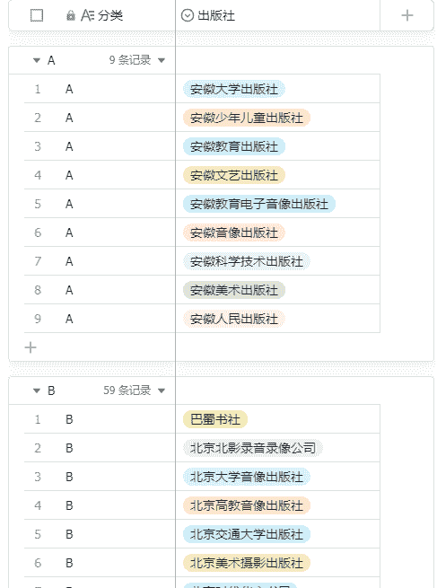
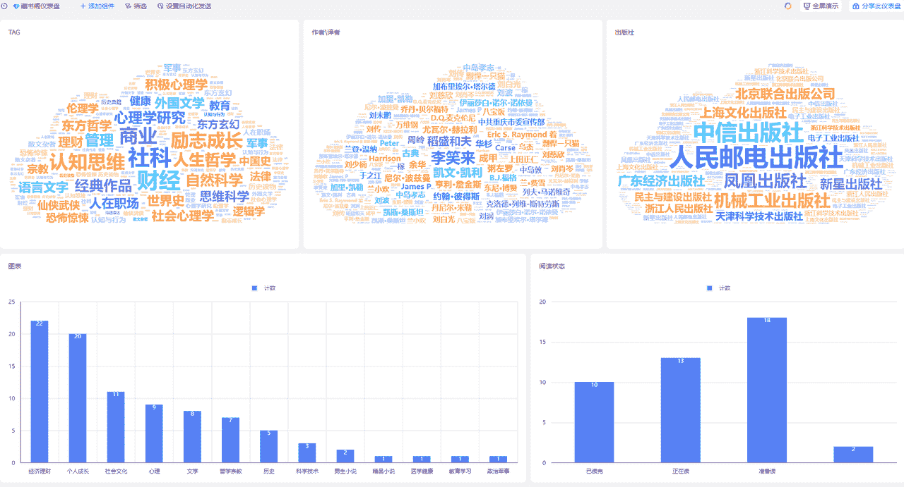

# 类目表如何在飞书多维表格中做成选项

> 来源：[https://my.feishu.cn/docx/HF6Rdn2jCozAGBxZlmRcZSVHnKc](https://my.feishu.cn/docx/HF6Rdn2jCozAGBxZlmRcZSVHnKc)

# 一、前言

前面我分享了几个用影刀 RPA 抓取类目的教程和思路，有的小伙伴可能不太理解我为什么这么喜欢抓分类。其实，我一直觉得分类非常有趣，因为它不仅能提升我们的理解和认知，还能帮助我们系统化管理、数据整合和分析，从而提高工作效率。更重要的是，分类可以作为一个数据库，自由组合应用在不同场景中。

今天，我将分享如何用抓取的类目在飞书中制作选项卡。

# 二、TikTok 项目类目管理

在 TikTok 项目中，我们可以通过飞书的多维表格实现类目管理。首先，创建一个单选字段，并引用类目表中的一级分类，这样所有的一级分类就会显示出来，方便选择。

对于二级类目，我们在单选字段中加入条件，使两个表中的一级分类相等，这样在选择二级类目时，只会显示对应的二级分类。

同理，三级类目限定了二级类目等于二级类目，这样显示出来的三级类目就只会是对应二级类目下的三级分类。

# 三、读书笔记多维表格

在读书笔记中，我抓取了所有的出版社和🛰️读书中的大分类和小分类，方便个性化选择。

通过搜索，可以直接引用之前抓取到的出版社表格中的数据。

在飞书多维表格中，可以按照🛰️读书的分类进行搜索和打标签，非常方便。

虽然很多功能🛰️读书也有，但是主要目的是为了自定义个性化满足一些🛰️读书满足不了的需求，其次这也是学习飞书多维表格的一种应用场景，我连体重啊运动啊读书记录啊，都是在飞书上，所以飞书的使用熟练度也越来越高了。

通过这些标签，还可以制作可视化仪表盘，轻松找到对应作者的书籍，了解哪些书还在看，哪些看完了，以及各分类下准备看的书籍，一目了然。

希望这些分享能帮助你更好地利用影刀 RPA 和飞书进行分类管理和数据分析，提升工作效率。