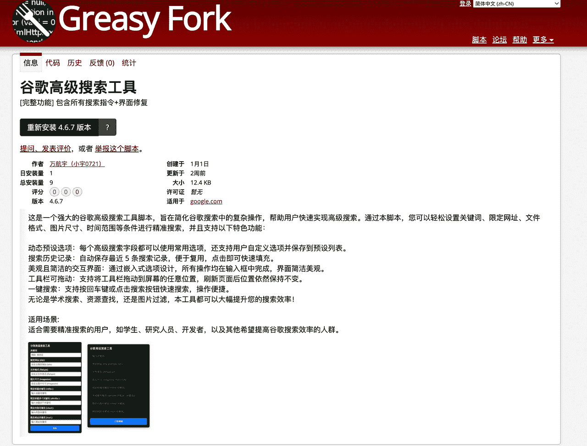

# 【方法】搜索技术

> 来源：[https://my.feishu.cn/docx/BRKAdnkJwoLP9QxPEHUcKj1FnVc](https://my.feishu.cn/docx/BRKAdnkJwoLP9QxPEHUcKj1FnVc)

搜索的目的、搜索的技巧、搜索的工具、搜索的案例

# 油猴谷歌搜索工具脚本

下载地址：[谷歌油猴搜索工具脚本下载地址](https://greasyfork.org/zh-CN/scripts/522470-%E8%B0%B7%E6%AD%8C%E9%AB%98%E7%BA%A7%E6%90%9C%E7%B4%A2%E5%B7%A5%E5%85%B7)

这是我自己用AI辅助写的，改了好多版本。有帮助的记得给我点个赞哇～

