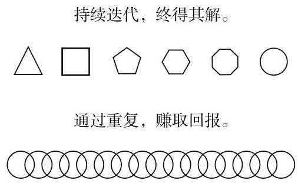

# 迭代思维

> 来源：[https://my.feishu.cn/docx/FCvtdexjLoIh4AxeB0YcrPfOnJf](https://my.feishu.cn/docx/FCvtdexjLoIh4AxeB0YcrPfOnJf)

+   培养迭代思维。生活中所有的回报，无论是财富、人际关系，还是知识，都来自复利。——《纳瓦尔宝典》

# 什么是迭代思维？

迭代，最初多用于计算机编程领域，意思是

**一**种重复反馈过程的活动，每一次对过程的重复称为一次“迭代”，而每一次迭代得到的结果会作为下一次迭代的初始值。

# 用好迭代思维，主要分 3 步 ——

**1）确定目标**

目标明确，我们才能清晰的知道，自己要朝哪个方向迭代。

**2）找到迭代方法**

如何知道自己，该朝什么方向迭代呢？

这点可以参考那些已经达成这个目标的高手，他们在这个过程中，用了哪些方法、思路、工具等。

3）每次改进一个小点，持续 N 次

就像上面的案例，小明没有追求完美，让自己一次就把所有的方法，全部用到公众号上，而是每一次改进一点。这样能让每一点都改进的更扎实。

那下一次的迭代，能在这个基础上，效果更明显。

有迭代思维的人，会很少内耗和纠结，因为她知道，自己这一次的行动，不是为了一步到位、做到完美，而是「我只要行动了，我就能得到反馈，根据反馈我就能知道，下一步该如何迭代」。

每一次的迭代，都能让自己的产品变得更好一些。这样多次迭代后，产品一定会越来越好。

这个世界从来都是不确定的。赚钱的结果更是一个不确定性极高的事情。

但如果你能用好迭代思维，这个不确定性就会相对变得更小一些。

因为你每一次的迭代，都会让事情更优化一些，就是朝目标更近一些，就是让结果的确定性更高一些。

只要你迭代的足够快，你赚到钱的概率就会提高很多。

# 迭代思维应用

**1）哪些场景下，可以用迭代思维**

迭代思维主要适用的场景就是 ——

当你做一个项目，一直想找到一个完美的方案，所以一直在拖延，迟迟没有行动时。

比如，你想写公众号建立个人品牌，但你不知道该如何定位什么，担心定位不好，写出来的文章，给大家的印象不好，后面变现就更难，于是就一直拖着。

用迭代思维来看这件事：

定位和人的能力有关，而人是会不断成长的。当你成长了，你的定位也可以改变。

所以，一开始的定位，并不是特别重要。先开始输出，让大家看到自己，然后根据读者的反馈，做下一步的改进。

**2）使用迭代思维的注意事项**

迭代思维，重点是需要小步快进。

每当发现一个小地方有改进的空间，就可以立刻行动，而不用非等到，攒了很多重大的改进点，才开始行动。

因为每一次的改进结果，都会收到外界的反馈，让我们知道这次迭代的方向，是否有效，进而可以针对性的做下一步的迭代。

# 迭代思维：用鲁莽定律开局，用迭代思维持续行动

——粥佐罗《学会成长》

凡事先开局，不开局，就永远不得终局。开局可以不好，但要开，因为凡事靠迭代。

什么是迭代？我给你一个接地气的定义。迭代就是，你想去远方，但你不可能一步迈过去；你想去山顶，但你不可能一步登上去。你需要无数步，每一步都可以被称为一次迭代，每一次迭代得到的结果会作为下一次迭代的初始值，每一次迭代都是为了逼近目标。

迭代思维之所以重要，是因为太多人看不清两件事。

一是看不清自己当下的位置，总是给自己设定与当下能力不匹配的目标，然后反复被现实打击，直到自我怀疑。

二是看不清事情的演化规律，总是给自己设定一个不合理的推进计划，让自己在整个过程中屡屡受挫。

每个人在成长中，都要用迭代思维来看清当下、看到未来。

特**别幸运的是，2018年2月6日那天（对，我记得特别清楚），我在朋友圈看**到一篇文章，点开后被脱不花的一段话“击中”了，她说：“人生总有很多左右为难的事，如果你在做与不做之间纠结，那么，不要反复推演，立即去做。莽撞的人反而更容易赢。因为如果不做，这件事就永远是停在脑中的‘假想’，由于没有真实的反馈，诱惑会越来越大，最终肯定会让你后悔。而去做，就进入了一个尝试、反馈、修正、推进的循环，最终至少有一半的概率能做成、不后悔。”

读完后，我热血沸腾，心里涌起一句话：干！

做大事者不纠结，成大器者不磨叽。那些莽撞的人反而更容易赢。

先干起来，才能一步一步逼近成功。

如果你不开始干，你脑子里就都是在论证“要不要干”。而你一旦开干了，你就开始了对“怎么干好”的论证，也就是你一旦开局了，就进入了迭代模式，每多干一步就离成功更近一步，因为问题都是在做事的过程中一个一个被解决的，空想不能解决任何问题。

所谓成事，就是用鲁莽定律开局，用迭代思维持续行动。