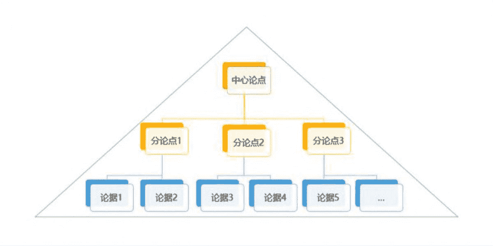

# 金字塔原理

> 来源：[https://my.feishu.cn/docx/KllddexqQo4Z4mxCwX2counfn15](https://my.feishu.cn/docx/KllddexqQo4Z4mxCwX2counfn15)

> 一种将思想归类分组、按逻辑组织、总结概括的结构，可用于思考问题和表达问题。

# **什么是金字塔原理**

金字塔原理是一种思考、表达和解决问题的逻辑方法。

金字塔原理就是任何事情都可以归纳出一个中心论点，而此中心论点可由三至七个论据支持，这些一级论据本身也可以是个论点，被二级的三至七个论据支持，如此延伸，状如金字塔。

金字塔的基本结构是：结论先行，以上统下，归类分组，逻辑递进。先重要后次要，先全局后细节，先结论后原因，先结果后过程。

金字塔的基本结构

**对于**金字塔每一层的支持论据，有个极高的要求： MECE (Mutually exclusive and collectively exhaustive) 即彼此相互独立不重叠，但是合在一起完全穷尽不遗漏。不遗漏才能不误事，不重叠才能不做无用功。

# **用好金字塔原理，主要分为4步**

1.  **确定主题**：明确要表达的核心观点或问题。

1.  **构建结构**：将信息进行分类和分组，形成金字塔结构。

1.  **分层阐述**：从上层开始，逐步向下展开，详细阐述各个层次的内容。

1.  **逻辑推理**：确保各层次之间的逻辑关系清晰，论据充分支持论点。

# **金字塔原理的应用场景**

在写作、演讲、沟通、问题解决等方面都有广泛应用，它能帮助人们更清晰、有条理地表达和思考。

• 分组归类，构建金字塔式的思维结构。 找出事务的共性， 并抽象概括。

• 自上而下，结论先行。 因为受众的知识背景和理解能力千差万别。

• 自下而上思考， 总结概括。不断对思想进行归类和概括。