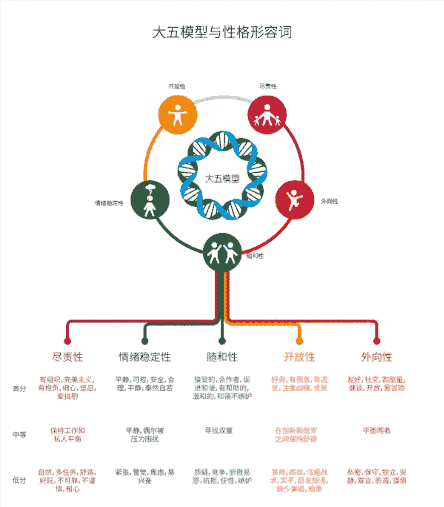
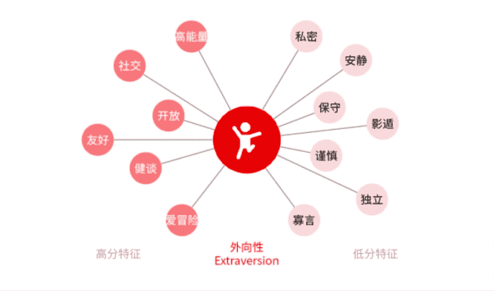
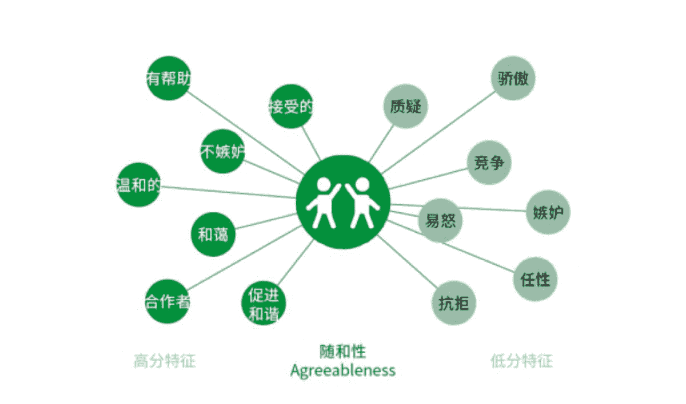
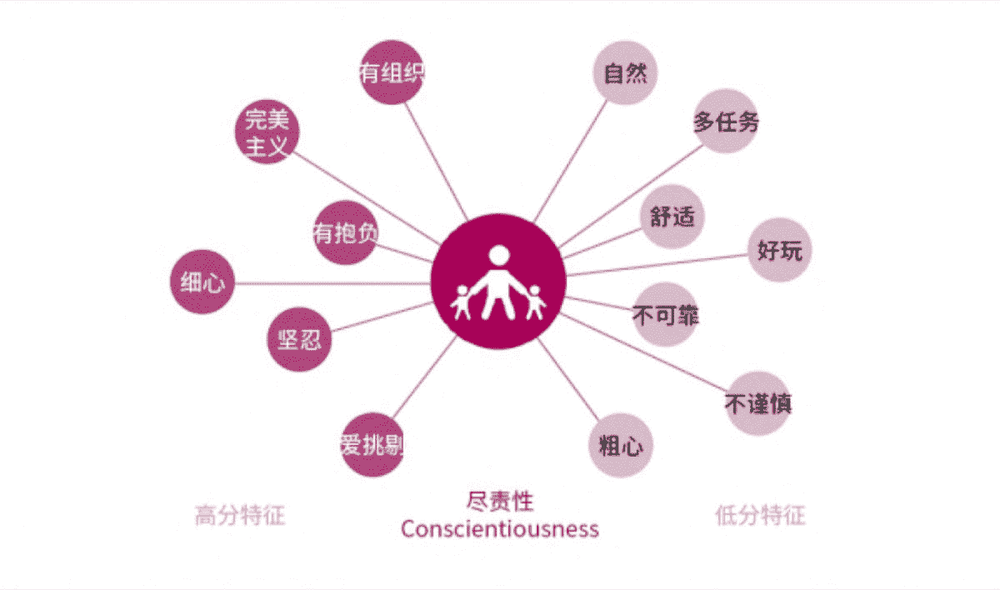
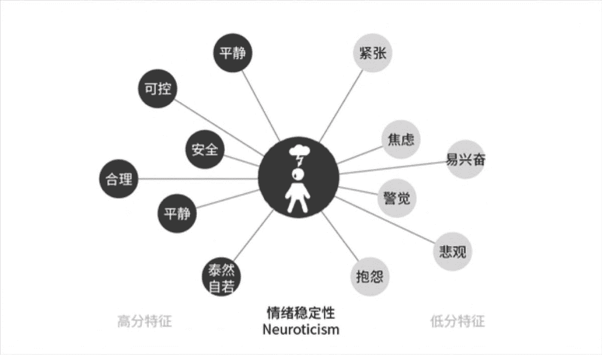
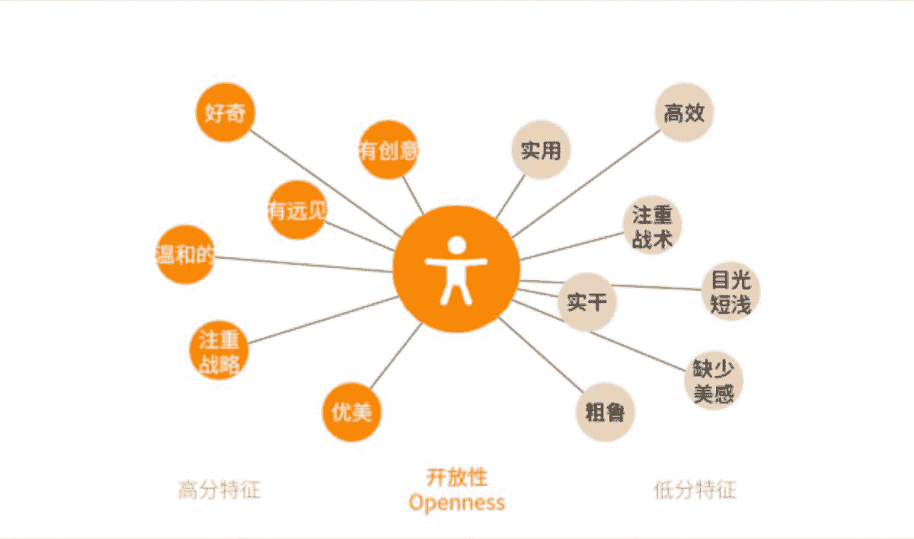

# 大五模型

> 来源：[https://my.feishu.cn/docx/DZXNdKlFQoYKJbx2DSqcJEQTnob](https://my.feishu.cn/docx/DZXNdKlFQoYKJbx2DSqcJEQTnob)

> 词条简介：

> 大五模型是一个经过实际验证的性格评判系统。也是过去二十年中，人格研究者支持最多的分类模型。

## **详细说明**

### **Ⅰ. 模型的特质被分类**

大五模型的性格分类有以下五种：

• 外向性（Extraversion）

• 随和性（Agreeableness）

• 尽责性（Conscientiousness）

• 情绪稳定性（Neuroticism）

• 开放性（Openness）

其中，每一个类别都有一些特有的特质形容词。这些词被分为高分，中等和低分三个维度，如下图：

对于这五因素与生活的关联，心理学家已经展开了大量的研究：

这些特征并不意味着“高外向性”在任何时候都有利。例如外向者喜欢开快车， 追求刺激。与内向者相比，它们会更多的卷入车祸。

随和的人与他人相处融洽，广受欢迎，避免冲突，争取和谐的家庭生活。不随和的人具有攻击性，容易使自己卷入大量的社会冲突中。

尽责性得分高者在学习和工作中表现良好，他们避免破坏规则，拥有更稳定与安全的恋爱关系。

情绪稳定性低者多变的情感会影响生活的方方面面。

高开放性的人喜欢拥抱新方法， 新经验，对外面世界充满了好奇心 。 而低开放性的人， 更喜欢稳定。

