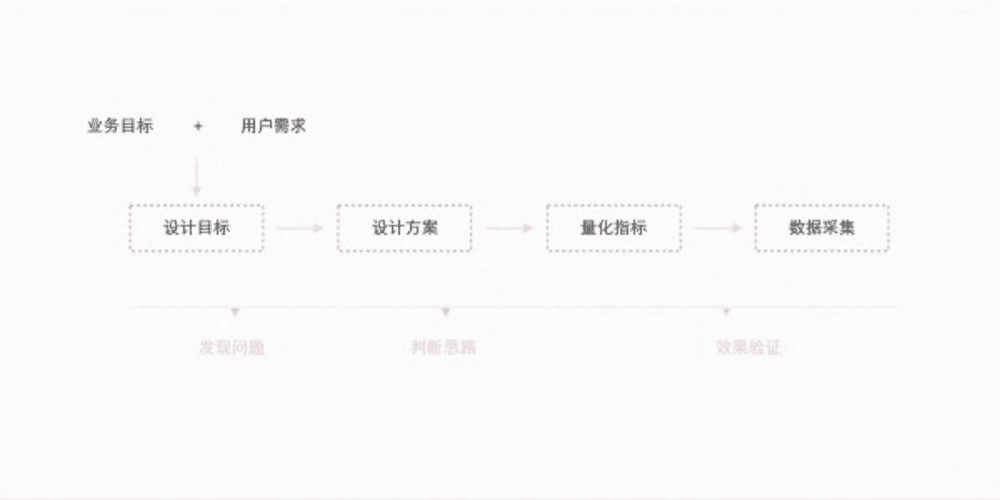

# GSM模型

> 来源：[https://my.feishu.cn/docx/PmNodvL6goks2oxWNmqc95mbnUf](https://my.feishu.cn/docx/PmNodvL6goks2oxWNmqc95mbnUf)

> “GSM”是Google 用户体验团队总结的一个分析模型，取自设计目标 (Goal) 现象信号 (Signal)、衡量指标 (Metric) 三者的英文首字母。

## **详细说明**

如何利用GSM模型进行分析呢？ 首先我们假设设计目标都会实现，那么用户行为会出现什么表现与信号，列举出所有，选择我们能够监控到的，然后将现象或信号转化为数据项，也就得到了相应的衡量指标。

其实GSM模型最重要的作用是为设计师建立一个简单的数据例如在方案设计前结合业务目标与用户需求， 帮助我们发现问题，查找设计切入点来树立设计目标，在设计中帮我们斧正设计思路对方案不断优化，上线后进行方案效果回收。分析的思路框架。

例如在方案设计前结合业务目标与用户需求，帮助我们发现问题，查找设计切入点来树立设计目标，在设计中帮我们斧正设计思路对方案不断优化，上线后进行方案效果回收。

数据分析作为设计方法中的一种，通过建立系统性的分析框架，可以帮我们在设计的整个流程中走的更加从容。