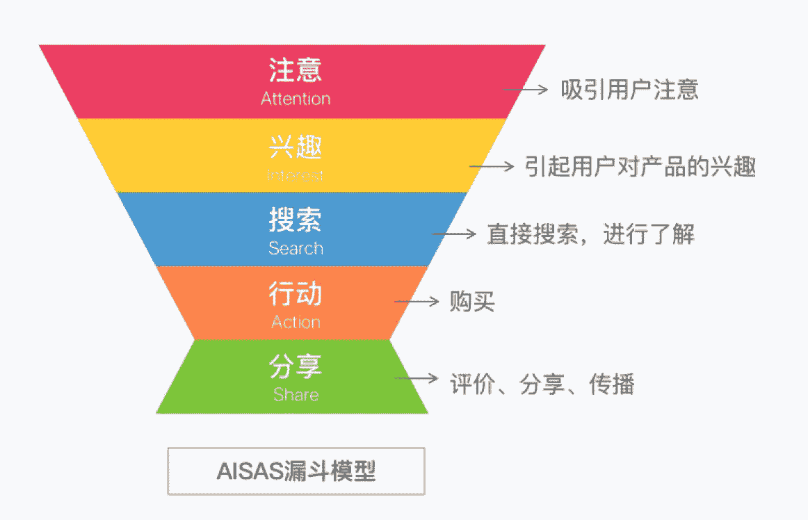

# AISAS模型

> 来源：[https://my.feishu.cn/docx/ThxCdSgtToVrorxzGi1cISGsndh](https://my.feishu.cn/docx/ThxCdSgtToVrorxzGi1cISGsndh)

基于 AIDMA 模型衍生出的模型，也就是 Attention 注意、Interest 兴趣、Search 搜索、Action 行动、Share 分享。

## **详细说明**

因为AIDMA模型缺少用户反馈的环节，且随着互联网用户教育的完成，消费者行为模式发生了改变，随之衍生出了AISAS模型（Attention、Interest、Search、Action、Share)，也就是注意、兴趣、搜索、行动、分享。

用户从接受到产品的宣传营销信息（硬广or软文），到引起兴趣，然后开始搜索进行了解（百度、知乎、🧣、淘宝），到在线下载or支付，以及后续的评价分享环节（产品内、🛰️🧣）。

AISAS模型更符合互联网的特点，时效性强，但它和IDMA模型一样，依旧缺乏量化标准，每一环节的效应不能通过数据进行反馈。