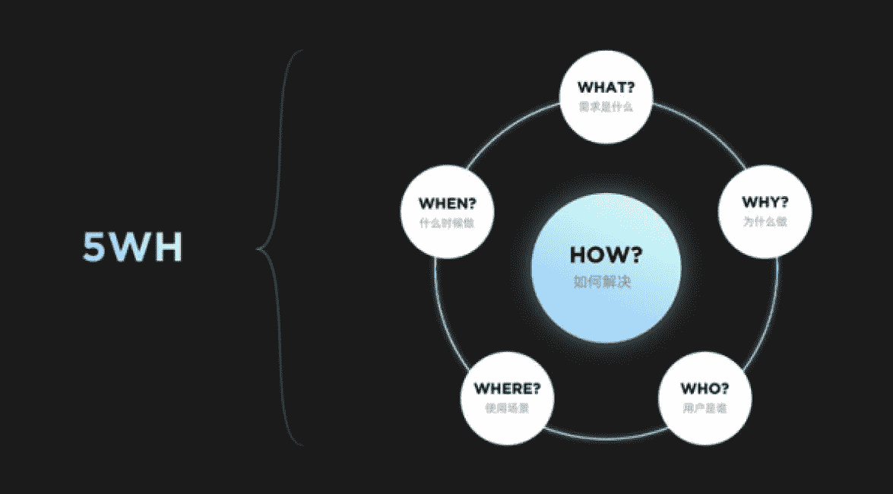
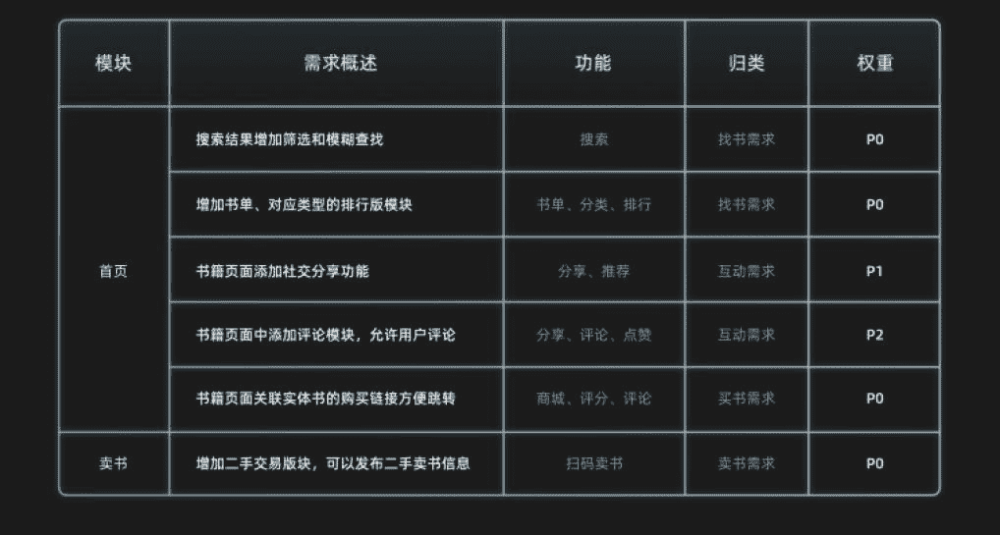
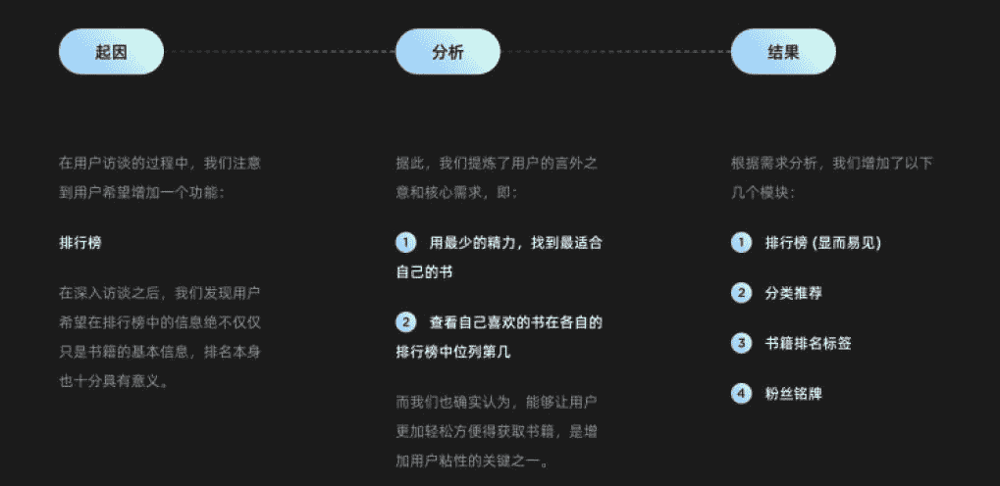
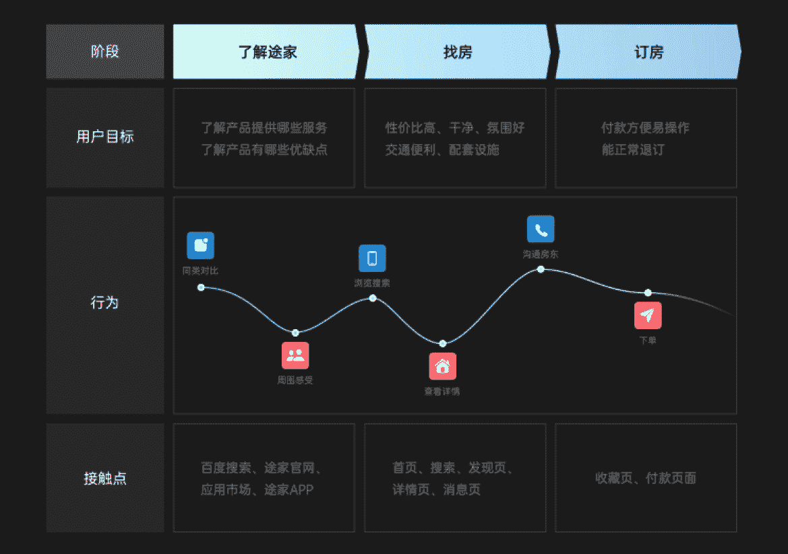
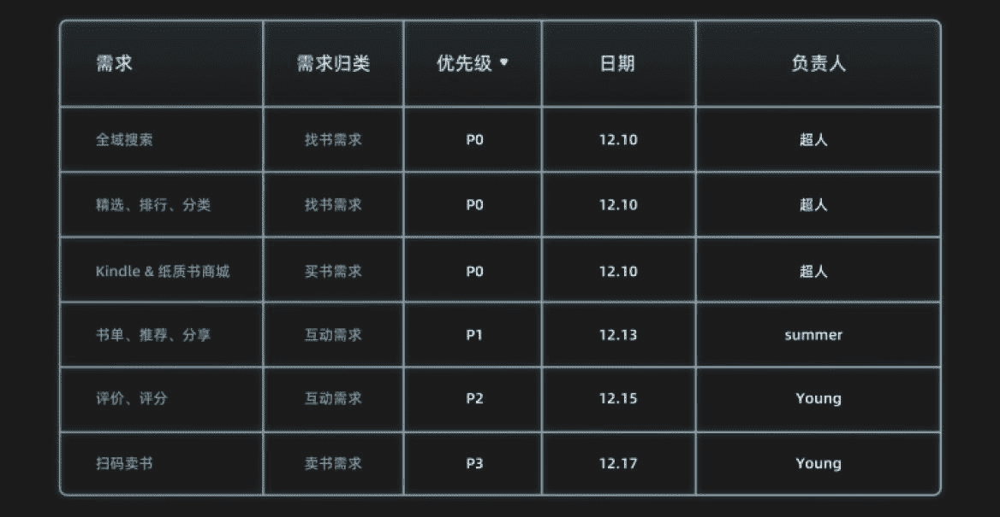

# 5W1H模型

> 来源：[https://my.feishu.cn/docx/StdwdOOAOo6KJcxcxqlcX2YYndg](https://my.feishu.cn/docx/StdwdOOAOo6KJcxcxqlcX2YYndg)

5W1H模型提出以做什么（What）、为什么做（Why）、做给谁（Who）、使用场景（Where）、什么时候做（When）以及要如何完成相应的工作内容（How）该五大问题进行定义以及寻找解决方法。

## **详细说明**

5W1H 是一个帮助我们完成任务的分析工具，由美国政治学家拉斯维尔于1932年提出，并经过不断的优化和更新。广泛应用在企业管理、学术研究、生产管控、日常生活中。

5W1H模型，就是提出下列5个问题，通过收集、定义这5个问题，找出解决方案的做事方法：

•

WHAT：要做的产品、需求是什么

•

WHY：为什么要做这个，原因是什么

•

WHO：设计给谁用的，对象是谁

•

WHERE：产品使用的场景、环境是什么

•

WHEN：什么时候开始做，时间节点呢

•

HOW：要如何完成相应的工作内容

5WH模型图解

### **I.WHAT？需求是什么：**

WHAT 步骤所做的，就是对每次项目的 PRD 和需求进行筛选，定义出和我们有关的具体需求和条目。

需求案例图

### Ⅱ.WHY？ 为什么要做这些需求：

每一个项目需求的制定，都会有它产生的原因，我们要去追本溯源，了解它是怎么被制定出来的，要实现什么目的。

步骤展示需求分析案例

### **Ⅲ.WHO？给谁用的：**

业务、功能的制定，必然会产生对不同类型用户的影响，或者就是专门针对他们制定的。在这一步我们要做的，就是了解需求针对哪些用户，以及他们的特征、痛点和需求。

### Ⅳ. WHERE？应用的场景是什么：

应用的场景，即需求实现后被应用在什么场景，解决哪些问题，便于我们制定对应的交互策略和流程。

在这个过程中，我们可以分别使用用户体验地图，可用性测试等方法，对场景、流程的深入做深入分析，为具体交互做指导性建议。

土家用户体验地图 · 部分

### Ⅴ.WHEN？什么时候开始和完成：

产品团队成员对业务的排期是至关重要的，不止影响团队效率、 OKR 执行，还关乎 KPI 绩效考核，这一步就需要我们对完成项目的时间进行安排，制定对应的排期。

需求优先级、日程安排

### **Ⅵ.HOW？应该怎么做：**

根据了解的需求点、目标、用户、场景、排期，我们可以开始制定更具体的设计方案了。通过类似参考、原型、飞机稿等内容，将我们思考的结果转化成 “实物” 进行输出和评审。