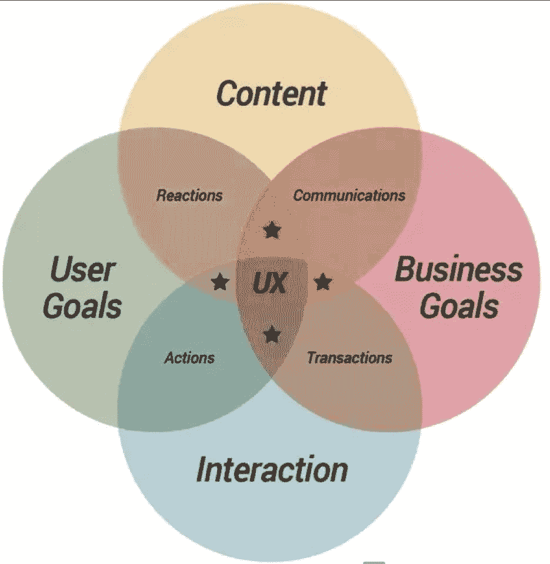
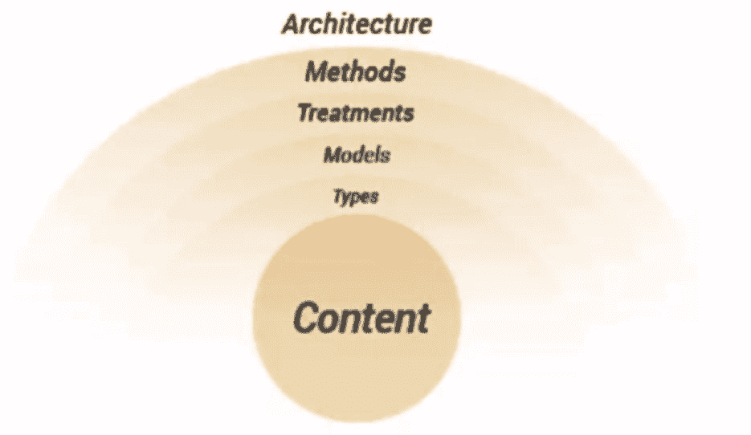
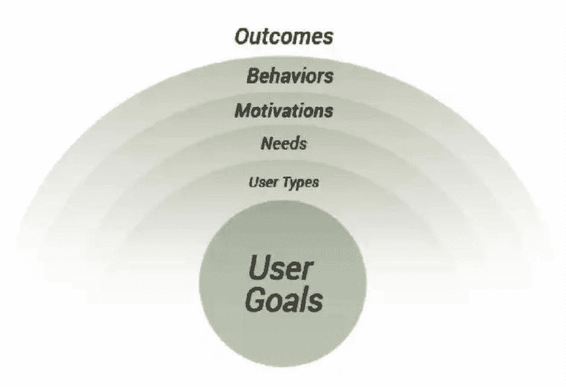
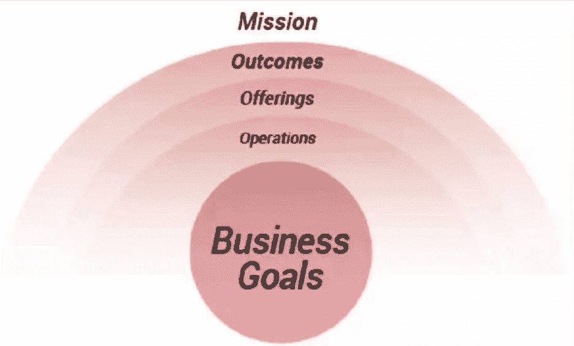
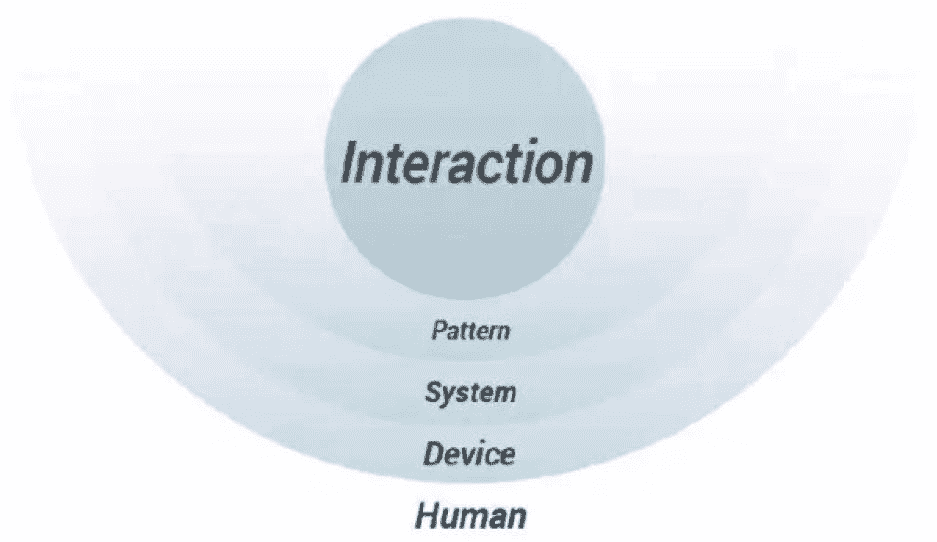

# CUBI模型

> 来源：[https://my.feishu.cn/docx/ZLimdYvc4oBIRCxl0FocgwUFnsb](https://my.feishu.cn/docx/ZLimdYvc4oBIRCxl0FocgwUFnsb)

CUBI模型即以内容（Content）用户目标（User Goals），业务目标（Business Goals），交互（Interaction）进行分析的模型。

## **详细说明**

为了解决设计的普遍性，拥有15年用户体验从业经验的Corey Stern用一种全面穷尽可能的方法，把现有的用户体验要素结合更多的场景和条件，进行归类和分析，推导出一种新的用户体验模型，提供一种新的思路，即 CUBI 模型。

CUBI模型

该模型有助于帮助我们解构项目的四大主要组成部分，其中包括内容（ Content ）、用户目标（ User Goals ）、业务目标（ Business Goals ）、交互（ Interaction ）。

### **I.内容：**

内容有五个要素——内容的种类、模型、处理方法、方式和体系结构。

内容（ Content ）模型

### **Ⅱ.用户目标：**

结合用户目标时有五个层次需要考虑：用户类型、需要、动机、行为和结果。

用户目标（ User Goals ）模型

### **Ⅲ.业务目标：**

结合业务目标，这里有四个层次需要考虑：操作、产品、结果和宗旨。

业务目标（ Business Goals ）模型

### **Ⅳ.交互：**

结合互动，这里有四个层面需要考虑：模式、系统、设备和人。

交互（ Interaction ）模型

这是一个非常宝贵的框架计划，以帮助确定产品的活力和可行性。无论是手机游戏，医疗软件平台或营销网站都需要详细的战略和有效的执行。