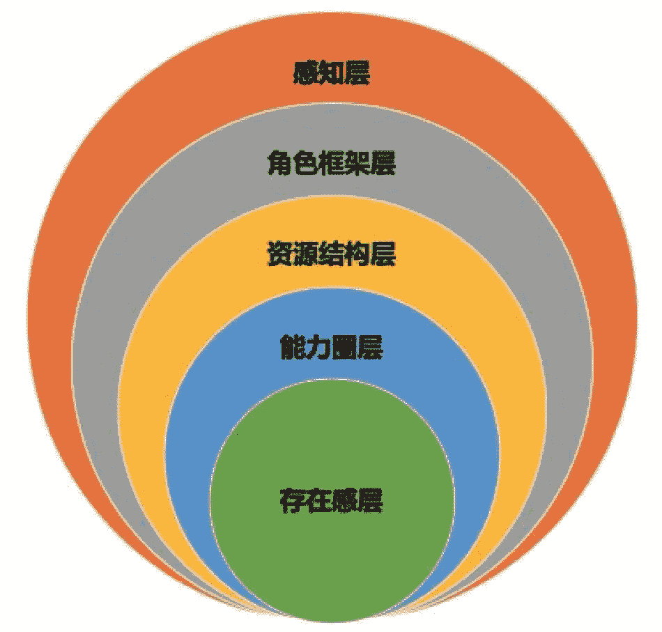

# 五大圈层模型

> 来源：[https://my.feishu.cn/docx/D5HydmoPuoHxNgx33rYc7DcXnLh](https://my.feishu.cn/docx/D5HydmoPuoHxNgx33rYc7DcXnLh)

该模型以感知层、角色框架层、资源结构层、能力圈层和存在感层来分析你对一个产品的理解深度和层次。

## **详细说明**

五大圈层模型图解

这个模型分别对应了 5 个层次，由外而内分别是感知层、角色框架层、资源结构层、能力圈层和存在感层，下面先分别介绍下这 5 个层次的含义。

### **I.感知层：**

所谓感知层，即通过你的感官能够直接感受到的内容，包括视觉、听觉、嗅觉、味觉、触觉这五感，对于一个人来说就是他的样貌、着装、配饰、仪表、举止、语言等等。

### **Ⅱ.角色框架层：**

所谓角色框架层，即作为一个社会人身上被赋予的角色，可以从家庭、工作、学习、社会等层面进行拆分，比如，你既是父母的子女，也是你孩子的家长，还是公司的管理者，也是你班级的成员，还是某个公益组织的成员，也是这个国家的公民等等。

### **Ⅲ.资源结构层：**

所谓资源结构层，即那些与你相关的资源，如你的财富资源、人脉资源、知识技能资源、一系列社会关系资源等等，不一定是你 100% 掌控，但至少是有交集的那些资源。

### **Ⅳ.能力圈层：**

所谓能力圈层，即那些你经过努力习得或者是天生所具备的能力，如表演能力、音乐天赋、管理能力、组织协调能力、营销能力、演讲能力、沟通能力等等。

### **Ⅴ.存在感层：**

所谓存在感层，即那些能够让你获得自身满足感的内容或意义，也可以说是你的价值观层，就是那些你觉得能为你带来成就感、让你觉得有价值有意义的，你认为比其他事情都重要的事情。

这五个层次由外而内逐层深入，前两层是非常表面的，而只有到了第三层之后，对一款产品或者一个人的了解才算深入。