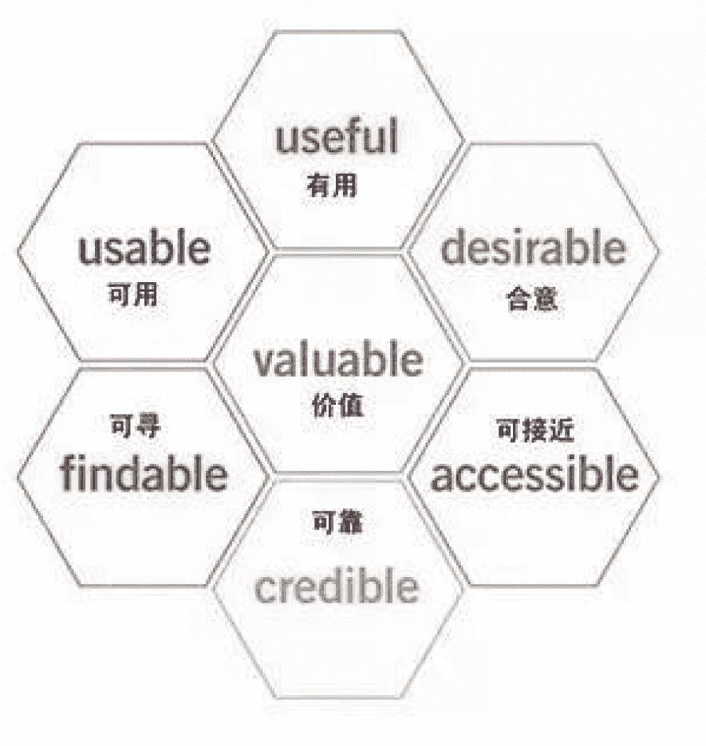

# 用户体验蜂巢模型

> 来源：[https://my.feishu.cn/docx/AWl5dWRGSoJfPhxc0IAc3ysJntg](https://my.feishu.cn/docx/AWl5dWRGSoJfPhxc0IAc3ysJntg)

用户体验包含7个模块，可以用蜂巢模型来体现。

## **详细说明**

用户体验的蜂巢模型，也叫Peter Morville的蜂窝模型，用户体验的蜂巢模型由Peter Morville在《The User Experience Honeycomb 》里提到，他认为用户体验包含7个模块，可以用蜂巢模型来体现。

用户体验蜂巢模型

### **I.Useful（有用）：**

面对的用户需求是真实的。作为实践者，不能满足于按照管理者的旨意行事。我们必须有勇气和创新能力去查看产品和系统是否有用，有没有更有创造性的想法使方案更加有用。

### **Ⅱ.Usable（可用）：**

功能可以很好地满足用户需求。容易使用当然意义重大，但面向界面的方法和人机交互的观点并不能解决网站设计的所有问题。总之，网站的可用性是必要的，但还不足够。

### Ⅲ.Desirable（合意/满意）：

情感设计的各个方面，图形、品牌和形象等都是有独特价值的。

### **Ⅳ.Findable（可寻）：**

我们必须努力设计可以方便导航的网站，用户可以找到他们需要的东西。

### Ⅴ.Accessible（可及）：

用户能够方便地完成操作。即使网站是高效的，我们也要适合障碍人士使用。

### **Ⅵ.Credible（信任）：**

让用户产生信任。影响用户相信和信赖网站的因素。

### **Ⅶ.Valuable（价值）：**

我们的网站必须能够带来价值。对非盈利性网站来说，用户体验必须促进完成目标。对于盈利性网站来说，网站要为投资人贡献价值并提升客户的满意度。