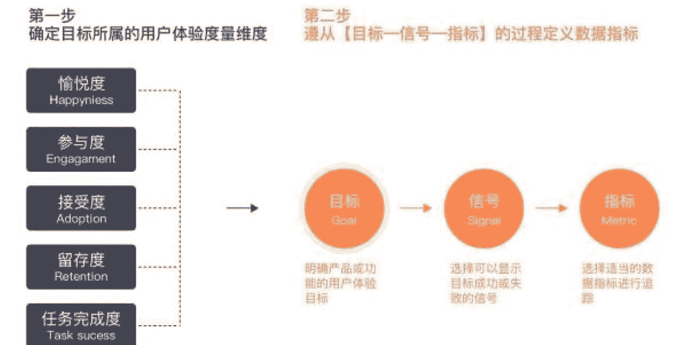
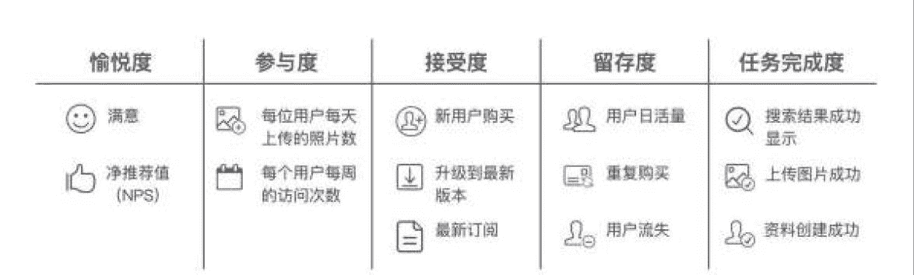
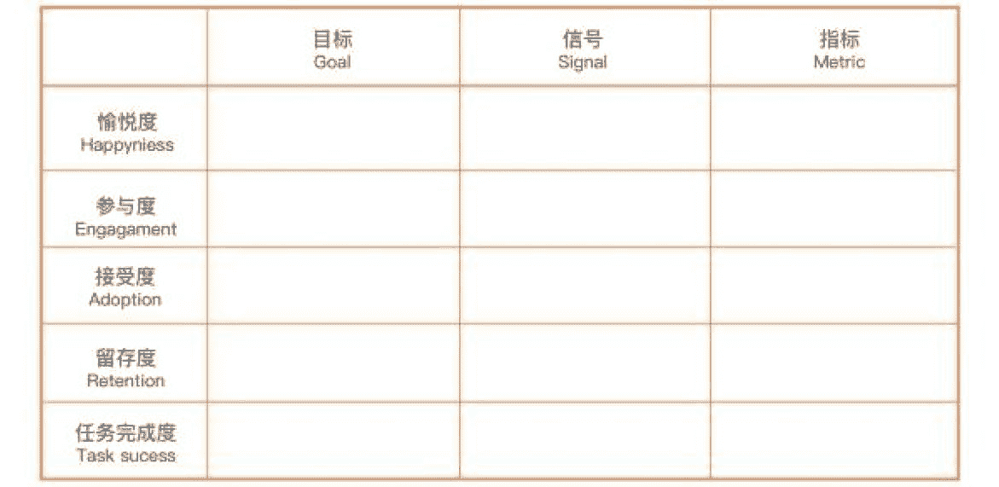

# Google HEART 模型

> 来源：[https://my.feishu.cn/docx/FE5rduqFDod5YJxzjtfcqWMRnXb](https://my.feishu.cn/docx/FE5rduqFDod5YJxzjtfcqWMRnXb)

HEART 是一个用来评估以及提升用户体验的模型，由五维度组成：Happiness（愉悦感）、Engagement （参与度）、Adoption（接受度）、Retention（留存率）、Task Success （任务完成率）。

## **详细说明**

HEART用户体验度量模型是谷歌资深用户体验研究员和数据分析师 Kerry Rodden ，通过大量度量用户体验的探索与实践中所总结出来。

### I.HEART模型包括两个模块：

HEART模型包括【5】+【3】两个部分：5个用户体验度量维度和3个确定数据指标的步骤。

HEART用户体验度量模型简介

### **Ⅱ.用户体验度量的5个维度：**

在大量实践中，谷歌团队发现他们所监控的用户体验数据指标可以聚类归为5个类别，即度量用户体验的5个维度。

明确这5个维度可以系统地从各维度入手，思考产品的用户体验目标在各维度下具体意味着什么，同时通过几个维度横向比较明确某产品用户体验的核心维度和核心目标：

•

Happiness 愉悦度：用户在使用产品过程中的主观感受，包括满意度、推荐指数(NPS)、视觉感受、易用性感知等。主要通过问卷调查获取数据。

•

Engagement 参与度：在一个新功能 / 新模块推出时，用户的参与深度。具体来说，即一段时间内的访问频次、访问时长等相关指标。

•

Adoption 接受度：通过特定时期内大量的用户统计来反应新用户对产品或功能的使用情况。

•

Retention 留存度：衡量现有用户的重复使用情况，比如有多少活跃用户在指定时间内仍在使用应用或某功能。

•

Task success 任务完成度：包括一些传统的用户体验行为指标，比如效率（如完成任务的时间），效果（比如任务完成的百分比）以及错误率。

五个用户体验度量维度

### Ⅲ.遵从“目标”、“信号”、“指标”步骤来选择数据指标：

“目标”、“信号”、“指标”是个自上而下的过程，首先阐明产品或者功能的用户体验目标，然后定义达成的信号，最终建立特定指标进行监控。

上一步介绍的五个维度，在第二步确定数据指标过程中起到了规范和引导的作用，从几个用户体验维度着手去选择适合当前产品阶段的用户体验维度和该维度下的核心用户体验目标，再去为体验目标选择数据度量指标。

HEART模型工具化表格