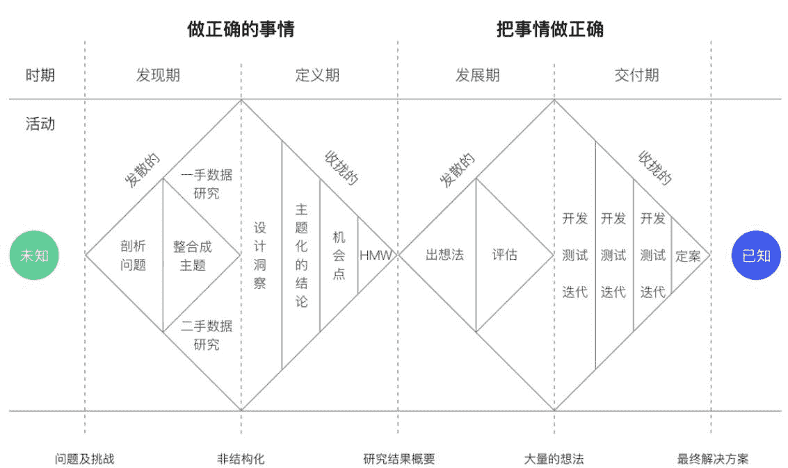

# 双钻模型

> 来源：[https://my.feishu.cn/docx/RS9WdisttofY7Wx9RtWc1d8MnHc](https://my.feishu.cn/docx/RS9WdisttofY7Wx9RtWc1d8MnHc)

双钻模型描绘了在设计流程中发散和收缩的过程，其核心是发现正确的问题和发现正确的解决方案。

## **详细说明**

双钻模型主要分为4步，主要是发现期、定义期、发展期及交付期。前两步可以定义为第一个阶段：做正确的事情，找准做设计的方向，后两步为第二个阶段：把事情做正确，把设计落实到点子上，避免偏差。

双钻模型图

### **I.发现期：**

发现问题——对现状进行深入研究。包括了解用户特征、产品当前状况、用户如何使用产品以及用户对产品的态度等等。

### **Ⅱ.定义期：**

定义问题——确定关键问题。此步是将第1步发散的问题进行思考和总结，把问题集中起来解决。

### **Ⅲ.发展期：**

构思方案——寻找潜在的解决方案，此步是真正开展设计创意了，在我们日常的设计过程中也称之为设计预研。

### **Ⅳ.交付期：**

交付方案——把上阶段所有潜在的解决方案，逐个进行分析验证，选择出最适合的一个或多个。