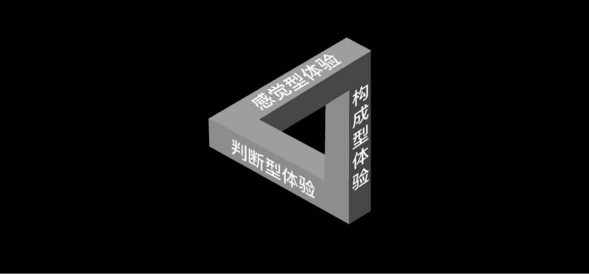
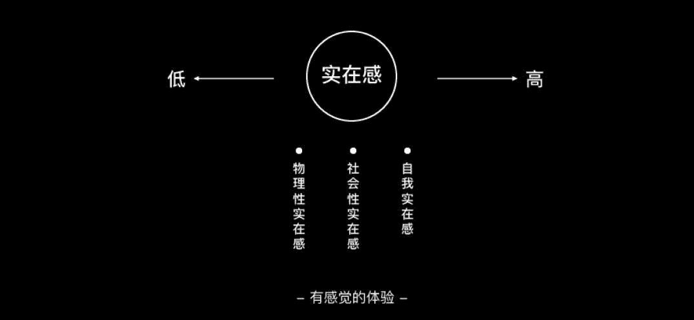
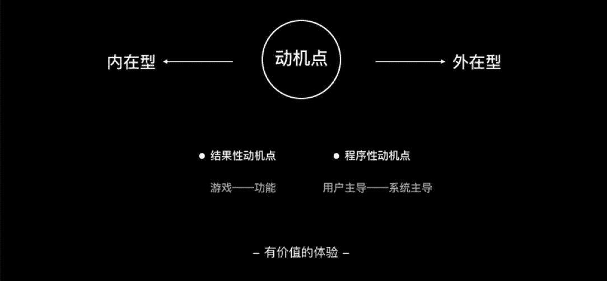
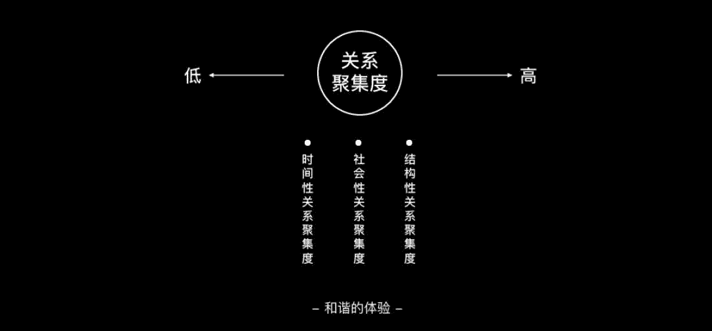
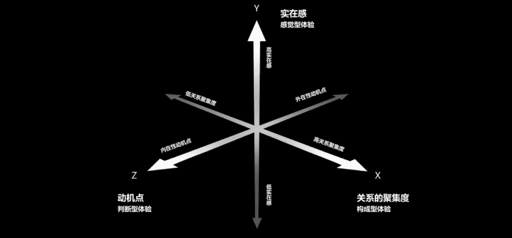

# 三维体验模型

> 来源：[https://my.feishu.cn/docx/ECJYdIFVkoBFMrxYysycMO5bn9e](https://my.feishu.cn/docx/ECJYdIFVkoBFMrxYysycMO5bn9e)

该模型描绘了在三种不同的用户体验维度下，产品的定位，以及在社会文化环境中会受到的影响。

## **详细说明**

三维体验模型由韩国延世大学教授金振宇 Jinwoo Kim提出，该理论主要是在他的《경험 디자인 》中体现，在金振宇看来，体验是一个被揉在一起的线团，复杂纷乱，难以解开；因此他首先对体验进行了分类；有以下三种：感觉型体验、判断型体验、和构成型体验。

感觉型体验、判断型体验、和构成型体验模型

感觉型体验——即感官上最直观的体验；比如某个学生在即将期末考试之际去看了演唱会，沉浸其中，这时候并不会去考虑当下的放飞会不会影响考试，而是陶醉于耳边的音乐和眼前的看点。

判断型体验——人类根据自己的想法解释并重新组合外界刺激，去进行判断的体验；判断是为了获取更高的价值，比如为了便利，购买全自动的扫地机器人，或者通过改装模型玩具获得内心的愉悦。

构成型体验——构成型体验重点在于不同体验要素间的关系；这个关系可以是人和人之间的关系，比如你在朋友圈上po了张风景照片，有老朋友看到后留言自己去过同个地方，然后你想起一起度过的时光。

## **Ⅰ.感觉型体验:**

感觉型体验是不假思索的，给到用户的一个最直接的感受；感觉型体验最重要的要因是实在感，或者说真实感；实在感的高低表示感受的强烈和真实与否，实在感具有更细分的类型：物理实在感、社会实在感、自我实在感。

有感觉的体验

•

物理实在感是感官上的真实感，比如在吃鸡等FPS游戏中，对于枪械真实操作的模拟，包含了视觉上的细节度、子弹上膛的声音等等。

•

社会实在感代表是否能感受到足够真实的社会关系，比如在诸多的社交应用中，平台会通过很多处理让你深信这些卡片中的帅哥靓妹都是真实存在的人。

•

自我实在感则更多得代表了在游戏、社交等产品使用过程中，你是否足够相信这个世界并沉浸其中；

## **Ⅱ.判断型体验：**

判断型体验是用户思考利弊后去进行判断的体验，因此对于判断型体验的评价中，用户的动机点很重要；而动机点主要可以分为内在型和外在型两类。

有价值的体验

•

内在的动机代表用户在判断中占据主导地位，比如在我收藏的歌曲list中挑选一首欢快的歌曲，这整个过程都是由用户主导的；

•

外在的动机代表系统在判断中占据主导地位，比如打开私人FM，系统根据我的听歌习惯，自行播放歌曲，且这个功能是没有上一首功能的；在这个状态下，整个听歌过程更像是完全托管给了推荐系统，这个就代表着比较高的外在型动机点。

## **Ⅲ.构成型体验：**

构成型体验代表了不同要素间的关系，评价构成型体验的要因是关系的聚集度——关系聚集度高，则要素关联紧密；关系聚集度低，则要素关联稀疏。

同样，关系的聚集度也包含不同的类型，分别是时间性关系聚集度、社会性关系聚集度、结构性关系聚集度。

和谐的体验

•

时间性关系聚集度代表着由于时间前后带来的因果关系，比如你的水快烧开了，过会厨房又传来了孩子的尖叫声，你会本能得把这两个事件联系到一起。

•

社会性关系聚集度就是我们生活的社会中人与人的关系密度；比如前段时间的疫情最严重的时期，大家在空间和心里都会保持一定的距离；相对于往前的春节，社会性聚集度大大降低。

•

结构性关系聚集度是指系统中元素逻辑间的关系，比如我们熟悉的交互设计，其实就是在处理链接不同的信息；比如在信息功能中可以跳转到联系人，你也可以给列表中联系人发送信息，这就是一个相对高的结构性关系聚集度。

## **Ⅳ.三维体验模型：**

了解了三种体验类型和各自的评价要因后，接下来我们就来介绍一下将复杂体验结构化的三维体验模型，见下图。

三维体验模型

这个模型其实不复杂，就是我们把感觉、判断、构成这三类体验对应到空间中的XYZ轴，轴上的单位即三类体验各自的判断要因；即：x轴外侧——关系聚集度越高，Y轴上测——实在感越高，Z轴外侧——偏向内在型动机点；明确了规则后，我们就可以在这个模型上对目标产品进行坐标定位。