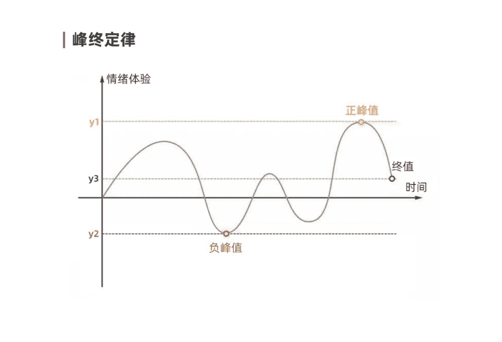
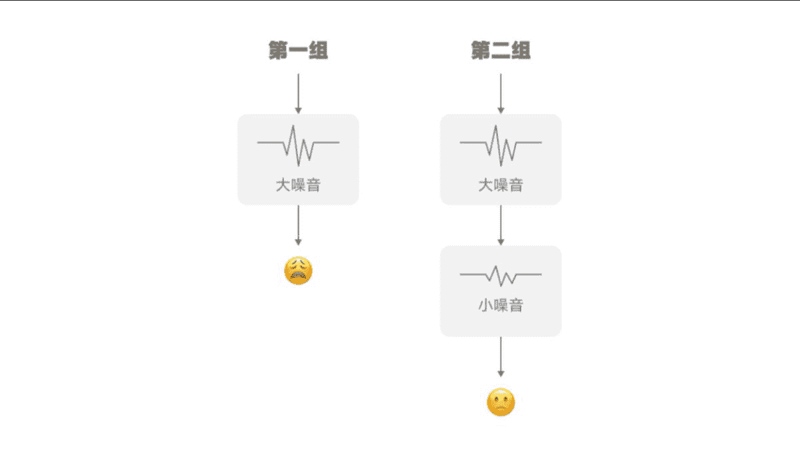

# 峰终法则

> 来源：[https://my.feishu.cn/docx/EETcdeTSNoBdNYxsdoAcaWCen2X](https://my.feishu.cn/docx/EETcdeTSNoBdNYxsdoAcaWCen2X)

> 人们对一件事的体验通常是由最高峰的感觉与结尾的感觉决定，而不是由总体决定

## **详细说明**

峰终法则的意思是，人们对于一件事物的记忆好坏，取决于高峰和结尾的感觉。注意，这个高峰并不一定是正向高峰，也有可能是负向高峰。

峰终法则

诺贝尔经济学得主丹尼尔•康纳曼（Daniel Kahneman）曾经做过一次实验，让两组人带上耳机听噪音。两组人听的时长和音量都是一样的，唯一不同的是，第一组听完这段就结束了，而第二组听完这段后，还会再听一段音量小一些的。

从测试设计者的角度看，第一组的忍受噪音的时间更短，总量也更少，理论上应该比第二组体验好一点。

按常理推断，第二组的人听了更久的噪音，应该比第一组感觉更痛苦，但事后调查，愿意继续参加实验的人，居然是第二组较多！

噪音实验

### **I. 宁愿长痛不愿短痛**

我们都说长痛不如短痛，但为什么实验中，而且哪怕长痛的总量比短痛的总量更大，大多人都宁愿长痛不愿短痛？

明知道高考的时候再努力一把，毕业后就能找到好工作了，可偏偏忍受不了。

明知道晚上少熬点夜，第二天神清气爽工作效率高，可就是做不到。

明知道每天只要花半个小时锻炼一下，不但体型能改善而且精气神也能上去，可就是坚持不了。

看来，短痛什么的都只能是对自己的要求，对大多数人来说，还是长痛更加符合人性。

运用到产品体验上，那就是：便捷性比不过易学性，与其与让用户短时间内完成一个高难度的操作，还不如花更长时间完成一个低难度操作。