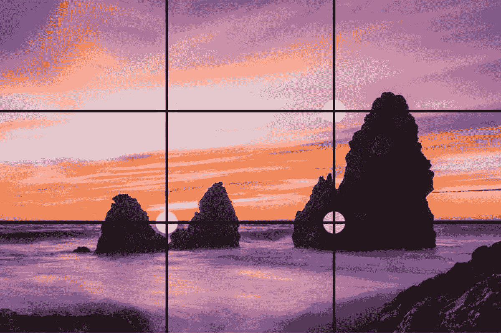
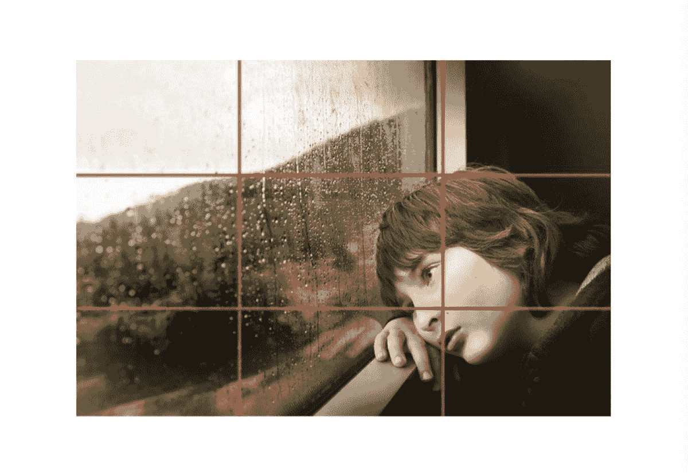

# 三分定律

> 来源：[https://my.feishu.cn/docx/Bt3BdSBlNoXpcQxbwCrcscbkndb](https://my.feishu.cn/docx/Bt3BdSBlNoXpcQxbwCrcscbkndb)

> 词条简介：

> 一种三等分构图技巧，需要把产品最主要元素放在最吸引人的位置

## **详细说明**

三分定律是一种构图技巧，把媒介的横向和竖向各分成三格，再把设计中的主要元素放在网格中的一个交叉点上。这种不对称结构图，有趣且具有美感。

三分定律很有用且很简单。在创作时，如果主要元素的强度不会被周围元素或空间强化，则可以用三分定律。反之,可以考虑居中构图。如果设计中有强烈的横向或竖向元素,常见的做法是把元素排放在同一方向的网格线上。

把画面的主要元素放在最吸引人的位置

三分定律源自于早期构图使用的网格系统，即把画面的橫向与纵向划分为三格，形成九个方格的网格以及四个交叉点。构图时把画面的主要元素放在网格中的一个交叉点上，最后呈现出非对称的构图形式，这种形式通常被认为具有一定的美感。

使用三分法则进行构图的摄影作品

三分法则的构图形式在设计中被广泛使用，因为文艺复兴时期的大师都普遍使用这个法则，而且它大致与黄金比有关。

虽然跟黄金比例稍有不同（例如2/3=0.666，黄金比例=0.618），但这项技巧的简单好用足以弥补它与黄金比例相差不多的近似比例值。