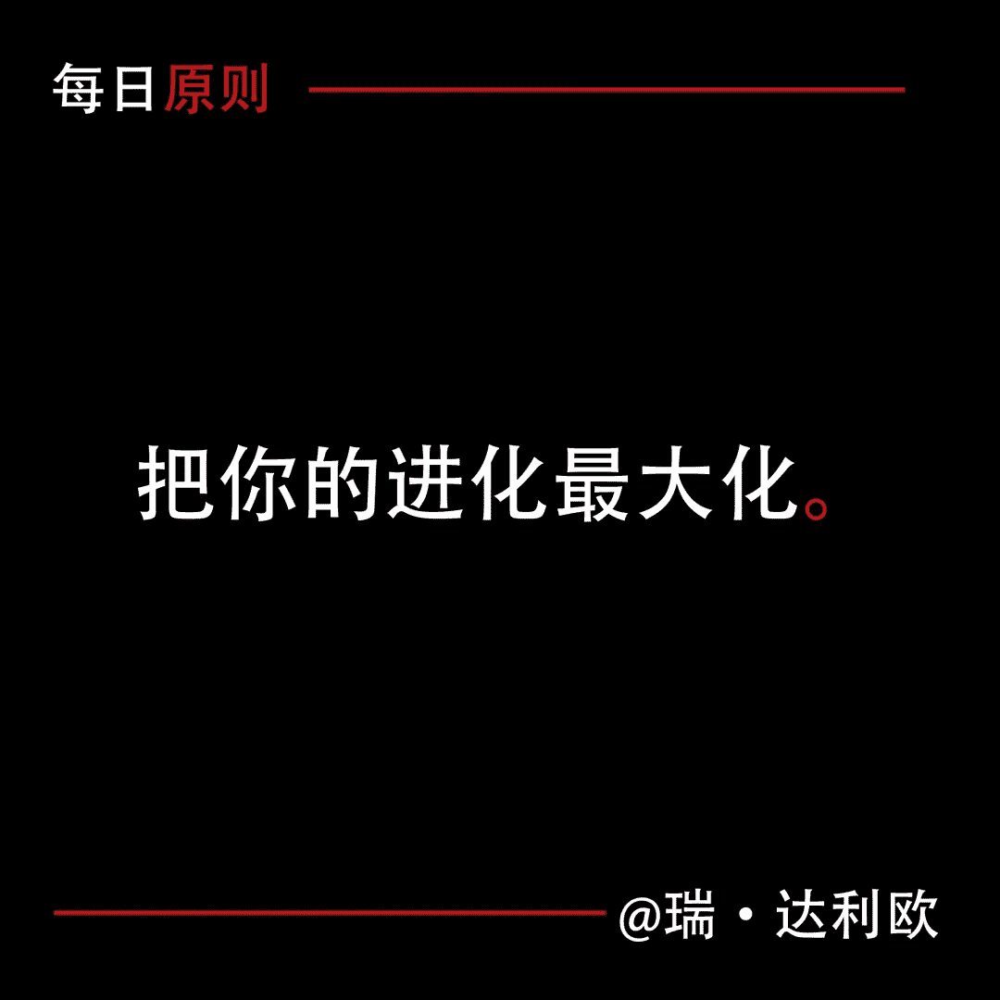

# 每日原则：把你的进化最大化

> 来源：[https://my.feishu.cn/docx/Ye0xdu0tUog7E2xl0m4cepNwnhc](https://my.feishu.cn/docx/Ye0xdu0tUog7E2xl0m4cepNwnhc)

因为人类能进行有意识的、以记忆为基础的学习，所以比任何物种都更快、更深入地进化，不仅一代代地进化，而且在自己的一生中进化。

这种持续追求学习和改进的动力，让人类天生地对进步感到快乐，对快速进步感到兴奋。尽管大多数人觉得他们是在追求能让自己快乐的东西（玩具、大房子、金钱、地位等），但这些只能带来小的满足，远远比不上进步能给大多数人带來的长期满足感。得到了追求的东西后，我们的满足感通常不会持久。这些东西只是诱饵。追逐诱饵，就必须进化，而且对所有人来说重要的是进化，而不是回报本身。这意味着对大多数人而言，成功就是以尽可能高效的方式去拼搏和进化，即迅速认识自身和所处环境，然后通过改变实现进步。

这是收益递减规律的自然结果。想想赚钱这件事。一旦钱赚得太多，人从赚钱中得到的边际收益就会很小或者没有，这会对人产生负面影响，这和任何形式的过量是一个道理，如暴饮暴食。如果拥有健康的心智，人们就会开始探索新东西，或者更深入地探索旧东西，并在这个过程中变得更强大。如弗洛伊德所说，“爱与工作是人性的基石”。

工作不一定是一份职业，不过我认为如果是职业的话，通常要好一些。而工作可以是任何使人进步的长期挑战。你也许已经猜到了，我相信，人们对有意义的工作的需求，与人天生对进步的渴望相关。而人际关系就是人与他人的自然联系，它会使人对他人和整个社会有意义。

Because humans are capable of conscious, memory-based learning, we can evolve further and faster than any other species, changing not just across generations but within our own lifetimes.

This constant drive toward learning and improvement makes getting better innately enjoyable and getting better fast exhilarating. Though most people think that they are striving to get the things (toys, bigger houses, money, status, etc.) that will make them happy, for most people those things don’t supply anywhere near the long-term satisfaction that getting better at something does. Once we get the things we are striving for, we rarely remain satisfied with them. The things are just the bait. Chasing after them forces us to evolve, and it is the evolution and not the rewards themselves that matters to us and to those around us. This means that for most people success is struggling and evolving as effectively as possible, i.e., learning rapidly about oneself and one’s environment, and then changing to improve.

It is natural that it should be this way because of the law of diminishing returns. Consider what acquiring money is like. People who earn so much that they derive little or no marginal gains from it will experience negative consequences, as with any other form of excess, like gluttony. If they are intellectually healthy, they will begin seeking something new or seeking new depths in something old—and they will get stronger in the process. As Freud put it, “Love and work are the cornerstones of our humanness.”

The work doesn’t necessarily have to be a job, though I believe it’s generally better if it is a job. It can be any kind of long-term challenge that leads to personal improvement. As you might have guessed, I believe that the need to have meaningful work is connected to man’s innate desire to improve. And relationships are the natural connections to others that make us relevant to each other and to society more broadly.

+   内容来源：https://mp.weixin.qq.com/s/ptXKlNrebUk_jj91XOBToQ