# TikTok 信息源知识库

> 来源：[https://my.feishu.cn/docx/SNaWdAYz1ooi0exkNVOc0XAznuf](https://my.feishu.cn/docx/SNaWdAYz1ooi0exkNVOc0XAznuf)

### **👉点击 T**[**ikTok AI问答知识库**](https://ask.feishu.cn/shared-space/7605852867051654091)

> **适用人群：**TikTok 电商所有从业者

> **首发时间：**2023 年 8 月 17 日

> **更新时间：**2025 年 10 月 16 日

> **文档作者：**** **

> **使用建议：**如需快速定位到准确内容，可以在电脑端使用 Ctrl+F/command+F 的形式，搜索关键词，查找你想要的内容。

> **文档说明：**

1.  本知识库几乎涵盖所有 TikTok 运营知识内容，总计约 500+文档（含子文档），并且在不断更新中，永久免费开放学习；

1.  内容来源于各个公开渠道整理汇总，仅供大家学习参考交流，部分属于原创，其余版权属于原作者；

1.  内容形式包括文章、图片、操作文档、直接上手的运营表格 SOP 等等，后期还会更新视频等形式，欢迎大家收藏链接和分享给身边的朋友，防止丢失；

1.  [关于 TikTok 的信息源](https://ghlf0s3q3l.feishu.cn/wiki/VyR9wEW9nixSOQkeudacqEMence)

>

> TikTok 电商正当红，一起为中国品牌出海加油！

> **💪vx: why0721-**

# 一、🌍TikTok 全球各站点官方规则

## 全球开店规则汇总 Set Up Shop

> [全球开店链接直达](https://ghlf0s3q3l.feishu.cn/wiki/WavEwHMN7iRIrYkh2lvcJqZPnBe)

| **全球市场** | **针对地区** | **具体规则** |
| --- | --- | --- |
| **日本** | **日本本土** | **企业店：****  日本本**土公司（代表国籍不限）  需要提供在日的主要联系人  主要联系人需要提供 KYC（人脸识别）+近三个月住址证明（电话单，住民票等）  个人店：  日本护照、驾照、有在劳许可的在留卡（三选一）  日本合法住址+近三个月住址证明（电话单，住民票等）  经验：非必需，但有日本市场电商运营经验/其他国家 TTS 运营经验优先  物流：3PL，商家自行安排物流  退货政策：自行安排退货地点仅限于日本本土 |
|  | **日本跨境** | **入驻门槛：** |
| **拉美** | **墨西哥本土** | **企业：****  （目前仅**支持企业入驻）  1、墨西哥本土注册的企业，需要提供营业执照；  2、墨西哥 RFC 税号信息；  3、法人身份信息（RFC 上法人的墨西哥护照、墨西哥 INE 卡、墨西哥居留卡/绿卡）  定邀类型：  TikTok 美国小店月销售 30 万美金卖家  TikTok 东南亚月销售 30 万美金卖家  墨西哥亚马逊和美客多类目头部卖家等 |
| **欧美** | **美国跨境** | 最新保证金政策：500 美金/站点 |
|  | **美国本土** | **个人：** |
|  | **英国本土** | **A：如何注册/成为 TikTok** 商店卖家/注册流程/注册需要准备什么？ |
|  | **英国跨境** | **保证金：**每个店铺需缴纳** 400 英镑**保证金 |
|  | **西班牙本土** | **个人卖家：** |
|  | **欧盟** | **入驻主体：** |
| **东南亚** | 东南亚跨境（越南、菲律宾、马来西亚、新加坡、泰国） | 入驻标准： |
|  | **印尼本土** | 如果您已经拥有[印尼本土营业执照]或[印尼人个人身份证]、[印尼本地仓库地址][印尼本 |
|  | **越南本土** | 本对本商家入驻要求 |
|  | **泰国本土** | #### 一、平台通用政策（面向所有商家） |
|  | **马来本土** | #### 一、马来西亚平台通用政策（面向所有商家） |
|  | **菲律宾本土** | #### 一、平台通用政策（面向所有商家） |
|  | **新加坡本土** | #### 一、新加坡平台通用政策（面向所有商家） |
| **中东** | 沙特全托管（除了沙特、美国和英国也有全托管，入驻条件一样） | **条件：** |
| **全球（半闭环）** | 日本、韩国、澳大利亚、加拿大、德国、法国、西班牙、意大利等 | **方式：** |

1.  eBay 店铺好评率≥90%

1.  Walmart 店铺评分≥4

1.  西马用户，运费补贴上限为 RM6/单

1.  东马用户，运费补贴上限为 RM10/单

1.  老用户每月 6 张，新用户多 1 张

## TikTok shop 官方全托管

| 全托管认知 | [TikTok Shop全托管模式-商家入驻操作流程](https://bytedance.sg.larkoffice.com/docx/QCI4d6QOqoGuBJxOIsWcTAu3noc?from=from_copylink) |
| --- | --- |
| 入驻规则 | [沙特市场禁售、暂不支持及禁止运输/进出口商品政策](https://bytedance.larkoffice.com/docx/Alvzdkl73oWX9fxYiwicsRsLnPc?from=from_copylink) |
| 供款规则 | [时效及订单货期相关要求](https://bytedance.sg.larkoffice.com/docx/LHBzdfvaaocUYWxOhUbcHNcBnSg) |
| 全托管选品 | [2024 Q4 tiktok全托管影音引品参考](https://bytedance.sg.larkoffice.com/sheets/UscTsYtuWhhGD6tb1UVltKvMgkc?from=from_copylink) |
| JIT 模式 | [【TikTok Shop全托管】JIT模式 商家操作手册](https://bytedance.sg.larkoffice.com/docx/IgazdLSCloyJ4tx3j7Jc1PH1nCh?from=from_copylink) |
| 发货备货 | [2024年春节假期全托管商家备货须知](https://bytedance.sg.larkoffice.com/docx/VLdddBFs2opA5px4qI5l2h2UgJd) |
| 平台结算 | [TikTok Shop全托管卖家中心-结算管理](https://bytedance.sg.larkoffice.com/docx/Etu0d7PbmoU4gexLpXxcSrjUnwc) |
| 建联达人 | [🌟全托管卖家运营实操分享——建联达人](https://vn6otwl5je.feishu.cn/docx/F5DpdY9GDo3b5yxVmL2cQoGhn2b?from=from_copylink) |
|  | [TikTok Shop全托管服饰商家运营手册](https://bytedance.sg.larkoffice.com/docx/I8kTdhGERorEvUxszxql3znUg4e) |

## 美国市场 US Market

| 店铺注册与入驻 | [美区跨境卖家自运营自助使用指南External（汇总版）](https://bytedance.larkoffice.com/docx/LpUHd5OJFoovNFxUIEbcb5Mmndc) |
| --- | --- |
|  | [TikTok Shop美国商家入驻与运营Q&amp;A（基础版）](https://bytedance.larkoffice.com/docx/G7Azd4cgQoIgx0xk82dcKLRanBh) |
|  | [ACCU/CCCU 入驻流程指南（对外）](https://bytedance.sg.larkoffice.com/docx/G2uZdovqPoGaxUxNyEslhNOwguh) |
|  | [GS商家企业信息认证操作指引（补充支付信息审核）—商家版](https://bytedance.sg.larkoffice.com/docx/Fvfqdj5YYoE0BExuiYKlME9GgDe) |
|  | [[官方社群]TikTok Shop美国跨境店ACCU手把手入驻攻略（转发、收藏）](https://bytedance.sg.larkoffice.com/docx/Z48qddRTBomoOgxkFo9lvgrvgDh) |
|  | [美区POP店定邀类目资质申请大全](https://bytedance.sg.larkoffice.com/docx/IS2XdLbBroscSSxX2pLcN7benyh) |
|  | [跨境US POP定邀类目清单-2024/05/08更新（External）](https://bytedance.sg.larkoffice.com/sheets/OfChs0KxDhK42vteeMScISYznac) |
|  | [「官方通道」TikTok Shop_美区跨境自营入驻指南](https://bytedance.sg.larkoffice.com/docx/RTN8dij7woLDtHxadoal25S3gyg) |
|  | [［官方社群］TikTok Shop美国跨境POP官方保姆级入驻攻略(转发、收藏)](https://bytedance.sg.larkoffice.com/docx/Zx1id04rvodukixhglPlHGl1gqh) |
|  | [「官方通道」TikTok Shop美区自运营入驻及运营指南](https://bytedance.sg.larkoffice.com/docx/LwdtdfYsUoJ9UsxgL4ml7HUSg4g) |
|  | [TikTok Shop 跨境 POP - 美国英国欧盟日本商家入驻 ALL-IN-ONE](https://bytedance.sg.larkoffice.com/docx/RVgudLcaAobdAWxbIDClplDpgkg) |
| 政策与激励 | [【美国】2024年7月TikTok Shop跨境自运营“新商启航”激励政策-External](https://bytedance.sg.larkoffice.com/docx/XxzBdhFfDoyoN2x0ILklGdX3gTc) |
|  | [【对外版】美国TikTok Shop跨境电商2025 Spring Glow-Up促销活动方案](https://bytedance.sg.larkoffice.com/docx/GRVqdzLYfoRnYyxT3bgl5nlxg9b) |
|  | [TikTok美区商家重要权益&amp;信息查询手册](https://bytedance.sg.larkoffice.com/docx/Q23KdacbRomDISxhqpllIlOvgbb?from=from_copylink) |
|  | [TikTok Shop US平台运费补贴](https://bytedance.sg.larkoffice.com/docx/JLIEdLdy2oWjG2xSTlVcHKeanie?from=from_copylink) |
|  | [9月US POP爆品孵化项目商家宣讲](https://bytedance.sg.larkoffice.com/docx/J5tadhFKioNmX3xXD4al1YL0gV4) |
|  | [【对外】US POP新品激励赛介绍_更新至Y25M10](https://bytedance.sg.larkoffice.com/docx/VJZ8dM4oooLPnFxKGEOls6CsgEb) |
|  | [【外部】TikTok Shop美区跨境商家激励政策_25年Q2](https://bytedance.sg.larkoffice.com/docx/VTLjdlqsEorWfYxwhoFlglIFgBd) |
|  | [【对外】2025年2月TikTok Shop美国跨境自运营HIPO高潜商家激励政策](https://bytedance.sg.larkoffice.com/docx/ZVBXdqI8moQtWJxcBD6lvoz7g2M) |
|  | [[GS POP] US商家自制内容Q2激励活动_25.Q2[对外]【已结束】](https://bytedance.sg.larkoffice.com/docx/N0tid665roR3XkxdpKGlhThlgFg) |
|  | [【UK&amp;EU&amp;JP POP】商家权益包Onepager_9月更新！](https://bytedance.sg.larkoffice.com/docx/TG69dXtNBo9HyvxrBfclS6uugqb) |
|  | [【对外版】2025年5月 TikTok Shop 美国市场爆品孵化激励政策](https://bytedance.sg.larkoffice.com/docx/NjU9d8iBooAK2BxzSj4lQg6igZg) |
|  | [【外部】TikTok Shop美区跨境商家激励政策_25年Q3](https://bytedance.sg.larkoffice.com/docx/IuWHdRe7kojM3dxlmjklCbWlgMb) |
|  | [【2025美区POP】PEAKS品牌新增长计划-对外](https://bytedance.sg.larkoffice.com/docx/Cy2Jddaseo9qCTxCuCElYP2pgMS) |
|  | [[GS POP] US商家自制内容Q3激励活动_25.9月【已结束】](https://bytedance.sg.larkoffice.com/docx/LAdldpd34oEYVTxB8oVlxPLug3b) |
| 物流与履约 | [TikTok Shop 美区跨境 POP 非珠宝 多履约模式规则（海外仓+跨境直邮自发货）- 对外版](https://bytedance.sg.larkoffice.com/docx/H5uFdabDKoHyBdxa5NOlgQefgBf) |
|  | TikTok Shop 美区跨境 POP - 珠宝配饰商家入驻 ALL-IN-ONE |
|  | [【可对外】TikTok Shop对接海外仓指引](https://bytedance.sg.larkoffice.com/docx/Bm49dovB9oOxZWxMQx8l88GEg7f?from=from_copylink) |
|  | [[2025年1月起生效]美国FBT新价卡介绍说明](https://bytedance.sg.larkoffice.com/docx/Dto4d3fbSo5tRrxHc3Fl9NJsguf) |
|  | [品牌CN主体海外仓发货定邀入驻指南【External】](https://bytedance.larkoffice.com/docx/KQ62dpd2So8w6bxOyakc4Jh7nbb) |
|  | [美国FBT中文介绍_GS PoP_Merchant Facing_v5.3](https://bytedance.larkoffice.com/docx/C06JdwQrsoAnWwxbwOdccQ3PnMh) |
|  | [FBT政策及资费标准解读_面向GS POP商家【更新黑五政策与福利】_v2.1](https://bytedance.sg.larkoffice.com/docx/Vf78dPyHXoGmy7xCXsMlTOm0g4f) |
|  | [【可对外】TikTok Shop跨境买家订单发货规则（针对卖家）（美国 - 跨境）20250219培训版](https://bytedance.sg.larkoffice.com/slides/NMWYsBqFUlHNcbdEqXkl4SGIgFg) |
|  | [【面向商家】FBT跨链接共享库存功能操作手册](https://bytedance.sg.larkoffice.com/docx/Js75dqPOnoGuRwx5R1nlh8zWgLf) |
|  | [【Logistics training】美国跨境4PL商家发货指南](https://bytedance.larkoffice.com/docx/FnGUdMzBvowG55xSIztcjf8bnCc) |
| 运营指南与教程 | [【对外】PEAKS美区新商启航百宝箱](https://bytedance.sg.larkoffice.com/docx/GjKXdwCs0o5ZdTxD6KYlcUO5gYf)⭐️⭐️⭐️⭐️⭐️ |
|  | [提升店铺体验分（SPS)_TikTok Shop Playbook.pdf](https://bytedance.sg.larkoffice.com/file/Iv7rbILbjou37UxaPUxlkiJVgRb?from=from_copylink) |
|  | [【商家自卖教程】Step 1.1 账号注册绑定和账号装修](https://bytedance.sg.larkoffice.com/docx/PmmFdbhwOog32nx07K5lqamaguc) |
|  | 商家自卖系列课程-店铺 TikTok 账号注册绑定【对外培训】 |
|  |  |
|  | [🔥TikTok Shop-美区跨境商家与平台运营经理联系指南](https://bytedance.sg.larkoffice.com/docx/SbN1d2alcoyjEMxB4ufltYJIgng) |
|  | [POP US 商家培训课程—店铺体验分SPS](https://bytedance.sg.larkoffice.com/docx/MeOXd5ugpoEoR2xUoTGlNzzNgph) |
|  | [TTS 美区珠宝商家培训【闭环规则，实时更新版】](https://bytedance.sg.larkoffice.com/docx/Pzmkd6nRloWB4Rx6ueGlzJbigrd) |
|  | [TK美区必学八段锦](https://bytedance.sg.larkoffice.com/docx/HOezdSJvGouDu0x0h5tlQPjlgT9) |
|  | [美区跨境卖家自运营自助使用指南External（汇总版）](https://bytedance.larkoffice.com/docx/LpUHd5OJFoovNFxUIEbcb5Mmndc) |
|  | [商家运营百宝箱](https://bytedance.sg.larkoffice.com/docx/RHRQdVxj5omE6OxspuvlVpl7gqf) |
|  | [【商家自卖内容】All in One运营指南（对外）](https://bytedance.sg.larkoffice.com/docx/SUgddd8oHob31GxhqExltMlVgtg) |
|  | [[US跨境商家]如何优化商品标题（CCCU）](https://bytedance.sg.larkoffice.com/docx/Sr48deSJeoqRU8xPDXClwV0ogie) |
|  | [美区跨境自运营店铺装修指南丨提升店铺UI☀️迎接订单爆发💎](https://bytedance.sg.larkoffice.com/docx/OWw7dzd5VoyooIxIcColxkbQgDh) |
|  | [TikTok Shop美区跨境POP经营方法论｜新商成长“三步走”V1.1](https://bytedance.sg.larkoffice.com/docx/UigRdhnYOoaTpcxr9wrlBRV4gff) |
|  | [TikTok Shop美区跨境POP经营方法论｜新商搜索运营4要素](https://bytedance.sg.larkoffice.com/docx/RLoOdtGqRom8MdxN8vdlPdPwgFb) |
|  | [【External】跨境商家部分退款功能使用手册](https://bytedance.sg.larkoffice.com/docx/JtTydbtIVoViIixeaBYlcJOAgbd) |
|  | [（对外）TikTok Shop 商城运营 7P 方法论 1.0](https://bytedance.sg.larkoffice.com/docx/RzmfdrnCKoOB9bx9YVTlTr8BgMg) |
|  | [POP商家多履约模式操作指南](https://bytedance.sg.larkoffice.com/docx/Kq2Edne9ToNlyLxb5vmlDoaZgEd) |
|  | [【对外版】GS POP_营销30天最低价口径说明//The calculation rules of &quot;the lowest price of the last 30/60/180/365 days&quot;_2025.9月](https://bytedance.sg.larkoffice.com/docx/HCuIdZAydonTfpxKCrwlp4T0goh) |
|  | [新版店铺体验分讲解外部版](https://bytedance.sg.larkoffice.com/docx/Lqv3dTR2fopCFfxNezAlS8OjgCc)SPS |
|  | [TikTok Shop美区跨境POP PEAKS出海经营方法论白皮书](https://bytedance.sg.larkoffice.com/docx/M7oudPQFyo3DTFxXIqllw9NugEh) |
|  | [[外部] TikTok Shop美区跨境商家自运营 经营方法论_ 2025/Q1](https://bytedance.sg.larkoffice.com/docx/VdGydligBohTUjxag8nlAPxDgcb) |
|  | [TikTok官方出海指南-刘汐玥](https://bytedance.sg.larkoffice.com/docx/Lp0ndJyTuogBx1xEkuZlC5pygCf) |
| 营销与工具 | [【GS-POP】商家自营销工具指南-商家优惠券 | Feature Guide : Seller Coupon](https://bytedance.sg.larkoffice.com/docx/GeMtdKI9Ro4fusxOsxPlcm6tgsf) |
| 合规与风控 | [US产品证书问题商家自查SOP- External](https://bytedance.sg.larkoffice.com/docx/XyZWdxn1Roy4yrxyOR6lBrzngIe) |
| 精选资源与案例 | [4月服饰珠宝品类促Toolkit](https://bytedance.sg.larkoffice.com/docx/PDXFd0R3zozczexzrxtlweTMgAh?from=from_copylink) |
|  | [卖方工具包🔥🔥（官](https://bytedance.ent.box.com/s/3s5qpq7aw1snib6vs67lipx7hnlg1yjk)方物料） |
|  | [TikTok Shop美区跨境POP PEAKS好案例100大全](https://bytedance.sg.larkoffice.com/docx/NqhjdsfR9oiZ2GxsRklls4iwgkf) |
|  | [美国TikTok水杯类目——线上分享会](https://bytedance.sg.larkoffice.com/docx/H6VbdqBpAokPgJxm5iOlS37wgne) |
|  | [家居日用选品分享-瑞真的小灶](https://bytedance.sg.larkoffice.com/docx/HODodZWEHo9O0qxC2celTkxGgTg) |
|  | [Beauty创意洞察  —【对外版】](https://bytedance.sg.larkoffice.com/docx/L15MdLzr3owx4DxASUClWsgxgGd) |

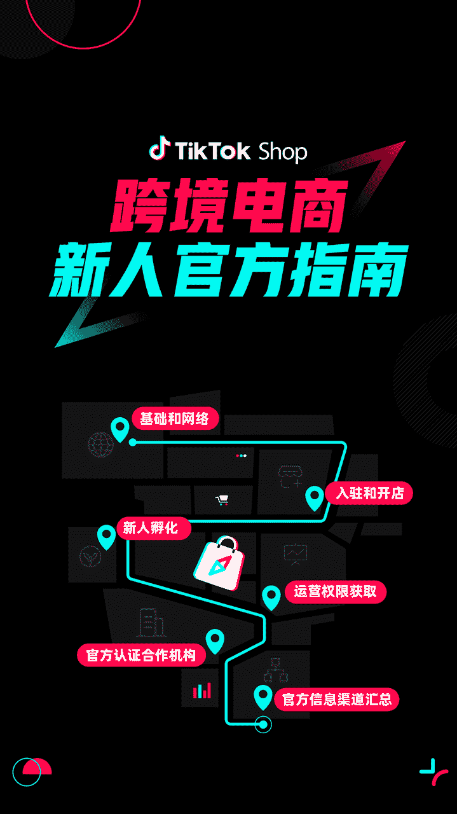

[TikTok Shop跨境电商新人官方指南(1).pdf](https://internal-api-drive-stream.feishu.cn/space/api/box/stream/download/all/CD24beuGEoyfkzx4yOOcgnojnjg)

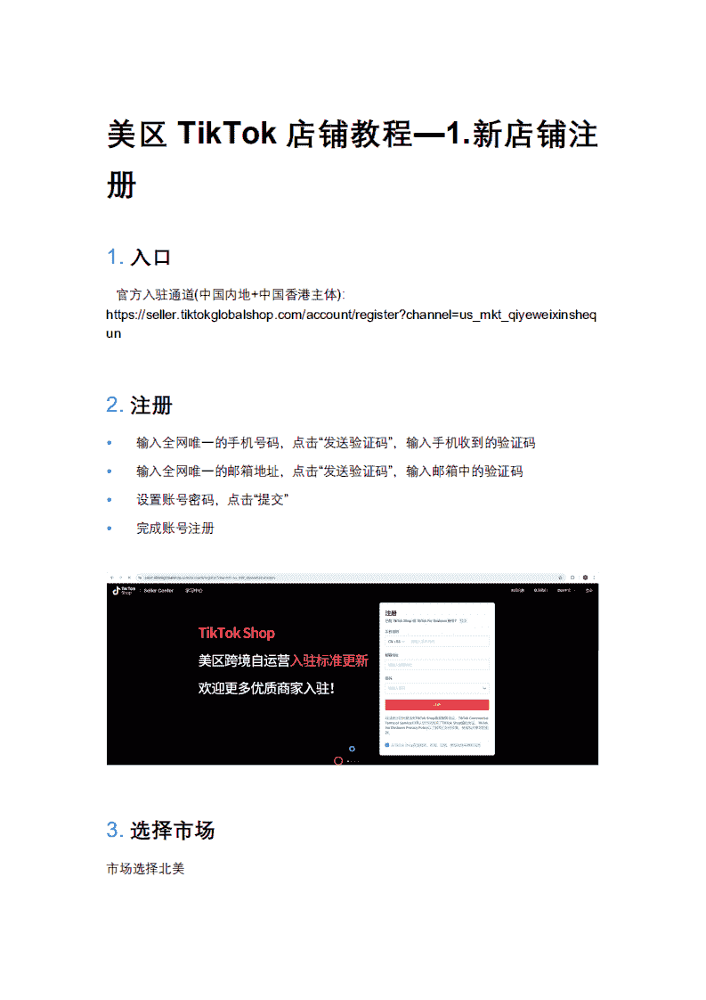

[美区TikTok Shop教程—1.新店铺注册(1).pdf](https://internal-api-drive-stream.feishu.cn/space/api/box/stream/download/all/GounbJFWnoH71SxpNm5cmOplnpb)

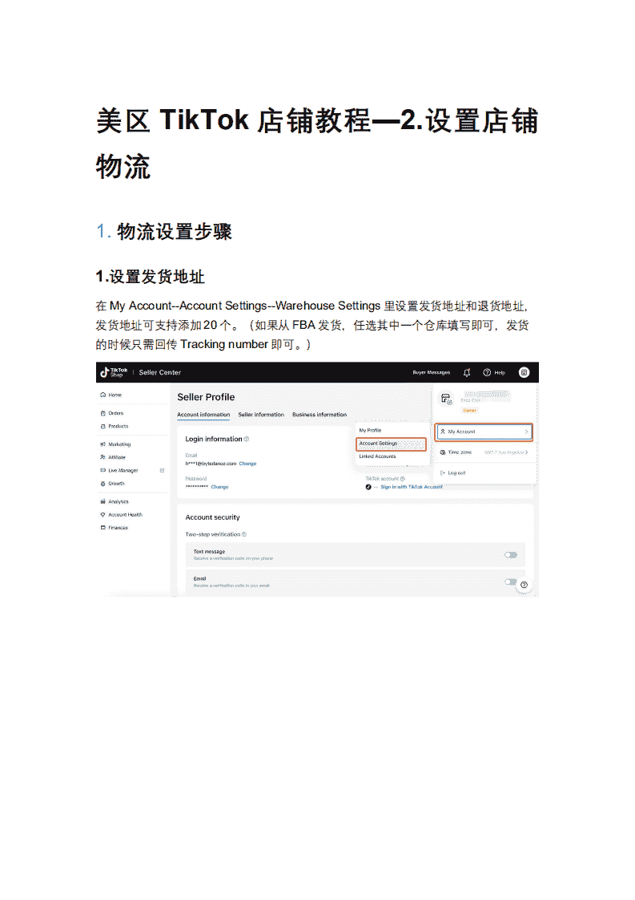

[美区TikTok Shop教程—2.设置店铺物流(1).pdf](https://internal-api-drive-stream.feishu.cn/space/api/box/stream/download/all/NFd5bIRU4oTTVwxgNwocGZvAnjb)

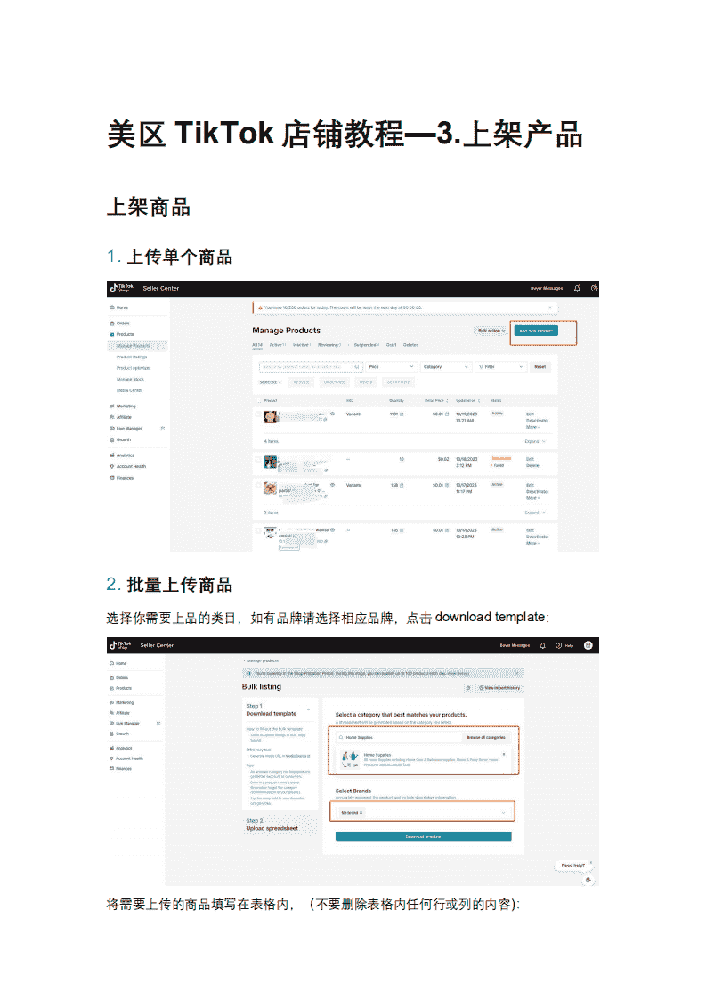

[美区TikTok Shop店铺教程—3.上架产品(1).pdf](https://internal-api-drive-stream.feishu.cn/space/api/box/stream/download/all/UFppbunsYoPgcixgtA6csL1XnMc)

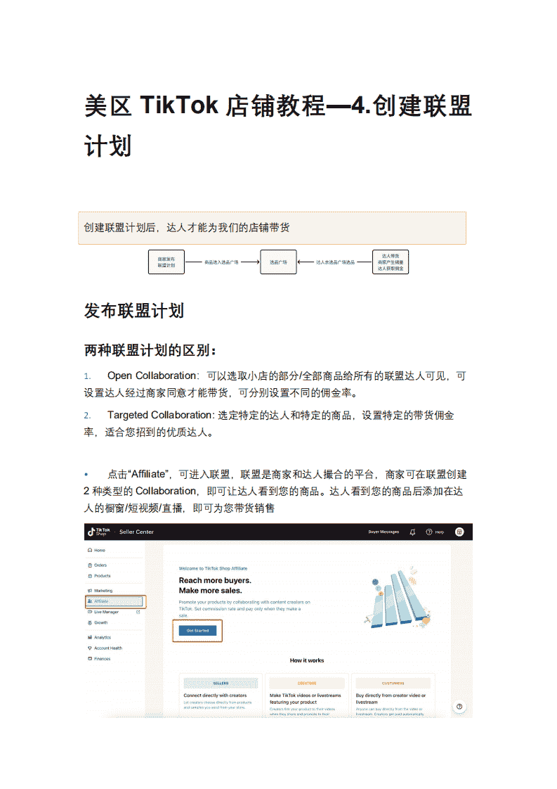

[美区TikTok Shop教程—4.创建联盟计划(1).pdf](https://internal-api-drive-stream.feishu.cn/space/api/box/stream/download/all/ZRmTbakm6oXuEoxDzLmchX12nGc)

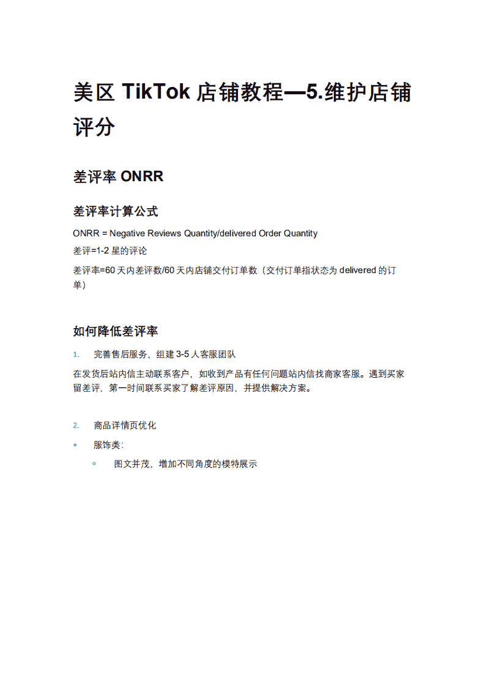

[美区TikTok Shop教程—5.维护店铺评分(1).pdf](https://internal-api-drive-stream.feishu.cn/space/api/box/stream/download/all/YQYsb2wkJo9eMSxsP6Gcdtjbnof)

## 日本市场 Japan Market

| 专题培训 | [【外部】POP日本新开国专题培训-定邀商家](https://bytedance.sg.larkoffice.com/docx/MbQOdPwXOo08xyxQDw9ldYBhg5b?from=from_copylink)🔥 |
| --- | --- |
| 跨境 POP 商家入驻说明 | [TikTok Shop日本跨境POP自运营商家入驻详解 【对外版本】](https://bytedance.sg.larkoffice.com/docx/M00XdfrVGoaTlsxdTjGlQervgbf) |
| 店铺申请 | [关联关系资质要求【对外版】](https://bytedance.sg.larkoffice.com/docx/EmfWdwOubo9lQUxZzn2lZvzGgS6?from=from_copylink) |
| 【日本】规则速递 | [日本规则速递合集](https://seller.tiktokglobalshop.com/university/essay?identity=1&amp;role=1&amp;knowledge_id=498951717963521&amp;from=policy) |
|  | [TTS Seller Center操作マニュアル ](https://bytedance.sg.larkoffice.com/docx/CnKmdppsdonClexSJ96ljkhngke) |

## 中东市场 GCC Market

| 内容服务 | [TikTok Shop沙特内容服务商招募.pptx](https://bytedance.sg.larkoffice.com/file/WKQ8bsdpIoWIbAxtOTmcTTLknjb) |
| --- | --- |

## 欧洲（英国）市场  Europe （UK） Market

| 跨境入驻 | [【对外版】POP跨境自运营新市场（EU/UK）商家入驻方式一表全（0506更新）](https://bytedance.sg.larkoffice.com/docx/Dvf8dMbGJougUxxrz72lbIMEg1e) |
| --- | --- |
| 备货仓激励 | [英国跨境海外认证仓One Pager【对外版】 ](https://bytedance.sg.larkoffice.com/docx/WJUydRuA1oQZzyxo3xycha03nag) |
| 海外仓 | [TikTok Shop 英国跨境海外仓使用流程（对外版） ](https://bytedance.larkoffice.com/docx/ErOodw6M9oGjXpxJKa7cmOjmnjh?from=from_copylink) |
| 英国跨境须知 | [UK VAT 大白话（for Magellan UK） 对外版](https://bytedance.larkoffice.com/docs/doccncACjbDMWLxF1IRf7cUv0Rb?from=from_copylink) |
|  | [TikTok Shop UK自运营商家入驻详解【对外版本】](https://bytedance.sg.larkoffice.com/docx/Zwswd3Z4SoCPBpx3yVUlpzLZgrd) |

## 欧盟（德国、西班牙、法国、意大利）

| 跨境入驻 | [【对外】GB/EU/JP 新商启航百宝箱](https://bytedance.sg.larkoffice.com/docx/UXPGdoQebohhqexp2LQlm4dggRc) |
| --- | --- |
| 本土入驻 | [TikTok Shop欧洲入驻流程[EXTERNAL]](https://bytedance.sg.larkoffice.com/docx/DqJbdRAcFoHnD8xQm0AlYKB1gic) |
| 物流相关 | [西班牙商家物流服务宝典](https://bytedance.sg.larkoffice.com/docx/LfeHdov2Cooh1Gx7LxElpx9dgPb?from=from_copylink) |
|  | [TikTok Shop EU市场 | Q2 POP 选品必看指南](https://bytedance.sg.larkoffice.com/sheets/AERQs5TkRhKjU9taIbYleKh2gyg?sheet=oIIsJw) |

## 东南亚市场 SEA Market

| 跨境商家入驻 | [TikTok Shop-东南亚跨境市场入驻指引](https://bytedance.larkoffice.com/docx/Rt90d9zQXokhPMx0uamc3CaanWf) |
| --- | --- |
| 印尼重建指南 | [Tiktok Shop ID灾后重建指南](https://ccpartner.feishu.cn/docx/V2v9du44ro6dEox8JhJcDbW8ndb?from=from_copylink) |
| 备货仓激励政策 | [TikTok Shop跨境东南亚商家海外仓使用说明（对外）｜Overseas Warehouse Use Guidelines for TikTok Shop CB SEA Merchants (External Version)](https://bytedance.larkoffice.com/docx/doxcni4NsVpLzmYZLaxcjdIQ4tb) |
| 开播激励政策 | [TikTok Shop马来大促 Sama Sama！Hot Deal 大促报名入口直达](https://bytedance.larkoffice.com/docx/doxcn75acmE5o8OQ0J50dYhloie) |
| 东南亚跨境商家须知 | [SEA单场破万美金直播case](https://bytedance.larkoffice.com/docx/doxcnAIZHFXVYdNkVjujrbAfcCd) |
|  | [TikTok Shop东南亚跨境公开课学习地图&amp;知识全览](https://bytedance.sg.larkoffice.com/docx/P8EPd6xnMovSF9xKyuvlRDM2gWb) |

## 通用规则 General

| 常见问题 | [商家/TSP常见Q&amp;A](https://bytedance.larkoffice.com/docx/doxcnsrORJA1NGrchO0Zx2dO9Ke) |
| --- | --- |
| 跨境商家入驻 | [TikTok Shop跨境商家快速开播指南](https://bytedance.larkoffice.com/docx/doxcn9IlpKusidBy5OZaOPNHMje) |
| 跨境收款 | [TikTok Shop跨境商家绑定派安盈Payoneer流程指南](https://bytedance.sg.larkoffice.com/docx/doxcnMtPYn57mT1G0bsz6XzPf7g) |
| 获取 ID | [账户UID获取方式.mp4](https://bytedance.sg.larkoffice.com/file/boxcnTtHmTbYTcknvfYU4iLlT5M) |
| 侵权规则 | [跨境知识产权规则](https://seller.tiktokglobalshop.com/university/essay?knowledge_id=6837859302901506&amp;identity=1) |
| 禁售规则 | [热门行业知识产权侵权案例解析](https://bytedance.larkoffice.com/docx/G1wLd1dtaoHKEMxpEGrcsQlunZd) |
| 申诉 | [TikTok Shop差评考核科普手册](https://bytedance.sg.larkoffice.com/docx/HJ2zdG7tioJJWhxgY1ncCBjVnDc) |

# 二、✍️TikTok 通识运营方法论

## TikTok 下载与账号注册

| 刷机 | [TikTok运营日志：刷机篇](https://ghlf0s3q3l.feishu.cn/wiki/A5rLwbcR5izD8BkTGXacNucJnOh) |
| --- | --- |
| 网络搭建 | [66云安装教程（FinalShell-节点搭建）2024版](https://ghlf0s3q3l.feishu.cn/wiki/GGITwBta3iih64kvNglcSwDHnUe) |
| 账号实名 | [Tik Tok账号实名认证指引](https://ghirb3j643.feishu.cn/docx/CjHPdTjAko5S2bxp6RVcyPihnFh) |

## TikTok 账号变现模式

| 新手认知 | [术语 | TikTok常见术语](https://ghlf0s3q3l.feishu.cn/wiki/Fq2Kwz1kwihn8HkfTL6cypt9nRb) |
| --- | --- |

## TikTok 短剧出海

| 行业报告 |  |
| --- | --- |
| 短剧基础 |  |

## TikTokShop 店铺运营

| 店铺运营 | [新入驻商家-如何获取各种ID](https://bytedance.sg.larkoffice.com/sheets/shtcnlQItZHLxrzbathVEqRyZQd) |
| --- | --- |
| 店铺操作 | [TikTokShop上传商品的流程](https://bytedance.larkoffice.com/docx/doxcn9zOa7Cww2RkN1vMQK4hxee) |
| 营销工具 | [【仅供跨境卖家参考】TTS营销工具介绍_25年4月version](https://bytedance.sg.larkoffice.com/sheets/LlTXsS8XghlTXWtfJQnlYuhrgVg?sheet=xroCLT)（活动互斥逻辑） |
| 差评规则 | [TikTok Shop差评率科普手册](https://bytedance.larkoffice.com/docx/QQzidp4FDowz6kxLW5DcHkkjnoI) |
| 类目资质 | [电子电器商品类目资质发布要求常见问题](https://bytedance.us.larkoffice.com/docx/V9k3dyqxNoRtPnxdAM6uW76osKc?from=from_copylink) |
| 商品发布 | [商品发布信息质量要求-商家阅读版本](https://bytedance.sg.larkoffice.com/docx/doxcn3IRKL3x706DnYZfBGoh8Ab) |
| 音乐版权 | [External：CML GTM](https://bytedance.larkoffice.com/docx/doxcnHSeak7Byj6KydCa3jLD7Nf?from=from_copylink) |
| 账号相关 | [FMCG商家渠道号Onepage](https://bytedance.sg.larkoffice.com/docx/EoX8dwc6GoE8LOxl86Ql7qwegmb) |
| 订单履约 | [跨境商家发货履约指南 (对外版)](https://bytedance.larkoffice.com/docs/doccnjT4SR72g5f4UikvZ0AF8ef) |

## TikTokShop 商城运营

| 商城介绍 | [2023 TikTok Shop跨境电商商城通案-内容货架双驱动 商城激发新增长.pdf](https://bytedance.sg.larkoffice.com/file/boxcnxzvV3zOpubWSva7UvBFWYc) |
| --- | --- |

## 短视频带货

| 短视频橱窗带货汇总 | [短视频：橱窗带货](https://ghlf0s3q3l.feishu.cn/wiki/Ly0xwtigfiBF1XkWKzDc3uQFnVn?from=from_copylink) |
| --- | --- |
| 创作 | [【POP商家自卖视频】优质视频内容库（可对外）--仅官号渠道号](https://bytedance.sg.larkoffice.com/sheets/U5wisUVF5h8GAqtwfh2ljcJMg1f?table=tblBa0KyWpiD4ztt&amp;view=vewXS1tQmy&amp;sheet=i1XQrg)🔥🔥 |
| AI | [Q4商家自制AI短视频活动方案[对外]](https://bytedance.sg.larkoffice.com/docx/US4WdcPiho1iRdxWyuClf268gzd) |
| 合拍 | [【External】电商短视频合拍功能使用指南//E-commerce stitch short video user guide](https://bytedance.larkoffice.com/docx/doxcngK0MfQ7zOjUGeHO7cbp60u) |
|  | [【帮商家做好短视频】一篇了解商家自制内容工具](https://bytedance.sg.larkoffice.com/docx/G74LdIzA9oS3rJxHwf4ljFxSgxb) |
| 素材创意指南 | 8 月家电素材指南：[CE 创意洞察月刊-【对外版】](https://bytedance.sg.larkoffice.com/docx/SoeedX2mjoRSPUx4WY7lRmiSgVf) |
| 下载 | 工具：哼哼猫批量下载 |
| 带货 | [教你如何玩转TikTok电商短视频](https://bytedance.larkoffice.com/docs/doccn1N7fBCmHuE5wEOv6Lg1TDh) |
| 添加商品 | [如何在短视频/直播中添加商品？/How to add products into EC-video&amp;LIVE](https://bytedance.sg.larkoffice.com/docx/doxcnYLRMy8q284mWy81k4IotFh) |
| 其它资料 | [商家自制短视频如何驱动品牌销售-0512.pdf](https://bytedance.sg.larkoffice.com/file/Gm6YbPz8Zo9y7nx4fBmluFUKgLe) |

## 直播带货

| 直播运营 | [【GS-POP】商家自营销工具指南-达人专属秒杀](https://bytedance.sg.larkoffice.com/docx/Mpc8daGjco7Q80xb1sMlj1sygXP) |
| --- | --- |
| OBS | [OBS开通及使用指南](https://bytedance.larkoffice.com/docx/doxcnPihgbKwBV8ctLMclZTVwTh) |
| 素材 |  |
| 直播功能 | [TikTok直播产品功能介绍/ UI and Functions of TikTok LIVE](https://bytedance.larkoffice.com/docs/doccnE095N4Y131yoW4whe0ceJg) |
| 黑词库 | [黑词库V1.0/banned word list](https://bytedance.larkoffice.com/sheets/shtcndS3Xzf3wFz2Y9ikmtSIoSc?sheet=YDoJ8n) |
| 英国原生感 | [【External】英国跨境直播内容“原生感” 分享](https://bytedance.larkoffice.com/docs/doccn4iz9ajfeXXDeOPavfNkOqg) |
| 直播间操作 | [商家自行申诉TikTok直播中断/封禁的操作指南 / Guidelines for Sellers to Appeal for Lifting The Ban from TikTok LIVE](https://bytedance.larkoffice.com/docs/doccnUfpsWOMlzMTrYQDQ4SPKif) |
| 直播分析 | [【GTM】Video Analysis-How to know engagement/transaction performance of videos&amp;good video benchmark？](https://bytedance.sg.larkoffice.com/docx/doxcntLCvzRmSzA5RcRwN5tgwKd) |
| 直播自检 | [TikTok Shop开播Checklist模板](https://ghlf0s3q3l.feishu.cn/wiki/ZfD8wv5gyiY7B1kWFEmcpemKnRc?from=from_copylink) |
| 流量 | [直播间流量入口说明（商家/达人直播大屏）//LIVE traffic source entrance instructions (Seller/Creator LIVE screen)](https://bytedance.sg.larkoffice.com/docs/doccn9ak1VSACAnnSV7TuXtZeag) |

## 跨境选品

| [跨境电商常用的选品工具](https://bytedance.larkoffice.com/docx/doxcn5srG6yDv5uGQjMnZcyntmc) | [用漏斗思维做 TikTok 美区跟品，资料店出单8000美金](https://ghlf0s3q3l.feishu.cn/wiki/RpcBwhsXXil1X1k5wJ8c8qwfnWf) |
| --- | --- |
|  |  |

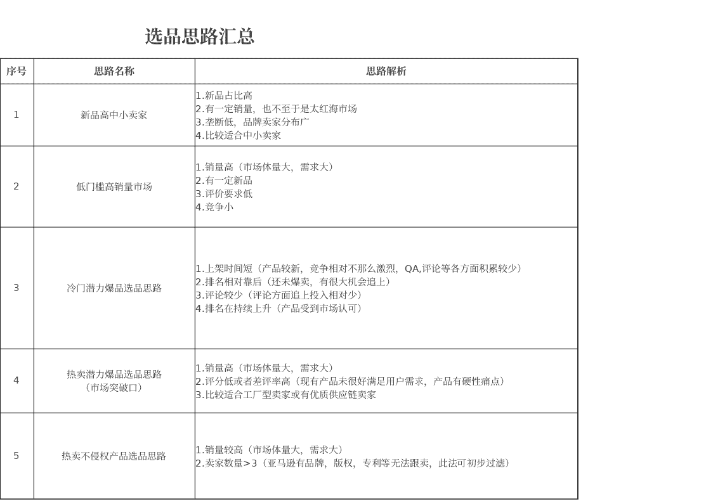

[22种选品方法.xlsx](https://internal-api-drive-stream.feishu.cn/space/api/box/stream/download/all/W0SGbE7NgowgE9xrD55cGbUknoc)

## 品类报告

| 宠物用品 |  |
| --- | --- |
| 居家日用 |  |
| 玩具爱好 |  |

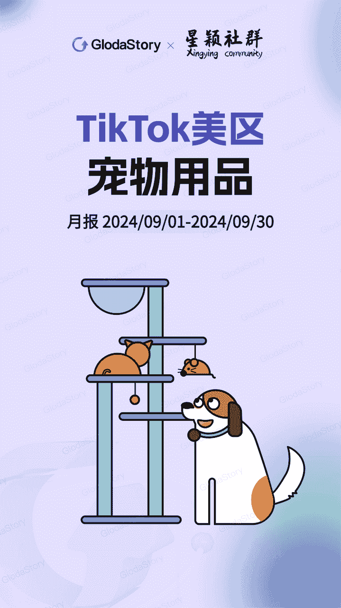

[【GlodaStory】TikTok美区9月宠物用品行业报告-星颖社群.pdf](https://internal-api-drive-stream.feishu.cn/space/api/box/stream/download/all/PExab6itEo2gWdxOMH4cI6u8nKh)

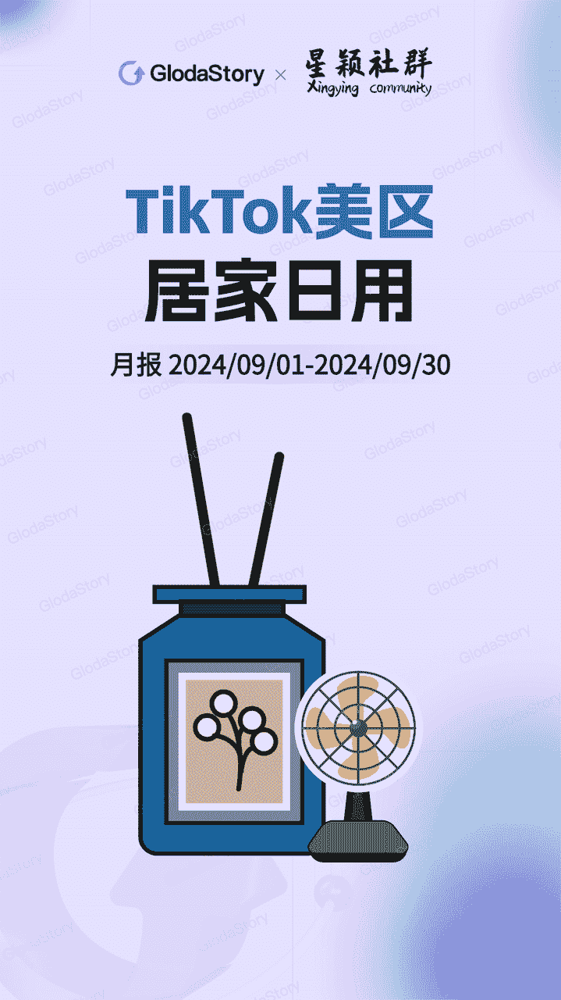

[【GlodaStory】TikTok美区9月居家日用行业报告-星颖社群.pdf](https://internal-api-drive-stream.feishu.cn/space/api/box/stream/download/all/XEwDbNofToNIoBx6zeSccgW2n1b)

[【GlodaStory】TikTok美区9月玩具爱好行业报告-星颖社群.pdf](https://internal-api-drive-stream.feishu.cn/space/api/box/stream/download/all/H3XJbBD8Po9AtWxMfLJcPRLXnPh)

## 跨境物流/支付收款/客服

物流通用

| [TikTok Shop首公里揽收覆盖范围](https://bytedance.larkoffice.com/sheets/shtcnQjLTkniJP7ibAx0V1BGQOd) |
| --- |
| [【External】跨境卖家拆包发货](https://bytedance.sg.larkoffice.com/docx/doxcnXGZwUCvwSxgdA68AAmtyQh) |
| [TT跨境价卡.xlsx](https://bytedance.larkoffice.com/file/boxcn3bhCl5lLExbGJ0U2B7OnC8) |
| [物流问题请到customer service寻求帮助！！](https://bytedance.sg.larkoffice.com/docx/BP0PdtjMHoj7fVx4VKAceo0vnNg) |
| [UK跨境卖家发货指南（to AM&amp;商家）](https://bytedance.larkoffice.com/docx/MgYUdf22goRFjUxS6iRc3RDxnyc) |
| [TikTok Shop POP US混发双向商品管理详细说明（对外）](https://bytedance.sg.larkoffice.com/docx/OgpwdrW0CoXdznxNCmsl4wZIgid?from=from_copylink) |
| [TikTok Shipping服务开通流程](https://bytedance.us.larkoffice.com/docx/QUzudIhn7oR91zxQZDEuqmvUsYc) |
| [TikTok Shipping服务升级指南](https://bytedance.us.larkoffice.com/docx/Z92od3sRToSLDYxXYiauHwL8smc) |
| [[TIKTOK] FBT+4PL官方物流渗透一页纸](https://bytedance.sg.larkoffice.com/docx/SVfBdKmP9oi4zkxgo8Elx8sogAM) |
| [[对外] CBT揽收操作指南及商家问题指引](https://bytedance.us.larkoffice.com/docx/Rop6dQBqhoifnMxABsEu5Vj9s2f) |
| [TikTok Shop包邮项目计划 / 取消CFFS 商家培训 ](https://bytedance.sg.larkoffice.com/docx/JBEmdPmwpo38JBx0Km5lVvuugvc) |

物流欧美 US

| [UK跨境卖家发货指南（to AM&amp;商家）](https://bytedance.larkoffice.com/docs/doccnybJhY5VvsLQ2DNQLJPfaEb) | [英国跨境135磅以上商品售卖手册（对外版） ](https://bytedance.sg.larkoffice.com/docx/doxcniCoN3paSbB330ANPMA2G9f) |
| --- | --- |
| [跨境物流运营流程商家指导手册（对外版）](https://bytedance.larkoffice.com/docx/doxcnm8brgyQdcehxb5O8i069uf) | [TTS英国跨境物流运费计算器](https://bytedance.larkoffice.com/sheets/shtcnUb3H9oq3AgyO21MDAjZH8b?sheet=119e2e) |

物流东南亚 SEA

| [东南亚跨境商家发货指南（to AM&amp;商家）](https://bytedance.larkoffice.com/docs/doccnYfnZOqXFziOsNBFZ6LUAwh) |  |
| --- | --- |

跨境支付收款

| 注册指南 | [TikTok Shop跨境商家绑定派安盈Payoneer流程指南](https://bytedance.sg.larkoffice.com/docx/doxcnMtPYn57mT1G0bsz6XzPf7g) |
| --- | --- |

## 联盟营销/达人 MCN

| 联盟介绍 | [TikTok Shop跨境电商官方运营手册-联盟达人经营篇.pdf](https://bytedance.larkoffice.com/file/Ctcib1KfcoKwAhxMR6hcLx1nn9c) |
| --- | --- |
| 违规指南 | [TikTok E-commerce Content Violation Cases and Solutions//电商内容常见违规案例与解决方案](https://bytedance.sg.larkoffice.com/docx/TPA7d0q9moOUNJxqweXct6kmnWh?chunked=false&amp;302from=wiki) |
| 寻找达人 | [【Guidebook for shop chat tool-for cross-border merchants】商家如何与达人建联和沟通//How sellers can communicate with creators](https://bytedance.sg.larkoffice.com/docx/doxcne6YSNNKk1GoeAeKcPHbpuG?from=from_copylink) |
| 建联达人 | [达人：运营流程SOP](https://ghlf0s3q3l.feishu.cn/wiki/CQUYw1Q8YiIRynkhNo7czZRnnGg) |
| 绑定账号 | [绑定TikTok账号使用手册](https://bytedance.sg.larkoffice.com/docx/doxcn7Thq1rPhrhVc0ehvQoqYvb) |
| 黑名单 | [TikTok电商全球红人骗样共享登记表（持续更新中） ](https://kuouk7rb5u.feishu.cn/sheets/N6mnsmBMghvvcVtq1qacXbwinzd) |
| 达人营销体系 | [TikTok Shop-达人及内容规则白皮书1.4（对外）](https://bytedance.sg.larkoffice.com/docx/YIxgdMHCPoYXZpxGNSLlEBC9gQe) |

## 直播公会

| 公会基础 | [TikTok 直播亚太及中东地区新公会入驻指南](https://bytedance.sg.larkoffice.com/docx/WAbFdjo2KofxqvxhFQycS2bAnoC) |
| --- | --- |

## 广告投放 TTForBusiness

| 广告基础与知识体系 | [TikTok产品知识一览](https://bytedance.larkoffice.com/mindnotes/bmncnwtSDiIkBqaovB21NCTQk5b?from=from_copylink) |
| --- | --- |
| 广告开户与设置 | [POP商家自助广告开户指引](https://bytedance.sg.larkoffice.com/docx/WBVydZUBkoxNc6xeCUEl0FBGgBg) |
| 核心投放策略：GMV Max | [GMV MAX 产品知识一本通（培训手册）](https://bytedance.sg.larkoffice.com/docx/LaQxdJpXBoctUox8EvdlvtSTgjd)🔥🔥 |
| 其他广告类型与投放指南 | [Live shopping ads计划投放策略-对外版](https://bytedance.larkoffice.com/docx/doxcn7McPgKmTixcCVNZz4XHYZf) |
| 广告创意、工具与流程 | [广告制作-创意工具「出海创意组」](https://bytedance.larkoffice.com/docs/doccnhtWR0cdLonmwgVlWVhlJ1c#Yxl1rb) |
|  | [[Shop Ads | 操作指南] | Affiliate Creatives for Ads (ACA投达宝）](https://bytedance.sg.larkoffice.com/docx/Gn0qdpbrTolTTEx4GOrlc1J1gK2) |
|  | [【External】如何找到商业音乐入口 how to find CML? ](https://bytedance.larkoffice.com/docs/doccnYVmoPyUbJq5gn7wO77rTpe) |
|  | [GMVMAX如何强挂车白号素材](https://ewiilxe94g.feishu.cn/docx/UCGLdoirsocotLx02wjcEL3Inod) |
|  | [[Shop Ads | PSO] Product GMV Max素材指南](https://bytedance.sg.larkoffice.com/docx/HaiYd3UPnoSmlzxaUXzlJP2cggd) |
|  | [Creative Boost 使用说明：](https://bytedance.sg.larkoffice.com/docx/QliLdkjIfokwBmxljVMlUAt1gnP) |
|  | [【可对外】PRODUCT GMV MAX 创编流程](https://bytedance.sg.larkoffice.com/docx/QCeedjU7hoExCwxwLEjlRCTxg5d) |
|  | [【可对外】LIVE GMV MAX创编指南](https://bytedance.sg.larkoffice.com/docx/BpVEdhnd7oPFXaxRON8ldFGfgXd) |
|  | [TTO介绍&amp;使用](https://bytedance.sg.larkoffice.com/docx/JZ2KdxtWAoj4xFxDr49lOIM6g9c) |
| 数据与归因 | [商品广告归因](https://bytedance.sg.larkoffice.com/docx/GP3UdWM7Do9D29x0oEZl1WrcgTf) |
|  | [gmvmax 广告归因](https://ads.tiktok.com/help/article/about-attribution-for-gmv-max?lang=en) |
| 直播回放 | [GMVmax直播答疑回放](https://bytedance.sg.larkoffice.com/minutes/obsg5vf7k2j2m1f834dph765) |

## 团队组建

| 直播团队架构 | [TikTok直播团队人员架构](https://ghlf0s3q3l.feishu.cn/wiki/TDsgwg0d0i80FZk4RJscGxyknbh?from=from_copylink) |
| --- | --- |
| 投流团队架构 | [TikTok付费投流团队架构](https://ghlf0s3q3l.feishu.cn/wiki/U2OhwBF6NizfFjkmDm4c10gpn7d) |
| 团队搭建 | [ENGU—TikTok美区新商重磅培训：达人、广告、团队搭建、选品方向](https://eg88888888.feishu.cn/wiki/VI24wUaXgiFOY2kuUFHcFLlonfb) |
| 绩效考核 | [运营KPI](https://ewiilxe94g.feishu.cn/sheets/UdDWsisKQh1ghHtC1oLcewavnAb) |

## 主播运营

| 主播标准话术 | [🙌直播通用话术公式+英文版案例](https://bytedance.larkoffice.com/docx/doxcnhtL49A9Ra96XUWptnsaOCe) |
| --- | --- |

## 活动/节日营销

| 圣诞元旦 |  |
| --- | --- |
| Double Day |  |
| 情人节 |  |
| 斋月 |  |
| 返校季 back to school | [[返校季 | Back to School]美国TikTok Shop跨境电商活动方案（对外版）](https://bytedance.sg.larkoffice.com/docx/MRpdd1fZVopianxTFBplZdtegnf) |
| 黑五网一 | [【可对外】Black Friday跨境招商会.pptx](https://bytedance.sg.larkoffice.com/file/boxcnn10RaQ52MJXv8W2Jryf1Ib) |
| 节点营销 | [TikTok Shop 夏季大促招商方案.pdf](https://bytedance.larkoffice.com/file/boxcnv1DbhXtb11WTmwtUrtS0Og) |
| 营销日历 |  |
| 物料 | [2025年中SS大促Deals For You Days 主题氛围物料](https://bytedance.sg.larkoffice.com/docx/Gfn2dIQMJoqaBwxRlEwllCQUgod) |

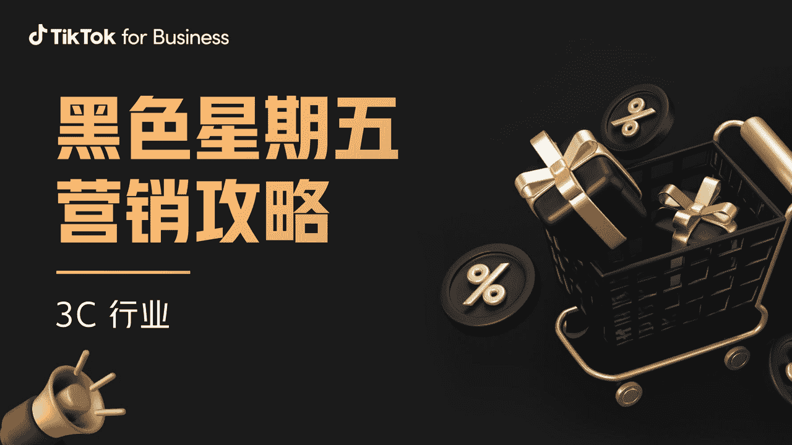

[【3C_行业】2024_TikTok_for_Business_黑色星期五营销攻略.pdf](https://internal-api-drive-stream.feishu.cn/space/api/box/stream/download/all/HvLwbgwG5ozUb6xMFedcfN9ynyb)

[【快消行业】2024_TikTok_for_Business_黑色星期五营销攻略.pdf](https://internal-api-drive-stream.feishu.cn/space/api/box/stream/download/all/UxtybAnZeo0RBwxzuFKcp4Fmnjc)

[【美妆行业】2024_TikTok_for_Business_黑色星期五营销攻略.pdf](https://internal-api-drive-stream.feishu.cn/space/api/box/stream/download/all/Wyx2bEGdeoIpSSx8eEGcE5gvnLg)

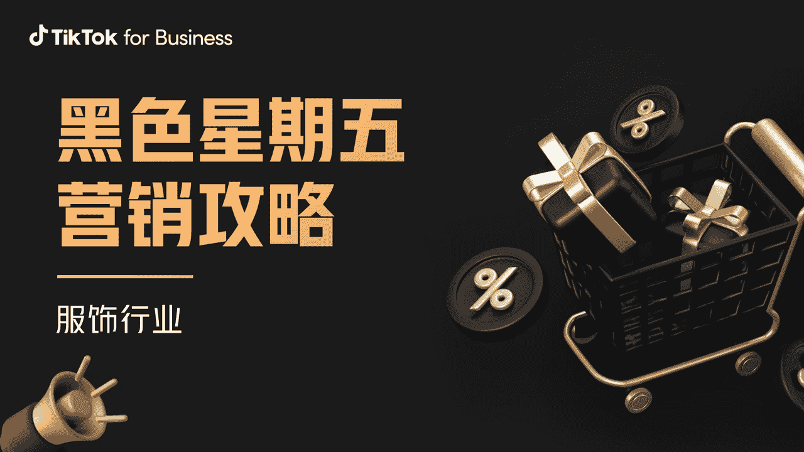

[【服饰行业】2024_TikTok_for_Business_黑色星期五营销攻略.pdf](https://internal-api-drive-stream.feishu.cn/space/api/box/stream/download/all/IMcUb2L5IogFUGx8cymcxGMtnod)

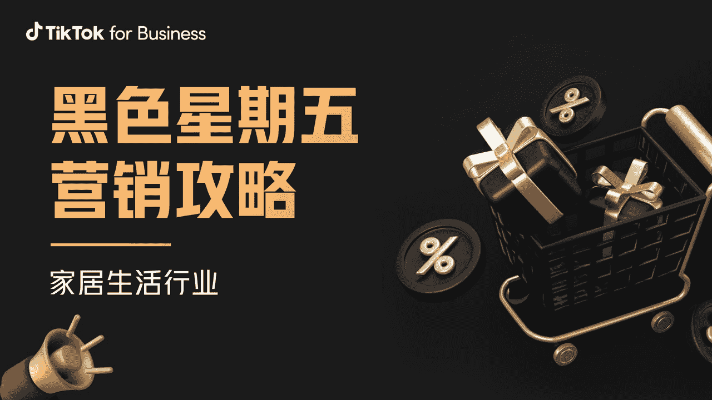

[【家居生活行业】2024_TikTok_for_Business_黑色星期五营销攻略.pdf](https://internal-api-drive-stream.feishu.cn/space/api/box/stream/download/all/SfN5bYF3UoyE6xxEePJcGG4Lnee)

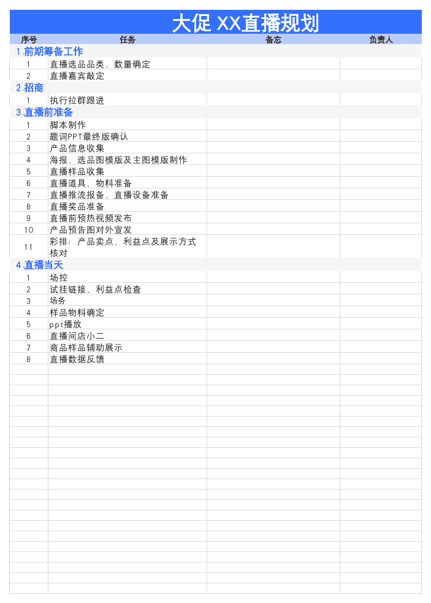

[大促直播间活动规划表.xlsx](https://internal-api-drive-stream.feishu.cn/space/api/box/stream/download/all/SQQFbhIqqo8i9VxR6cwcTPiWnFW)

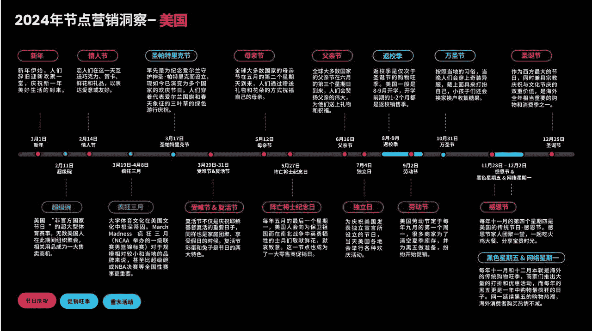

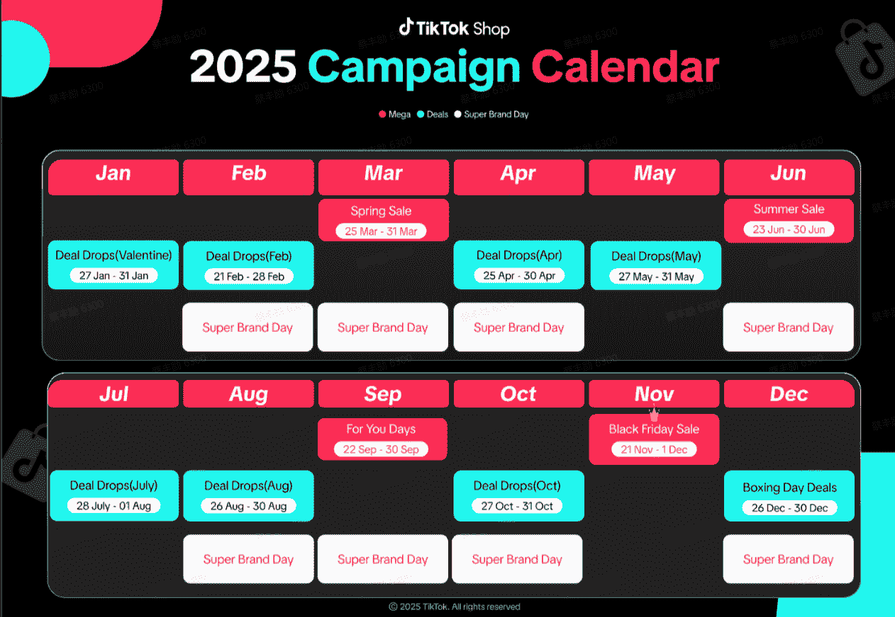

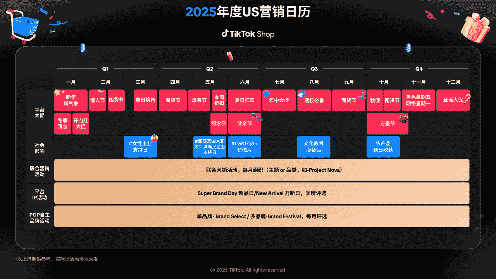

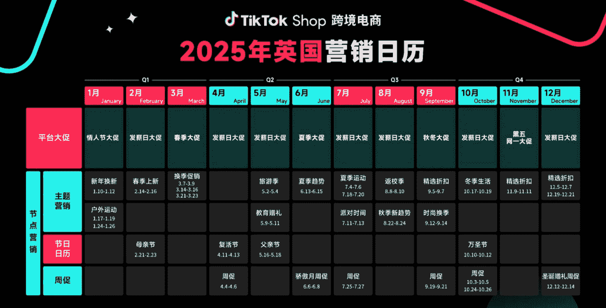

## 外部知识库

> 以下内容均无合作关系，请注意甄别，以防被骗。

| [TT目录](https://ewiilxe94g.feishu.cn/sheets/I1P1sFaFMhsmZAtxsePc8TLinHr?sheet=023d7e) |
| --- |

## 最新动态