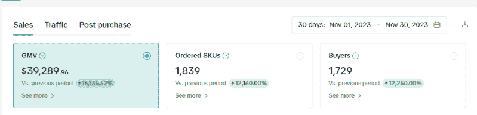
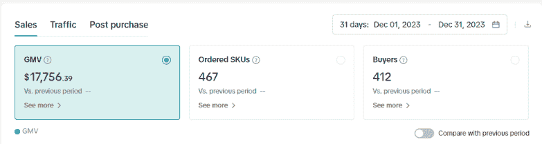
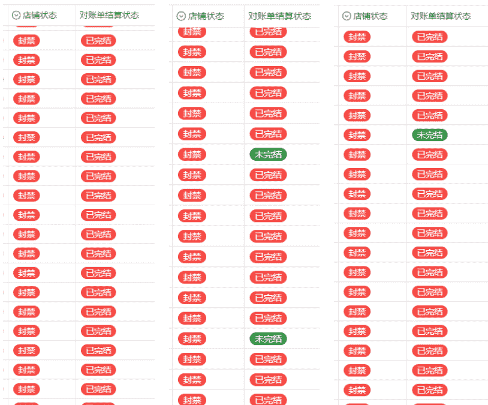

# TikTok真的能赚钱吗？简单算算账

> 来源：[https://my.feishu.cn/docx/P7uudm2HPoyDCIxSoXtc9vu1n2g](https://my.feishu.cn/docx/P7uudm2HPoyDCIxSoXtc9vu1n2g)

# 一、前言

先给想做TikTok电商的朋友们泼一盆冷水，这不是一个赚快钱的生意，也不会那么快的拿到反馈。甚至可以说已经是一件重资产的项目了，对于各个环节的要求也变得更高了。很多人可能是国内电商做不下去了，亚马逊的单量下滑了，各种各样的原因想要寻求新的方向，所以看到了这个正在增长且有无限可能性和机会的平台。

2023年9月份TikTok美区小店刚正式开通的时候，有虚拟仓玩法，也就是说可以从国内发货，这样物流时效勉强能够达到要求，也不需要垫太多的资金，只需要疯狂开店铺品就好了，店铺在出单后，立刻从1688下单给货代，然后由货代发往海外仓后，再从海外仓发给用户。

但是2024年虚拟仓的玩法已经无法实现了，平台对于店铺的物流时效和商责取消率评价等等要求都变得更加严格了，而且最致命的一个问题是，资料店和虚拟仓可能会导致无法回款，这是最致命的，变成给平台打工了。

无论是跨境店还是本土店都硬性要求从美国本土发货，那想要赚钱就需要备更多的货过去，如果没有销售完，除了需要支出货款和头程，还有高额的仓储费甚至是销毁费。可能会将前面的利润都给吞掉。

再加上TikTok美区经常修改规则和风控，导致“赚钱”变成了一件不确定性极大的事，很多行业内的人都转而做服务商、陪跑、培训..这些事情赚到钱的概率自然要比电商高很多，风险也小很多。所以行业内开玩笑说，TikTok搞培训的比商家还多。

看到很多文章都在说做TikTok有多么容易，因此我写这篇文章是为了给大家泼一盆冷水，帮助大家降低预期，脚踏实地。希望大家能够冷静地看清整个运营的脉络，然后一步一步前行。尽量积累经验和价值，做一个长期主义者。

# 二、过往

在2023年的时候，我们团队最高一天达到了8000美金的销售额，但最后我们还是不赚钱。因为都是资料店和虚拟仓，有的店铺卖爆了之后很快就被封禁了，基本上一个店只能活一周不到的时间。之后我们就等回款，然后继续拿新的店铺补上。最终，有几个店铺因为跳二次违规人脸核对，导致无法提现。

所以我对于合规性和是否能够正常回款尤为在意和重视。如果不能回款，那所有努力都是白费的。

# 三、算账

在电商运营中，必须清晰明确地了解所有成本。不能像某些平台那样，虽然天天爆单，但最后一算账却亏了十万。只有清晰地了解成本，才能知道钱花在哪儿，哪里还需要花钱，以及投入的钱多久才能周转回来。虽然有些成本难以完全算清，但尽量做到清晰已经很好了。

举个例子，卖纸吸管的利润虽然每根只有3厘钱，但一天卖出100万根，利润就能达到3万元，一个月就是90万元。另一个例子是某日本企业，他们对员工采购办公用品的管理非常严格，甚至需要填写详细的申请表。这些案例展示了企业在微小利润和成本控制方面的策略。

提高人效，利润就在企业运转过程中的细节中抠出来的。在经济下行中，增长放缓时要更多考虑保守策略。太过激进，风险也会高很多。我们要考虑的是如何在不下牌桌的情况下稳住，才能有机会不断试错，提高成功的概率。

如果前期投入成本是10万元，并希望实现30%的毛利率，那么至少需要准备36万元的货物成本和物流费用。这样才能确保在销售额达到51.43万元时，实现15.43万元的毛利。扣除前期投入的10万元，实际利润只有5.43万元。也就是说，总共投入了46万元，只有5.43万元的利润，回报率约为11.8%。当然，这些货物必须全部销售掉，否则将面临滞销风险，导致更多的边际成本。

前期投入成本包含了以下几项：

**人员成本**：店铺运营、剪辑、投手、选品、BD等

**准备成本**：真实店、测品店、宽带、网络、短视频账号等

**店铺运营成本**：拍摄成本、场景搭建、设备、道具、损耗、样品等

**其它成本**：投流、选品软件、ERP软件、指纹浏览器、培训、场地、退货率等

货物成本已经算在后面了。

这些成本中有些具有时效性，时间越久，成本越高。因此，资金周转率以及整体的效率要求极高，否则就会增加边际成本。

# 四、效率

通过前面算账我们就会明白，这是一件资金投入、技术投入要求极高的一件事情，稍不注意就会亏损。所以要求每一个环节都能够最大化的提高效率。

### 人员效率

+   培训：提供定期培训，提高员工技能和知识水平。团队成员之间项目认知也能够及时拉平。

+   合理分工：根据员工的特长和能力进行任务分配，避免资源浪费。

+   绩效考核：建立科学的绩效考核体系，激励员工提高工作效率。

+   PDCA：计划、执行、检查、处理。没有检查的计划毫无意义，这很重要。

+   信息化管理：采用信息化管理工具，提高流程的透明度和可追溯性。

+   流程优化：定期审查和优化业务流程，消除不必要的步骤和环节。

### 资金周转效率

+   库存管理：合理控制库存量，避免资金过多占用在库存上。

+   销售策略：制定有效的销售策略，加快商品销售速度。

+   供应链优化：优化供应链流程，减少资金滞留时间。

### 备货效率

+   供应商管理：与供应商保持良好关系，确保及时供货。

+   库存预测：利用数据分析和预测技术，准确预测需求，合理备货。

### 运营效率

+   市场调研：深入了解市场需求和竞争状况，制定针对性的运营策略。

+   品牌建设：通过品牌建设，提高企业的市场影响力和客户忠诚度。

+   数据驱动：利用数据分析和大数据技术，优化运营决策和策略。

+   人工智能：通过AI的辅助，提升运营过程中的效率。

# 五、碎碎念

所以要考虑清楚最终的目的是什么？是为了整合相关资源？是为了做案例？是有供应链优势？是有足够的预算？是有高效的团队？还是打算作为长期项目深耕？还是新业务探索？

每一个项目都有人赚到钱，也会有人赚不到钱。深度思考项目的落地难度、项目生命周期、反脆弱能力以及管理项目预期。当一切都逐渐清晰之后，再行动时才能做到笃定和不迷茫。

因为相信，所以看见。愿我们扬帆而行在出海的路上，都能找到属于自己的ONE PIECE。