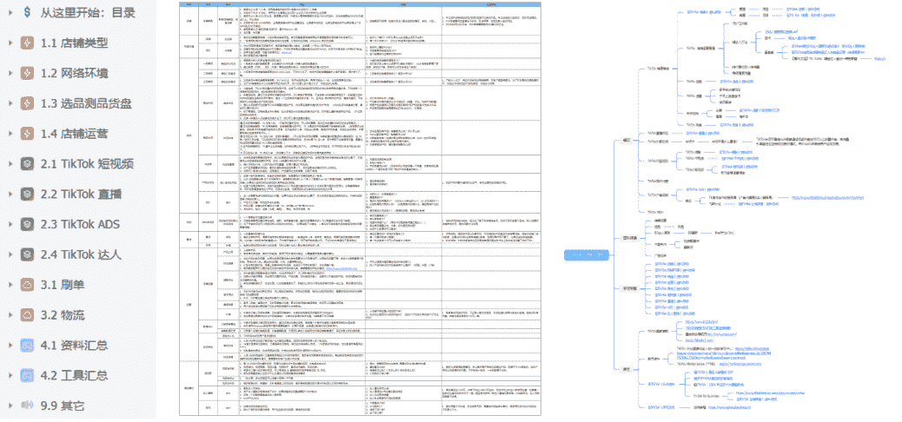
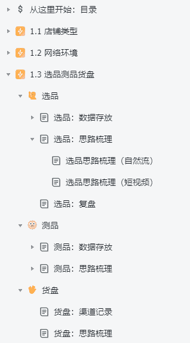
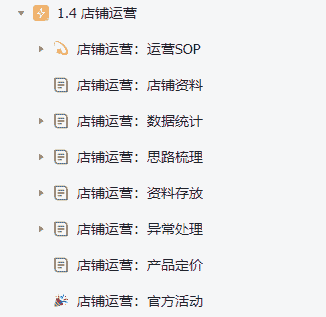
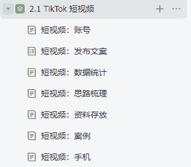
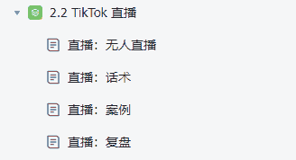
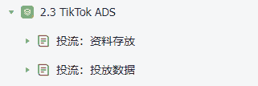
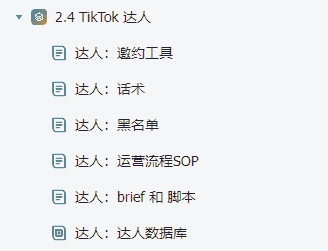
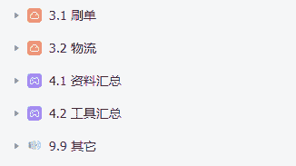

# 从零开始：打造高效的TikTok飞书知识库

> 来源：[https://my.feishu.cn/docx/GObUdr77JonpC5xwBm8c0j0RnSg](https://my.feishu.cn/docx/GObUdr77JonpC5xwBm8c0j0RnSg)

# 一、前言

在《原则》一书中，作者提到“让企业变成一部机器”，通过系统化流程提升效率。这让我感触颇深，因为专注于每个任务或案例往往会陷入逐一应对的困局。而建造一部“机器”虽然耗时，但能通过学习和提炼经验，使未来的工作更加高效。

李笑来也说过，“因为定义不准确，所以思考范围模糊，选择依据缺失，进而行动错误……最终影响整个生活。”这句话让我意识到，清晰的定义和流程有多么重要。

因此，搭建知识库的目的是为了让团队之间的项目认知和经验快速拉齐，使项目有一个清晰的模块化结构。通过让模糊的概念变得清晰，我们可以提高成功的概率，并更有利于建立SOP和复制成功案例。

# 二、知识库介绍

最一开始只是用思维导图作为目录的形式去串联各种相关的表格和文档，之后随着单一模块的信息量越来越大就开始用表格的形式去梳理，所有人用多维表格进行协作，多维表格真不错啊，相当于一个数据库，在同一个多维表格内的不同表格可以相互引用数据，但是用多维表格之后又开始面临一个问题，就是信息量越来越大，单个模块需要用到文档来存储信息，多维表格有一些限制，无法创建比较多的文档，所以决定用知识库的形式来承载整个项目的信息，知识库可以满足更多的需求，包含了表格、多维表格、文档、白板、思维导图等等....

知识库目前主要的几个板块以及板块中的模块。

1.  **基础运营和准备**（包含了店铺类型、网络环境、选品测品货盘、店铺运营..)

1.  **增长渠道和放大**（包含了短视频、直播、投流、达人）

1.  **比较重要的分支**（包含了刷单、物流）

1.  **工具汇总和资料**（软件、账号、资料）

1.  **其它**（百问百答和知识库的更新迭代的记录）

已经尽可能的将每个模块涵盖其中了，大家在搭建自己的知识库的时候也可以根据自己和团队的需求去做调整，其中的一些细节就是每个模块下的分类，我会在下面分享。

# 三、知识库搭建

店铺类型就不说了，本土、跨境等等一些入驻相关的资料信息。

网络环境也不说了，比较敏感。主要分为手机和店铺。

然后就是选品、测品、货盘，其中分支出来数据的存放、思路梳理、以及复盘，基本上都可以按照这个结构。

选品思路梳理一种是自然流一种是短视频还有就是打品，自然流跟品就是我之前写的那篇跟品的文章，找出近期上架且销量不错的，就可以快速跟品拿到自然流。短视频选品就需要找适合做短视频内容的产品。打品的话就需要考虑类目体量，投流素材等等，因为我还没到这一步所以就不细说了。

接下来就是店铺运营，运营的地方会比较细一些，因为遇到的都是实际的问题，不像选品这些没有固定的流程，需要不断的测试和调整。

所以有运营SOP，这样点开之后每天的固定任务就可以在这里看到，相当于运营的专属目录。

接着就是店铺相关的资料，和开头1.1那个店铺类型不同，那个是属于比如开店需要的信息啊之类的东西，这里的店铺资料是已经开通的店铺名称、账号密码等一些信息存放的地方。

数据统计就是让运营每天记录数据的表格，每个店铺的访客、点击、商品卡GMV、短视频GMV等等数据，方便团队中不登录店铺的其它人都可以看到数据进展。

思路梳理就是运营策略的沉淀，不同阶段的运营方式和规划以及每个人的todo，都可以在这里进行记录和梳理。

资料存放就是相关的一些别人分享的，官方分享的资料，保存在这里方便查看。比如家电类目需要什么证书，每种证书的作用。

异常处理就是分为店铺异常，订单异常，店铺异常就是比如之前年初资料店封禁的时候，各种违规但是不知道什么意思，进行一个梳理和应对的策略。比如触发二审了，需要什么资料等等。

订单异常就是差评啊，退换货啊之类的需要跟踪解决的问题，都直接存放在这里。

官方活动就是比如POP店铺每个季度会有不同的活动或者开学季等等一些活动补贴和扶持，官方的活动一定要跟进，及时了解政策的变化。就比如26号开始的共资包邮，及时了解就可以及时思考应对策略。

短视频就会涉及到自己做还是达人做，账号的数据，文案的管理，数据的记录和分析，思路的梳理，市面上的案例，短视频用到的手机编号并且记录，方便快速可以找到。

直播其实我不太涉及到，但是我还是建了一个板块，因为这是不可缺少的一环，最终想要更上一步还是需要直播的加持。大致上写了几个子文档。

投流和达人现在不太涉及，但是也是一件非常复杂且重要的事情，暂时先建立了模块。

剩下的也没什么好说的了，大家根据自己需要建立子文档就好了。可以当作文件夹，在知识库中文档是可以放在文档中的，层级关系管理。非常好理解。

其它里面我放了一个百问百答，这是我在22年刚接触TK的时候就想做好的一个文档，就是比如遇到的各种各样的问题，都可以记录在表格中，然后找到解决方案了在把方案放在表格中，这样其它人或者以后的人再看到这个百问百答的问题库之后可以少走很多弯路，相当于一个内网版的百度知道，随着遇到的问题越来越多，积累的解决方案越来越多，也会变得越来越强。

这也符合《原则》中提到的理念，维护好“企业机器”，这样就不用依赖于某个人，所有人都是为了知识库这个系统而存在，都是为了填充和完善它。这样的话当项目想要复制的时候，第二个团队可以快速从知识库中的SOP进行运转。

不过这也只是我的想法罢了，现实是只有我一个人维护知识库，大家平时要找什么文件会问我，然后我告诉他们文件在知识库的位置，或者发直达的链接。

不过如果看到这篇文章且看到这里的你，对于这个理念和愿景也感兴趣和认可，且有能力落地执行的，我相信你会做的更好。

# 四、碎碎念

我认为每个团队都应该有一个自己的知识库，以沉淀经验和方法，提升协作和培训效率。清晰的框架和细节可以大大提高工作效率。

好了，关于知识库的搭建已经分享完毕，最后感谢小麦和大家的支持与认可。你们的点赞和打赏是对我最大的鼓励。

冲吧，乘风破浪，披荆斩棘！