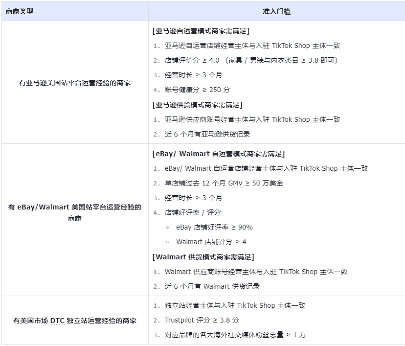
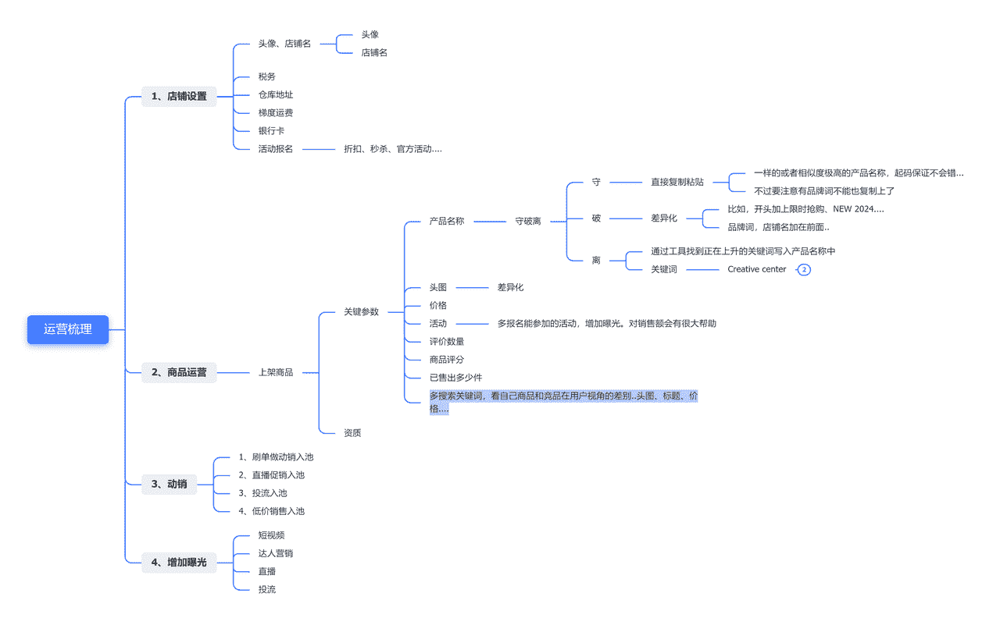
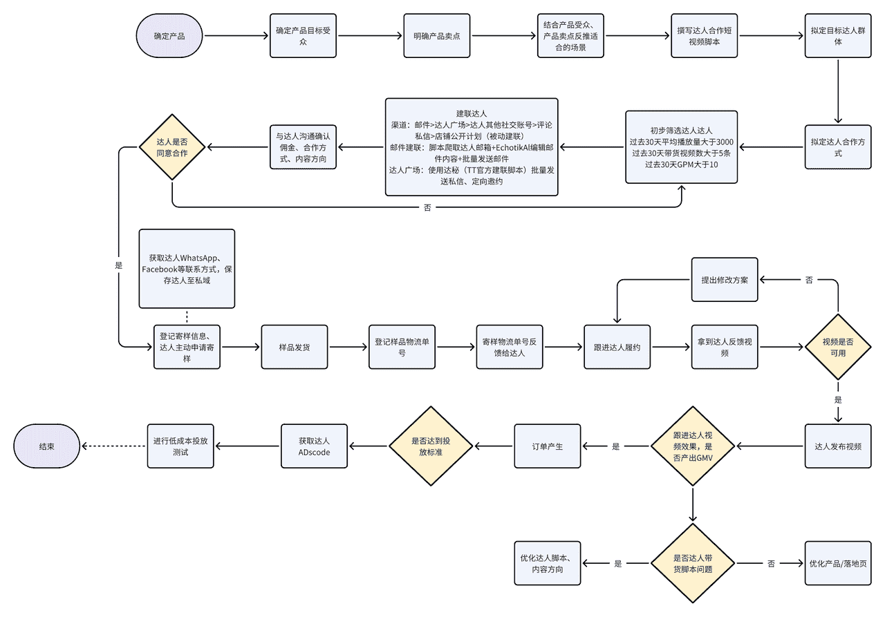

# 做TikTok美区的全流程梳理

> 来源：[https://my.feishu.cn/docx/TZsIdrslJo14Rxxo1MZcthMUnHh](https://my.feishu.cn/docx/TZsIdrslJo14Rxxo1MZcthMUnHh)

# 一、前言

2022年初刚开始做英区小店时，我刚接触TikTok，面对大量碎片信息，感到手足无措，不知道该准备些什么，也不知道当下最重要的事情是什么。随着对TikTok项目的深入，我对整体框架越来越清晰。现在，再看到碎片化信息时，我能将它们纳入已有的框架体系中。从前期准备、店铺搭建、网络配置、选品、测品、运营、短视频、直播、投流到物流，我都进行了细致的分类。

我的笔记也经历了从最初的文档到思维导图，再到表格，最后又回到文档的线性方式来分享给大家。虽然这篇文章可能不会讲得特别细致，因为每个阶段的细节和问题都不同，有的模块我没有深入实践，但我会尽可能把自己的感悟和各个模块讲清楚。有了整体框架的概念后，你可以根据自己的进度进行判断和思考。

保持开放的心态，降低预期，或许会有更多惊喜。接下来，让我们开始吧。

# 二、店铺

TikTok美区小店主要是分为美国本土店和跨境店还有全托管，有以下类型。

## 2.1 店铺类型

1.  美国本土小店-个人店，使用美国驾照或护照+美国SSN注册的个人店铺

1.  **美国本土小店-企业店**，使用法人为美国企业公司+企业法人SSN注册的企业店铺

1.  美国本土小店-ACCU本土店，美国营业执照，中国法人需持有美国主体至少25%的股份，亚马逊美国站GMV200万美金以上。本土发货

1.  **美国跨境小店-POP跨境店**，之前是需要亚马逊流水200万，从2024年6月份要求宽松很多。具体的要求我贴在下面。

1.  美国跨境小店-美区跨境“品牌”店，要求与ACCU一致。

1.  全托管、半托管

## 2.2 注意事项

1.  **店铺是否可溯源**，确保能够找到法人配合后期的提现、审核、人脸识别等操作。这一点很重要，市面上很多店铺是用假资料注册的，可能会导致无法提现的问题。店铺是头，回款是尾，这些解决了才能正式开始TikTok之旅。

1.  **POP保证金政策**，2024年8月16日开始，POP店铺需要缴纳500美元的保证金。如果是联系不到法人的那种店铺，后期钱可能拿不回来。英区小店当时退了一年多保证金才退回来..先是没有退保证金的入口，然后是需要公示退店，之后突然出现几个订单未完结。一直找客服处理，折腾了一年半才退回..

1.  **全托管信息渠道**，全托管要求挺严格的，利润貌似也比较低，但是我还是开了个全托管店铺。虽然没有做，但是有很多官方群，各个类目官方群里面有很多官方资料，出了问题也好在群里问，所以推荐大家能开的可以开一个，TikTok美区规则变化很快，能掌握到最新的信息，就能够少走很多弯路。有的问题只需要搜索群消息就能找到了。

# 三、网络

网络我就不细说了，之前写了一篇关于手机刷机的文章一直发不出去被删了..22年做完英区之后写了篇两万字的汇总，一年后也被删了....这个模块大致的说一下吧。

网络环境方面主要分为店铺和手机。

## 3.1 店铺

店铺网络方面主要是用指纹浏览器来防关联，现在用的比较多的就是紫鸟指纹浏览器。

## 3.2 手机

手机主要是做短视频使用，网络我就不说了..（害怕，辛辛苦苦写好的文章被删）

[最好每次发视频之前](http://whoer.net)都检查伪装度，检查伪装网址：whoer.net，确保伪装是100。有几个检查的方向可以对照一下。

1.  是否可以看到TikTok视频内容？

1.  伪装是否可以达到100？

1.  是否可以看到对应国家的购物车？

1.  实拍视频是否有播放量？

1.  账号是否可以关注评论？

如果有问题，那就需要进一步排查和解决。

# 四、选品

电商圈有句话叫，“七分靠选品，三分靠运营。” 选品是一件很复杂的事情，最近在看亚马逊的一些选品方式，各种数据分析和工具，感觉是另一个维度了

选品主要需要看平台所处的阶段：初期阶段、增长阶段、成熟阶段。

## 4.1 平台阶段

### 4.1.1 初期阶段

初期阶段，卖家少、商品种类少、消费者需求强烈，这个阶段可以通过硬铺的形式快速占领市场。比如去年美区小店刚上线时，挂上店铺就能出单。今年则需要增加很多运营方式去竞争才能吃到自然流量。此外，无法做虚拟仓，需要备货到海外仓销售，这就需要更加谨慎。

这个阶段可以参考我之前写的那篇《用漏斗思维做TikTok美区跟品》。其中的核心点是确保资质齐全，能够在资料店上架，以及通过近期上架且销量高的筛选方式，快速筛选出潜力产品进行跟品截流，从而快速拿到反馈。

### 4.1.2 增长阶段

目前所处的阶段，卖家数量增加，商品种类也变多了，消费者数量和需求也很大，平台的规则也在逐渐完善。这个阶段最重要的是差异化。

不管是从运营策略还是产品策略，都需要做出差异化才能够在茫茫人海中脱颖而出，获得更多的曝光和点击机会。

### 4.1.3 成熟阶段

成熟阶段，卖家数量饱和、商品种类饱和、消费者也饱和，就像现在的亚马逊一样。这个阶段需要做品牌的差异化，包括品牌的包装、产品的私模等等。对于卖家的选品会有更高的要求。

### 4.1.4 总结

1.  **初期阶段**：可以考虑通过硬铺的形式快速占领市场，确保资质齐全，快速筛选出潜力产品进行跟品截流。

1.  **增长阶段**：注重差异化，无论是运营策略还是产品策略，差异化是关键。

1.  **成熟阶段**：注重品牌的差异化，包括品牌包装和产品私模。

选品是一个动态的过程，需要根据平台的不同阶段不断调整策略。

## 4.2  选品步骤

### 4.2.1 确认类目

1.  根据预计投入的资金情况和团队能力：选择适合的类目。

1.  **大盘的类目销售数据**：比如美区GMV排名第一的最大类目就是美妆。不一定是做美妆类目，但是需要对各个类目的销售情况，市场体量有一个认知，然后选择合适的类目。卖的最好的，也意味着竞争是最大的。

1.  **综合判断**：通过数据（外部）和团队（内部）等综合因素判断出适合的类目，确定好大的方向。

### 4.2.2 具体产品

1.  **兴趣电商**：可以从有流量的视频选择产品，保证后续做短视频时容易有流量反馈。

1.  **关键词延伸**：通过下拉词相关关键词找到产品，帮助扩散思路，避免被单一关键词局限。

1.  **AI挖掘**：通过AI挖掘节日或节日中所需的产品，再去搜索关键词和分析市场。

1.  **差异化策略**：在众多竞品中找到有独特卖点的产品，和市面上爆款有差异的产品。

1.  **现货盘卖**：如果别人已经备货到海外仓，可以考虑拿货盘卖。跑通闭环后再考虑备货。

**检查要点**

+   是否容易做内容（流量）

+   产品解决的需求是否经过市场验证（销量、评论、同类产品数量）

+   根据产品关键词以及需求找是否有更好的产品能够作为解决方案

+   产品是否禁售或需要相关证书如FCC、CE等

### 4.2.3 竞品市场

1.  亚马逊和TikTok的产品销售额对比：亚马逊有销售额，TikTok没有人做，可能存在套利空间。

1.  **市场验证**：亚马逊爆款说明已经验证有需求，TikTok上也有销售额，且销售数量比较平均，说明需求比较稳定。

1.  **市场空白**：亚马逊没人做，TikTok也没人做，但抖音爆款，可以挂资料店测试看看。

1.  **避免风险**：亚马逊和TikTok销售额低的产品，做的意义不大，风险较大。

**检查要点**：

+   亚马逊是否有产品？销售额和评价怎么样？

+   TikTok是否有产品？销售额怎么样？

+   谷歌趋势或一些插件看往期的数据怎么样？

+   抖音有哪些产品，播放量和销售怎么样？

### 4.2.4 供应链

1.  **供货商渠道**：主要是阿里巴巴，如果亚马逊或TikTok看到的产品，阿里巴巴没有货，可能是本土供应链或独家产品。

1.  **采购价格和物流成本**：确认采购价格，以及产品体积和重量，方便计算定价和利润。

1.  **产品质量把控**：最好购买样品回来检查，否则会影响店铺评分和转化。现在国内电商甚至1688会出现一个情况，就是同样的头图，同样的产品，但是买回来之后会发现质量不一样，所以最好是买样品回来看一下，1688上也尽量去选择实力厂家。

1.  **后期考虑OEM定制**：品牌建设、产品差异化改款等初期不考虑。

### 4.2.5 产品合规性

1.  **品牌和专利**：检查产品是否有品牌或专利，避免选择有专利风险的产品。

1.  **市场竞争**：避免与已经类目垄断的品牌竞争，如监控摄像设备类目中Wyze店铺的链接。卖家精灵做的真好，可以看出来市场的垄断程度，比如某个类目市面上90%的销售额是前十的产品，那再进入的话竞争会很大。TikTok的话好像kalodata可以看这个数值，不然的话就需要自己抓数据后再做分析了。

**检查要点**：

+   是否是有品牌？

+   是否有外观专利？

### 4.2.6 定价

1.  **利润率和定价**：考虑利润率和定价问题，利润过低没有做的必要。

1.  **物流成本**：产品太大太重，物流成本较高。

1.  **物流计算**：实重与体积重取大计费，如体积重=长宽高CM/6000。

1.  **综合考虑**：货物成本、包材、运费（头程、尾程）、佣金、各项手续费、税等。

**检查要点**：

+   体积大小，长宽高是多少？

+   重量是多少？

+   竞品价格区间是多少？

+   头程和尾程大概多少钱？

+   最后定价应该多少？（根据利润率和竞品综合考虑）

大家感兴趣的话我后面可以分享一下飞书多维表格的制作思路，只需要填写重量、长宽高、采购价，毛利率、就会自动计算出头程、尾程、销售价格等数据。

# 五、测品

资料店测品主要用于测试自然流量和转化率，同时也可以检查产品的合规性。

## 5.1 测试自然流和转化率

1.  **自然流量和转化率**：一个是看自然流量和转化率，了解产品在市场上的表现。有自然转化的话，后期再去推品也会更容易一些。

1.  **合规性检查**：检查商品是否存在违规、侵权、资质等问题。备货之前需要测试一下，以免备货过去发现不能卖。

1.  **短视频+投流**：为了节省时间，也可以用短视频+投流的方式测品。如果消耗了20美金，一单没出，可能就是产品或者短视频的问题，需要调整。

**检查要点**：

+   自然流量有多少？

+   转化率有多少？

+   流量来源是什么？（商品卡、搜索流量还是达人）

+   商品是否需要证书、分类，证书是否有问题？

+   达到什么数据才可以备货？

## 5.2 具体示例

假设你在测品过程中使用了一个测品店，以下是具体的步骤和注意事项：

1.  **设定目标**：设定自然流量和转化率的目标，比如自然流量至少1000，转化率至少2%。

1.  **上架产品**：将产品上架到资料店，观察其自然流量和转化率。

1.  **检查合规性**：检查产品是否需要特定证书，如FCC、CE等，确保产品合规。

1.  **短视频+投流**：制作短视频并进行投流，观察投流效果。如果消耗了20美金，一单没出，可能需要调整产品或短视频。

1.  **数据分析**：分析数据，确定是否达到设定的目标。如果达到目标，可以考虑备货；如果未达到，需要调整策略。

## 5.3 总结

测品是一个动态的过程，需要不断调整和优化。通过资料店测品，可以快速了解产品的市场反应和合规性，避免备货后发现不能卖的情况。同时，设定明确的数据指标和使用短视频+投流的方式，可以更高效地进行测品。

# 六、备货

## 6.1 备货策略

1.  **小批量备货**：初期可以小批量备货到海外仓，减少资金占用和滞销风险。也可以当作二次测品，但是前面是测品店测品不发货，这次是备货到海外仓正式销售。

1.  **稳定出单的产品**：对于稳定出单的产品，根据可销库存长期保持有在途。就像超市一样，有库存，有在途，根据可销天数提前采购商品。例如，某一件商品库存数量是100，平均每天销售10个，那可销天数就是10天。不过，TikTok的出单情况可能不太稳定。

**检查要点**：

+   海运还是空派？物流时效是多少？

+   第一次要采购多少数量？

+   第一批货卖多少才可以开始第二次备货？

## 6.2 注意事项

1.  **滞销风险**：周期性产品如季节性、节日类型的产品备货太多容易滞销。滞销之后，第二年才能卖，但这中间的仓库存储费较高，后面如果产品不要了，仓库还会收取销毁费。

1.  **缺货风险**：TikTok和传统货架电商的区别是销售情况会脉冲式上涨然后突然下跌，需特别注意缺货风险。

# 七、运营

## 7.1 店铺设置

基础的一些设置在拿到店铺的时候就要设置好

+   头像和店铺名

+   税务和仓库地址

+   银行卡提现

+   梯度运费（8月26号共资包邮，运费就不太重要了，还不如换个包邮标，国内淘宝当年也是很多不包邮的，后来越来越多商家包邮之后，如果不包邮会很影响转化。当年我淘宝第一单货到付款三十多块钱运费，现在肯定是舍不得，其实商家是把运费加到标价里面了，但是用户心理会不一样。）

+   活动报名（折扣、秒杀、官方活动：积极报名各种活动，增加店铺曝光和销售额。）

## 7.2 商品运营

### 7.2.1 商品名称

+   守：直接复制粘贴相似度极高的产品名称，确保不会出错，但要注意不要复制品牌词。

+   破：差异化处理，例如在开头加上“限时抢购”或“NEW 2024”，或者品牌词和店铺名。

+   离：通过工具找到正在上升的关键词写入产品名称中。

### 7.2.2 头图

头图尽量和别人不一样，这一点可以用📕的运营策略代入进来思考。比如所有人都在用白底图的时候，你用黑底图，比如所有人都乱七八糟群魔乱舞的时候，你来个极简主义。从茫茫商品卡中脱颖而出了，自然就多了一分被用户点击的机会。

想起来还有国内手写的头图，但是如果所有人都用了之后，就不够特别了。

### 7.2.3 价格

多去搜索关键词，看自己产品和别人产品的价格进行对比，如果自己价格高了，在不亏本的情况下可以跟一下价格，如果自己团队的运营策略是通过短视频、直播、达人这些，不是太看重商品卡的转化，那可以不用卷低价。

我是有看到过有案例，一个封口机，S店卖3美金，应该运费里面藏了一点，但是有个新链接卖二十多美金，同样的产品，同一个平台，高价跟品，特别有意思，但是销量也比低价的多。主要是靠达人去带的，所以不一样的运营方式，就不一样的策略。

### 7.2.4 活动

+   用打折的形式，秒杀的形式，优惠券的形式这些方式都可以促进用户下单。

+   秒杀可以带来危机感，这个价格还有多久多久就结束了，也算是一种逼单，让用户尽快下单，不然这个优惠的价格就没有了。

+   打折的形式可以设置一个比较高的原价，然后然后再打折打下来，让用户有一种买了就很划算的感觉。

+   官方还有很多活动，能报名的也可以报名上。

### 7.2.5 方法

多在TikTok上搜索关键词去看自己商品和别人商品的差别，站在用户视角去看，会发现很多只从商家角度去看，看不到的东西。

## 7.3 动销入池

动销入池是电商运营中提升产品曝光和销量的重要策略。通过刷单、直播促销和投流等方式，可以有效地将产品推向更多潜在消费者。以下是具体的动销入池策略和注意事项。

#### 7.3.1 刷单做动销入池

1.  **全店动销**：以做全店动销为主，主要研究每天的入池划线，通过各种手法让商品“入池”。全店前期需要进行1-3遍的全店动销，即全店的产品都刷一次。一般采用一拖三或一拖五的操作去刷。

1.  **流量观察**：在做全店动销的过程中，陆续观察店铺产品的流量情况。如果某些产品流量出众，可以单独拿出来进行刷单，做好评。前期每天刷1-3单，不建议刷太多，因为TikTok小店可能会吞销量和评价。

1.  **效果评估**：观察产品是否有持续出单。如果没有，可能是产品不行，建议换品；如果有，说明产品“入池”了，可以继续加大力度做测评，提升产品排名。排名越高，出单则会更多。

#### 7.3.2 直播促销入池

1.  **低价促销**：通过直播以低价促销的方式，大量送福利，做出产品的起始销量。例如，送出三五十件产品，客户收到货后催促评价。等到出评之后，产品就有机会“入池”。

1.  **AB单模式**：类似抖音小店的玩法，通过AB单形式刷第一波起始销量。直播间让客户下单，下单后通过🛰️全额返款，实际发货的是一包纸巾，最后要求客户留下好评。这种方法在抖音小店上效果显著，可以借鉴到TikTok小店上，虽然语言和文化差异可能会影响效果。

1.  **初始数据**：利用直播间流量快速给产品“上”初始数据，数据足够好就有机会“入池”。

#### 7.3.3 投流入池

1.  **直接投流**：通过付费广告直接投流，用钱烧出基础数据。这样可以快速获得基础销量和目标人群画像。

1.  **选品关键**：自然流量的操作不难，难的是选品。只要产品好，价格有优势，“入池”然后爆单是很容易的事情。同样质量有一定热度的产品，同行卖20，你卖10，运用上述“入池”方法，不爆单都不可能。归根结底，还是拼供应链的能力。

# 八、增加曝光与放大

## 8.1 短视频

### 8.1.1 视频发布前

**分析爆款视频**：查看TikTok和国内抖音对应产品的爆款视频，收集并分析它们的视频结构、画面、文案、钩子、逼单方式和互动内容。

**检查要点**：

+   播放量、完播率、CTR（点击率）和转化率如何？

+   从视频中出了多少单？

+   刷粉和橱窗号的解决方案。

**注意事项**：

+   美区TikTok容易封橱窗号，最好只带自己店铺的产品，并设置1%的佣金，以免账号被封后无法提款。

### 8.1.2 视频发布后

1.  **数据分析**：做好完播率、五秒完播率和互动率的数据分析和记录，方便团队之间的信息同步。

1.  **评论区互动**：可以使用小号在评论区带节奏，增加互动和提高转化率。

## 8.2 直播

虽然直播不在我的主要运营范围内，但它依然是增加曝光和放大的重要渠道。

1.  **低价促销**：通过直播以低价促销的方式，大量送福利，做出产品的起始销量。

1.  **互动和逼单**：在直播过程中，通过互动和逼单方式增加销售额。

## 8.3 达人营销

1.  **发样品**：与达人建立联系并发样品。

1.  **使用SOP**：参考SOP进行达人建联。

1.  **达人服务商**：可以直接找达人服务商进行合作。

1.  **Brief产出/优化**：产出并优化Brief，确保达人的推广效果。

**检查要点**：

+   达人履约率如何？

+   达人是佣金+坑位费还是纯佣金？

+   达人过往带货销量如何？

+   达人粉丝画像和产品的匹配度。

**注意事项**：

+   美区达人30万，出单的达人只有10万左右。市场上的达人都被一些自动化邀约软件洗了一遍，回复率较低。即便回复了，也有一些达人不履约，视频质量差。虽然很多达人不行，但是出单多的也都是达人带出来的。

## 8.4 投流

1.  **投流测试**：尝试对出单的短视频进行投流。

1.  **数据监控**：制作广告投放效果的表格，用于监控和优化数据，确保投放效率。

**检查要点**：

+   千展成本是多少？

+   CTR（点击率）是多少？

+   投放消耗了多少钱？

+   出了多少单？

**注意事项**：

+   如果素材质量不行，投放容易亏损。需要先通过自然流量出单，再使用投流来放大和测试，不然意义不大。

# 九、碎碎念

工程思维是一种研究和构建复杂事物的思维模型，其核心有两个要点：“模块化”和“标准化”。当我们有了一个初步的框架之后，可以在框架内细分出相互独立、完全穷尽的模块。然后通过制定每个模块的SOP（标准操作程序）进行标准化，这样我们可以尽可能深入和细致地了解和掌握每个环节。

假如我们不知道自己为什么成功，这样的成功无法复制；假如我们不知道自己为什么失败，这样的失败毫无意义。

如果觉得有收获的话给我点个赞哦~这是对我最大的正反馈，也是我更新的动力。感谢 跨境小生 赞赏，早上刚醒，突然看到打赏，噌的一下起来开电脑，继续把文章搞完，哈哈。