# TikTok 运营日志：达人篇

> 来源：[https://my.feishu.cn/docx/IUY3dfnYqoHiBjxPkk8cqHdynzb](https://my.feishu.cn/docx/IUY3dfnYqoHiBjxPkk8cqHdynzb)

# 一、前言

近期我深入研究了不少关于达人的内容，最终建立起了一套初步的达人运营体系。本篇文章将从以下几个方面进行分享：为什么要做达人、如何筛选达人、如何建联达人，以及达人素材的玩法。

目前，美区的达人因受到大量商家信息的轰炸，导致回复率低、履约率低，甚至有些达人索要高额的坑位费。即便收到信息并拿到样品，出单率也不高。根据数据平台的统计，可能 30 条达人视频中只有 1-3 条能产生较好的销售转化，其余的出单率几乎为零。

因此，虽然达人营销非常重要，但也不能过于依赖。一个可行的方案是：让达人按照要求拍摄素材，我们再根据自己的标准和脚本进行混剪，这样可能会取得更好的效果。

具体的操作需要大家在实践中摸索，找到规律，不断调整玩法，才能最大化地提升达人的价值。

# 二、为什么要做达人

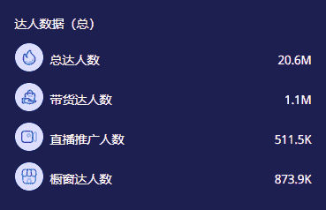

截止目前 TikTok 美国的达人数量和带货达人数

先看一组官方关于达人素材的数据

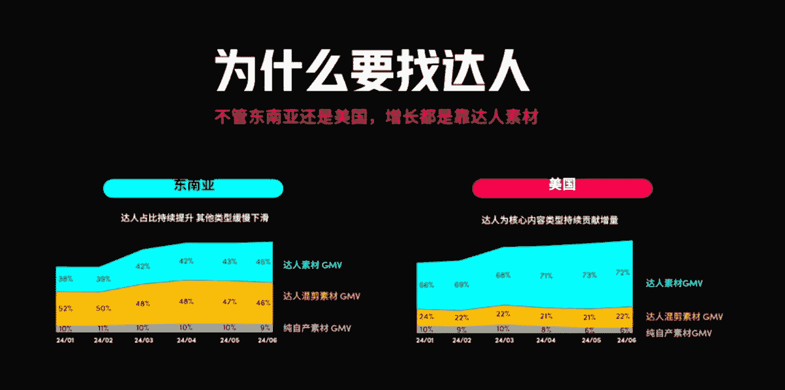

可以看到美区 72%是达人素材带来的 GMV，22%是混剪达人素材带来的 GMV，达人素材加起来就是 94%，只有 6%是自产的素材。

由此可见，达人素材在短视频的重要性。想要做大，就绕不开达人素材和投流。

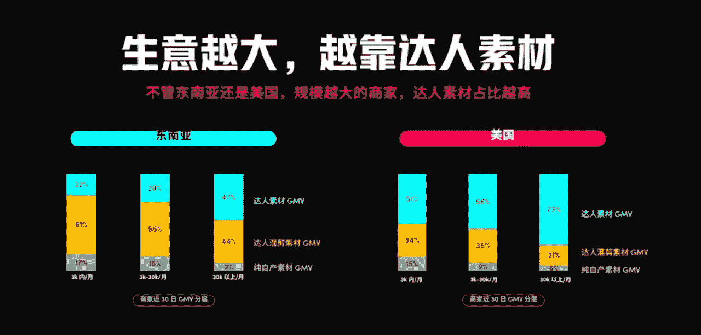

TikTok 是短视频平台，所以内容是非常非常重要的！

看蒙卡讲了一个关于短视频内容特别好的例子。

首先拿到一款产品之后，需要梳理用户对于这类产品的痛点，比如钢化膜在美国是怎么样的一种存在呢？在美国的线下店贴一张膜大概要 30-40 美元之间，原因是线下专业贴膜店铺的人工和房租都非常的贵。

但用户可以从网上买了自己贴，这时候就会遇到一些问题，比如贴膜经验不丰富导致贴不好，贴出来之后会有气泡或者灰尘，总之就是有瑕疵，另外很多钢化膜的质量不太好，容易粘指纹，或者用久了容易碎，不够坚固。

这时候就需要把用户在意的痛点从大到小进行排列，每个人的痛点排列顺序都是不一样的，有的人可能更在意价格，有的人怕贴不好太难了，所以展示卖点的顺序是可以变化的。所以我们不仅可以把痛点排序，更要做到可视化，视觉上要有冲击力。

比如为了展示钢化膜非常的坚固可以在开头用电钻或者锤子直接暴击屏幕，为了表达钢化膜容易安装，可以单手贴膜、10 秒贴膜、蒙着眼睛贴膜等等..

这个案例展示了短视频种草的力量以及细节的重要性。通过与大量达人合作，并为他们提供清晰的产品 brief，既讲解卖点又指出痛点，让达人自由发挥，这样往往能带来意想不到的创意和效果。

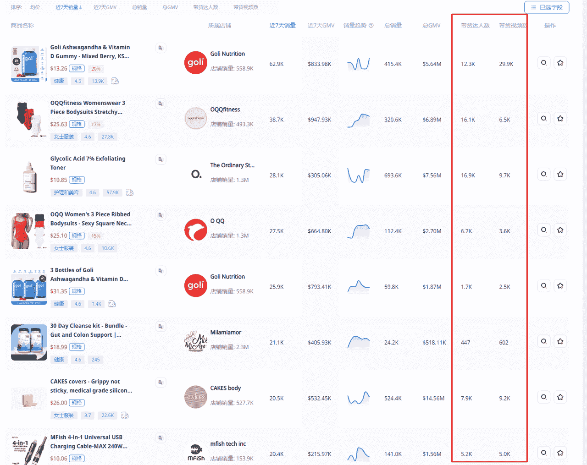

可以看到近 7 天出单排序后，靠前的都有建联几千、上万的达人。并且制作了大量的短视频来种草。

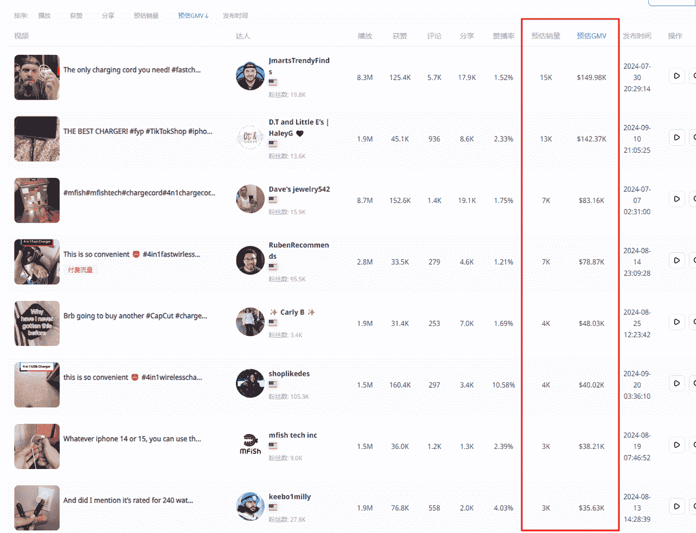

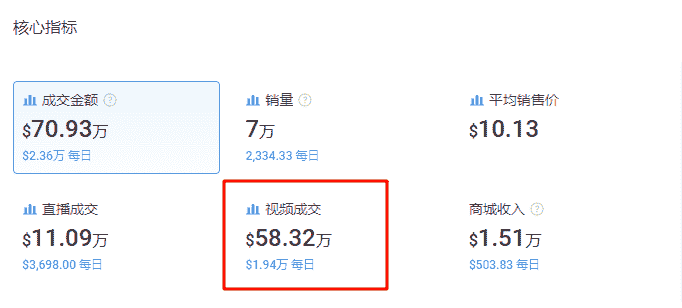

比如这款数据线，大部分的 GMV 来源都是达人短视频。

# 三、怎么筛选达人

## 3.1 联盟后台

可以直接在达人中心去邀约，也可以用第三方插件去私信和定邀。比如达卖、达秘啊这些之类的。

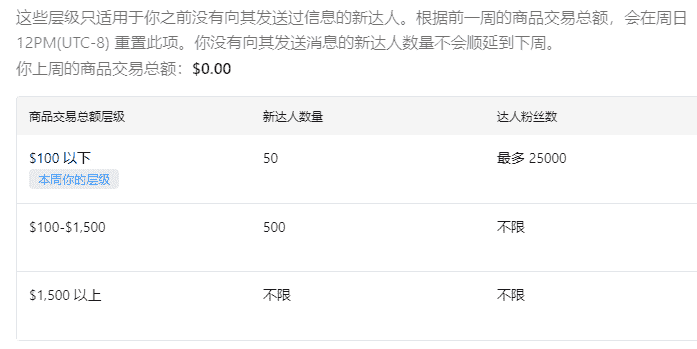

不过新店铺的话邀约的意义不大，商品交易总额低于 100 美金的，只能每天邀约 50 个达人，而且粉丝数量最多只有 25000，这个量级的达人带货数据都挺差的...

## 3.2 Email

一般达人的主页会留有邮箱，也可以和别的团队去置换达人库，还有一种是使用数据平台直接导出（比如 Fastmoss、Echotik 等等）。然后一筛选就可以筛出很多达人的邮箱以及 WhatsApp。

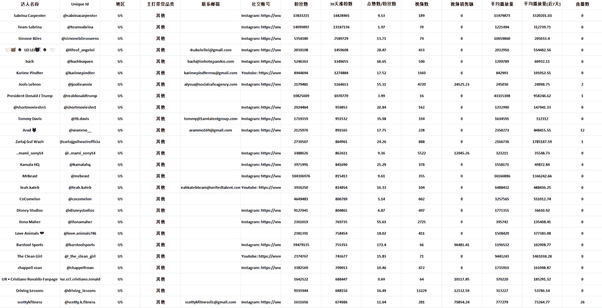

## 3.3 机构

官方提供的三个渠道，TTCX、TTCC、TTCM，几个渠道可以获取达人素材，每个渠道的要求和类型都有所不同，可以根据自己目前情况选择合适的。官方的比较方便一些，比如 TTCM。

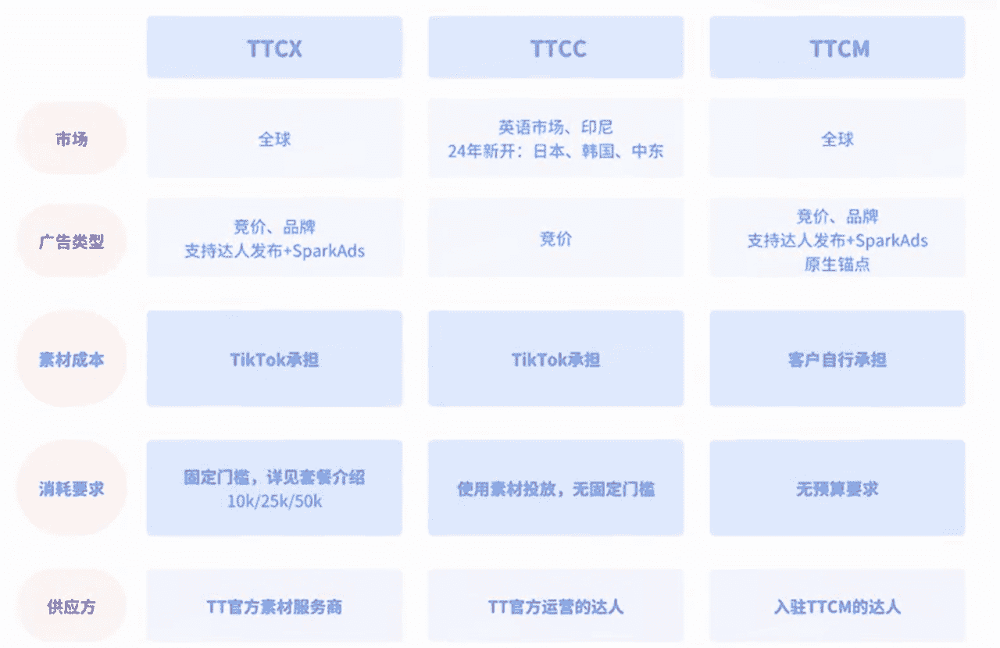

市面上还有专门做达人 BD 的机构，可以和他们合作。一般是收取固定的会员费，然后达人每一条素材再单独额外收费。比如蜗牛开箱视频。

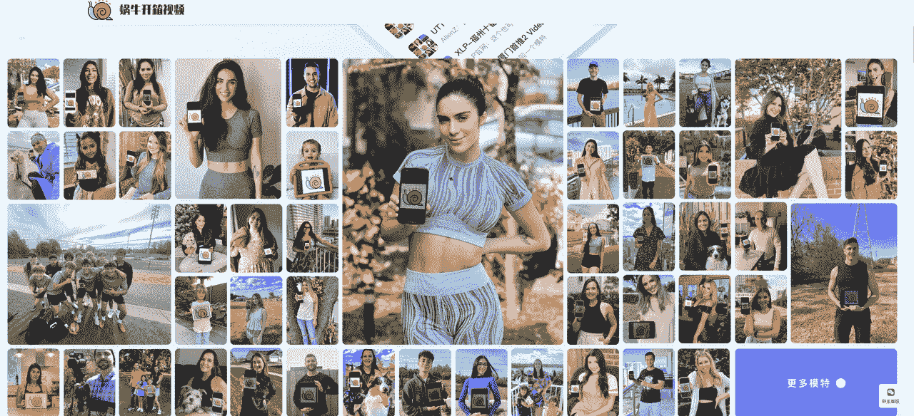

虽然省事儿，但是价格也比较高。最好大家还是自己去建联达人，建立自己的达人库。

## 3.4 筛选维度

TK 后台就可以看到达人的很多数据，GMV、人群画像、交付率、类目、粉丝量等等。

我们还可以看达人的主页，看达人视频的内容质量、风格，还有互动的情况，以及近期 10 条视频的流量怎么样。

GMV：主要是看达人带货的战绩，如果一个达人带货 GMV 就几十，又怎么能够期待她带我们的产品就会上万呢..

人群画像：不仅要看达人带货的能力，还要结合达人的粉丝画像（年龄、性别等）判断是否适合带我们的产品。

交付率：有的达人白嫖样品的，尽量规避这种情况。但是看 100%履约的，也有问题，有可能是通过直播来刷履约率的..可能一场直播带了几十个产品，然后只是把我们的产品挂在直播间了，播了一会儿..这种也是刷的履约率。

粉丝量：粉丝量其实不是太重要了，目前百万粉丝的达人带货效果可能还不如几万粉丝几十万粉丝的达人。最重要的还是内容和产品。但是粉丝量太低的，也有赌的成分...

内容质量：主要看达人的表现力、拍摄视频的风格怎么样，因为即便自然流跑的不行，我们还可以投流。视频还可以混剪。所以如果表现力可以的话，也是可以发样品给达人拍摄的。

近期播放量：和抖音一样，TikTok 也有流量层级。如果近期视频播放量都在一千以上，说明处于较高的流量层级。如果播放量只有几十，则不建议合作。

# 四、怎么建联达人

## 4.1 怎么沟通？

有了 Email 和 WhatsApp 就可以直接去建联了，但是其中涉及到一个问题，就是打开率的问题。

WhatsApp 的消息页会显示 12 个单词左右，所以也要把吸引人的词语放在开头，这样达人看到了感觉好奇或者有意思会点开看一看，然后才有下面的发展。不然达人一天收到那么多的消息，点都不点开，就更加谈不上回复了。

先发 Brief 再发文字，这样保证达人在消息页外面看到的是吸引人的文字，而不是一个文件或者图片的缩略描述..

Email 也是一样的，标题和内容。标题要吸引人才能让达人打开，从而增加我们邮件的打开率和回复。

## 4.2 怎么制作 Brief

Brief 就是需求说明，说明清楚需要加什么 tag，需要达人怎么做，不能做什么，产品的卖点，产品的案例等等。

最重要的是前面部分要说明达人能拿多少佣金（醒目），达人可以收获多少价值的样品，数据好的话可以投流，这样达人可以快速涨粉并且赚到更多的佣金。还会有什么激励等等。

达人带货就是为了赚钱的，想要让达人配合和带我们的产品，最重要的就是让达人知道，我们牛逼，我们的产品牛逼，我们是来带你赚钱的。

## 4.3 怎么维护

经常发发节日问候，日常聊聊天。和达人成为朋友，这样后面有其他产品的时候也可以联系上，并且带我们的产品。

接着最重要的就是达人库了，建立自己的达人数据库，达人的履约情况，建联情况，合作情况，都在表格中展现。因为每天要建联那么多的达人不可能都记得住，但是有表格有记录就可以随时增删改查！

给大家看一下别人做的达人数据库，最好是用多维表格，多维表格筛选和看板以及丰富的字段功能会有很多玩法，能够提升效率和清晰的展示达人建联情况。

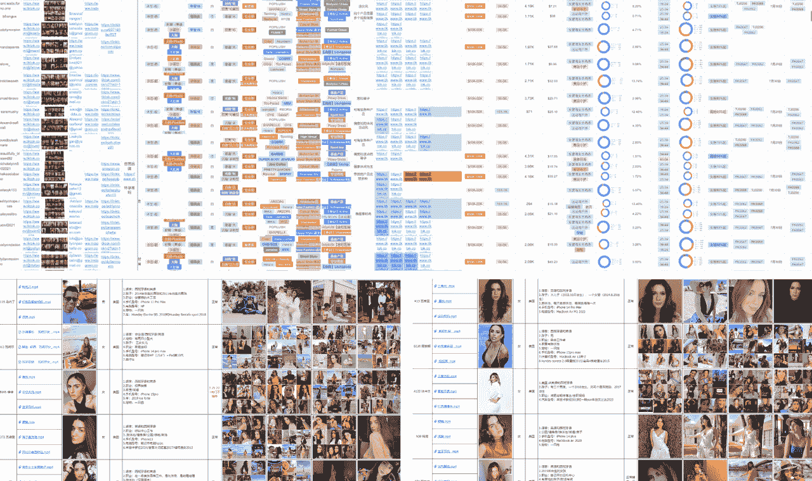

# 五、达人素材玩法

1、code 码直接投

2、达人自己发，自然流量，好的视频可以投流

3、达人给素材，剪辑后单独发一个达人账号上

4、达人按照素材要求拍需要的镜头，混剪直接投流强挂车

## 5.1 code 码

一种是达人给了我们 code 码之后，给我们自己邀约的达人去投流。

还有一种是比如我们跟品，市面上已经有爆款的视频素材了，我们可以联系达人给我们 code 码，然后我们从广告户直接投广告的方式去投他的视频但是是挂我们自己店铺的同款链接。

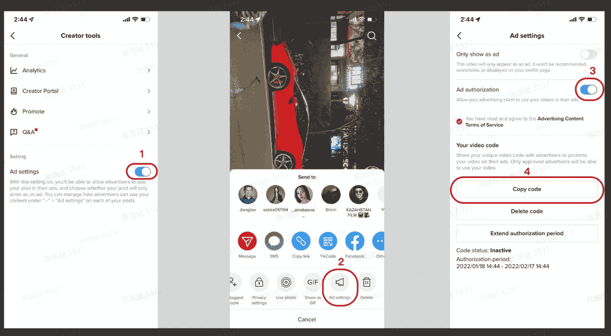

直接发给达人这张图片，达人就知道怎么操作了。

## 5.2 达人自己发

就是常规的达人履约后，拍摄视频发在自己的账号上，如果我们觉得数据不错的话可以要 code 码去投流。

## 5.3 达人给素材

定期付费，和达人深度绑定，让达人按照脚本拍摄素材，然后给到我们剪辑之后发在单独的达人账号上，达人账号完全由我们自己来运营，但是看着就像是达人号一样。这样也会提升海外用户对账号的信任感，也会比较容易涨粉。

自己剪辑的话就可以控制好结构，比如前三秒、产品效果展示、最后下单优惠来促进转化等等，更可控一些。

## 5.4 混剪强挂车

混剪有个好处是可以自己找达人，也可以用别人的素材，别的平台的素材等等；灵活性会更强一些，甚至还可以加一些自己拍摄的原创产品素材。

怎么混剪呢？主要是去测试脚本的结构，痛点的顺序等等。

目前主要的还是产品展示为主，复杂一些的是三段式结构。

开头：前三秒吸引停留，可以夸张一些，展示效果，或者痛点放大，引人好奇，不断的测试和看市面上好的前三秒去模仿。

中间：效果对比，或者场景展示，使用展示等等。

结尾：一般是说一下活动等等方式来催促和引导下单。

和国内的短视频什么情绪曲线，4P 法则啊等等的结构和营销方式，TK 上目前简单很多了。

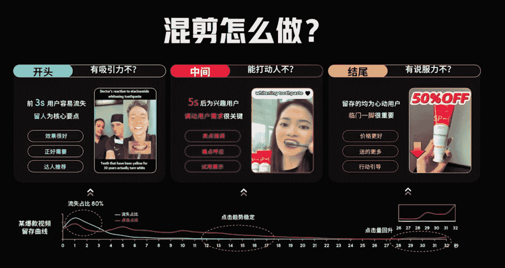

选择一条不错的达人视频作为种子视频，接下来就是“补、贴、换”

补：痛点特征、试用效果、产品特写

贴：文字提示、产品贴片、引导动作

换：对比形式、模特风格、效果展示

达人原生视频一般都比较简单，但是我们混剪的时候就可以加上这些东西，视频的效果会更好。有了固定的脚本和结构，多找素材替换一下就是新的视频，就可以裂变出多条视频，提升效率。

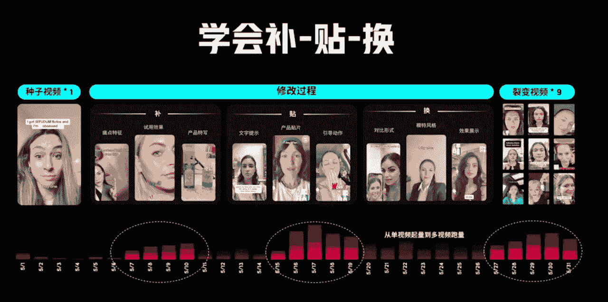

# 六、碎碎念

目前美区大部分的成交内容都是通过达人短视频投流或者达人混剪直接从广告户强挂车的方式运作，不管是测品还是打品都绕不开达人和投流。所以达人短视频是比较重要的一个环节，这篇内容是近期的一个梳理，希望对大家有所帮助，如果后面我对于达人板块进一步实践，会写一篇新的文章，包含更多关于实践的内容。

我想到了一个关于短视频的标题，《重生之我在 TikTok 做短视频》大家觉得怎么样？哈哈哈

先建好了文档，还没开始写，短视频也是比较复杂庞大的一个板块，等我在梳理梳理！感兴趣的可以先关注一下我！！