# 做TikTok相关的工具有哪些？

> 来源：[https://my.feishu.cn/docx/A71bdRlCGoyxhdxosHQcW74bni9](https://my.feishu.cn/docx/A71bdRlCGoyxhdxosHQcW74bni9)

# 前言

工欲善其事，必先利其器。任何足够先进的科技，都与魔法无异。在当今数字化时代，掌握高效的工具和平台可以显著提升工作效率和成果。今天主要是分享在做TikTok中，经常会遇到也会用到的工具有哪些，选择合适的最重要，主要是短视频制作、数据分析、指纹浏览器、ERP、导航、还有官方的课程资料。

# 一、短视频编辑工具

## 炫变AI [https://xuanbian.net]

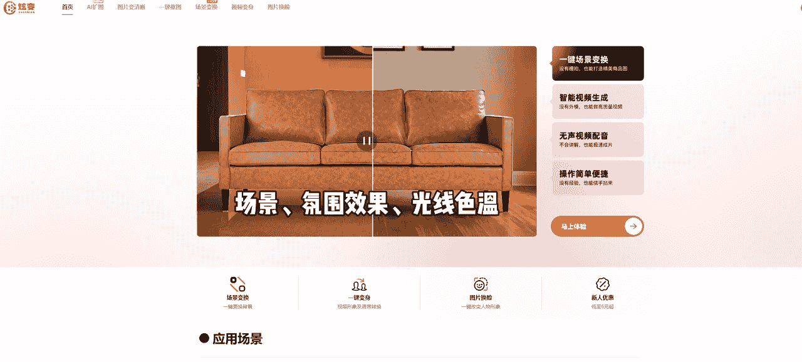

现在短视频的在线工具还挺多的，还有混剪啊什么的，因为我用的不多所以就不推荐了，放一个在这边是为了告诉大家有这个东西，可以多去搜索然后看看有什么提升效率的工具或者骚操作。

其它主要是PR、剪映、CapCut这些常规的剪辑工具..

## 哼哼猫 [https://www.henghengmao.com]

视频下载工具，该工具功能强大，支持无水印下载，虽然也有很多在线在线之类的免费工具，但是从做抖音开始就在用哼哼猫，下📕也很方便，没想到做TikTok的时候，这款工具还能经常用到，值得推荐一下。

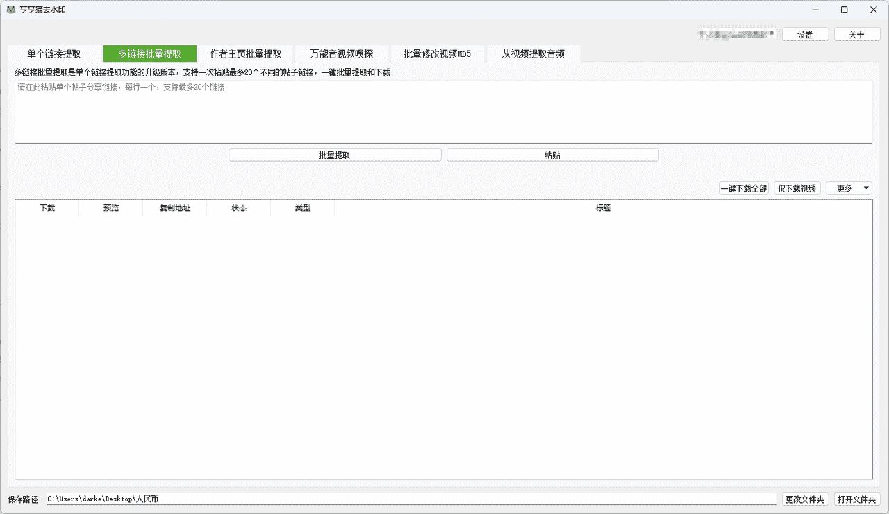

# 二、数据平台

## FastMoss [https://www.fastmoss.com]

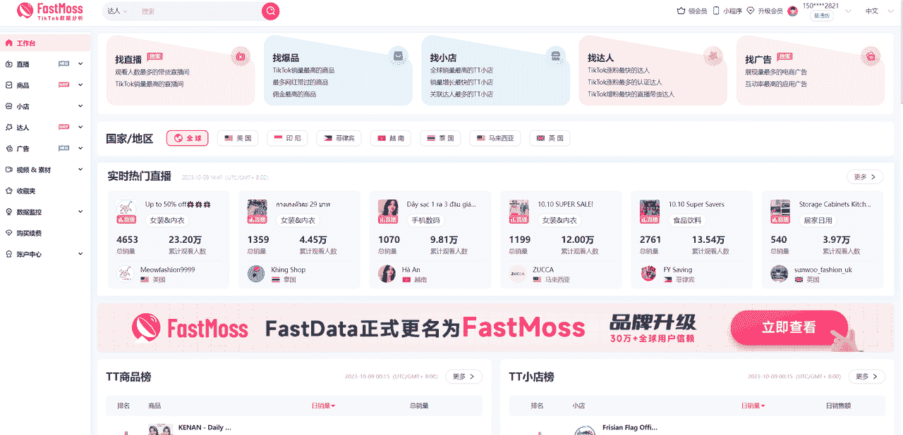

创始人史文禄，公司在北京，创始团队主要来自于阿拉丁和国内各个大厂，获得了多家知名基金投资。

阿拉丁是🛰️小程序、视频号生态最大的数据分析平台。

市场推广能力很强，有非常好的资源整合能力，同时，他们对短视频、直播有很强的认知能力。

目前，FastData海内外客户已经超过30万，行业里各大品牌、头部的机构很多都是他们的客户。

## 特看TabCut [https://www.tabcut.com]

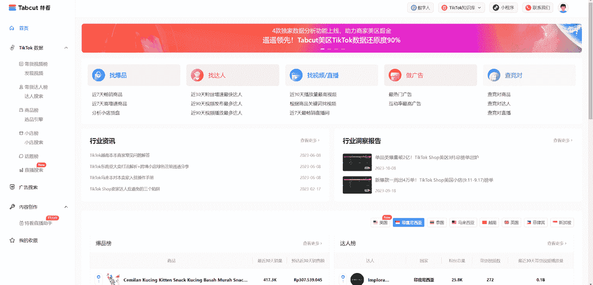

创始团队阿里出身，原淘宝鲁班视频团队，公司在杭州。

峰瑞资本和嘉程资本投资了天使轮。

主要功能：TikTok电商数据分析，虚拟数字人技术，obs直播平台（和TikTok电商合作，帮助国内的商家实现直播）。

特看数据的团队都很谦逊，和行业里的交流开始多起来，出席各种峰会活动。

## 超店有数 [https://www.shoplus.net]

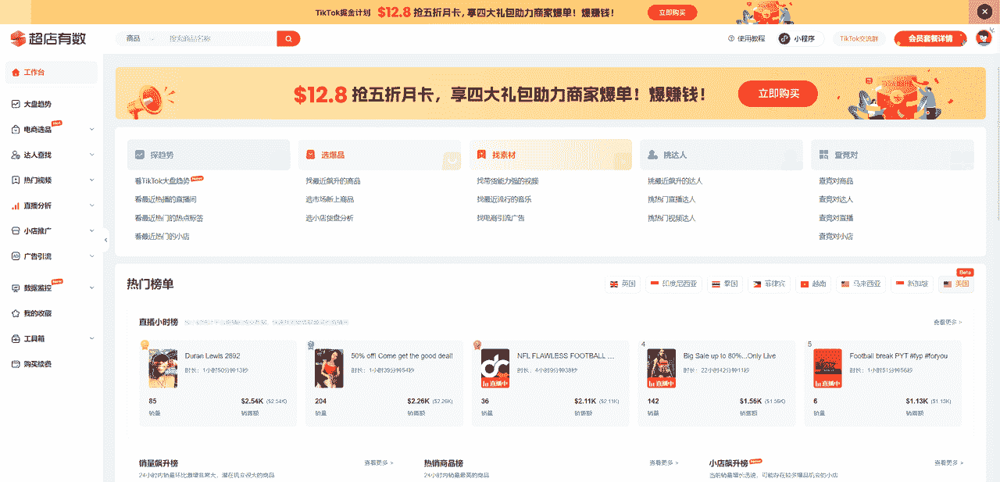

## 滴答狗 [https://didadog.com]

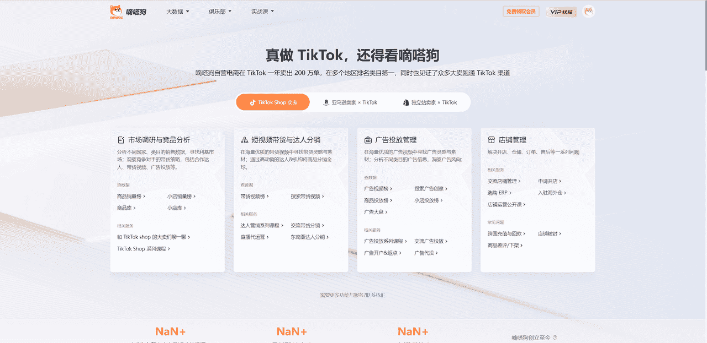

创始人杨剑栩，公司在厦门。

联合创始人黄伟强，也就是大家称呼的狗哥，是2020年第三期训练营的学员。

早期主要做自然流选品，现在衍生到小店数据选品。

目前，在TikTok数据平台中，注册用户数和行业声量都排头部，累计注册超过10万。

投资人行业资源强，不止投资嘀嗒狗，同时布局品牌、TSP业务，包括大家很熟悉的TikTok品牌MeToo、印尼最大的TAP机构ibooming。

所以，嘀嗒狗除了懂数据，还深度参与了MeToo的品牌运营，目前是MeToo菲律宾国家独家代理。

## etsy平台数据选品 [https://www.etsyshop.ai]

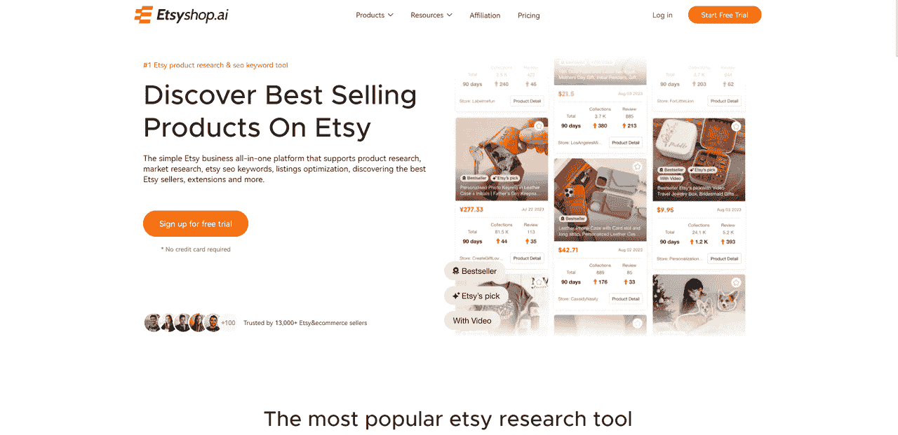

## PIPIADS [https://www.pipiads.com]

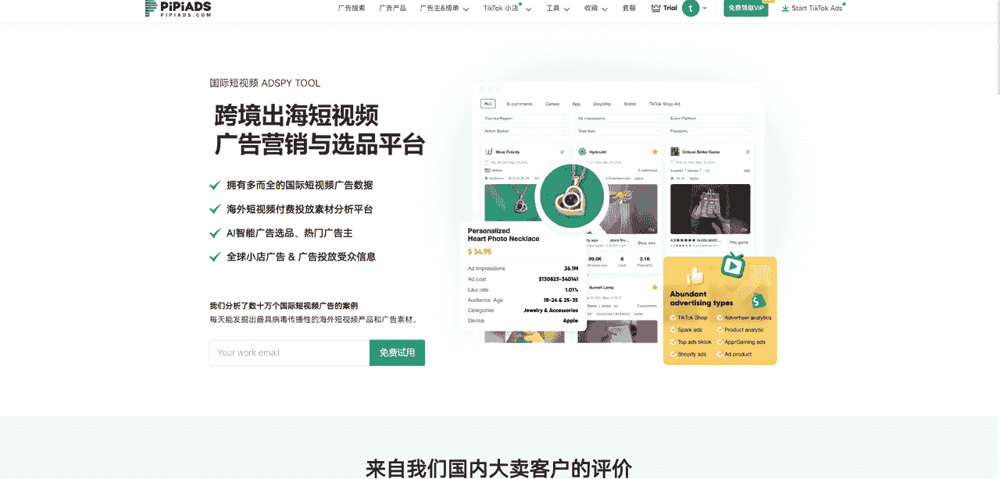

创始人阳光杉木，公司在广州，老互联网人，非常低调。

最早的业务是做帮助海外华人在淘宝代购，没有记错的话，每天有20几万单，业务量是行业最大的。

TikTok数据平台最早期的产品tikstar就是皮皮投资的，20年、21年大家主要通过tikstar看用户数据，查自己的账号归属国家。

pipiads主要是针对广告投放选品（TikTok、Facebook投放广告的素材、落地页分析，用户通过平台可以直接抄品）。

pipiads虽然只做广告数据，但是各项数据指标都是行业最高的。

目前每个月利润过百万，是数据平台中营收最好的。

## EchoTik [https://echotik.live]

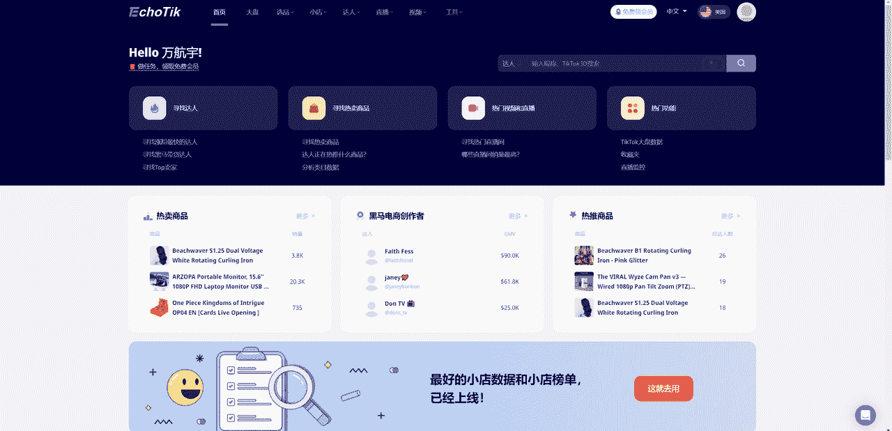

创始人小米团队出身，公司在武汉，很难得。武汉的TikTok公司应该多支持本地的echotik。

武汉做TikTok的圈子比较小，早期360也投资了一家武汉的服务商。

echotik主要针对TikTok电商选品数据，紫鸟浏览器的创始人King投资了天使。

另外一个消息是，小米的顺为资本投资了国内数据平台飞瓜。紫鸟、飞瓜、蝉妈妈都是福建的公司。

echotik近期和亿邦动力联合做市场宣传，以提升影响力和知名度。

## Kalodata [https://kalodata.com]

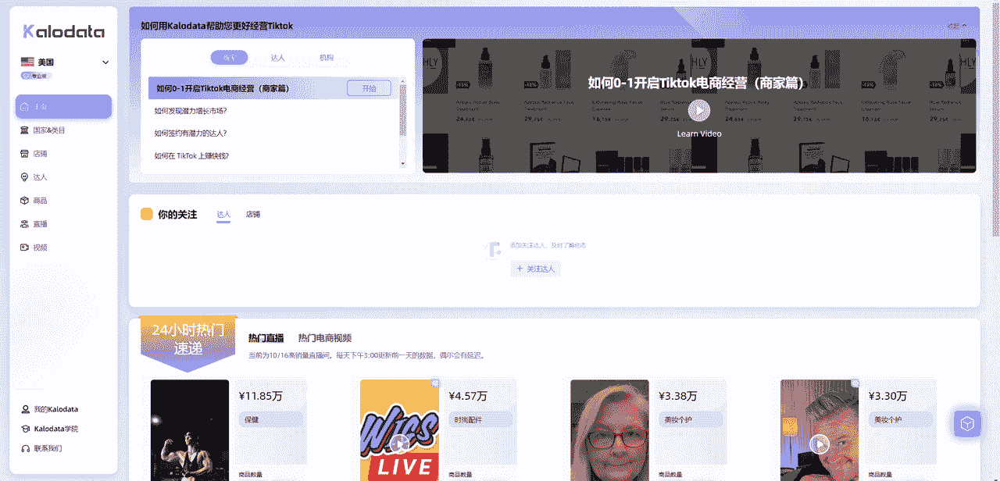

## Tikbuddy [http://tikbuddy.com]

创始人老金，团队在杭州和新加坡。

目前TikTok综合数据平台中，访问量最大的，主要针对海外市场，用户主要来自美国。

我觉得这个方向很重要，从长远看，国内创作者的数量有限，而且涉及合规问题。

现在大家要做TikTok工具的话，第一天就要定位海外市场。

tikbuddy主要提供创作者数据，国内市场营销做的很少，经常是老马人肉做宣传。

# 三、指纹浏览器

目前还是用紫鸟的比较多，建议选择大牌的，之前听说因为指纹浏览器被盗店的..

# 四、ERP

妙手、领星ERP、店小秘、客优云、马帮ERP、芒果店长、甩手店长....还有很多ERP，不过常用的常见的就是这几个，选择自己喜欢和适合的就好。也可以对比一下能够满足需求且合适的价格..

# 五、导航页

**授人以鱼，不如授人以渔。**

收款、网络、达人等等工具都有一些优秀的导航页汇总起来了，可以多去挖掘挖掘好用的工具。

## TT123 [https://www.tt123.com]

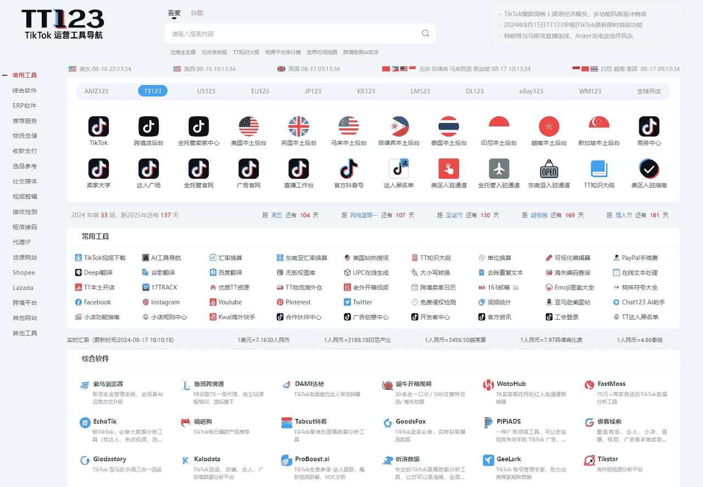

## TK0123 [https://www.tk0123.com]

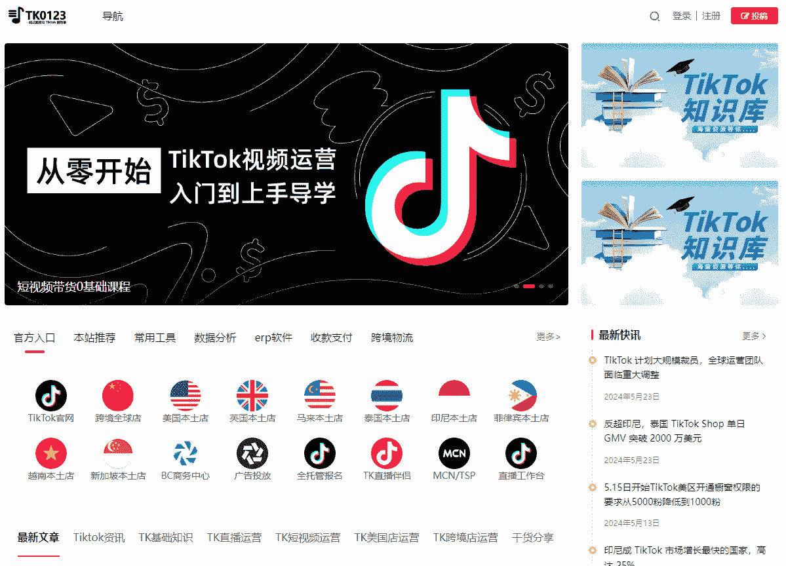

## TKTOC运营导航 [https://www.tktoc.com]

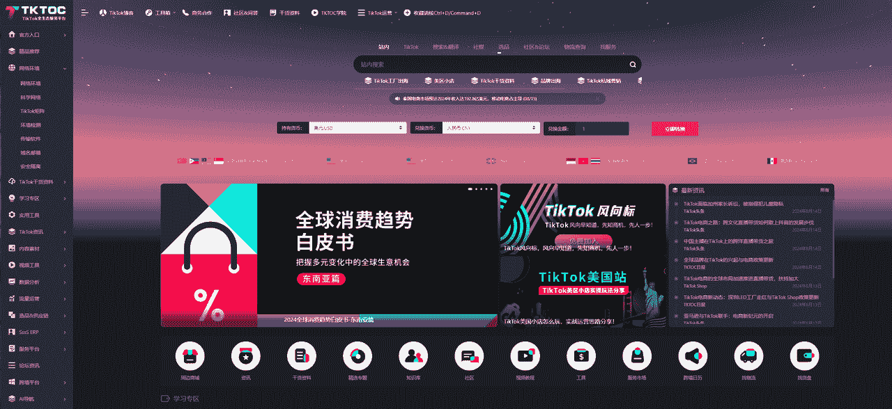

## TK后勤部 [https://nav.tik178.com]

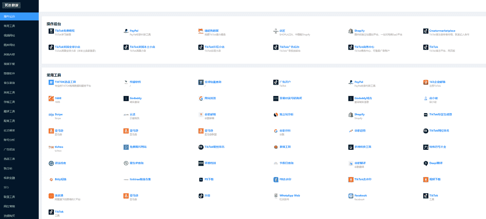

## AMC跨境导航 [https://tkstart.com]

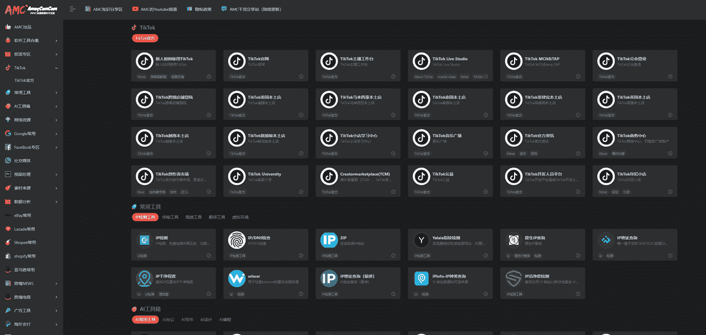

## TKMASTER [http://tkmaster.huilife168.com]

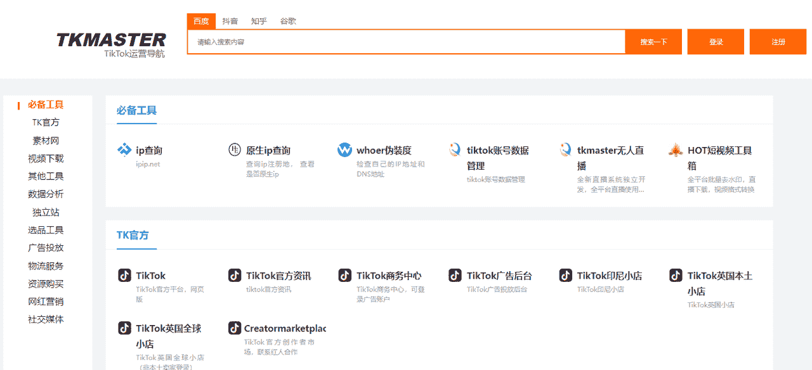

# 六、TikTok官方

## TikTokshop学习中心 [https://seller.tiktokglobalshop.com]

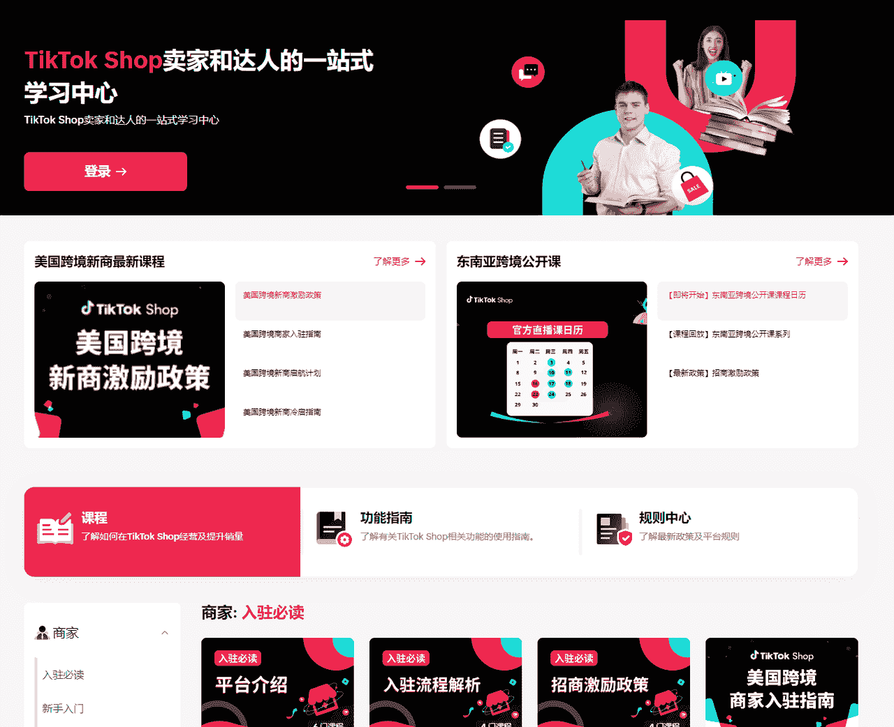

官方的很多政策、基础尝试都在学习中心可以找到，新人卖家必看的一个平台，不要被外面搞知识付费的割韭菜了，官方团队的资料和课程真的很干货！

## 出海学堂 [https://academy-outbound-ads.tiktok.com/]

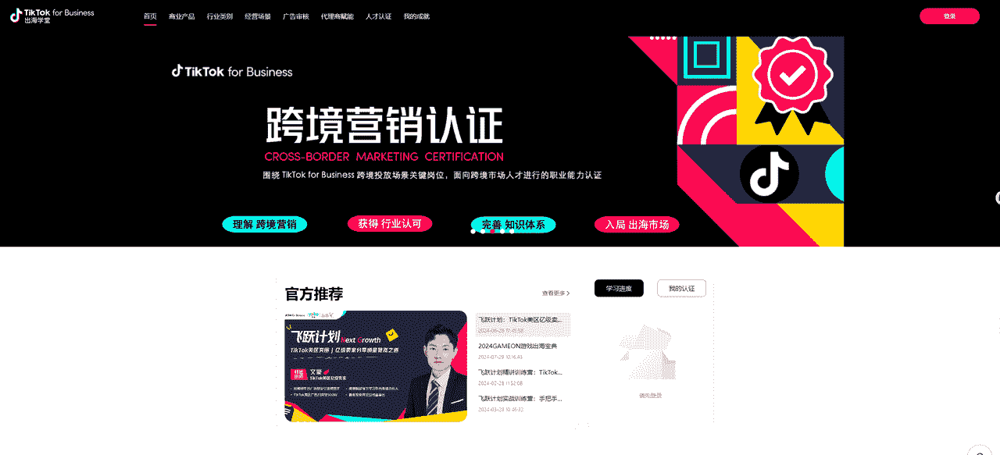

关于投流的基本操作、实操、大卖分享，很多干货，不过主要是投流为主的。还可以考跨境营销认证，很有意思，上网课一样的感觉，感兴趣的也可以看一看。

# 碎碎念

道法术器，工具虽然重要，但与我们真正想要达成的目标相比，它们并没有那么重要。比如，数据网站有很多，我们其实只需要用一个就好。关键在于如何从有效的数据中分析出更深层次的信息，提高我们的成功率。所以，不要陷入寻找工具的陷阱之中。

我想起以前总喜欢找更高效的方法或工具，结果常常忘记了最初的目的。有一次，别人问我怎么弄一个东西，我说之前好像遇到过，于是开始找那个所谓更高效的解决方案。找了一会儿，没找到。那个人说能解决就好，最后用笨办法一点一点弄好了。我突然意识到，我们真正需要的是解决问题，而不是那个不存在的完美解决方案。世界上没有完美的方案。和完美比起来，完成更重要。